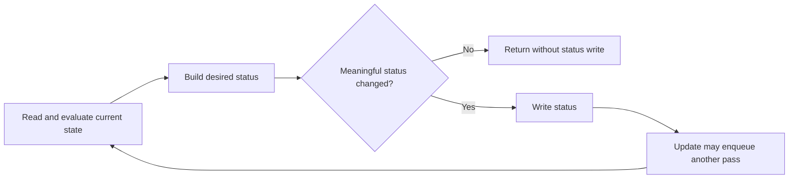

# Stop Status Updates from Creating Kubebuilder Reconcile Loops

Author: [nawazdhandala](https://www.github.com/nawazdhandala)

Tags: Kubernetes, Kubebuilder, Go

Description: Break status-driven reconcile loops with stable conditions, meaningful change detection, a status subresource, and carefully scoped event filtering.

A controller reads an object, writes its status, receives an update event, and repeats. The resource never changes from the user's perspective, but the controller keeps writing to the API server. Common causes include a timestamp updated on every pass, unstable condition messages, or an unconditional status write.

A second reconciliation after a real status transition is normal. The defect is that the second pass creates another meaningful write even though the observation is unchanged. Fix that behavior before suppressing events; otherwise a filter can hide an unnecessarily active writer without making reconciliation safe to repeat.

This guide uses controller-runtime **v0.22.4** and Kubernetes apimachinery **v0.34.1**. The Go helper below was executed in local tests. It models status calculation for a custom resource; it is not a claim that a complete controller was run against a cluster.

## Find which field keeps changing

Capture two versions of the same object while the loop is active. Substitute your actual resource, name, and namespace:

```bash
kubectl -n staging get synctask.example.com sample -o json > first.json
# Capture again after another reported reconciliation.
kubectl -n staging get synctask.example.com sample -o json > second.json
jq '.status' first.json
jq '.status' second.json
```

These commands inspect state without modifying it. Compare status separately from metadata such as resource version. A changing resource version tells you a write occurred; it does not identify the field responsible. Controller logs and audit records, when available, help attribute writes to the right actor.

Look for a `lastCheckedAt` field, a condition message containing the current time, a randomly ordered collection, or a transition timestamp rebuilt on every loop. Also inspect explicit immediate requeues and returned errors: not every recurring reconciliation originates from a status watch event.



The quiet path is the important one. Once actual and recorded state agree, another pass should be inexpensive and should not manufacture a difference.

## Enable the status subresource

For a custom resource, enable the status subresource in its CRD and use the status client for status writes. In a Kubebuilder API definition, the `+kubebuilder:subresource:status` marker is the usual generation mechanism. Regenerate and deploy the CRD through your normal project workflow; editing the Go marker alone does not change an installed CRD.

With the status subresource, status writes do not increment the custom resource's generation. They can still produce update notifications. Kubernetes documents that behavior in the [CRD status-subresource reference](https://kubernetes.io/docs/tasks/extend-kubernetes/custom-resources/custom-resource-definitions/#status-subresource).

Generation and resource version answer different questions. Generation identifies desired-state revisions according to the resource's API semantics. Resource version participates in concurrency and changes with persisted updates. Neither means that the controller should blindly write another status record.

## Calculate status without inventing a transition

The example status has an observed generation and a Ready condition. Adapt the fields to your own API type, preserving any additional fields your controller owns. Pass the generation actually evaluated, not whichever newer generation happens to arrive afterward.

```go
package status

import (
	"k8s.io/apimachinery/pkg/api/equality"
	"k8s.io/apimachinery/pkg/api/meta"
	metav1 "k8s.io/apimachinery/pkg/apis/meta/v1"
)

type SyncStatus struct {
	ObservedGeneration int64              `json:"observedGeneration,omitempty"`
	Conditions         []metav1.Condition `json:"conditions,omitempty"`
}

func DesiredStatus(current SyncStatus, evaluatedGeneration int64,
	ready bool, reason, message string,
) (SyncStatus, bool) {
	desired := current
	desired.Conditions = append([]metav1.Condition(nil), current.Conditions...)
	desired.ObservedGeneration = evaluatedGeneration
	value := metav1.ConditionFalse
	if ready {
		value = metav1.ConditionTrue
	}
	meta.SetStatusCondition(&desired.Conditions, metav1.Condition{
		Type: "Ready", Status: value, Reason: reason, Message: message,
		ObservedGeneration: evaluatedGeneration,
	})
	return desired, !equality.Semantic.DeepEqual(current, desired)
}
```

The copied condition slice prevents this helper from changing the caller's original status in memory. That original value is needed for comparison and for a patch baseline. The function returns `changed=false` when the desired status is semantically equal to the current status.

`SetStatusCondition` preserves the existing transition time when the condition's `Status` remains the same. Changing a reason, message, or observed generation can still be a meaningful status update without representing a True-to-False transition. When `Status` does change, the helper sets a new transition time. This behavior comes from the [matching condition implementation](https://github.com/kubernetes/apimachinery/blob/v0.34.1/pkg/api/meta/conditions.go).

Keep `reason` and `message` stable for unchanged observations. A message such as “checked at 14:03:02” defeats change detection because it is new every time. If operators need a reconciliation heartbeat, prefer controller metrics or logs with an appropriate retention policy rather than making the custom resource a high-frequency heartbeat record.

The returned boolean is the write gate. When false, skip the status API call. When true, take a deep-copy baseline from the fetched resource, assign the calculated status, and persist through `Status().Patch` or `Status().Update` with your chosen concurrency strategy. A change detector saves writes only if callers actually honor its result.

## Preserve concurrent updates

A patch baseline must represent the object before your changes. Taking a baseline after assigning desired status can produce an empty patch. Conversely, replacing an entire condition list from a stale snapshot can overwrite another controller's condition.

Define ownership of status fields, retain fields you do not own, and handle conflicts by re-reading and recomputing. For merge patches, consider an optimistic-lock option when you need a resource-version precondition; ordinary merge patches do not automatically provide the same protection as an update with a stale resource version. See the [versioned patch options](https://github.com/kubernetes-sigs/controller-runtime/blob/v0.22.4/pkg/client/patch.go).

Do not assume a cached read immediately reflects your last write. A briefly stale observation may cause another attempted write. Concurrency handling and idempotence should make that safe; an in-memory “already reconciled” flag is not durable across restarts and can hide later legitimate changes.

## Use predicates only after defining required events

`GenerationChangedPredicate` can reduce status-only update notifications for an appropriately configured custom resource. It is an optimization with a contract: updates that leave generation unchanged will not pass that predicate.

That can also exclude annotation changes, the initial deletion-timestamp transition, or status changes made by another actor that your controller needs to observe. A finalizer workflow must still be able to notice deletion and perform cleanup. Applying the same predicate globally to secondary watches can discard the very dependency changes that should trigger reconciliation.

The [controller-runtime predicate source](https://github.com/kubernetes-sigs/controller-runtime/blob/v0.22.4/pkg/predicate/predicate.go#L172) documents generation caveats, including differences between API kinds. Do not assume a rule that works for your status-enabled CRD has identical behavior for Deployments or ConfigMaps.

Keep the primary-resource predicate local to that watch, and explicitly include relevant metadata or lifecycle changes if needed. If you rely on periodic reconciliation to detect drift, test that path too. Filtering events does not replace a correct write gate.

## Prove that the second pass becomes quiet

The local helper tests cover an unchanged Ready condition, first-time condition creation, a generation change, a reason/message change, a True-to-False transition, and preservation of the original input. They confirm that unchanged calculations retain timestamps and return no change.

For a real controller, add an API-server integration test that performs a meaningful update, lets the controller settle, and then checks that repeated reconciliation produces no further status writes. Also test concurrent writers, status conflicts, deletion with finalizers, and changes to watched dependencies.

Do not require that reconciliation runs exactly once: queue behavior and cache timing can legitimately produce extra calls. Require that the controller converges, stops writing unchanged status, and still responds to every state change its contract depends on. That is the difference between a harmless extra observation and an endless feedback loop.
