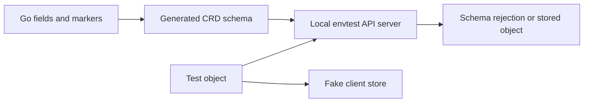

# Test Kubebuilder Validation Markers Beyond the Fake Client

Author: [nawazdhandala](https://www.github.com/nawazdhandala)

Tags: Kubernetes, Kubebuilder, Testing

Description: Test generated CRD constraints with envtest, prove what the fake client misses, and check rejected writes, valid boundaries, and server defaults.

A controller test creates a custom resource with an impossible replica count. The fake client accepts it, and the test passes. Later, the same request fails against Kubernetes. The validation marker was not necessarily wrong: the test used a storage substitute that never evaluated the generated schema.

This guide builds a small test that makes that difference visible. It first stores an invalid object through the fake client, then sends invalid and valid objects to a local Kubernetes API server. The test also verifies a default and confirms that a rejected update leaves the stored resource unchanged.

## Choose the component that actually enforces the rule

A Kubebuilder marker is a comment consumed by code-generation tooling. For CRD validation, the result is an OpenAPI schema inside a CustomResourceDefinition (CRD), which teaches Kubernetes about your resource. Instantiating a Go struct does not execute that schema. The controller-runtime fake client explicitly documents that it does not perform OpenAPI validation. [Fake client limitations](https://github.com/kubernetes-sigs/controller-runtime/blob/v0.22.1/pkg/client/fake/doc.go).

Use different tests for different promises:

| Promise | Appropriate test |
| --- | --- |
| A reconciliation branch creates the intended object | Unit test, often with a fake client |
| A marker generates the intended constraint | Inspect the generated CRD |
| Kubernetes rejects an invalid field | Write through an envtest API server |
| Custom webhook logic rejects a request | Test the validator, then test its admission wiring separately |

The path under test matters more than whether a test is called a unit or integration test.



The fake store is a separate path. Adding types to its scheme lets it recognize those types; it does not install their CRD validation rules.

## Generate a deliberately small schema

The example uses a Kubebuilder **4.9.0** go/v4 scaffold, controller-runtime **0.22.1**, Kubernetes Go libraries **0.34.0**, and envtest binaries **1.34.0**. It was run locally with Go **1.25.0**. These are the tested versions, not a claim that they are the latest releases.

Start in an existing scaffold containing a namespaced `platform.example.com/v1` resource named `SyncTask`. The example module is `example.com/projectrepair`; replace that import path in the test with your own. Replace the resource's specification with this small fixture in a disposable development branch:

```go
type SyncTaskSpec struct {
    // +kubebuilder:validation:Minimum=1
    // +kubebuilder:validation:Maximum=5
    Replicas int32 `json:"replicas"`

    // +kubebuilder:validation:Enum=Safe;Fast
    // +kubebuilder:default=Safe
    // +optional
    Mode string `json:"mode,omitempty"`
}
```

`Replicas` has inclusive numeric boundaries. `Mode` accepts two strings, and an omitted mode should become `Safe`. Its `omitempty` tag lets the empty Go string represent an omitted JSON field in this fixture. An explicitly supplied empty JSON string is a different input and is not one of the permitted enum values.

Generate both Go helpers and manifests from the project root:

```bash
make generate manifests
```

Inspect `config/crd/bases/platform.example.com_synctasks.yaml`. Under the served version's schema, expect `spec.replicas` to contain `minimum: 1` and `maximum: 5`, and `spec.mode` to contain the two-value enum and `default: Safe`. Kubernetes applies CRD schema validation and defaulting on its API path. [CRD validation and defaulting](https://kubernetes.io/docs/tasks/extend-kubernetes/custom-resources/custom-resource-definitions/).

Do not continue with an old manifest. A perfectly written test can verify yesterday's schema if its CRD directory contains yesterday's generated files.

## Prepare the isolated API server

Envtest runs a local API server and etcd, the backing database. It does not start a scheduler, kubelet, or the standard controller manager. That is sufficient for this schema test: no Pod needs to run. [Envtest configuration](https://book.kubebuilder.io/reference/envtest).

This explicit setup pins the downloader to a source commit from controller-runtime v0.22.4, while the application retains its own v0.22.1 dependency. Run from the project root with Go installed and network access for the initial downloads:

```bash
mkdir -p bin
GOBIN="$PWD/bin" go install   sigs.k8s.io/controller-runtime/tools/setup-envtest@7a1b16d039d204e7e4c5c8df57124d4e060a55f0
export KUBEBUILDER_ASSETS="$(./bin/setup-envtest use   --bin-dir "$PWD/bin/envtest" -p path 1.34.0)"
```

`KUBEBUILDER_ASSETS` points to the directory containing the downloaded server binaries. The downloader is a separate Go module, so do not assume a repository's root release tag is also a valid module version for that tool. The pinned commit avoids that ambiguity. [setup-envtest usage](https://github.com/kubernetes-sigs/controller-runtime/blob/v0.22.4/tools/setup-envtest/README.md).

## Test rejection, acceptance, and persisted results

Save the following as `internal/validation/markers_test.go`. The relative CRD path assumes exactly that directory. The test forces `UseExistingCluster` to false, starts its own server, installs the CRDs, and creates its own namespace.

```go
package validation

import (
	"context"
	platformv1 "example.com/projectrepair/api/v1"
	corev1 "k8s.io/api/core/v1"
	apierrors "k8s.io/apimachinery/pkg/api/errors"
	metav1 "k8s.io/apimachinery/pkg/apis/meta/v1"
	"k8s.io/apimachinery/pkg/runtime"
	"path/filepath"
	"sigs.k8s.io/controller-runtime/pkg/client"
	"sigs.k8s.io/controller-runtime/pkg/client/fake"
	"sigs.k8s.io/controller-runtime/pkg/envtest"
	"testing"
)

func task(name string, replicas int32, mode string) *platformv1.SyncTask {
	return &platformv1.SyncTask{
		ObjectMeta: metav1.ObjectMeta{Name: name, Namespace: "marker-test"},
		Spec:       platformv1.SyncTaskSpec{Replicas: replicas, Mode: mode},
	}
}

func TestMarkers(t *testing.T) {
	ctx := context.Background()
	scheme := runtime.NewScheme()
	if err := corev1.AddToScheme(scheme); err != nil {
		t.Fatal(err)
	}
	if err := platformv1.AddToScheme(scheme); err != nil {
		t.Fatal(err)
	}

	fakeClient := fake.NewClientBuilder().WithScheme(scheme).Build()
	if err := fakeClient.Create(ctx, task("fake-invalid", 0, "Turbo")); err != nil {
		t.Fatalf("expected fake store to accept schema-invalid object: %v", err)
	}

	useExisting := false
	testEnv := &envtest.Environment{
		UseExistingCluster:    &useExisting,
		CRDDirectoryPaths:     []string{filepath.Join("..", "..", "config", "crd", "bases")},
		ErrorIfCRDPathMissing: true,
	}
	cfg, err := testEnv.Start()
	if err != nil {
		t.Fatal(err)
	}
	t.Cleanup(func() {
		if err := testEnv.Stop(); err != nil {
			t.Error(err)
		}
	})
	realClient, err := client.New(cfg, client.Options{Scheme: scheme})
	if err != nil {
		t.Fatal(err)
	}
	if err := realClient.Create(ctx, &corev1.Namespace{
		ObjectMeta: metav1.ObjectMeta{Name: "marker-test"},
	}); err != nil {
		t.Fatal(err)
	}

	for _, invalid := range []*platformv1.SyncTask{
		task("below-min", 0, "Safe"), task("above-max", 6, "Safe"),
		task("bad-mode", 2, "Turbo"),
	} {
		if err := realClient.Create(ctx, invalid); !apierrors.IsInvalid(err) {
			t.Fatalf("%s: expected Invalid, got %v", invalid.Name, err)
		}
	}
	for _, valid := range []*platformv1.SyncTask{
		task("minimum", 1, "Safe"), task("maximum", 5, "Fast"),
	} {
		if err := realClient.Create(ctx, valid); err != nil {
			t.Fatal(err)
		}
	}
	good := task("defaulted", 2, "")
	if err := realClient.Create(ctx, good); err != nil {
		t.Fatal(err)
	}
	stored := &platformv1.SyncTask{}
	key := client.ObjectKeyFromObject(good)
	if err := realClient.Get(ctx, key, stored); err != nil {
		t.Fatal(err)
	}
	if stored.Spec.Mode != "Safe" {
		t.Fatalf("default missing: %q", stored.Spec.Mode)
	}
	stored.Spec.Replicas = 6
	if err := realClient.Update(ctx, stored); !apierrors.IsInvalid(err) {
		t.Fatalf("expected rejected update, got %v", err)
	}
	if err := realClient.Get(ctx, key, stored); err != nil {
		t.Fatal(err)
	}
	if stored.Spec.Replicas != 2 {
		t.Fatal("rejected update changed stored object")
	}
}
```

Run just this test from the project root, retaining the assets environment variable:

```bash
go test ./internal/validation -run '^TestMarkers$' -count=1 -v
```

The expected outcome is `PASS`. Here, passing includes several negative assertions: both out-of-range replica counts and the unknown mode must produce Kubernetes `Invalid` errors. An arbitrary error is not enough. A missing namespace, unavailable server, or authentication failure would otherwise create a misleading green test.

The valid boundary cases matter too. A broken schema that rejects every object should fail the suite. Reading the defaulted object back checks the persisted result, and the final read verifies that the rejected update did not change its replica count. In the local run for this article, all of these checks passed against the real envtest API server; the fake client accepted the deliberately invalid object.

## Diagnose failures at the right layer

If startup fails, check the assets path, binary operating system and architecture, and local execution permissions. Keep startup failures fatal in required integration tests. Automatically skipping them would hide a machine that never ran schema validation.

If an invalid create succeeds, first inspect the CRD file being loaded. Confirm its group, version, kind, field path, and generated constraint. Then check that the test uses `realClient`, not the fake client created earlier. `ErrorIfCRDPathMissing` catches a missing directory, but cannot recognize a valid directory containing the wrong schema.

If the default is absent, inspect whether the request omitted the field or explicitly supplied a value. Defaults and validation are related but separate behaviors. Add a raw JSON test when distinctions such as omitted, null, and empty matter to your API.

Finally, keep the test's scope explicit. This fixture installs CRDs without starting an admission webhook or a controller. It verifies generated schema behavior, not webhook certificates, production permissions, scheduling, or reconciliation. Keep fast fake-client tests for controller decisions, and require this API-server test whenever changing markers that define what users are allowed to store.
