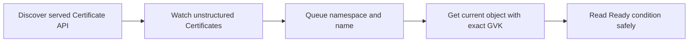

# Watch an External CRD Without Importing Its Go Types

Author: [nawazdhandala](https://www.github.com/nawazdhandala)

Tags: Kubernetes, Kubebuilder, Go

Description: Use unstructured objects to watch an external Kubernetes API, set its exact GVK, read status safely, and diagnose discovery, permissions, and cache failures.

Your controller needs to observe a custom resource managed by another operator, but importing that operator's Go API package would add dependencies you do not otherwise need. You can use Kubernetes' unstructured object representation instead. It stores the resource as a map while retaining Kubernetes metadata and runtime interfaces.

That removes the compile-time dependency on the external Go types. It does not remove the runtime dependency on the external API. The CustomResourceDefinition, or CRD, must still exist, serve the version you request, and expose fields compatible with your reader.

This example implements a read-only observer for cert-manager Certificates. It uses **controller-runtime v0.22.4** with Kubernetes libraries v0.34.1. The external shape is checked against the **cert-manager v1.18.2** Certificate CRD; this is a compatibility reference, not a recommendation to downgrade an installation. Use the corresponding contract tests when upgrading either dependency.

## Identify the object, not just the endpoint

An unstructured object needs its group, version, and kind, usually shortened to GVK. For this resource those are `cert-manager.io`, `v1`, and `Certificate`. The plural REST resource is `certificates`, and it is namespace-scoped. These values come from the [tagged Certificate CRD](https://github.com/cert-manager/cert-manager/blob/v1.18.2/deploy/crds/crd-certificates.yaml).

GVK describes the object type. API discovery maps it to the resource endpoint. Do not put the plural resource name in the Kind field, and do not assume the version stored internally is the version your client should request.

Before starting the observer, check the installation:

```bash
kubectl api-resources --api-group=cert-manager.io
kubectl get crd certificates.cert-manager.io -o jsonpath='{range .spec.versions[*]}{.name}{" served="}{.served}{"\n"}{end}'
kubectl -n staging get certificates.cert-manager.io
```

Use a namespace in your manager's configured scope instead of `staging`. Expect the Certificate resource and a served `v1` version. A missing CRD is an installation-order problem; an empty resource list can simply mean no Certificates exist yet.



## Implement a small observer

Add this code to a Kubebuilder controller package. Construct `CertificateObserver` with `Client: mgr.GetClient()` and call `SetupWithManager` before starting the manager. It logs reported readiness without changing Certificates, Secrets, or their owner references.

```go
package controllers

import (
	"context"
	"fmt"
	"k8s.io/apimachinery/pkg/apis/meta/v1/unstructured"
	"k8s.io/apimachinery/pkg/runtime/schema"
	ctrl "sigs.k8s.io/controller-runtime"
	"sigs.k8s.io/controller-runtime/pkg/client"
	"sigs.k8s.io/controller-runtime/pkg/log"
)

var certificateGVK = schema.GroupVersionKind{
	Group: "cert-manager.io", Version: "v1", Kind: "Certificate",
}

func certificateObject() *unstructured.Unstructured {
	obj := &unstructured.Unstructured{}
	obj.SetGroupVersionKind(certificateGVK)
	return obj
}

type CertificateObserver struct{ client.Client }

func readyStatus(obj *unstructured.Unstructured) (string, error) {
	conditions, _, err := unstructured.NestedSlice(obj.Object, "status", "conditions")
	if err != nil {
		return "", err
	}
	for _, value := range conditions {
		condition, ok := value.(map[string]interface{})
		if !ok {
			return "", fmt.Errorf("condition is not an object")
		}
		kind, _, err := unstructured.NestedString(condition, "type")
		if err != nil {
			return "", err
		}
		if kind != "Ready" {
			continue
		}
		status, found, err := unstructured.NestedString(condition, "status")
		if err != nil {
			return "", err
		}
		if !found {
			return "Unknown", nil
		}
		return status, nil
	}
	return "Unknown", nil
}

func (r *CertificateObserver) Reconcile(ctx context.Context, req ctrl.Request) (ctrl.Result, error) {
	obj := certificateObject()
	if err := r.Get(ctx, req.NamespacedName, obj); err != nil {
		return ctrl.Result{}, client.IgnoreNotFound(err)
	}
	status, err := readyStatus(obj)
	if err != nil {
		return ctrl.Result{}, err
	}
	log.FromContext(ctx).Info("Observed Certificate",
		"certificate", req.NamespacedName, "ready", status,
		"resourceVersion", obj.GetResourceVersion())
	return ctrl.Result{}, nil
}

// +kubebuilder:rbac:groups=cert-manager.io,resources=certificates,verbs=get;list;watch
func (r *CertificateObserver) SetupWithManager(mgr ctrl.Manager) error {
	return ctrl.NewControllerManagedBy(mgr).
		Named("external-certificate-observer").
		For(certificateObject()).Complete(r)
}
```

The helper creates a fresh object and sets GVK both for watch registration and each read. An empty unstructured map without type information cannot identify the intended API. No cert-manager Go package or `AddToScheme` call for its generated Certificate type appears here.

`For()` makes the Certificate key the input to this observer's reconcile loop. It does not transfer ownership from cert-manager. If your real controller instead reconciles a separate application resource, use `Watches()` with a mapping handler that returns those application keys. Watching the right external type and choosing the right reconciliation target are separate decisions. The [Kubebuilder resource-watching guide](https://book.kubebuilder.io/reference/watching-resources) describes that distinction.

## Read optional status as optional data

A new Certificate may have no status yet. The example returns `Unknown` when it cannot find a Ready condition, instead of treating absence as `False` or panicking. `NestedSlice` and `NestedString` also report unexpected field types. Returning those errors lets the controller's normal error handling retry rather than silently inventing a readiness value.

The observer reports cert-manager's condition; it does not independently validate the certificate chain, expiry, private key, or workload trust. It also does not prove the reported condition reflects the newest desired generation. If readiness will authorize a deployment or another consequential action, add freshness checks appropriate to the external API contract, including its observed-generation fields where applicable.

Do not convert the whole object into a partial home-grown struct and write it back just to read one status field. That creates unnecessary risks around fields you do not understand. This observer intentionally needs only metadata and condition access.

A delete event can arrive after the object is gone. `IgnoreNotFound` makes that a normal no-op while preserving other errors such as forbidden access or connection failures. The queued key is a prompt to examine current state, not a guarantee that the triggering version remains available.

## Account for RBAC and cache behavior

The RBAC marker requests only `get`, `list`, and `watch` on `certificates` in the `cert-manager.io` group. Generate and deploy your project's RBAC manifests through its normal workflow. Reading status through the main resource does not require a separate write permission for `certificates/status`, and this observer does not require access to the TLS Secret.

Scope those permissions and the manager's cache to the namespaces your observer should cover. With administrator permission to impersonate the service account, you can inspect one relevant permission:

```bash
kubectl auth can-i watch certificates.cert-manager.io \
  --namespace=staging \
  --as=system:serviceaccount:operator-system:controller-manager
```

Replace the namespace, service-account namespace, and service-account name. A `yes` confirms that authorization check, not cache synchronization or successful reconciliation. Check `get` and `list` as well when diagnosing a failed informer.

There is an easy performance trap: in controller-runtime v0.22.4, unstructured reads use live lookups unless the client is configured to read unstructured objects from cache. The watch still uses an informer, but that does not automatically make every `Get` a cached read. Review `CacheOptions.Unstructured` in the [versioned client implementation](https://github.com/kubernetes-sigs/controller-runtime/blob/v0.22.4/pkg/client/client.go) before estimating API traffic or changing consistency expectations.

## Validate the API contract and startup separately

Local tests for this example compile the observer and exercise missing conditions, Ready true and false, an unrelated condition, malformed status data, an existing object, and NotFound handling. The fake-client test uses generic unstructured scheme entries in its harness; it does not import the external Certificate type.

Those tests cannot prove discovery, API permissions, informer startup, or the external operator's behavior. In staging, start the observer against an existing served CRD and verify its cache synchronizes. Observe a Certificate through creation, readiness changes, and deletion. Do not add a generation-only event filter if status updates are the information you need.

If startup reports no mapping for the kind, check the exact GVK and CRD installation order. If synchronization fails with forbidden errors, inspect the deployed service account and generated role. If events arrive but parsing fails, compare the actual served object's field types with the schema version you reviewed.

Finally, decide whether the external API is mandatory. For a required integration, a clear startup failure is better than silently running without its watch. For an optional integration, deliberately skip registration when unavailable and define how the process starts watching after installation, such as a managed restart. Unstructured access makes dependencies smaller; explicit discovery, scope, and contract checks make the integration reliable.
