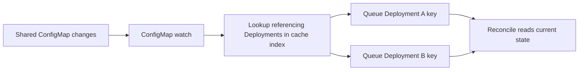

# Watch Unowned ConfigMaps with Kubebuilder Map Functions

Author: [nawazdhandala](https://www.github.com/nawazdhandala)

Tags: Kubernetes, Kubebuilder, Go

Description: Map shared ConfigMap changes to the Deployments that reference them, using a cache index, namespace-safe lookups, and controller-runtime watch handlers.

A Deployment can mount a ConfigMap created by a different team. Your controller may need to react when that ConfigMap changes, even though it did not create the ConfigMap and should not own it. Adding an owner reference just to receive events is the wrong relationship: the reference expresses lifecycle ownership, not a subscription.

Use a watch with a mapping function instead. The watch observes ConfigMaps; the mapper returns the namespaced keys of Deployments that depend on each ConfigMap. Reconciliation then reads current state and decides whether action is necessary.

This example uses **controller-runtime v0.22.4**, whose dependency set includes Kubernetes libraries v0.34.1 and requires Go 1.24 or newer. The code was compiled and its mapping behavior tested locally using Go 1.25. It is watch wiring for an existing Kubebuilder controller, not a complete rollout controller. The [tagged module file](https://github.com/kubernetes-sigs/controller-runtime/blob/v0.22.4/go.mod) defines that version boundary.

## Model references separately from ownership

The primary object here is a Deployment. The secondary object is a ConfigMap mounted through a direct ConfigMap volume in the Deployment's pod template. Multiple Deployments may reference the same ConfigMap, and the ConfigMap can exist before any of them.



`Owns()` is useful when ownership connects secondary resources to a primary resource. Here there is no such relationship. `Watches()` plus `EnqueueRequestsFromMapFunc` supplies the missing reverse lookup explicitly. The [Kubebuilder guide to externally managed resources](https://book-v3.book.kubebuilder.io/reference/watching-resources/externally-managed) explains this reference-based pattern, though older book examples use different API signatures.

The scope is intentionally narrow: direct `volumes[].configMap` references. Environment variables, `envFrom`, and projected ConfigMap volumes need additional extraction logic. Do not describe a direct-volume index as covering every possible ConfigMap dependency.

## Register the reverse index before starting watches

The index extracts ConfigMap names from each Deployment. It returns distinct names because one ConfigMap can appear in multiple volumes. The field identifier is a private cache-index name; it is not a new API field or a server-side field selector.

Add this code to the controller package. Keep your existing `Reconcile` method for `DeploymentConfigReconciler`; the watch setup expects that method to exist. Initialize its embedded client with `mgr.GetClient()` and ensure core and apps API types are registered in the manager's scheme.

```go
package controllers

import (
	"context"
	appsv1 "k8s.io/api/apps/v1"
	corev1 "k8s.io/api/core/v1"
	ctrl "sigs.k8s.io/controller-runtime"
	"sigs.k8s.io/controller-runtime/pkg/client"
	"sigs.k8s.io/controller-runtime/pkg/handler"
	"sigs.k8s.io/controller-runtime/pkg/log"
	"sigs.k8s.io/controller-runtime/pkg/reconcile"
)

const configMapIndex = "example.com/configmap-volume"

type DeploymentConfigReconciler struct{ client.Client }

func configMapNames(obj client.Object) []string {
	deployment := obj.(*appsv1.Deployment)
	seen := map[string]bool{}
	var names []string
	for _, volume := range deployment.Spec.Template.Spec.Volumes {
		if volume.ConfigMap == nil || volume.ConfigMap.Name == "" {
			continue
		}
		name := volume.ConfigMap.Name
		if !seen[name] {
			names = append(names, name)
			seen[name] = true
		}
	}
	return names
}

func (r *DeploymentConfigReconciler) deploymentsForConfigMap(
	ctx context.Context, obj client.Object,
) []reconcile.Request {
	var deployments appsv1.DeploymentList
	if err := r.List(ctx, &deployments,
		client.InNamespace(obj.GetNamespace()),
		client.MatchingFields{configMapIndex: obj.GetName()},
	); err != nil {
		log.FromContext(ctx).Error(err, "Cannot map ConfigMap to Deployments",
			"configMap", client.ObjectKeyFromObject(obj))
		return nil
	}
	requests := make([]reconcile.Request, 0, len(deployments.Items))
	for i := range deployments.Items {
		requests = append(requests, reconcile.Request{
			NamespacedName: client.ObjectKeyFromObject(&deployments.Items[i]),
		})
	}
	return requests
}

// +kubebuilder:rbac:groups=apps,resources=deployments,verbs=get;list;watch
// +kubebuilder:rbac:groups="",resources=configmaps,verbs=get;list;watch
func (r *DeploymentConfigReconciler) SetupWithManager(mgr ctrl.Manager) error {
	if err := mgr.GetFieldIndexer().IndexField(context.Background(),
		&appsv1.Deployment{}, configMapIndex, configMapNames); err != nil {
		return err
	}
	return ctrl.NewControllerManagedBy(mgr).
		For(&appsv1.Deployment{}).
		Watches(&corev1.ConfigMap{},
			handler.EnqueueRequestsFromMapFunc(r.deploymentsForConfigMap)).
		Complete(r)
}
```

The index registration happens before the controller is built. Returning its error prevents startup with a missing index. The [FieldIndexer contract](https://github.com/kubernetes-sigs/controller-runtime/blob/v0.22.4/pkg/client/interfaces.go#L195) supports multiple extracted values: matching succeeds when at least one indexed value equals the requested name.

In the mapper, `InNamespace` is essential. A Deployment in namespace `payments` mounting `settings` depends on `payments/settings`, not on `search/settings`. Both namespaces can use the same ConfigMap name without sharing the object. Namespace-scoped lookup prevents unrelated reconciliation requests.

Use the manager's cached client for this indexed query. Sending the synthetic field selector through an uncached API reader does not make the API server understand your local index. Likewise, a manager configured to cache only some namespaces cannot find dependents outside its cache scope.

## Understand what the handler guarantees

The handler turns create, update, delete, and generic events into reconcile requests. For an update, v0.22.4 invokes the mapper for both the old and new objects, then avoids duplicate requests within that handling operation. That behavior is visible in the [tagged event handler](https://github.com/kubernetes-sigs/controller-runtime/blob/v0.22.4/pkg/handler/enqueue_mapped.go).

A delete event can still be mapped because the mapper uses the event object's name and namespace. It does not fetch the ConfigMap before finding dependents. Fetching it first would turn a normal deletion into a failed lookup and could prevent notifying the affected Deployments.

A queued request identifies a Deployment, not the ConfigMap event that caused it. Multiple changes can collapse into one queued key. Your `Reconcile` implementation must read the latest Deployment and referenced ConfigMaps, tolerate deletion, and converge toward the desired state. Do not use the mapper to patch workloads or perform expensive external calls.

The mapper's signature returns requests, not an error. Logging a list failure and returning `nil` does not automatically retry that event. Monitor those errors and provide a deliberate recovery mechanism, such as bounded periodic reconciliation in the primary controller where required. A missing index should be caught at startup; permission failures should be fixed rather than hidden behind retries.

## Grant read access and keep filtering honest

The markers in the example grant `get`, `list`, and `watch` for Deployments and ConfigMaps. Run your project's usual `make manifests` step and deploy the resulting RBAC changes. Additional permissions depend on what your existing reconciler actually writes; the watch itself does not require permission to modify ConfigMaps.

Do not add a broad generation-change filter to every watched type without checking what changes you need. A ConfigMap data change is precisely the event this controller needs to observe. If you later filter events, test data, binary data, creation, and deletion explicitly, including any metadata changes your application uses.

Watching a ConfigMap also does not automatically restart Deployment pods. Decide that policy in reconciliation. If your application needs a restart to consume changed configuration, implement a stable change detector and an idempotent template update there. Otherwise an unrelated resync could cause repeated rollouts.

## Test the mapping before testing the cluster

A useful local test creates four Deployments in a fake client: two referencing `settings` in one namespace, one referencing another name, and one referencing `settings` in another namespace. Register the same index with the fake client's `WithIndex` option. A ConfigMap event should produce exactly the two keys from the matching namespace.

Also test repeated volume references, missing references, deletion events, and update events containing both old and new ConfigMaps. Local tests for this example covered those mapping cases and handler deduplication. A compile-only `Reconcile` stub supplied the existing-controller method in the test harness; no rollout behavior was tested.

Fake-client tests cannot establish that real watches start, RBAC permits cache synchronization, or cached objects arrive in a particular order. Follow with an API-server integration test and a staging manager run. Change a referenced ConfigMap, delete it, recreate it, and change a Deployment's volume reference. Confirm the correct primary keys reconcile and unrelated namespaces remain unaffected. That evidence validates the subscription relationship without taking ownership of a resource your controller should merely observe.
