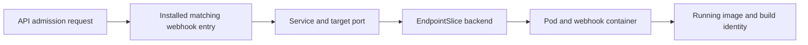

# Find Why a Redeployed Kubebuilder Webhook Still Runs Old Code

Author: [nawazdhandala](https://www.github.com/nawazdhandala)

Tags: Kubernetes, Kubebuilder, Troubleshooting

Description: Trace admission requests through webhook configuration, Service endpoints, running image identities, and rollout state to locate stale validation behavior.

You changed a validator, rebuilt the image, and deployed it, but Kubernetes still returns the old validation message. Before changing code again, establish which process actually handled the request. A successful deployment command does not prove that the API server reached a pod running the intended build.

The investigation follows two paths that must meet: the release path from source to running container, and the routing path from admission configuration to Service backend. This guide uses kubectl 1.34-compatible inspection commands and jq 1.6 syntax. The extraction commands were checked locally with fixtures; no live cluster diagnosis is claimed.

## Start with the request's destination

Capture the installed webhook configuration, not only the YAML in your working tree:

```bash
kubectl config current-context
kubectl get validatingwebhookconfigurations -o yaml > validating-webhooks.yaml
kubectl get mutatingwebhookconfigurations -o yaml > mutating-webhooks.yaml
```

Verify that you are inspecting the intended cluster. Find the entries that match the resource, version, operation, namespace, and subresource in your failing request. Record each webhook name and its `clientConfig` destination.

A Service-backed webhook identifies a namespace, Service name, port, and path. A URL-backed webhook follows a different route and may point outside the cluster. Do not investigate the manager Deployment by habit if the installed configuration points somewhere else. The [admission webhook reference](https://kubernetes.io/docs/reference/access-authn-authz/extensible-admission-controllers/) documents both destinations and request matching.



Check for overlapping entries left behind by a renamed release. The new validator may run correctly while another matching webhook still rejects the request with an old message. Correlate admission request UIDs and handler logs when available instead of assuming every denial comes from the newest installation.

## Compare the template with running containers

Replace the namespace, Deployment name, and label selector with those discovered for your webhook:

```bash
kubectl -n operator-system get deployment controller-manager -o yaml
kubectl -n operator-system rollout status deployment/controller-manager --timeout=120s
kubectl -n operator-system get pods -l control-plane=controller-manager \
  -o json > manager-pods.json
```

A Deployment rollout starts when its pod template changes. Rebuilding an image under the same tag does not itself change that template or replace existing pods. The [Deployment documentation](https://kubernetes.io/docs/concepts/workloads/controllers/deployment/#updating-a-deployment) describes the rollout trigger.

Now inspect each container rather than assuming the first container is the manager:

```bash
jq '.items[] as $pod | $pod.spec.containers[] as $container |
  {
    pod: $pod.metadata.name,
    uid: $pod.metadata.uid,
    container: $container.name,
    requestedImage: $container.image,
    pullPolicy: $container.imagePullPolicy,
    runtime: ([$pod.status.containerStatuses[]? |
      select(.name == $container.name) |
      {imageID, ready, restartCount}][0] // null)
  }' manager-pods.json
```

The output pairs requested images with status by container name. A sidecar's digest is not evidence about the webhook binary. A null runtime entry can indicate that the container has not started or its status is not yet reported.

Compare runtime identity with your registry and build provenance. For multi-platform images, the image index digest and the selected platform manifest digest can differ, so do not treat every unequal digest string as proof of stale code. Establish which digest the runtime reports and which architecture the node selected.

## Treat tags, pull policy, and build contents separately

A mutable tag can point to different content over time. `IfNotPresent` can reuse a locally available image, while `Always` resolves the image when a container starts. Neither setting hot-reloads a process already running. Image pull policy is also defaulted when the object is created; changing a tag later does not automatically recalculate that stored policy. See [Kubernetes image behavior](https://kubernetes.io/docs/concepts/containers/images/#image-pull-policy).

Prefer an immutable release reference, such as an approved digest, in the Deployment template. Apply it through the normal release source and observe the resulting rollout. Do not begin by clearing node caches or deleting every manager pod; first identify whether the discrepancy is the template, runtime identity, or image contents.

Even the intended image can contain an old binary. Check the build context, Dockerfile copy paths, compilation step, and the exact artifact uploaded by CI. Record a source revision and build identifier in startup logs or build metadata so you can connect a running process to its source. Reusing the same version string for every build defeats that evidence.

## Inspect the actual Service backends

Using the Service from `clientConfig`, inspect its selector and ports, then all associated EndpointSlices:

```bash
kubectl -n operator-system get service webhook-service -o yaml
kubectl -n operator-system get endpointslices \
  -l kubernetes.io/service-name=webhook-service -o json > endpoints.json
jq '.items[] as $slice | $slice.endpoints[] |
  {slice: $slice.metadata.name, ports: $slice.ports,
   addresses, conditions, targetRef}' endpoints.json
```

Match each Pod target reference and UID to the image inventory. A broad Service selector may include an old Deployment, a different release, or both revisions during rollout. Inspect every slice; one Service can have several.

Read the endpoint conditions, including readiness and termination state, and check `publishNotReadyAddresses` on the Service before assuming which backends are eligible. The [EndpointSlice documentation](https://kubernetes.io/docs/concepts/services-networking/endpoint-slices/) explains these fields and their relationship to Services.

Also follow `port` to `targetPort` and then to the webhook server's listening port. A healthy manager pod serving metrics does not prove the webhook handler is registered at the configured admission path. When behavior varies between otherwise identical requests, mixed backend revisions are a strong possibility worth checking against per-pod logs.

## Separate transport failures from validation results

A TLS trust error, connection refusal, missing endpoint, or timeout does not mean old validation code ran. With a fail-closed policy, those transport problems can reject requests before any validator returns a decision. Read the error carefully and distinguish an explicit business-rule denial from a webhook call failure.

Conversely, a validator that never matches the request will not log it. Check operation and subresource rules, selectors, and match conditions before changing the handler. A status write and a normal resource update can take different admission paths.

For a staging regression check, use one payload whose expected decision deliberately changed between releases. Send it through server-side dry-run when supported by the webhook's side-effect declaration, then correlate the admission UID, pod, handler path, and build identity. Do not use a denial string alone as the only release fingerprint.

Finish with evidence from both paths: the installed webhook reaches only the intended backends, those backends run the approved artifact, and the regression payload receives the expected decision. If one path disagrees, repair that specific release or routing step. Rebuilding repeatedly without this chain can keep deploying the right source to a process that never receives the request.
