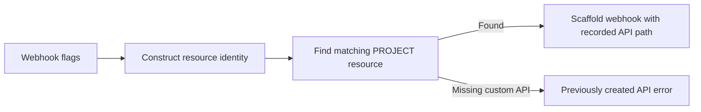

# Repair Kubebuilder's Missing API Entry Before Creating a Webhook

Author: [nawazdhandala](https://www.github.com/nawazdhandala)

Tags: Kubernetes, Kubebuilder, Troubleshooting

Description: Diagnose the previously created API error by matching webhook flags to PROJECT metadata, restoring the correct resource entry, and checking the generated scaffold.

Your API type exists under `api/v1`, but `kubebuilder create webhook` says it requires a previously created API. The apparent contradiction comes from two different inventories: Go source files define your type, while the `PROJECT` file records the resources Kubebuilder knows how to scaffold.

For an ordinary project-owned custom API, a missing or mismatched resource entry can trigger the error even when the Go package compiles. Installing the CRD in a cluster does not repair this local scaffolding metadata.

This guide uses **Kubebuilder v4.9.0**, the `go/v4` plugin, and a project-owned `platform.example.com/v1` resource named `SyncTask`. In a temporary project, removing its resource entry reproduced the error; restoring that entry allowed webhook creation. The procedure below preserves existing implementations rather than recreating the project over them.

## Understand the lookup that failed

In v4.9.0, the webhook command asks the project configuration for the requested resource's group, version, and kind. If it cannot find the resource and the request is neither an external nor a built-in API, it returns the “previously created API” error. See the [tagged webhook command](https://github.com/kubernetes-sigs/kubebuilder/blob/v4.9.0/pkg/plugins/golang/v4/webhook.go#L139).



The lookup is not an inspection of installed CRDs. It is also not a broad filesystem scan that reconstructs resource metadata from every Go file. The [project configuration implementation](https://github.com/kubernetes-sigs/kubebuilder/blob/v4.9.0/pkg/config/v3/config.go#L188) looks through its recorded resources.

That gives you a narrow diagnostic question: do the CLI flags identify the same resource recorded in `PROJECT`?

## Confirm the project and exact flags

From the project root, inspect the local state:

```bash
pwd
kubebuilder version
git status --short
cat PROJECT
```

Record uncommitted changes before editing. Preserve a backup or use a separate working copy if the project already contains handwritten webhook code. This is especially important because successful scaffolding can modify registration code, configuration, tests, and dependencies in addition to creating a webhook file.

For this example, the command is:

```bash
kubebuilder create webhook --group platform --version v1 --kind SyncTask \
  --programmatic-validation --make=false
```

Use `platform` as the group flag because the project domain is `example.com`; do not substitute the combined group `platform.example.com` without checking your project's configuration semantics. Kind capitalization and the API version must also match. A `v1beta1` entry does not register a `v1` API automatically.

`--make=false` skips the subsequent `make generate` step in this release. It does not turn the command into a dry run: scaffolding still writes files and performs dependency updating. The [v4.9.0 source](https://github.com/kubernetes-sigs/kubebuilder/blob/v4.9.0/pkg/plugins/golang/v4/webhook.go#L166) shows those post-scaffold actions.

## Restore the resource entry from evidence

The relevant portion of the example's `PROJECT` file before webhook creation is:

```yaml
resources:
- api:
    crdVersion: v1
    namespaced: true
  domain: example.com
  group: platform
  kind: SyncTask
  path: example.com/projectrepair/api/v1
  version: v1
```

This is a fragment, not a replacement for the entire file. Keep root fields such as `repo`, `layout`, and project format `version`, and retain every other resource entry. The project format version, the custom resource's API version, and the CRD definition version are different values with different meanings.

Prefer restoring the known-good entry from version control or a trusted backup. Compare its group, domain, kind, version, namespaced setting, and Go import path with the actual API package. The [project configuration reference](https://book.kubebuilder.io/reference/project-config.html) explains these fields.

For a single-group layout, the path may end in `api/v1`; a multi-group project can use another directory structure. Do not copy the example's module path into your project. Check `go.mod`, the package's group-version declaration, and the existing type registration together.

If the API was hand-added and never recorded, reconstruct the entry carefully from those sources. A useful reference is a disposable project scaffolded with the same CLI version, plugin, domain, module layout, and resource flags. Compare metadata rather than copying generated implementations over your existing code.

The `PROJECT` header may say it is generated and should not be edited. Normal CLI usage should maintain it. A targeted repair of demonstrably missing metadata is different from treating it as a free-form configuration file; keep the change small and review it against a generated reference.

## Do not use force as a metadata repair

`--force` controls some existing-scaffold checks. It does not bypass the missing custom-API lookup in this release. Re-running `create api` with force in your existing project can also put generated content in the path of handwritten types or controllers.

If the resource truly has never existed, create it through the CLI first. If the Go API already exists and only the record is missing, restore its metadata instead. These cases require different repairs.

Built-in and external APIs are another branch of the command's behavior. Do not falsely mark your own API as external just to get past the check. For a real external type, use the external API flags supported by your CLI and its actual import path. A group name that overlaps a built-in Kubernetes group can also change fallback behavior when metadata is missing, so preserve the exact domain and recorded path rather than relying on inference.

## Retry and review the scaffold

After repairing the entry, retry the webhook command in the protected working copy. Inspect the resulting diff before proceeding. Confirm that the generated webhook imports your actual API package and that registration targets the correct kind and version.

Then regenerate supporting code and compile:

```bash
make generate
go build ./...
git diff -- PROJECT go.mod go.sum cmd/main.go internal/webhook config
```

Use the toolchain required by the pinned scaffold. Review new untracked files as well as the diff; ordinary `git diff` does not show their contents. Compilation catches a wrong import path or missing type, but it does not prove webhook admission behavior.

Generate the project manifests using its normal workflow and inspect webhook rules, service references, and paths before deployment. Implement the validation logic and test it separately. A scaffold whose validator returns success for every request is not a completed validation feature.

## Define what the repair proves

The local reproduction kept the API source present, removed only its resource record, observed the expected error, restored the original record, and successfully scaffolded the validating webhook. Supporting code generation and compilation provide an additional consistency check.

This does not establish that a cluster can reach the webhook, trust its certificate, or route admission requests correctly. Those are later deployment checks. The repair is complete when local metadata and source agree, the requested scaffold targets the intended API, and the generated changes survive review without overwriting the existing implementation.
