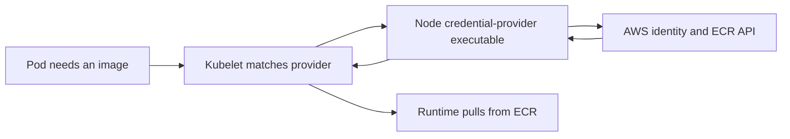

# Replace Static Pull Secrets with Kubelet Credential Providers

Author: [nawazdhandala](https://www.github.com/nawazdhandala)

Tags: Kubernetes, Container Registry, Authentication

Description: Pilot an ECR kubelet credential provider with pinned configuration, scoped node identity, and cache-aware tests before retiring namespace pull secrets.

Copying registry passwords into many namespaces creates a rotation problem. A kubelet credential-provider plugin can obtain image-pull credentials when the node needs them, using an identity mechanism appropriate to the registry. That removes some stored credentials, but it does not remove the need for a trusted identity or a reachable authorization service.

This guide uses **Kubernetes1.34.1** and the **AWS cloud-provider v1.34.1 ECR credential provider** as a concrete example. Amazon Elastic Container Registry, or ECR, supplies short-lived registry credentials through an API. A different registry requires a compatible provider implementation; this is not a universal plugin that accepts any registry URL.

## Understand where the plugin runs

The kubelet invokes an executable on the node. It sends a credential request through standard input and reads a structured response from standard output. The returned credentials are then available for the image-pull operation through the container runtime.



This is separate from an application's AWS SDK credentials and from a Docker desktop credential helper. The [Kubernetes credential-provider guide](https://kubernetes.io/docs/tasks/administer-cluster/kubelet-credential-provider/) documents the executable protocol and kubelet configuration. Ordinary exec credential providers are stable from Kubernetes1.26; do not copy obsolete alpha feature-gate instructions into a1.34 deployment.

The plugin binary is trusted node software. Install it through the same reviewed node-image or configuration-management path as other privileged node components, with the correct operating-system and CPU build, recorded version, integrity verification, and protected executable permissions.

## Choose the identity before removing Secrets

For this pilot, use an approved EC2 node role and the provider's normal AWS credential chain. The [tagged AWS provider documentation](https://github.com/kubernetes/cloud-provider-aws/blob/v1.34.1/docs/credential_provider.md) describes that chain and its use of instance metadata on EC2.

Ensure the role can obtain ECR authorization credentials and pull from only the intended repositories. Check cross-account repository policies where relevant. Do not compensate for a failed pull by giving every node broad registry administration rights.

Node-level identity has a different isolation boundary from namespace-specific Secrets. Workloads placed on the node may benefit from the node's image-pull permissions. A migration that broadens which workloads can obtain private images is not merely a credential-storage change.

Kubernetes also has a ServiceAccount-token integration for credential providers. It requires matching kubelet feature support, provider behavior, token audience, and identity-provider policy. The configuration below deliberately uses the node-identity path and does not configure `tokenAttributes`. Do not assume an application's ServiceAccount annotation automatically controls this example's registry identity.

## Configure a narrow matching rule

After installing the approved executable as `/opt/kubelet-credential-providers/ecr-credential-provider`, save the following as `/etc/kubernetes/ecr-credential-provider.yaml`:

```yaml
apiVersion: kubelet.config.k8s.io/v1
kind: CredentialProviderConfig
providers:
  - name: ecr-credential-provider
    matchImages:
      - "123456789012.dkr.ecr.us-east-1.amazonaws.com"
    defaultCacheDuration: "0s"
    apiVersion: credentialprovider.kubelet.k8s.io/v1
```

Replace the account ID and region with your approved ECR registry. An exact host is easier to audit during a pilot than a pattern matching every account in every region. The provider name must match the executable's filename.

The two API versions describe different objects: the outer configuration file and the request/response protocol spoken to the executable. The fields are defined in the [Kubernetes1.34.1 configuration types](https://github.com/kubernetes/kubernetes/blob/v1.34.1/staging/src/k8s.io/kubelet/config/v1/types.go).

Add these arguments through the node's existing kubelet startup configuration:

```text
--image-credential-provider-bin-dir=/opt/kubelet-credential-providers
--image-credential-provider-config=/etc/kubernetes/ecr-credential-provider.yaml
```

They are kubelet startup flags, not Pod fields or containerd `hosts.toml` entries. Use the distribution's documented node configuration mechanism. Managed clusters may restrict or preconfigure this integration, so inspect the existing setup before replacing it. Roll any required kubelet restart through your normal node-maintenance procedure.

## Understand the two credential lifetimes

`defaultCacheDuration` applies when the provider response does not supply its own cache duration. Setting it to zero does not force a plugin that returns a duration to run for every pull.

The [v1.34.1 ECR implementation](https://github.com/kubernetes/cloud-provider-aws/blob/v1.34.1/cmd/ecr-credential-provider/main.go) returns registry-scoped credentials and normally sets cache duration to half the remaining authorization-token lifetime. That is an implementation behavior to recheck when changing provider versions.

AWS documents ECR authorization tokens as valid for12 hours, with permissions based on the IAM principal used to retrieve them. IAM is AWS's identity and access-management system. See [ECR registry authentication](https://docs.aws.amazon.com/AmazonECR/latest/userguide/registry_auth.html).

Distinguish cached image layers from cached credentials. A successful test can be explained by either cache without exercising fresh credential acquisition. Also distinguish token expiry from the lifetime of the underlying node identity: the provider must still be able to renew credentials when its cache expires.

## Prove the provider on a controlled node

Keep the existing Secret deployment available as a rollback path. Create an isolated pilot workload whose admitted Pod has no pull-secret references, including references inherited from its ServiceAccount. Do not remove credentials from all production workloads just to force the experiment.

Use a clean staging node or an approved image digest that has not been cached there. Confirm the exact image host matches the configured rule. Examine kubelet logs for plugin invocation and errors without recording returned passwords or authorization tokens.

| Test | Evidence required |
| --- | --- |
| First uncached private-image pull | Expected provider runs and image is retrieved |
| Unmatched registry host | This provider is not selected for that host |
| Repository outside the allowed policy | Pull remains denied |
| Fresh node from the production node template | Binary, configuration, identity and trust are all present |
| Credential refresh after cache expiry | A later pull succeeds through renewed credentials |
| Authorization-service outage in staging | Failure is visible and understood; cached success is not mistaken for renewal |

For a refresh rehearsal, allow the actual cache interval to expire or use a fresh isolated kubelet environment. Avoid repeatedly restarting production kubelets to manipulate a cache. Observe API throttling and credential-service latency as the pilot grows.

## Roll out without losing the fallback

Deploy the verified node configuration to every node pool that can schedule the affected workloads. Then remove the relevant Secret references from a limited workload group and perform a controlled rollout. Retain references for registries not handled by the plugin.

Once uncached pulls and refreshes succeed across the intended node classes, retire unused credentials through the secret-management system. Confirm that autoscaling and replacement-node templates include the provider; otherwise the next node rotation can recreate the outage.

If the pilot fails, restore the reviewed workload pull-secret references and roll out those workloads through the normal process. Diagnose binary execution, match rules, AWS identity, endpoint access, or TLS trust separately. Never print plugin responses to troubleshoot them: they contain credentials.

Local validation uses the tagged provider's automated tests with mocked API responses and a strict configuration decode. It does not demonstrate an EC2 identity, an ECR pull, or real credential renewal. Those remain deployment acceptance tests.
