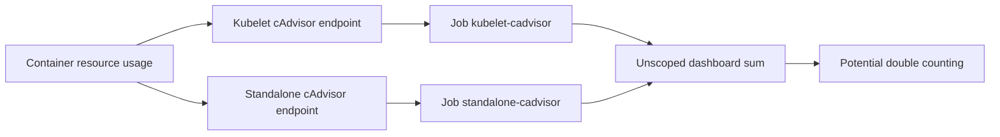

# Avoid Duplicate Metrics from Kubelet and Standalone cAdvisor

Author: [nawazdhandala](https://www.github.com/nawazdhandala)

Tags: Kubernetes, Prometheus, Monitoring

Description: Compare kubelet and standalone cAdvisor collection, identify overlapping container series, and migrate to one authoritative source without hiding missing data.

A Kubernetes memory dashboard suddenly doubles after a new monitoring DaemonSet is installed. The application did not necessarily grow. Prometheus may now collect the same container through both the kubelet's cAdvisor endpoint and a standalone cAdvisor exporter.

These are usually separate time series because their `job`, `instance`, or other labels differ. Prometheus can store both correctly while a broad dashboard query adds them together incorrectly. The fix starts with collection ownership, not a mathematical adjustment to the displayed value.

## Understand the two collection paths

The kubelet exposes container metrics at `/metrics/cadvisor` alongside other kubelet metrics endpoints. A standalone cAdvisor instance is a separately deployed process or container with its own image, configuration, host access, and endpoint. [Kubernetes system metrics](https://kubernetes.io/docs/concepts/cluster-administration/system-metrics/) and [standalone cAdvisor](https://github.com/google/cadvisor/blob/v0.55.1/README.md).



The two implementations need not expose identical data. For example, Kubernetes 1.35.0 depends on cAdvisor 0.53.0, while a separately deployed 0.55.1 image is a different release. Those are explicit comparison versions, not a claim that all current clusters use them. [Kubernetes 1.35.0 dependency manifest](https://github.com/kubernetes/kubernetes/blob/v1.35.0/go.mod).

| Question | Kubelet collection | Standalone collection |
| --- | --- | --- |
| Who upgrades the embedded collector? | Kubernetes distribution or node upgrade process | Exporter deployment owner |
| What connection needs access? | Kubelet HTTPS endpoint | Exporter's configured endpoint |
| Where are host permissions configured? | Kubelet's managed environment | Standalone deployment and host policy |
| Can labels and metric groups differ? | Yes, with kubelet and runtime behavior | Yes, with version, flags, and mounts |

Choose based on required coverage and operational support, not just which endpoint is easier to reach.

## Inventory what Prometheus actually scrapes

Start in Prometheus's Targets and Service Discovery views. Record every endpoint that returns container metrics, including jobs with names that do not mention cAdvisor. Look for a kubelet endpoint, a DaemonSet Service, direct pod targets, and additional discovery generated by an operator.

If you use Prometheus Operator, inspect the generated configuration and the owning ServiceMonitor or PodMonitor rather than editing generated files. Two monitoring resources can select the same endpoint. That is a different duplication source from two collectors observing the same host, but both can inflate downstream sums. [Operator configuration troubleshooting](https://prometheus-operator.dev/docs/platform/troubleshooting/#troubleshooting-servicemonitor-changes).

For a quick label inventory, evaluate:

```promql
count by (job, instance) (
  container_memory_working_set_bytes
)
```

This counts series from each scrape identity. It does not prove duplicate containers: cAdvisor can also report parent control groups and other non-application entries. A control group, or cgroup, is the kernel's resource-accounting group. First inspect representative raw series and determine which entries correspond to application containers.

The selected metric is a gauge representing current working-set bytes, making it useful for a simple side-by-side comparison. It is not the same quantity as a container's memory limit or necessarily the application's own heap usage. [cAdvisor metric reference](https://github.com/google/cadvisor/blob/v0.55.1/docs/storage/prometheus.md).

## Compare identities before comparing numbers

For this example, assume both jobs expose meaningful `namespace`, `pod`, and `container` labels. Replace the example job names with those from your actual configuration. If one exporter lacks these labels, this comparison is not ready to use: inspect its raw identity labels and establish a trustworthy mapping first.

The following query finds application-container names represented in both selected jobs:

```promql
count by (namespace, pod, container) (
  count by (namespace, pod, container, job) (
    container_memory_working_set_bytes{
      job=~"kubelet-cadvisor|standalone-cadvisor",
      namespace!="",
      pod!="",
      container!="",
      container!="POD"
    }
  )
) > 1
```

The inner count collapses series within each job into a presence indicator for that identity. The outer count asks how many distinct jobs reported it. This is an overlap detector, not a deduplication query. [Prometheus aggregation semantics](https://prometheus.io/docs/prometheus/latest/querying/operators/).

Run it against one cluster. If your query system combines clusters, include a reliable `cluster` label in both groupings and selectors. During pod replacement, names can be reused; compare node placement, container identity, and timestamps before declaring two samples to be the same running container.

Likewise, two series within one job will not trigger this particular cross-job test. Inspect the target list and raw labels for multiple scrape routes even when the result is empty.

## Select an authoritative source explicitly

Suppose your platform supports kubelet scraping, and its coverage meets your requirements. Start by changing a staging dashboard to select that job:

```promql
container_memory_working_set_bytes{
  job="kubelet-cadvisor",
  namespace!="",
  pod!="",
  container!="",
  container!="POD"
}
```

This keeps the original per-series values. Only aggregate after checking that the remaining identity labels represent the units you intend to add. If a namespace total falls from roughly twice the expected value to the expected value, compare individual containers as well; a plausible total can still hide omitted workloads.

Do not divide every result by two. Some containers may be collected by only one source, and scrape timing differs. Do not use `max` across collectors as a permanent substitute for choosing ownership either: it can hide a failed source and select samples with different semantics.

Removing `job` or `instance` labels from stored samples is not safe deduplication. Labels define time-series identity. Collapsing distinct inputs onto the same label set can create conflicting or out-of-order samples, and it removes useful provenance. [Prometheus time-series selection and identity](https://prometheus.io/docs/prometheus/latest/querying/basics/).

## Test the query with known data

Before updating recording rules, create a small test containing one container reported by both jobs and another reported by only the selected job. The overlap query should return only the first identity. The selected-source query should return both containers once, preserving their values.

Prometheus provides `promtool test rules` for evaluating expressions against supplied time series. Use the binary matching your deployment. A synthetic test confirms query behavior; it cannot prove that two real exporters attach equivalent labels or observe the same workload. [Prometheus rule testing](https://prometheus.io/docs/prometheus/latest/configuration/unit_testing_rules/).

Also test a recreated pod and a temporarily unavailable target with real staging data. Check alert behavior when samples disappear, not only when values change.

## Remove the redundant path in a controlled order

First compare the required metric families, label coverage, scrape health, and dashboard results from both sources over a representative workload period. A newer standalone release may expose something that the embedded collector does not. Record any intentional exception instead of silently deleting it.

Next update recording rules, dashboards, and alerts to reference the chosen source. Then disable the redundant scrape through its owning configuration. Keep the exporter deployment temporarily if needed for rollback, but verify no other discovery resource still scrapes it.

Once coverage remains correct, remove an unnecessary standalone deployment and its host permissions through the normal change process. If it is intentionally retained for a distinct metric family, make that separation explicit in scrape configuration and query selectors.

Historical duplicate data does not disappear when collection stops. Older chart ranges can still show both jobs, so keep source selection in historical queries and annotate the migration time. Do not delete historical series merely to make a graph look smoother.

## Make the ownership decision durable

Document the chosen endpoint, owning configuration, expected node count, required metric families, and approved exceptions. Recheck that inventory after installing a monitoring chart or changing Kubernetes versions.

The goal is one intentional source for each measurement used by a rule or dashboard. Multiple collectors can coexist during evaluation, but their overlap must remain visible and must not become accidental arithmetic.
