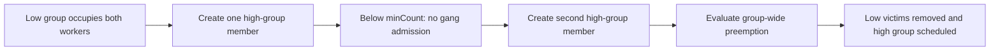

# Test Kubernetes 1.36 Workload-Aware Preemption with PodGroups

Author: [nawazdhandala](https://www.github.com/nawazdhandala)

Tags: Kubernetes, Scheduling, Testing

Description: Build a bounded Kubernetes 1.36 PodGroup preemption rehearsal, verify gang admission and victim behavior, and distinguish group policy from ordinary pod preemption.

A distributed job may need two workers before either can do useful work. Scheduling one worker while the other waits can waste resources. Gang scheduling addresses that problem by requiring a minimum number of group members to be schedulable together. Workload-aware preemption adds a related capability: making space for the group as a scheduling unit.

Kubernetes 1.36 introduces workload-aware preemption as an alpha feature, disabled by default. This tutorial is specifically for **1.36.0**, not newer manifests copied into an older cluster. Its API version is `scheduling.k8s.io/v1alpha2`; its disruption modes are `Pod` and `PodGroup`. See the [versioned disruption documentation](https://v1-36.docs.kubernetes.io/docs/concepts/workloads/workload-api/disruption-and-priority/).

The following is a staging acceptance procedure. The generated manifests were checked locally against the matching schema, but this article does not claim a live preemption test.

## Establish the test boundary

Use a disposable cluster with two Linux workers reserved for this experiment. Do not introduce these alpha features or deliberate contention into production as an exploratory test. You need administrator access to configure feature gates and the API server, plus permission to create PriorityClasses, PodGroups, and Pods.

For 1.36, enable `GenericWorkload`, `GangScheduling`, and `WorkloadAwarePreemption` on the relevant components. In particular, the API server must retain the group priority/disruption fields and serve `scheduling.k8s.io/v1alpha2`; the scheduler must run the gang and workload-aware preemption logic. Configure the API server's runtime configuration with `scheduling.k8s.io/v1alpha2=true`, preserving its other settings. Use your cluster provisioner's supported control-plane configuration mechanism.

The [1.36 feature definitions](https://github.com/kubernetes/kubernetes/blob/v1.36.0/pkg/features/kube_features.go) record the dependencies, and the [default plugin configuration](https://github.com/kubernetes/kubernetes/blob/v1.36.0/pkg/scheduler/apis/config/v1/default_plugins.go) enables the gang plugin when its gate is enabled. A custom scheduler profile can override defaults, so inspect the effective profile too.

Check discovery before creating anything:

```bash
kubectl version
kubectl api-resources --api-group=scheduling.k8s.io
kubectl explain podgroup.spec --api-version=scheduling.k8s.io/v1alpha2
```

Expect `podgroups` discovery and fields including `schedulingPolicy`, `priorityClassName`, and `disruptionMode`. Discovery proves API availability, not that scheduler features are operating correctly. Confirm component configuration and startup logs separately.

## Design a bounded contention case

Each worker in this test should have at least one but less than two CPUs of unallocated request capacity before the low-priority group starts, and enough remaining memory for the small pause pods. Account for system workloads and DaemonSets. Keep other workload arrivals and autoscaling out of this controlled experiment.

The low group places one one-CPU pod on each worker. The high group later requests the same shape. Each high pod can fit if its corresponding low pod is removed, but neither should fit alongside it. Adjust the fixture's requests to your lab if those assumptions are not true; do not infer pressure from CPU utilization alone.



This isolates group admission and preemption from application startup. The pause image holds requests without running a real distributed training job.

## Generate the fixture

Create an empty namespace named `gang-lab`. Save the following as `make-fixture.py` and replace the two node placeholders with the workers' actual `kubernetes.io/hostname` label values. Run it with Python 3 in an empty working directory. It only writes JSON files; it does not contact Kubernetes.

```python
import json
from pathlib import Path

nodes = ["REPLACE_WORKER_A_HOSTNAME", "REPLACE_WORKER_B_HOSTNAME"]
namespace = "gang-lab"

def save(name, items):
    Path(name).write_text(json.dumps({
        "apiVersion": "v1", "kind": "List", "items": items
    }, indent=2) + "\n")

classes, groups, members = [], [], {}
for name, priority in [("low", 0), ("high", 1000)]:
    cls = "gang-lab-" + name
    classes.append({
        "apiVersion": "scheduling.k8s.io/v1", "kind": "PriorityClass",
        "metadata": {"name": cls}, "value": priority,
        "globalDefault": False, "preemptionPolicy": "PreemptLowerPriority"
    })
    groups.append({
        "apiVersion": "scheduling.k8s.io/v1alpha2", "kind": "PodGroup",
        "metadata": {"name": name, "namespace": namespace},
        "spec": {"priorityClassName": cls, "disruptionMode": "PodGroup",
                 "schedulingPolicy": {"gang": {"minCount": 2}}}
    })
    members[name] = []
    for index, hostname in enumerate(nodes):
        members[name].append({
            "apiVersion": "v1", "kind": "Pod",
            "metadata": {"name": f"{name}-{index}", "namespace": namespace},
            "spec": {
                "schedulerName": "default-scheduler",
                "priorityClassName": cls,
                "schedulingGroup": {"podGroupName": name},
                "nodeSelector": {"kubernetes.io/hostname": hostname},
                "automountServiceAccountToken": False,
                "terminationGracePeriodSeconds": 0,
                "containers": [{"name": "pause",
                    "image": "registry.k8s.io/pause:3.10.1",
                    "resources": {"requests": {"cpu": "1", "memory": "64Mi"}}}]
            }
        })
save("classes.json", classes)
save("groups.json", groups)
save("low.json", members["low"])
save("high-first.json", members["high"][:1])
save("high-second.json", members["high"][1:])
```

The [PodGroup API](https://v1-36.docs.kubernetes.io/docs/concepts/workloads/podgroup-api/) permits standalone groups. No Workload template or Job controller is needed here. Membership uses `spec.schedulingGroup.podGroupName`, not an invented annotation. Group and member priorities deliberately agree so the test does not accidentally depend on different priority values in different scheduling paths.

The zero grace period is for disposable pause pods only. If namespace policy requires additional container security settings, add and validate those settings before the scheduling experiment. Image admission or image-pull failures should not be mistaken for gang scheduling failures.

## Run the stages and record evidence

Review the generated files, then create dependencies in order. A dry-run cannot make a PriorityClass available for a subsequent request, which is why these steps are separate:

```bash
python3 make-fixture.py
kubectl apply --dry-run=server -f classes.json
kubectl apply -f classes.json
kubectl apply --dry-run=server -f groups.json
kubectl apply -f groups.json
kubectl apply --dry-run=server -f low.json
kubectl apply -f low.json
kubectl -n gang-lab get pods -o wide
kubectl -n gang-lab get podgroups -o yaml
```

Wait until both low members are running on their intended workers. Read back group priority and disruption mode; missing fields indicate a configuration or admission problem. Capture their UIDs before proceeding.

```bash
kubectl apply -f high-first.json
kubectl -n gang-lab get pods -o wide
# After confirming the first member remains unassigned:
kubectl apply -f high-second.json
kubectl -n gang-lab get pods -w
```

With only one high member, the gang has not reached `minCount: 2`. After creating the second, the scheduler can evaluate the group. Collect scheduler logs, events, PodGroup status, and Pod UIDs to verify that the intended low group was disrupted and both high members were assigned.

| Stage | Required evidence |
|---|---|
| Low baseline | Both low members running on the two intended workers |
| One high member | High member unassigned; low group remains intact |
| Full high group | Victim evidence correlated to low UIDs; both high members assigned |
| After scheduling | Inspect actual pods, not just historical group status |

Gang scheduling coordinates placement, not simultaneous process startup or application health. The [PodGroup lifecycle documentation](https://v1-36.docs.kubernetes.io/docs/concepts/workloads/podgroup-api/lifecycle/) also warns that `PodGroupScheduled` records the initial decision and does not become a continuous health indicator after later failures.

## Test the limits separately

Repeat with fresh objects for policy variations because key group fields are immutable. Compare `Pod` versus `PodGroup` disruption using a fixture where removing only part of a victim group would suffice; the two-node case above needs both victims and cannot prove that distinction alone.

Also test an ordinary, ungrouped high-priority pod separately. In 1.36, default single-pod preemption does **not** respect a victim group's priority or disruption mode. The [versioned workload-aware preemption page](https://v1-36.docs.kubernetes.io/docs/concepts/scheduling-eviction/workload-aware-preemption/) explicitly documents that limitation. Group-level policy is not universal protection from every disruption source.

When finished, remove the fixture's Pods before its PodGroups, then remove its dedicated PriorityClasses after confirming no references remain. Keep the evidence and component configuration with the test report. Passing means the expected staged behavior was observed under known capacity conditions, not merely that the API accepted the JSON.
