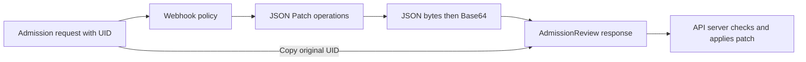

# Return a Valid Kubernetes AdmissionReview v1 Response

Author: [nawazdhandala](https://www.github.com/nawazdhandala)

Tags: Kubernetes, Python, JSON, Testing

Description: Build and test AdmissionReview v1 responses with the original request UID, correctly encoded JSON Patch, explicit denial, and a clean no-change response.

A mutating webhook can make the right policy decision and still break an API request. Kubernetes does not accept a modified Pod returned as the response body. It expects an admission response envelope, and any mutation must be expressed in the required patch format.

This tutorial isolates that response-building boundary. The Python example runs without a cluster, while the protocol checks are grounded in **Kubernetes v1.35.0** source. That version is a reproducible reference, not a claim that it is the newest release. A deployed webhook still needs an HTTPS server, trusted certificates, registration, and carefully scoped matching rules.

## Keep the three layers separate

The HTTP response carries an `AdmissionReview`. Inside it, `response` contains the decision. If the decision includes a mutation, `response.patch` contains encoded patch bytes.



For a successfully handled admission call, return HTTP status **200**, `Content-Type: application/json`, and the serialized review. This includes a policy denial: denial belongs in `response.allowed: false`, rather than an HTTP 403 from the webhook endpoint. Kubernetes documents the distinction in its [response protocol](https://kubernetes.io/docs/reference/access-authn-authz/extensible-admission-controllers/#response).

The important fields are:

| Field | Required meaning |
|---|---|
| `apiVersion` | `admission.k8s.io/v1` for this v1-only implementation |
| `kind` | `AdmissionReview` |
| `response.uid` | Exact value of the incoming `request.uid` |
| `response.allowed` | A JSON boolean, not the string `"true"` |
| `response.patchType` | `JSONPatch` when returning a patch |
| `response.patch` | Standard Base64 text representing a JSON array of operations |

The UID identifies this admission round trip. It is not the object's name, its `metadata.uid`, or a new identifier generated by your server. The [v1 admission types](https://github.com/kubernetes/api/blob/v0.35.0/admission/v1/types.go) define its correlation purpose and the response fields.

Keep the review API version separate from the object's API version. A request about an `apps/v1` Deployment can still arrive inside an `admission.k8s.io/v1` review. Advertise only `v1` in `admissionReviewVersions` for this implementation; accepting a version in configuration creates an obligation to understand and answer it.

## Build the envelope in one place

Save this as `admission_response.py`. It requires Python 3.11 and uses only the standard library. The input is the parsed incoming review; the policy layer supplies the decision and optional operations.

```python
import base64
import json


def admission_response(review, *, allowed=True, patch=None, message=None):
    if not isinstance(review, dict):
        raise ValueError("AdmissionReview must be an object")
    if (review.get("apiVersion") != "admission.k8s.io/v1"
            or review.get("kind") != "AdmissionReview"):
        raise ValueError("Expected AdmissionReview v1")
    request = review.get("request")
    if not isinstance(request, dict):
        raise ValueError("Missing admission request")
    uid = request.get("uid")
    if not isinstance(uid, str) or not uid:
        raise ValueError("Missing request UID")
    if type(allowed) is not bool:
        raise ValueError("allowed must be a boolean")
    if patch is not None and not isinstance(patch, list):
        raise ValueError("patch must be a list of operations")
    if not allowed and patch:
        raise ValueError("A denial must not contain a mutation")
    if message is not None and not isinstance(message, str):
        raise ValueError("message must be text")

    response = {"uid": uid, "allowed": allowed}
    if not allowed and message:
        response["status"] = {"code": 403, "message": message}
    if patch:
        patch_bytes = json.dumps(
            patch, separators=(",", ":"), allow_nan=False
        ).encode("utf-8")
        response["patchType"] = "JSONPatch"
        response["patch"] = base64.b64encode(patch_bytes).decode("ascii")

    return json.dumps({
        "apiVersion": "admission.k8s.io/v1",
        "kind": "AdmissionReview",
        "response": response,
    }, separators=(",", ":"), allow_nan=False).encode("utf-8")
```

The result is the complete UTF-8 HTTP body. Send those bytes directly; passing them through another JSON serializer would produce a quoted string instead of a review object. Python's [JSON documentation](https://docs.python.org/3.11/library/json.html) describes serialization, while its [Base64 documentation](https://docs.python.org/3.11/library/base64.html) distinguishes standard encoding from the URL-safe variant.

For a no-change decision, omit `patch` or pass an empty list. The builder omits both patch fields. For a denial, it optionally adds a human-readable explanation. Do not include secret values, full credentials, or complete object dumps in that explanation.

This helper validates the envelope inputs, not every JSON Patch operation or Kubernetes resource field. It also is not an HTTP exception handler. Your server adapter must impose request-size limits, parse JSON, and classify malformed transport input separately from a deliberate policy denial. An exception must never be converted into an accidental `allowed: true` response.

## Encode the operations exactly once

For a scoped example, imagine a policy that sets a test Pod's termination grace period to 45 seconds. This is only a patch example; it is not a recommendation to overwrite every workload's shutdown settings.

```python
from admission_response import admission_response

# Minimal envelope fixture for this encoder, not a complete API-server request.
review = {
    "apiVersion": "admission.k8s.io/v1",
    "kind": "AdmissionReview",
    "request": {"uid": "fixture-request-001"},
}
operations = [{
    "op": "add",
    "path": "/spec/terminationGracePeriodSeconds",
    "value": 45,
}]
body = admission_response(review, patch=operations)
```

JSON Patch is an ordered array. Its `add` operation can add an object member or replace an existing member, but the containing object must exist. Here `/spec` must already be present. The path is relative to the resource being admitted, not to `/request/object` in the review envelope. These semantics come from [RFC 6902](https://www.rfc-editor.org/rfc/rfc6902.txt).

The builder performs three steps: serialize the array to JSON, encode those bytes once as Base64, and place the resulting text in the outer JSON response. Do not encode each operation separately. Do not send a merge-patch object under `patchType: JSONPatch`.

A related Go-specific trap is worth recognizing when translating this example: `AdmissionResponse.Patch` is a byte slice. Go's JSON encoder already Base64-encodes byte slices, so that field should receive raw JSON Patch bytes. Python's dictionary does not provide that automatic field behavior. See [Go JSON marshaling](https://pkg.go.dev/encoding/json#Marshal).

## Test the decoded patch, not its appearance

Continue the local example with these assertions:

```python
import base64
import json

result = json.loads(body)
response = result["response"]
assert result["apiVersion"] == "admission.k8s.io/v1"
assert response["uid"] == review["request"]["uid"]
assert response["allowed"] is True
assert response["patchType"] == "JSONPatch"
decoded = base64.b64decode(response["patch"], validate=True)
assert json.loads(decoded) == operations

unchanged = json.loads(admission_response(review))["response"]
assert "patch" not in unchanged and "patchType" not in unchanged

denied = json.loads(admission_response(
    review, allowed=False, message="This workload is outside the approved policy"
))["response"]
assert denied["allowed"] is False
assert denied["uid"] == review["request"]["uid"]
assert "patch" not in denied
print("Response encoding checks passed")
```

Also apply decoded operations to representative resource fixtures using a JSON Patch implementation. Verify the intended change and that unrelated fields survive. A valid Base64 string can still decode to invalid JSON, the wrong JSON shape, or an impossible path.

The [v1.35 response verifier](https://github.com/kubernetes/kubernetes/blob/v1.35.0/staging/src/k8s.io/apiserver/pkg/admission/plugin/webhook/request/admissionreview.go) checks the response UID and review type, and requires patch bytes and patch type together. The [mutating dispatcher](https://github.com/kubernetes/kubernetes/blob/v1.35.0/staging/src/k8s.io/apiserver/pkg/admission/plugin/webhook/mutating/dispatcher.go) subsequently decodes and applies the patch. These are separate failure stages, so log them separately in your own tests.

Local encoder tests establish serialization behavior, not successful admission in a cluster. Finish deployment verification in an opt-in test scope: inspect the endpoint's HTTP status and content type, exercise allow/no-change/deny paths, and confirm the resulting resource. Keep request UID, outcome, and patch-operation count in diagnostic logs so failures can be correlated without recording the complete workload payload.
