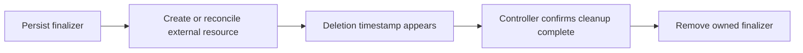

# Should a Kubernetes Finalizer Live in a Controller or Webhook?

Author: [nawazdhandala](https://www.github.com/nawazdhandala)

Tags: Kubernetes, Go, Automation

Description: Choose who adds a finalizer, keep cleanup in a controller, and test that protection is persisted before external resources are created or deletion completes.

A finalizer is a promise that some component will finish work before Kubernetes removes an object. It is not a cleanup function stored in metadata. Adding the string is easy; maintaining the component that can safely remove it is the real responsibility.

In most operators, the controller should own the finalizer lifecycle. A mutating webhook may add the finalizer at creation when the design requires protection before the first reconciliation, but it should not perform the external cleanup during admission.

This article uses **Kubernetes v1.35.0**, **controller-runtime v0.23.0**, and **Go 1.25.0** for its example. The code is a focused reconciliation helper, not a complete operator or an external-service implementation.

## Understand the deletion sequence

When an object with finalizers is deleted, Kubernetes sets its deletion timestamp and retains it while finalizers remain. The responsible controller observes that state, completes cleanup, and removes its own finalizer. New finalizers cannot be added once deletion has begun. The [finalizer documentation](https://kubernetes.io/docs/concepts/overview/working-with-objects/finalizers/) describes these rules.



Other finalizers may still prevent deletion after yours is removed. Do not clear the entire list, and do not assume list order is an execution sequence among controllers.

If the dependent resources are Kubernetes objects with suitable owner relationships, first consider whether normal [garbage collection](https://kubernetes.io/docs/concepts/architecture/garbage-collection/) solves the lifecycle problem. A custom finalizer should have a concrete responsibility, not merely indicate that your controller has seen an object.

## Default to controller ownership

A controller can persist its finalizer before creating external state. If the user deletes the object before that initial update succeeds, no external state should have been created, so there is nothing to clean up. This closes the common leak race without requiring an admission server.

The important ordering is **save protection, then provision**. Adding a finalizer to an in-memory object and immediately calling the external service is insufficient: the API update might fail afterward.

The [Kubebuilder finalizer guide](https://book.kubebuilder.io/reference/using-finalizers.html) describes the normal reconcile branches and the requirement for idempotent cleanup. Idempotent means repeating an operation has the same intended result; for example, deleting an already absent owned resource should count as successful cleanup.

## Make the persistence boundary visible in code

This example uses a ConfigMap as a small stand-in for an operator's custom resource. In a real controller, replace it with your API type and define which objects that controller owns. The external resource is identified by the Kubernetes object's UID, which prevents a newly created object with the same name from sharing the old object's identity.

```go
package finalizerdemo

import (
    "context"

    corev1 "k8s.io/api/core/v1"
    "sigs.k8s.io/controller-runtime/pkg/client"
    "sigs.k8s.io/controller-runtime/pkg/controller/controllerutil"
)

const finalizer = "platform.example.com/external-cleanup"

type External interface {
    Ensure(context.Context, string) error
    Delete(context.Context, string) error
}

func ReconcileOne(ctx context.Context, c client.Client,
    key client.ObjectKey, external External) error {
    var object corev1.ConfigMap
    if err := c.Get(ctx, key, &object); err != nil {
        return client.IgnoreNotFound(err)
    }

    if object.DeletionTimestamp != nil {
        if !controllerutil.ContainsFinalizer(&object, finalizer) {
            return nil
        }
        if err := external.Delete(ctx, string(object.UID)); err != nil {
            return err
        }
        controllerutil.RemoveFinalizer(&object, finalizer)
        return c.Update(ctx, &object)
    }

    if !controllerutil.ContainsFinalizer(&object, finalizer) {
        controllerutil.AddFinalizer(&object, finalizer)
        return c.Update(ctx, &object)
    }
    return external.Ensure(ctx, string(object.UID))
}
```

The first successful reconcile only saves the finalizer. A later reconcile performs `Ensure`. On deletion, `Delete` must return nil only after cleanup is actually complete, not merely after an asynchronous deletion request was accepted. A production implementation can instead return an explicit pending result and requeue after a bounded delay.

Both external operations must use the supplied identity, be safe to repeat, and respect cancellation. A failed Kubernetes update can cause cleanup to be repeated. Do not delete an external object solely because its display name happens to match.

The [`controllerutil` helpers](https://github.com/kubernetes-sigs/controller-runtime/blob/v0.23.0/pkg/controller/controllerutil/controllerutil.go) manage the owned finalizer in memory. Persisting it is still the client's job. `Update` carries the fetched resource version; handle conflicts by returning the error and reconciling fresh state rather than overwriting a newer finalizer list. The [client interface](https://github.com/kubernetes-sigs/controller-runtime/blob/v0.23.0/pkg/client/interfaces.go) defines these operations.

Coordinate provisioning and cleanup under one controller ownership model. Concurrent independent workers must not recreate an external resource after cleanup has completed; UID-based names alone do not prevent that race.

Your surrounding controller must watch the target objects and metadata changes, return errors to its reconciliation machinery, and arrange retries. A filter that only processes generation changes can miss finalizer or deletion metadata updates. The helper alone does not schedule work or grant API permissions.

## When admission-time insertion is justified

A webhook can add the finalizer during CREATE if another component can create external state before your controller's first pass, or if the API contract requires the object to be protected immediately when stored. That is a specific coordination requirement, not a reason to put every finalizer in admission.

Before choosing that design, answer three questions:

- Which running controller recognizes the exact finalizer string?
- Can that controller clean up every admitted object, including an object deleted immediately after creation?
- What happens if the webhook allows creation without inserting the finalizer because of its scope or failure policy?

Register the cleanup controller and its permissions before admitting objects that rely on it. Keep the controller tolerant of partially provisioned or never-provisioned resources. A finalizer injected into an object nobody watches can leave deletion stuck indefinitely.

The webhook should only calculate the metadata mutation. External provisioning or deletion during admission creates side effects that may survive a rejected or dry-run request. Kubernetes documents the [admission side-effect constraints](https://kubernetes.io/docs/reference/access-authn-authz/extensible-admission-controllers/#side-effects). A controller provides the durable retry loop described in the [controller model](https://kubernetes.io/docs/concepts/architecture/controller/).

## Test the awkward transitions

For the helper above, test more than the successful cleanup path:

| Scenario | Expected behavior |
|---|---|
| New owned object | Save finalizer without calling Ensure |
| Finalizer update fails | Return error; no external creation |
| Protected active object | Call Ensure with its UID |
| Cleanup fails | Keep finalizer and return error |
| Cleanup succeeds | Remove only this controller's finalizer |
| Object already absent | Return without external calls |

Also test a successful external deletion followed by a failed API update. The next pass must safely repeat deletion and preserve unrelated finalizers. For real API concurrency and deletion behavior, use an API-server-backed integration environment; controller-runtime's [fake client](https://github.com/kubernetes-sigs/controller-runtime/blob/v0.23.0/pkg/client/fake/client.go) is useful for branch tests but is not a complete substitute.

If deletion is stuck in production, inspect the owning controller, its permissions, its recent errors, and the external resource's actual state. Removing a finalizer manually can orphan resources or bypass required cleanup. Treat that as an explicit recovery decision with evidence, not the default troubleshooting command.
