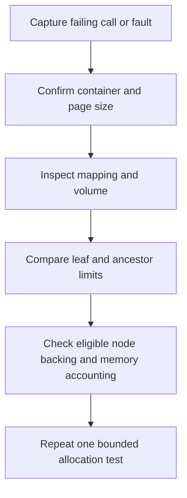

# Debug Huge-Page ENOMEM and SIGBUS Inside Kubernetes Pods

Author: [nawazdhandala](https://www.github.com/nawazdhandala)

Tags: Kubernetes, HugePages, Troubleshooting

Description: Diagnose huge-page allocation failures inside Pods by checking the failing call, container limits, parent cgroups, mount size, and eligible NUMA nodes.

A Pod can start successfully and still fail when its application tries to use huge pages. The worker may even show free pages at that moment. Scheduling establishes a resource assignment; the later memory operation must also satisfy the container's limits, the mapping's requirements, and the worker's allocation constraints.

The first useful question is where failure occurred. Did `mmap()` return `MAP_FAILED` with `ENOMEM`, or did it return an address and a later access receive `SIGBUS`? Those observations point to different stages and should not be merged into one “out of huge pages” message.

This guide uses **Kubernetes 1.34**, **Linux 6.12**, and a cgroup v2 diagnostic example. It concerns explicit HugeTLB pages, not automatic Transparent Huge Pages. Run investigations in the actual failing container or through an approved worker diagnostic session; a different container can have different limits and permissions.

## Preserve the failure context

Record the Pod UID, container name, node, timestamp, allocation length, requested page size, and exact system-call result. For a signal, capture the fault address and mapping information through your application's normal crash diagnostics. An allocation library's generic message may omit the distinction you need.

The [mmap manual](https://man7.org/linux/man-pages/man2/mmap.2.html) explains both mapping failures and `SIGBUS` when accessing beyond a mapped file's end. A successful mapping call is therefore not proof that every later access can obtain valid backing.

With read access to the Kubernetes API, inspect the stored container configuration:

```bash
namespace=analytics
pod=worker-0
container=engine

kubectl -n "$namespace" get pod "$pod" -o json |
  jq --arg name "$container" '.spec.containers[] |
      select(.name == $name) | {name, resources, volumeMounts, securityContext}'
kubectl -n "$namespace" describe pod "$pod"
```

Replace the names and check that the filter actually returns the intended container. Use the matching init-container entry if the failure happened during initialization.

Huge-page limits apply at container scope. A sibling container's request does not become this container's allocation allowance. The [Kubernetes huge-page guide](https://raw.githubusercontent.com/kubernetes/website/release-1.34/content/en/docs/tasks/manage-hugepages/scheduling-hugepages.md) documents that isolation and the requirement for requests and limits to agree.

## Check the mount and requested size

For a file-backed allocation, inspect the application's actual mount namespace. If the image contains util-linux, this read-only command shows the filesystem covering its huge-page directory:

```bash
findmnt --target /hugepages --output TARGET,FSTYPE,OPTIONS
```

Replace `/hugepages` with the application's mount path. Expect `hugetlbfs`; inspect its `pagesize` and any size ceiling. [`findmnt --target`](https://man7.org/linux/man-pages/man8/findmnt.8.html) finds the filesystem containing a path, so also confirm the returned target is the intended volume rather than an unexpected parent filesystem.

Compare three values: the application's page-size choice, the Pod's `hugepages-<size>` resource, and the volume's `HugePages-<size>` medium. A 2 MiB request and a 1 GiB mount are not interchangeable.

For a file-backed `SIGBUS`, verify the file was extended to cover the accessed range and was not subsequently truncated. Preserve the file offset as well as the mapping address. For anonymous `MAP_HUGETLB`, a filesystem mount is not the backing source, so do not spend the whole investigation changing volume mounts.

## Read the correct cgroup and its parents

A cgroup, or control group, is the kernel's resource-control boundary. First identify the application's actual cgroup directory from its process and the runtime's diagnostics. Do not construct it from a guessed Pod UID path: systemd and cgroupfs layouts differ.

Inside a container, `/proc/self/cgroup` can be relative to a private cgroup namespace. A reported `/` can mean the container's visible root, not the host's unrestricted root. The [cgroup namespace manual](https://man7.org/linux/man-pages/man7/cgroup_namespaces.7.html) explains this virtualization. Use the worker's initial cgroup namespace when you need to inspect ancestors hidden from the container.

Save this Python 3 helper as `read-limits.py`. It reads a resolved cgroup directory and walks upward only to the supplied mount root:

```python
import sys
from pathlib import Path

if len(sys.argv) != 4:
    raise SystemExit('usage: read-limits.py CGROUP_DIRECTORY MOUNT_ROOT SIZE_TOKEN')
leaf, root = (Path(value).resolve(strict=True) for value in sys.argv[1:3])
size = sys.argv[3]
if not size.isalnum() or not leaf.is_dir() or not root.is_dir():
    raise SystemExit('Use existing directories and a size token such as 2MB')
if leaf != root and root not in leaf.parents:
    raise SystemExit('Cgroup directory must be inside the supplied mount root')
names = [f'hugetlb.{size}.{suffix}' for suffix in
         ('current', 'max', 'events', 'events.local', 'rsvd.current', 'rsvd.max')]
names += ['memory.current', 'memory.max', 'memory.events']
current = leaf
while True:
    print(f'[{current}]')
    for name in names:
        try:
            value = (current / name).read_text().strip().replace('\n', '; ')
        except FileNotFoundError:
            value = '(not exposed)'
        print(f'{name}: {value}')
    if current == root:
        break
    current = current.parent
```

From the approved host diagnostic context, replace the example path with the directory you resolved:

```bash
python3 read-limits.py /sys/fs/cgroup/RESOLVED_CONTAINER_DIRECTORY     /sys/fs/cgroup 2MB
```

Use the kernel filename token, such as `2MB`, not the Kubernetes resource suffix `2Mi`. Confirm the cgroup v2 mount root on your node. The helper prints absent files instead of converting them to zero or infinity, and a permission error remains an error.

In the [Linux 6.12 HugeTLB controller implementation](https://raw.githubusercontent.com/torvalds/linux/v6.12/mm/hugetlb_cgroup.c), fault and reservation accounting have separate controls. Read the supported files rather than assuming all kernels expose identical reservation interfaces. A restrictive ancestor can matter even when the leaf's displayed maximum looks generous.

Take snapshots around one bounded staging reproduction. A rising size-specific `events` maximum-failure counter is evidence of a limit-related failure. An old nonzero counter alone does not identify the current crash. The [cgroup v2 interfaces](https://www.kernel.org/doc/html/v6.12/admin-guide/cgroup-v2.html#hugetlb) distinguish hierarchical events from local events.

For cgroup v1, use its documented `limit_in_bytes`, `usage_in_bytes`, and `failcnt` interfaces instead. The [v1 HugeTLB controller guide](https://www.kernel.org/doc/html/v6.12/admin-guide/cgroup-v1/hugetlb.html) describes reservation and fault accounting separately; the v2 helper is not a v1 path translator.

## Check eligible backing and ordinary memory accounting

A global free-page count does not describe which NUMA nodes can supply the allocation. NUMA means memory locality within the machine. On the worker, compare the relevant page-size pools per NUMA node with the application's allowed memory nodes and memory policy.

For an already-resolved host PID, this command shows the allowed-node list:

```bash
pid=12345  # Replace with the application's current host PID.
awk '/^Mems_allowed_list:/ {print}' "/proc/$pid/status"
```

The field is documented in [proc_pid_status](https://man7.org/linux/man-pages/man5/proc_pid_status.5.html). It is an eligibility constraint, not a full description of the process's NUMA policy. Free pages on an excluded node may not help.

Linux 6.12 also has an opt-in cgroup v2 mount option, `memory_hugetlb_accounting`. When enabled, failure to charge used HugeTLB memory to the ordinary memory controller can cause `SIGBUS` despite available pool pages. Inspect mount options and the relevant memory limits/events; do not assume every cluster enables this behavior. See the [cgroup mount-option documentation](https://www.kernel.org/doc/html/v6.12/admin-guide/cgroup-v2.html#mounting).



## Correct the cause through the workload configuration

If the demonstrated cause is a too-small container allowance, change the owning workload's resource configuration and plan its rollout. Do not write directly into kubelet-managed cgroup files as a persistent fix.

If the error is `EPERM` from a HugeTLB operation, investigate the documented permission or group requirements instead of relabeling it as `ENOMEM`. For example, [shmget](https://man7.org/linux/man-pages/man2/shmget.2.html) documents its HugeTLB authorization checks. Avoid making the entire Pod privileged to bypass an unidentified failure.

Finally, repeat the application's actual allocation and page-touch sequence with the same size and limits. Retain before/after evidence and verify normal application behavior. Starting a container or creating an empty file is insufficient proof.

The limit-reader helper was tested with synthetic leaf and ancestor directories, missing controls, and an invalid boundary. Shell syntax and JSON extraction were checked. No live Pod, cgroup charge, NUMA allocation, or signal reproduction was performed for this article.
