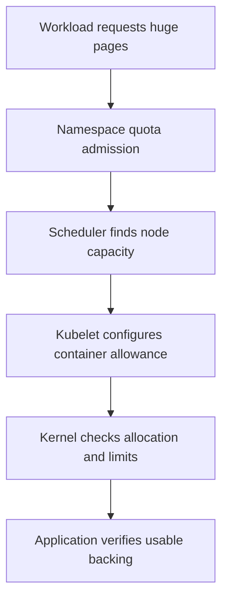

# Enforce Kubernetes Huge-Page Quotas and Container Limits

Author: [nawazdhandala](https://www.github.com/nawazdhandala)

Tags: Kubernetes, HugePages, Resource Management

Description: Combine namespace ResourceQuota with explicit container huge-page limits, test admission failures, and verify runtime enforcement without confusing the layers.

A team budget and a container memory limit solve different problems. ResourceQuota limits how much huge-page capacity a namespace may request. A container's resource limit constrains its own runtime allowance. Neither creates physical huge pages on a node.

A reliable policy uses all three layers: namespace admission, node scheduling, and kernel enforcement. If you inspect only the namespace quota, an admitted Pod may still have nowhere to run. If you inspect only the host pool, you may miss an exhausted team budget.

This guide uses **Kubernetes 1.34** and a Linux cgroup v2 inspection example. It keeps huge-page settings at container scope and does not use Pod-level resource settings.

## Identify which layer rejected the workload

| Observation | Relevant layer | Evidence to inspect |
| --- | --- | --- |
| Pod creation returns quota-related Forbidden | Namespace admission | ResourceQuota hard and used values |
| Pod exists but has no node assignment | Scheduler | Pod events and candidate Node allocatable resources |
| Container starts but allocation fails | Runtime/kernel | Container limits, ancestors, backing pool, exact memory error |

The [ResourceQuota guide](https://raw.githubusercontent.com/kubernetes/website/release-1.34/content/en/docs/concepts/policy/resource-quotas.md) describes quota rejection as an admission failure. A Deployment can still exist when creation of one of its Pods is rejected. Inspect the owning controller's events when no expected Pod appears.



## Set a namespace budget per page size

In an existing dedicated staging namespace, save the following as `quota.yaml`:

```yaml
apiVersion: v1
kind: ResourceQuota
metadata:
  name: hugepage-budget
spec:
  hard:
    hugepages-2Mi: 128Mi
    hugepages-1Gi: 0
```

This allows 128 MiB of aggregate requests for 2 MiB pages and blocks positive requests for 1 GiB pages. The quantity is bytes of backing, not a count of pages: 128 MiB represents 64 pages of 2 MiB each.

Use the documented `hugepages-<size>` quota keys. The [1.34 quota evaluator](https://raw.githubusercontent.com/kubernetes/kubernetes/v1.34.0/pkg/quota/v1/evaluator/core/pods.go) tracks huge-page requests for each size. Omitted sizes are not automatically denied by this two-entry policy; inventory the sizes your cluster exposes and state the intended allowance for each.

Apply and inspect the budget:

```bash
namespace=hugepage-quota-test
kubectl -n "$namespace" apply -f quota.yaml
kubectl -n "$namespace" describe resourcequota hugepage-budget
```

Wait for the quota's status to show its hard and used values before exercising the workload. In a normal cluster, quota reconciliation maintains this status. Do not manually edit quota status as an operational workaround.

A namespace budget is a maximum, not a reservation on a worker. Setting it to 128 MiB does not carve out a private pool, and several namespaces can have budgets whose sum exceeds available physical capacity. Decide whether that is acceptable for your availability requirements.

## Declare the application's own allowance

Save this as `worker.yaml`. Replace the image with your approved huge-page application image and adapt its entrypoint if needed; the registry reference is a placeholder, not a published test image:

```yaml
apiVersion: v1
kind: Pod
metadata:
  name: hp-worker-1
spec:
  automountServiceAccountToken: false
  restartPolicy: Never
  containers:
    - name: worker
      image: registry.example.com/hugepage-app:replace-me
      resources:
        requests:
          cpu: 100m
          memory: 128Mi
          hugepages-2Mi: 64Mi
        limits:
          memory: 128Mi
          hugepages-2Mi: 64Mi
      volumeMounts:
        - name: pages
          mountPath: /hugepages
  volumes:
    - name: pages
      emptyDir:
        medium: HugePages-2Mi
```

The container requests and limits 64 MiB of 2 MiB huge pages, or 32 pages. Ordinary memory and CPU are declared separately. The explicit volume medium matches the requested page size.

The [Kubernetes huge-page documentation](https://raw.githubusercontent.com/kubernetes/website/release-1.34/content/en/docs/tasks/manage-hugepages/scheduling-hugepages.md) requires huge-page requests to equal limits and documents container-level isolation. Do not give a sidecar an allowance and expect the main application to borrow it. For multi-container or init-container designs, inspect the effective Pod request instead of multiplying one container's value by the replica count without checking the rest of the Pod.

## Exercise admission without pretending it tests allocation

In the empty staging namespace, create the first worker and inspect quota usage:

```bash
kubectl -n "$namespace" create -f worker.yaml
kubectl -n "$namespace" describe resourcequota hugepage-budget
```

Create two additional manifest copies with only `metadata.name` changed to `hp-worker-2` and `hp-worker-3`. With no other consuming Pods, the second 64 MiB request fits the 128 MiB budget; the third should be rejected for exceeding it.

The test measures admission. A Pending Pod can consume quota even though it has not allocated any physical pages. In a local Kubernetes 1.34 API/etcd test, two unscheduled 64 MiB Pods were admitted, quota usage reached 128 MiB, and the third creation returned Forbidden with an exceeded-quota message.

That test had no quota controller, so its harness initialized quota status before admissions. It did not reproduce controller reconciliation, scheduling, or runtime enforcement. In a real cluster, use the controller-managed status and events.

Keep the namespace clean and use unique names when repeating the test. An AlreadyExists error is not a quota result. Other admission policies can also reject a Pod first; read the actual response instead of assuming every Forbidden message came from ResourceQuota.

## Verify what the node enforces

For an admitted, running container, identify its actual cgroup through approved node/runtime diagnostics. Do not guess the directory from a Pod name. Once resolved in the host's cgroup namespace, inspect it read-only:

```bash
cgdir=/sys/fs/cgroup/RESOLVED_CONTAINER_DIRECTORY
for name in hugetlb.2MB.current hugetlb.2MB.max             hugetlb.2MB.events hugetlb.2MB.events.local; do
    if [ -r "$cgdir/$name" ]; then
        printf '%s: ' "$name"
        cat "$cgdir/$name"
    fi
done
```

Replace the directory before running. Kernel filenames use `2MB`; Kubernetes resource names use `2Mi`. A 64 MiB configured limit corresponds to 67108864 bytes. Check ancestor limits as well, and investigate missing controller files rather than interpreting them as unlimited access.

The [kubelet's Linux resource configuration](https://raw.githubusercontent.com/kubernetes/kubernetes/v1.34.0/pkg/kubelet/kuberuntime/kuberuntime_container_linux.go) passes huge-page limits to the container runtime. The [cgroup v2 HugeTLB controller](https://www.kernel.org/doc/html/v6.12/admin-guide/cgroup-v2.html#hugetlb) exposes usage, maxima, and limit-failure events. Capture event deltas around a bounded application allocation test; a historical counter is not attribution to the current failure.

For these container-scoped settings, unrequested page sizes should not be assumed available merely because a node has free pages. Conversely, a correctly configured limit cannot ensure a particular allocation succeeds: page size, permissions, memory policy, and backing availability still matter.

## Leave room for rollouts and policy changes

With two 64 MiB replicas, the 128 MiB quota is fully committed. A rollout that temporarily creates a third replica needs another 64 MiB of request budget. Plan the rollout's overlap deliberately rather than discovering that constraint during an upgrade. Check both namespace budget and schedulable node capacity before raising the allowance.

Lowering a quota does not evict already-created Pods or rewrite their container limits. Changing a workload template also needs the appropriate rollout before replacement containers use the new settings. The [quota documentation](https://raw.githubusercontent.com/kubernetes/website/release-1.34/content/en/docs/concepts/policy/resource-quotas.md) makes the existing-resource distinction explicit.

Protect quota administration through the cluster's authorization policy, monitor hard versus used quantities, and keep runtime failure events separate from admission failures. The useful success criterion is not simply “quota applied”; it is a demonstrated team budget plus a verified application allowance on suitable nodes.

The admission sequence was tested against a local Kubernetes 1.34 API server and etcd. YAML and shell syntax were checked. No node scheduling, cgroup enforcement, or real HugeTLB allocation was tested.
