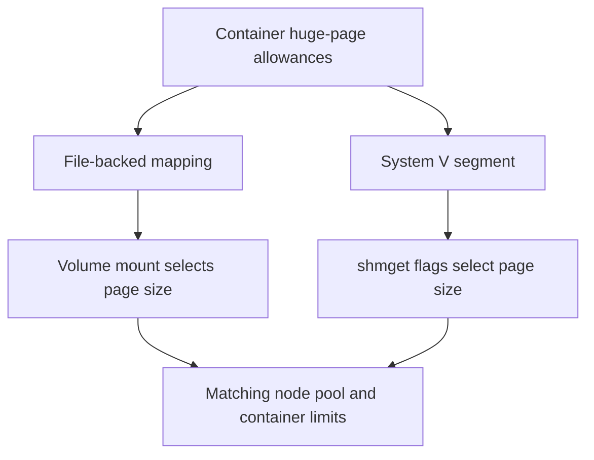

# Use Kubernetes Huge Pages with mmap, shmget, and Two Sizes

Author: [nawazdhandala](https://www.github.com/nawazdhandala)

Tags: Kubernetes, HugePages, Linux

Description: Configure explicit huge-page sizes in Kubernetes and compare file-backed mmap with System V SHM_HUGETLB, including group permissions and cleanup.

A Kubernetes huge-page request supplies a resource allowance. It does not choose an application's memory API. A program can map a file on a hugetlbfs volume, or create a System V HugeTLB shared-memory segment. Those paths share the node's backing pools but differ in how the application selects the size, obtains permission, and releases the allocation.

This staging walkthrough targets **Kubernetes 1.34** and **Linux 6.12**, using 2 MiB and 1 GiB pools. It gives each file-backed size its own volume and uses a separate 2 MiB System V probe. Run the probes sequentially so their allocations do not compete unnecessarily.

## Prepare the node and application image

Eligible workers need both pools preallocated and reported in Node capacity. Verify `hugepages-2Mi` and `hugepages-1Gi` before creating the Pod. The [Kubernetes 1.34 guide](https://raw.githubusercontent.com/kubernetes/website/release-1.34/content/en/docs/tasks/manage-hugepages/scheduling-hugepages.md) requires equal requests and limits, disallows huge-page overcommit, and requires explicit volume sizes when multiple sizes are requested.

The sample image below is a **placeholder in your private registry**, not a published image to pull. Replace it with an approved image containing Python 3.12 and, for the System V test, the compiled `shm-probe` program shown later. Use your deployment's reviewed image digest before applying the manifest.

This example assumes the optional Linux `memory_hugetlb_accounting` mode is disabled. If your nodes enable it, budget ordinary memory limits for the charged HugeTLB use as well; the illustrated 128 MiB ordinary-memory allowance would not cover a 1 GiB charge. See [cgroup v2 mount options](https://www.kernel.org/doc/html/v6.12/admin-guide/cgroup-v2.html#mounting).

For the System V path, arrange an approved supplemental group matching each eligible node's `/proc/sys/vm/hugetlb_shm_group`. The example uses **3000 only as a replacement value**. Check it on the node; do not change host authorization just to match the example. File-backed mapping also needs appropriate directory/file access.

## Declare one volume per page size

Save this as `hugepage-lab.yaml`, replace the image and group, and use an existing staging namespace:

```yaml
apiVersion: v1
kind: Pod
metadata:
  name: hugepage-lab
spec:
  restartPolicy: Never
  automountServiceAccountToken: false
  securityContext:
    runAsUser: 10001
    runAsGroup: 10001
    runAsNonRoot: true
    fsGroup: 10001
    supplementalGroups: [3000]
    seccompProfile:
      type: RuntimeDefault
  containers:
    - name: probe
      image: registry.example.com/platform/python:3.12.8
      command: [python3, -c, 'import time; time.sleep(3600)']
      securityContext:
        allowPrivilegeEscalation: false
        capabilities:
          drop: [ALL]
      resources:
        requests:
          cpu: 100m
          memory: 128Mi
          hugepages-2Mi: 64Mi
          hugepages-1Gi: 1Gi
        limits:
          memory: 128Mi
          hugepages-2Mi: 64Mi
          hugepages-1Gi: 1Gi
      volumeMounts:
        - name: small
          mountPath: /hugepages-2Mi
        - name: large
          mountPath: /hugepages-1Gi
  volumes:
    - name: small
      emptyDir:
        medium: HugePages-2Mi
    - name: large
      emptyDir:
        medium: HugePages-1Gi
```

The 64 MiB small-page allowance represents 32 pages, while the 1 GiB allowance represents one large page. The command merely keeps the container available for inspection; it does not prove that either pool can be used.

`fsGroup` handles supported volume access, whereas `supplementalGroups` supplies group membership for the System V permission check. These are different responsibilities even if a deployment uses the same numeric group for both. The [security-context documentation](https://kubernetes.io/docs/tasks/configure-pod-container/security-context/) explains their placement in the Pod specification.

Check the prepared manifest and then create it in the selected staging namespace:

```bash
kubectl -n hugepage-test apply --dry-run=server -f hugepage-lab.yaml
kubectl -n hugepage-test apply -f hugepage-lab.yaml
kubectl -n hugepage-test describe pod hugepage-lab
```

Do not interpret dry-run success as a scheduling or mount test. In a local Kubernetes 1.34 API test, the explicit two-size manifest passed and unequal requests/limits were rejected. An intentionally ambiguous generic `HugePages` medium also passed API validation. The [node's emptyDir implementation](https://raw.githubusercontent.com/kubernetes/kubernetes/v1.34.0/pkg/volume/emptydir/empty_dir.go) performs the later multi-size check, which is why the explicit media are necessary.

## Map a file on each hugetlbfs volume

Save this as `file-probe.py` on your workstation:

```python
import mmap
import os
import sys
import tempfile

if len(sys.argv) != 3:
    raise SystemExit('usage: file-probe.py MOUNT_DIRECTORY PAGE_BYTES')
length = int(sys.argv[2])
if length not in (2 * 1024**2, 1024**3):
    raise SystemExit('This example accepts 2 MiB or 1 GiB only')
with tempfile.TemporaryFile(dir=sys.argv[1]) as backing:
    os.ftruncate(backing.fileno(), length)
    with mmap.mmap(backing.fileno(), length, flags=mmap.MAP_SHARED,
                   prot=mmap.PROT_READ | mmap.PROT_WRITE) as region:
        region[0] = 37
        region[length - 1] = 91
        assert region[0] == 37 and region[length - 1] == 91
        print(f'Mapped and touched {length} bytes through {sys.argv[1]}')
```

The file is created on the chosen volume, extended before mapping, and removed automatically when closed. [`TemporaryFile`](https://docs.python.org/3.12/library/tempfile.html) provides that lifetime; Python's [mmap interface](https://docs.python.org/3.12/library/mmap.html) supplies the shared writable mapping.

Once the container is running, execute each probe separately:

```bash
kubectl -n hugepage-test exec -i hugepage-lab --     python3 - /hugepages-2Mi 2097152 < file-probe.py
kubectl -n hugepage-test exec -i hugepage-lab --     python3 - /hugepages-1Gi 1073741824 < file-probe.py
```

The expected message confirms a mapping and endpoint writes, not just file creation. Inspect the actual volume filesystem and size during your staging review. Running this script on an ordinary filesystem can also succeed, so its output alone does not prove HugeTLB backing.

Here the hugetlbfs mount selects the page size. The mapping does not need to add `MAP_HUGETLB` to select that backing. This differs from an anonymous HugeTLB mapping, where the application supplies the corresponding flags. The [Linux HugeTLB guide](https://www.kernel.org/doc/html/v6.12/admin-guide/mm/hugetlbpage.html) describes file-backed use.

## Create and release a System V segment

System V shared memory uses a segment identifier rather than a pathname. It does not consume the mounted emptyDir file merely because that volume exists. The program must select HugeTLB and the page size itself.

Build this `shm-probe.c` for the image's Linux architecture and C runtime:

```c
#define _GNU_SOURCE
#include <sys/shm.h>
#include <stdio.h>
#ifndef SHM_HUGE_2MB
#define SHM_HUGE_2MB (21U << 26)
#endif
int main(void) {
    const size_t length = (size_t)2 * 1024 * 1024;
    int id = shmget(IPC_PRIVATE, length, 0600 | SHM_HUGETLB | SHM_HUGE_2MB);
    if (id == -1) { perror("shmget"); return 1; }
    void *address = shmat(id, NULL, 0);
    if (address == (void *)-1) {
        perror("shmat");
        if (shmctl(id, IPC_RMID, NULL) == -1) perror("IPC_RMID");
        return 1;
    }
    if (shmctl(id, IPC_RMID, NULL) == -1) {
        perror("IPC_RMID");
        if (shmdt(address) == -1) perror("shmdt");
        fprintf(stderr, "Check segment %d for cleanup.\n", id);
        return 1;
    }
    volatile unsigned char *bytes = address;
    bytes[0] = 37;
    bytes[length - 1] = 91;
    printf("Touched one 2 MiB System V HugeTLB segment.\n");
    if (shmdt(address) == -1) { perror("shmdt"); return 1; }
    return 0;
}
```

For a Linux build environment with a matching compiler:

```bash
cc -std=c11 -Wall -Wextra -Werror shm-probe.c -o shm-probe
```

Include that executable at `/app/shm-probe` in the reviewed image, then invoke it in the same Pod:

```bash
kubectl -n hugepage-test exec hugepage-lab -- /app/shm-probe
```

`IPC_PRIVATE` requests a new segment; permissions `0600` restrict access to its owner. `SHM_HUGETLB` and the size encoding are specified by [shmget](https://man7.org/linux/man-pages/man2/shmget.2.html). The configured group permits HugeTLB creation without making the container privileged. A denied call must be diagnosed from its actual error, group membership, and applicable security policy.

After [shmat](https://man7.org/linux/man-pages/man2/shmat.2.html) attaches the segment, the program marks its own segment for deletion. [IPC_RMID](https://man7.org/linux/man-pages/man2/shmctl.2.html) removes it once the last attachment is gone. Marking it before touching memory also avoids leaving this test segment behind if a later memory access terminates the process. This lifecycle suits a private probe; a multi-process application must coordinate segment discovery and lifetime deliberately.



## Keep the evidence specific

Record the requested size, observed backing, successful writes, and cleanup for each API separately. A successful 2 MiB file test does not establish that 1 GiB allocation or System V authorization works. Preserve a failed test's exact return value or signal instead of increasing every limit at once.

The Pod underwent local API dry-run tests, the Python file lifecycle ran on ordinary macOS files at both lengths, and the C program compiled to a Linux x86-64 object with strict warnings. No Linux HugeTLB mapping, container execution, or System V allocation was performed. Those remaining checks require the prepared staging worker.
