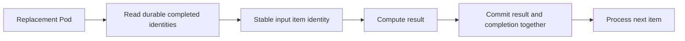

# Make Kubernetes Jobs Recover Safely from Preemption

Author: [nawazdhandala](https://www.github.com/nawazdhandala)

Tags: Kubernetes, Batch Processing, Reliability

Description: Combine durable checkpoints, duplicate-safe work, and Pod failure policies so Kubernetes Job retries recover progress without repeating harmful side effects.

A Job controller can replace an interrupted Pod, but it cannot know whether the old process committed a payment, uploaded half a file, or finished a batch without recording its checkpoint. Restarting the process is only the infrastructure half of recovery.

A recoverable batch job needs three things: durable evidence of completed work, safe repetition when completion is uncertain, and a retry policy that distinguishes disruption from a genuine application failure. None of these alone provides exactly-once execution.

This guide uses **Kubernetes 1.34.0** Job APIs. The small persistence example uses Python's standard `sqlite3` module to illustrate a transaction boundary; it is not a recommendation to share a SQLite database across arbitrary network filesystems or distributed workers.

## Decide what one unit of work means

Give each input item a stable identifier tied to a specific input version. A Pod UID is unsuitable because a replacement Pod has a different UID. An item number without an input-version identifier is also unsafe if a later run changes what that number represents.

For a report generator, one unit could be “customer 123 for input snapshot 2026-11-20.” Record whether that unit's result is durably committed. A replacement process should use the same identity to detect completed work and resume missing items.

A checkpoint on the container's writable layer or an `emptyDir` volume does not survive replacement as a durable workflow record. Use an appropriate database, object store protocol, or persistent storage with verified durability and access semantics.



If the result and checkpoint live in different systems, there is a failure window between the two writes. Design that window explicitly rather than hiding it behind a longer termination grace period.

## Make repetition harmless

Idempotent processing means repeating the same logical operation does not create a second harmful effect. A transaction can provide this for a result and completion record stored together.

Here is a local illustration for Python 3.11 or later with SQLite supporting `ON CONFLICT` syntax. It stores the result itself as the completion record:

```python
import sqlite3


def store_result(db, item_key, result):
    with db:
        db.execute(
            "INSERT INTO completed(item_key, result) VALUES (?, ?) "
            "ON CONFLICT(item_key) DO NOTHING",
            (item_key, result),
        )
        existing = db.execute(
            "SELECT result FROM completed WHERE item_key = ?",
            (item_key,),
        ).fetchone()[0]
        if existing != result:
            raise ValueError("same item key produced a different result")


def open_store(path):
    db = sqlite3.connect(path, timeout=30)
    db.execute(
        "CREATE TABLE IF NOT EXISTS completed "
        "(item_key TEXT PRIMARY KEY, result TEXT NOT NULL)"
    )
    db.commit()
    return db
```

Use `open_store()` with a dedicated test database, then call `store_result()` with a stable key and deterministic result. Repeating the same pair leaves one row. Reusing the key with a different result raises an error instead of silently hiding inconsistent input or code behavior. Close the connection when finished.

Python's [connection context manager](https://docs.python.org/3.13/library/sqlite3.html#how-to-use-the-connection-context-manager) commits successful transactions and rolls back exceptions under this transaction mode. SQLite's [UPSERT documentation](https://www.sqlite.org/lang_upsert.html) explains the targeted uniqueness conflict behavior.

This example does not cover external side effects. If processing calls a remote API, use that API's documented idempotency mechanism or an application-specific transactional delivery design. Writing “done” after a remote operation cannot by itself prevent the operation from happening twice after a crash.

## Keep disruption out of the application failure budget

The following Job is a configuration template for a worker that already implements durable recovery. Replace the image with your reviewed, pinned worker build and provide its required backend configuration through your normal deployment process. `/app/worker` is an application-specific executable, not a Kubernetes-provided command.

```yaml
apiVersion: batch/v1
kind: Job
metadata:
  name: resumable-batch-example
  namespace: batch-test
spec:
  completions: 1
  parallelism: 1
  backoffLimit: 3
  activeDeadlineSeconds: 3600
  podReplacementPolicy: Failed
  podFailurePolicy:
    rules:
      - action: Ignore
        onPodConditions:
          - type: DisruptionTarget
            status: "True"
  template:
    spec:
      restartPolicy: Never
      terminationGracePeriodSeconds: 60
      containers:
        - name: worker
          image: registry.example.com/batch/worker:REPLACE_WITH_REVIEWED_VERSION
          command: ["/app/worker"]
          resources:
            requests:
              cpu: "500m"
              memory: "256Mi"
            limits:
              cpu: "1"
              memory: "512Mi"
```

The `Ignore` rule means a matching failed Pod does not consume the Job's backoff failure count. It does not mark the Job successful or prevent the Pod from being disrupted. Failures that do not match remain subject to ordinary counting. The [Pod failure policy task](https://kubernetes.io/docs/tasks/job/pod-failure-policy/) describes this pattern.

The condition matcher uses type and status, not a reason field. This rule therefore covers matching disruptions beyond scheduler preemption. Decide whether that broader behavior fits your job. The [1.34.0 policy implementation](https://github.com/kubernetes/kubernetes/blob/v1.34.0/pkg/controller/job/pod_failure_policy.go) shows how matching rules affect counting.

`restartPolicy: Never` is required for this policy. `podReplacementPolicy: Failed` makes the replacement timing explicit, and the one-hour active deadline bounds the run even when repeated disruptions are ignored. These settings do not remove the application's need to tolerate duplicate starts. Review the [Job documentation](https://kubernetes.io/docs/concepts/workloads/controllers/job/) for controller behavior and deadlines.

## Treat graceful shutdown as an optimization

On termination, a worker can stop accepting new items and finish or abandon its current transaction within the configured grace period. That reduces rework, but recovery must remain correct when no graceful handler runs.

A node failure, forced termination, or process crash can interrupt work between any two instructions. Periodic durable progress reduces lost effort; a shutdown-only checkpoint does not protect those cases. Choose checkpoint granularity according to acceptable replay cost and persistence overhead.

Do not use the example's sixty seconds as an unmeasured production setting. Measure the longest safe unit of work and its cleanup time. Large uninterruptible units may need to be split rather than given an ever-longer shutdown interval.

## Test the uncertainty windows

In staging, test interruption before commit, immediately after commit, and before the worker reports success. Confirm that replacement workers retain every committed result, replay incomplete work safely, and reject incompatible input versions.

Also test an ordinary application error without a disruption condition. It should not disappear into the disruption exception. Verify deadline behavior and alerting for a Job that keeps restarting without advancing durable progress.

The local persistence checks repeated identical writes, rejected conflicting results, and reopened the database to verify committed state. The Job template passed Kubernetes 1.34.0 schema checks. No live Job controller, preemption, storage durability failure, or external side-effect test was run. A successful retry policy is useful only when the worker can resume without losing completed work or duplicating its effects.
