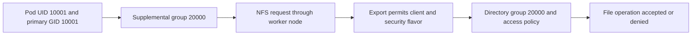

# Fix Kubernetes NFS Permission Denied with UID, GID, and fsGroup

Author: [nawazdhandala](https://www.github.com/nawazdhandala)

Tags: Kubernetes, NFS, File Permissions

Description: Diagnose Kubernetes NFS access failures by checking export rules, numeric identities, supplemental groups, and server ownership while retaining root squashing.

An NFS permission error can happen before the container starts or when the application opens a file. Those are different failure paths. Adding `fsGroup` cannot repair an export that refuses the node, and running a container as root cannot reliably repair ownership on a root-squashed export.

This example uses Kubernetes 1.34 semantics, a static NFS PersistentVolume, NFSv4.1 with `sec=sys`, and a preconfigured staging directory. It is a reference configuration, not a claim that these are the newest releases. Kerberos-protected NFS and storage appliances with identity-mapping policies need their own identity review.

## Locate the failure before changing permissions

| Evidence | Likely boundary to inspect | Useful question |
| --- | --- | --- |
| Pod events show mount access denied | Export path, permitted clients, security flavor | Does the server permit the node's actual source address? |
| Container runs but cannot create a file | Process identity, directory mode, ACLs | Which numeric user and groups reach the server? |
| Root init container cannot change ownership | Root squashing and server policy | Should ownership be prepared on the server instead? |
| Reads work but writes fail | Read-only settings or write permissions | Is the export, PV, mount, or directory read-only? |

A UID is a numeric user identifier; a GID is a numeric group identifier. With the reference `sec=sys` setup, numeric identities matter more than matching account names inside the image and on the server. This security flavor assumes an appropriately trusted client environment; it is not strong user authentication by itself.

The server's [export rules](https://man7.org/linux/man-pages/man5/exports.5.html) determine permitted clients and options such as read-only access and root squashing. `root_squash` maps client root identities to the configured anonymous identity. Preserve that boundary instead of treating `no_root_squash` as a general application fix.

## Prepare a narrow server-side test directory

Have the storage administrator provision a new, dedicated staging directory with numeric owner `0`, group `20000`, and mode `2770`, plus the required traversal permissions. In this example, the group receives directory read, write, and search access; the set-group-ID bit makes new entries inherit the directory's group. Review ACLs as well as mode bits.

Expose it through the approved NFSv4 export namespace with read-write access for the relevant worker nodes, keeping root squashing enabled. The client-visible export path can differ from the server's physical directory path. Confirm both rather than copying one into the other blindly.

On a Linux NFS server, an administrator can inspect the physical directory and active exports without changing them:

```bash
stat -c '%u:%g %a %n' /srv/nfs/kube-permission-lab
exportfs -v
```

For the stated fixture, the first command should show `0:20000 2770` before the path. [GNU stat](https://man7.org/linux/man-pages/man1/stat.1.html) documents these numeric fields; [exportfs](https://man7.org/linux/man-pages/man8/exportfs.8.html) documents the listing mode. Managed NAS platforms may expose equivalent evidence through their own administration interface.

Do not recursively change an existing production tree to match this lab. Inventory its ownership and access policy first, then make a reviewed correction to the specific resource.

## Understand the two roles often attributed to fsGroup

At the Pod level, `runAsUser` sets the process UID and `runAsGroup` sets its primary GID. `fsGroup` supplies a group for volume access. Ownership-changing behavior depends on the volume implementation; it is not a universal recursive repair operation.

For this exact reference, the [Kubernetes v1.34.0 built-in NFS implementation](https://github.com/kubernetes/kubernetes/blob/v1.34.0/pkg/volume/nfs/nfs.go) mounts the export in `SetUpAt` without a recursive ownership change. The example therefore relies on server-side group ownership already being correct.

CSI, the Container Storage Interface, is a different path. A driver advertising `VOLUME_MOUNT_GROUP` handles the requested mount group itself; Kubernetes does not perform that ownership change and `fsGroupChangePolicy` does not take effect there. Check the driver's capabilities rather than assuming built-in NFS behavior. See the [versioned security-context guide](https://v1-34.docs.kubernetes.io/docs/tasks/configure-pod-container/security-context/).



## Use a non-root probe with explicit storage binding

Prerequisites are an existing approved namespace named `nfs-permission-lab`, working NFS client support on the nodes, and administrator authorization to create the static PV. Replace documentation address `192.0.2.10` and `/kube-permission-lab` with the verified server and client-visible export path.

Save this as `nfs-probe.yaml`. The image uses the versioned [official BusyBox 1.37.0 image](https://github.com/docker-library/official-images/blob/master/library/busybox). For an immutable deployment, resolve and approve the appropriate image digest in your environment.

```yaml
apiVersion: v1
kind: PersistentVolume
metadata:
  name: nfs-permission-lab
spec:
  capacity:
    storage: 1Gi
  accessModes: [ReadWriteMany]
  persistentVolumeReclaimPolicy: Retain
  storageClassName: ""
  claimRef:
    namespace: nfs-permission-lab
    name: data
  mountOptions: [nfsvers=4.1, sec=sys]
  nfs:
    server: 192.0.2.10
    path: /kube-permission-lab
---
apiVersion: v1
kind: PersistentVolumeClaim
metadata:
  name: data
  namespace: nfs-permission-lab
spec:
  accessModes: [ReadWriteMany]
  storageClassName: ""
  volumeName: nfs-permission-lab
  resources:
    requests:
      storage: 1Gi
---
apiVersion: v1
kind: Pod
metadata:
  name: nfs-permission-probe
  namespace: nfs-permission-lab
spec:
  restartPolicy: Never
  automountServiceAccountToken: false
  securityContext:
    runAsNonRoot: true
    runAsUser: 10001
    runAsGroup: 10001
    fsGroup: 20000
    seccompProfile:
      type: RuntimeDefault
  containers:
    - name: probe
      image: busybox:1.37.0
      command: [sh, -ec]
      args:
        - |
          id
          ls -ldn /data
          probe=$(mktemp /data/probe.XXXXXX)
          printf 'nfs-permission-probe\n' > "$probe"
          cat "$probe"
          ls -ln "$probe"
      securityContext:
        allowPrivilegeEscalation: false
        readOnlyRootFilesystem: true
        capabilities:
          drop: [ALL]
      volumeMounts:
        - name: data
          mountPath: /data
  volumes:
    - name: data
      persistentVolumeClaim:
        claimName: data
```

A PersistentVolume describes the shared storage; a PersistentVolumeClaim requests it. The explicit binding and empty storage-class name avoid accidentally provisioning unrelated storage. `Retain` preserves the backing resource after claim release. The `1Gi` declaration is matching capacity metadata, not an NFS server quota. See [PersistentVolumes](https://v1-34.docs.kubernetes.io/docs/concepts/storage/persistent-volumes/).

The probe uses [BusyBox utilities](https://busybox.net/downloads/BusyBox.html) to print its identity, display numeric ownership, create a unique file, and read it back. Its container root filesystem is read-only, but the mounted data volume is writable. It needs no privileged container or root init container.

## Validate configuration, then observe the actual access

With the namespace already present, use an authorized staging context:

```bash
kubectl apply --dry-run=server -f nfs-probe.yaml
kubectl apply -f nfs-probe.yaml
kubectl describe pod nfs-permission-probe -n nfs-permission-lab
kubectl logs nfs-permission-probe -n nfs-permission-lab
```

The [server dry run](https://kubernetes.io/docs/reference/kubectl/generated/kubectl_apply/) checks API handling and admission without persisting the objects. It does not mount NFS or test permissions. After the real apply, [Pod description](https://kubernetes.io/docs/reference/kubectl/generated/kubectl_describe/) exposes scheduling and mount events; [logs](https://kubernetes.io/docs/reference/kubectl/generated/kubectl_logs/) expose the container's checks once it runs.

Expected evidence includes UID `10001`, primary group `10001`, group `20000` in the process's groups, the intended directory ownership, and the printed marker `nfs-permission-probe`. A successful Pod completion establishes that this identity could create and reread its own fixture file. It does not prove other users can read it: `mktemp` intentionally creates a restrictive file.

The manifest passed local checks against the Kubernetes v1.34.0 OpenAPI schema, including binding relationships and shell syntax. No cluster apply, container run, or NFS access was executed for this article.

## Resolve the remaining denial at its actual layer

If the mount fails, check the export's client allowlist, actual node egress identity, NFSv4 path, and security flavor. Container UID changes happen too late to repair that mount-level refusal.

If the process lacks group `20000`, inspect the admitted Pod configuration and runtime identity. Container-level settings can override overlapping process settings, and admission policies may constrain requested IDs. Use the observed identity rather than assuming the submitted YAML took effect unchanged.

If IDs and basic mode bits look correct, inspect access ACLs, read-only settings, server identity mapping, and node security-policy denials. An access failure is not justification to disable those controls globally. For existing files, verify their own permissions as well as the parent directory; group-writable creation does not guarantee every old file is writable.

After a targeted correction, rerun the probe and then the real application's required operations. Keep its retained test file and storage objects until evidence is reviewed, then clean up only those assigned fixtures. The durable fix is agreement between process identity, server ownership, and export policy, not a container that happens to run with more privilege.
