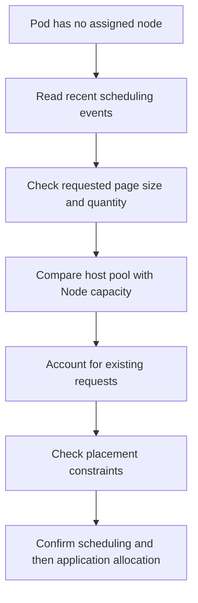

# Fix Pending Kubernetes Pods After Adding Huge Pages

Author: [nawazdhandala](https://www.github.com/nawazdhandala)

Tags: Kubernetes, HugePages, Troubleshooting

Description: Trace huge-page scheduling failures from host pools through kubelet capacity reporting, existing requests, and placement constraints before changing a Pod.

You reserve more huge pages on a worker, confirm that Linux reports them, and expect a waiting Pod to start. Instead, its events still say `Insufficient hugepages-2Mi`.

The missing link may be capacity reporting. Kubernetes does not schedule a Pod by reading the worker's current `free_hugepages` file. It uses the Node information reported to the API and the resource requests already assigned to that node. Adding physical pages addresses only one part of that chain.

This walkthrough follows **Kubernetes 1.34** and preallocated Linux HugeTLB pages. Transparent Huge Pages, or THP, are a different mechanism and do not create Kubernetes `hugepages-2Mi` capacity. Start with evidence from the failing Pod, then compare the host and Kubernetes views.

## Establish whether scheduling is actually blocked

Use a configured Kubernetes context and permission to read Pods, events, and Nodes. Replace these example names with your own:

```bash
namespace=analytics
pod=worker-0
node=worker-a

kubectl -n "$namespace" get pod "$pod" -o wide
kubectl -n "$namespace" describe pod "$pod"
kubectl -n "$namespace" get pod "$pod" -o json > pending-pod.json
```

The describe output includes recent events, as recommended by the [Pod debugging guide](https://raw.githubusercontent.com/kubernetes/website/release-1.34/content/en/docs/tasks/debug/debug-application/debug-pods.md). Record the message and timestamp, not just the word Pending.

Check whether `.spec.nodeName` is empty. An unassigned Pod with a recent `FailedScheduling` event belongs in this investigation. A Pod already assigned to a node but waiting for an image or volume needs a different diagnosis. Adding huge pages does not repair an image pull failure.

Also read the whole scheduling message. It can describe different reasons on different nodes: one lacks huge pages, another fails affinity, and a third is unschedulable. There may be no single node satisfying all requirements yet.



## Confirm the requested resource, not just its byte total

Inspect the stored Pod because admission-time defaults or mutation may differ from the original manifest:

```bash
jq '{nodeName: .spec.nodeName,
     containers: [.spec.containers[] | {name, resources}],
     initContainers: [(.spec.initContainers // [])[] | {name, resources}],
     nodeSelector: .spec.nodeSelector,
     affinity: .spec.affinity,
     tolerations: .spec.tolerations}' pending-pod.json
```

A `hugepages-2Mi: 512Mi` request means 256 pages of 2 MiB each. It does not mean 512 pages. A free 1 GiB page belongs to a different resource pool and cannot satisfy that request merely because its byte capacity is larger.

For reference, this is a container resource fragment, not a complete Pod:

```yaml
resources:
  requests:
    cpu: 100m
    memory: 128Mi
    hugepages-2Mi: 512Mi
  limits:
    memory: 128Mi
    hugepages-2Mi: 512Mi
```

Huge-page requests must match limits and cannot be overcommitted. A huge-page workload must request ordinary CPU or memory too. These requirements and the resource-name format are specified in the [1.34 huge-page guide](https://raw.githubusercontent.com/kubernetes/website/release-1.34/content/en/docs/tasks/manage-hugepages/scheduling-hugepages.md).

Do not lower the huge-page request solely to get past scheduling unless the application can operate within the smaller allocation. That can turn a clear scheduling error into a less obvious runtime memory failure.

## Compare Linux with the Node object

On the intended Linux worker, using your approved host-access method, read the pool:

```bash
pool=/sys/kernel/mm/hugepages/hugepages-2048kB
for name in nr_hugepages free_hugepages resv_hugepages surplus_hugepages; do
    printf '%s=' "$name"
    cat "$pool/$name"
done
```

The [Linux HugeTLB documentation](https://www.kernel.org/doc/html/v6.12/admin-guide/mm/hugetlbpage.html) describes these per-size counters. Read back the resulting pool after any allocation change; a requested target is not evidence that physical allocation succeeded. Record the size as well as the count.

Now save the API view and show its huge-page resources. This example requires `jq`:

```bash
kubectl get node "$node" -o json > node.json
jq -r '
.status as $s |
[($s.capacity // {} | keys[]), ($s.allocatable // {} | keys[])] |
unique | map(select(startswith("hugepages-")))[] as $name |
[$name, ($s.capacity[$name] // "missing"),
        ($s.allocatable[$name] // "missing")] | @tsv
' node.json
```

The columns are resource name, capacity, and allocatable quantity. For 512 pages of 2 MiB each, the physical pool totals 1 GiB. Compare that total with the corresponding API entry, while keeping runtime free-page counts separate from scheduler capacity.

If the host shows the new pool but the API still shows its old size, investigate reporting before changing the Pod again. The Kubernetes guide explicitly requires a **kubelet restart for huge pages allocated dynamically after boot to be reflected**. The kubelet is the node agent that reports resources.

Arrange that restart through the node's existing maintenance procedure. Consider workload continuity, disruption budgets, and whether the node should first be cordoned or drained. The [safe drain procedure](https://kubernetes.io/docs/tasks/administer-cluster/safely-drain-node/) explains those controls. Do not restart every kubelet in the cluster or force eviction simply to refresh one worker's resource report.

After the node agent returns, verify node health and read the API values again. If they remain stale, inspect that worker's kubelet logs and node registration/update behavior. Manually patching advertised capacity would hide the reporting problem without establishing usable backing.

## Subtract existing reservations in the scheduler's view

Even a correctly advertised pool may already be committed:

```bash
kubectl describe node "$node"
kubectl get pods --all-namespaces \
    --field-selector "spec.nodeName=$node" -o wide
```

Inspect the node's allocated-resource summary and the requests of its assigned Pods. In Kubernetes 1.34, the [resource-fit plugin](https://raw.githubusercontent.com/kubernetes/kubernetes/v1.34.0/pkg/scheduler/framework/plugins/noderesources/fit.go) compares the incoming request with allocatable capacity minus existing requested resources.

For example, 1 GiB allocatable with 768 MiB already requested leaves 256 MiB of scheduling headroom. A new 512 MiB request does not fit, even if existing applications have not faulted in all their pages and Linux currently reports many free pages.

Conversely, host processes outside Kubernetes can consume backing that the scheduler's Pod accounting does not describe. Scheduling fit is not an application allocation test. Keep both views in the incident record rather than treating one as a replacement for the other.

## Check the remaining constraints and confirm recovery

If resource arithmetic fits, inspect node selectors, required affinity, taints/tolerations, cordon state, and other requested resources. A newly enlarged pool on an excluded worker does not help the Pod. The [node-assignment documentation](https://raw.githubusercontent.com/kubernetes/website/release-1.34/content/en/docs/concepts/scheduling-eviction/assign-pod-node.md) explains these placement rules.

Do not set `nodeName` to bypass the scheduler as a repair. It removes the scheduling decision instead of proving the request fits.

After scheduling, node-local admission can still matter. With NUMA-aware policies, memory and other resources may need compatible placement within the machine. The [Memory Manager documentation](https://raw.githubusercontent.com/kubernetes/website/release-1.34/content/en/docs/tasks/administer-cluster/memory-manager.md) describes how its hints feed Topology Manager admission. Diagnose those events separately from an earlier scheduler rejection.

Recovery evidence should include the updated Node resource values, a successful assignment, container startup, and a real application huge-page allocation check. A sleeping test container proves startup, not that the intended memory operation works.

The JSON extraction was tested with synthetic Node data, including a missing allocatable entry. Resource arithmetic, YAML parsing, and shell syntax were checked. No worker was modified, kubelet restarted, or Pod scheduled in a live cluster for this article.
