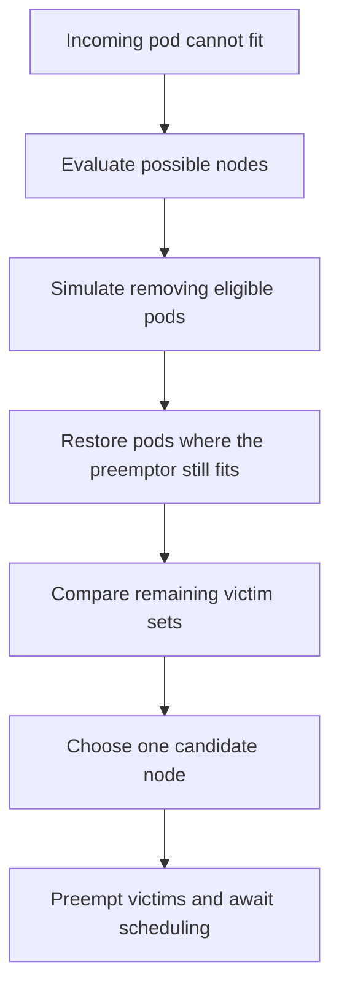

# How Kubernetes Chooses Preemption Victims Across Candidate Nodes

Author: [nawazdhandala](https://www.github.com/nawazdhandala)

Tags: Kubernetes, Scheduling, Troubleshooting

Description: Follow Kubernetes preemption from per-node victim selection to ordered tie-breakers, with worked examples and commands for gathering useful evidence.

Suppose an urgent pod could run on either of two full nodes after other pods are removed. One node would lose one pod; the other would lose three. Does Kubernetes always choose the first node? No. Victim count is only one part of the decision, and several criteria take precedence.

Understanding that ordering helps explain incidents without treating every surprising eviction as a scheduler defect. This walkthrough follows the default preemption implementation in **Kubernetes 1.34.0**. Custom scheduler plugins, extenders, and later versions can change the behavior. The examples below explain source code; they are not measurements from a running scheduler.

## Separate feasibility from preference

A preemptor is the incoming pod seeking space. A victim is an existing pod selected for removal. The scheduler first needs candidate nodes where removing eligible pods could make the preemptor fit. Only then can it compare the disruption associated with those nodes.



Removing low-priority pods does not fix an incompatible node selector, an untolerated taint, or every storage restriction. The scheduler also searches a bounded candidate set rather than promising an exhaustive global optimum. The [tagged default plugin](https://github.com/kubernetes/kubernetes/blob/v1.34.0/pkg/scheduler/framework/plugins/defaultpreemption/default_preemption.go) controls candidate sizing and uses a randomized starting offset.

This distinction matters when investigating a node that appears cheaper in hindsight. It might have failed a placement check, or might not have been part of the candidates compared during that attempt. Current cluster state is not necessarily the state used for the earlier decision.

## Build a victim set on each node

For a candidate node, the default plugin simulates removing eligible lower-priority pods, then checks whether the incoming pod fits. This is an in-memory calculation, not immediate deletion of every pod considered.

If that simulation works, it tries to restore, or *reprieve*, potential victims. It first considers pods whose removal would violate a PodDisruptionBudget, abbreviated PDB. Within the relevant groups, higher-importance pods are considered first. A restored pod stays if the preemptor still fits; otherwise it remains a victim. The [selection routine](https://github.com/kubernetes/kubernetes/blob/v1.34.0/pkg/scheduler/framework/plugins/defaultpreemption/default_preemption.go#L216) implements this sequence.

A PDB describes an application's allowed disruption, but it is not absolute protection from scheduler preemption. The algorithm attempts to reduce violations. A candidate can still contain violations if satisfying the incoming pod requires them.

Avoid interpreting this as an exhaustive search for the mathematically smallest subset of victims. The restore procedure is an ordered heuristic with scheduling-filter checks. Resource shapes and placement constraints influence which restores succeed.

## Apply the node tie-breakers in order

The default plugin supplies no alternative scoring functions in this release, so the framework uses the ordered criteria in [pickOneNodeForPreemption](https://github.com/kubernetes/kubernetes/blob/v1.34.0/pkg/scheduler/framework/preemption/preemption.go#L611). Each criterion eliminates worse candidates. The next one runs only if multiple candidates remain tied.

| Order | Prefer the candidate with |
|---|---|
| 1 | Fewer PDB-violating victims |
| 2 | Lower priority of its highest-priority victim |
| 3 | Smaller adjusted sum of victim priorities |
| 4 | Fewer victims |
| 5 | Later earliest start time among its highest-priority victims |

The adjusted sum in step three adds `2^31` to **each** victim's priority before summing. This avoids misleading comparisons involving negative priorities. It also means that summing the printed priority numbers alone does not reproduce the implementation.

For the final time comparison, consider only victims at the highest victim priority on that node. Find the earliest start time within that group, then prefer the candidate whose resulting timestamp is later. This tends to preserve the older high-priority victims in a tie. The [timestamp helper](https://github.com/kubernetes/kubernetes/blob/v1.34.0/pkg/scheduler/util/utils.go#L59) is more precise than the shortcut “evict the newest pod.”

If every criterion still ties, do not expect a stable alphabetical node choice. The implementation returns a remaining candidate without an ordering guarantee suitable for operational policy.

## Work through three comparisons

Assume both nodes are feasible and the preemptor's priority exceeds every victim priority below. These are illustrative candidate sets, not manifests to deploy.

| Case | Node A | Node B | Preferred node and deciding reason |
|---|---|---|---|
| Budget first | One victim at priority 10; one PDB violation | One victim at priority 100; zero violations | B: fewer violations wins before priority |
| Priority before count | Three victims at priority 10; zero violations | One victim at priority 100; zero violations | A: its highest victim priority is lower |
| Adjusted sum | Two victims at priority -10; zero violations | One victim at priority -10; zero violations | B: equal highest priority, smaller adjusted sum |

In the last row, a raw sum would be `-20` for A and `-10` for B. Choosing the smaller raw sum would select A, which is the wrong interpretation of the source.

This small Python 3 example checks the adjusted arithmetic without needing a cluster:

```python
shift = 2**31
candidates = {"A": [-10, -10], "B": [-10]}
adjusted = {
    node: sum(priority + shift for priority in priorities)
    for node, priorities in candidates.items()
}
assert adjusted == {"A": 4294967276, "B": 2147483638}
assert min(adjusted, key=adjusted.get) == "B"
print(adjusted)
```

Run it locally to see the two positive totals. It demonstrates only the third criterion after earlier criteria tie. It does not implement feasibility, PDB accounting, candidate sampling, or the full scheduler.

## Collect evidence before reconstructing the decision

Use read-only access and replace the namespace and pod name with the actual preemptor. Capture evidence promptly because events expire and victims disappear:

```bash
kubectl -n staging get pod incoming-worker -o yaml > preemptor.yaml
kubectl get pods -A -o json > pods.json
kubectl get pdb -A -o yaml > budgets.yaml
kubectl get nodes -o yaml > nodes.yaml
kubectl get events -A --sort-by=.metadata.creationTimestamp > events.txt
```

These files include workload metadata; store them according to your incident-data policy. The preemptor record supplies its UID, resolved priority, scheduler name, constraints, and any nominated node. The pod snapshot supplies placement and start times. Budget status provides context, although a later snapshot cannot prove its exact earlier value.

Ask the platform operator for scheduler logs around the relevant timestamp when your own access does not expose them. Match pod UIDs rather than names alone. A recreated workload can reuse a name while representing a different scheduling attempt.

For each suspected candidate, write down its feasibility result, proposed victims, PDB violation count, maximum victim priority, and adjusted sum. Stop at the first criterion that distinguishes it from the chosen node. Do not apply later tie-breakers to overturn an earlier decision.

If you cannot recover the original candidate sets, report that limitation instead of presenting a reconstructed ranking as fact. A useful incident conclusion can still identify incompatible placement, unexpected priorities, or a missing budget. Those findings lead to concrete fixes; a speculative claim that the scheduler should simply have evicted fewer pods does not.
