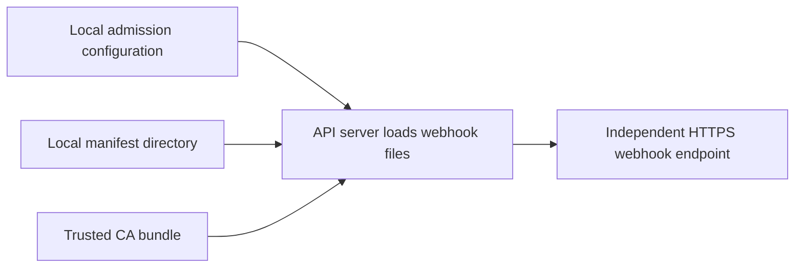

# Load Static Mutating Webhook Manifests in Kubernetes 1.37

Author: [nawazdhandala](https://www.github.com/nawazdhandala)

Tags: Kubernetes, Security, Configuration

Description: Load webhook registration from API-server files, plan an independent HTTPS endpoint, and distinguish startup failures from rejected runtime reloads in Kubernetes 1.37.

A webhook registered through the Kubernetes API cannot enforce its rules until that registration has been created and loaded. For certain bootstrap controls, administrators need the configuration present when the API server begins serving requests.

Kubernetes 1.37 documents **manifest-based admission control as beta and enabled by default** through the `ManifestBasedAdmissionControlConfig` feature gate. It loads admission configuration from local files. This article uses the **v0.37.0 API-server source** to check the example's fields and loader restrictions; it does not claim a live control-plane deployment. See the [feature overview](https://kubernetes.io/docs/reference/access-authn-authz/manifest-admission-control/).

Static registration removes the API-object bootstrap step. It does not remove the webhook server, its network connection, or its TLS trust requirements.

## Start with an endpoint that can exist before the cluster

For static webhook manifests, `clientConfig.service` is forbidden. Use `clientConfig.url` with an HTTPS endpoint reachable from every API-server host. This restriction is enforced by the [tagged webhook manifest loader](https://github.com/kubernetes/apiserver/blob/v0.37.0/pkg/admission/plugin/webhook/manifest/loader/loader.go).



An external management service, with suitable availability and host-level DNS, can fit that dependency model. Merely replacing a Service reference with a URL that still relies on unavailable cluster DNS or routing does not solve bootstrap availability.

For the example below, assume `admission.example.internal` is your reviewed endpoint, its certificate covers that name, and `/mutate` implements the AdmissionReview protocol. Replace these illustrative values. If the server requires client authentication, configure the API server's webhook credentials through its supported kubeconfig mechanism; a CA bundle only establishes server trust.

## Configure the admission plugin's local directory

Merge this entry into the API server's existing admission configuration, illustrated as `/etc/kubernetes/admission-config.yaml`:

```yaml
apiVersion: apiserver.config.k8s.io/v1
kind: AdmissionConfiguration
plugins:
  - name: MutatingAdmissionWebhook
    configuration:
      apiVersion: apiserver.config.k8s.io/v1
      kind: WebhookAdmissionConfiguration
      staticManifestsDir: /etc/kubernetes/admission/mutating-webhooks
```

Preserve other plugin entries already required by your cluster. The embedded type and `staticManifestsDir` field come from the [v0.37.0 webhook configuration API](https://github.com/kubernetes/apiserver/blob/v0.37.0/pkg/admission/plugin/webhook/config/apis/webhookadmission/v1/types.go). The configuration loader permits an omitted `kubeConfigFile` when only the manifest directory is configured; see its [configuration parsing logic](https://github.com/kubernetes/apiserver/blob/v0.37.0/pkg/admission/plugin/webhook/config/kubeconfig.go).

The API-server process must receive this argument, alongside its existing arguments:

```text
--admission-control-config-file=/etc/kubernetes/admission-config.yaml
```

Keep the `MutatingAdmissionWebhook` admission plugin enabled and confirm that the feature gate is not explicitly disabled. For a containerized API server, the configuration and manifest directory must be mounted into the container at the paths shown. A path that exists only on the host is insufficient.

The manifest directory must be absolute, exist, and be a directory. The [directory validation implementation](https://github.com/kubernetes/apiserver/blob/v0.37.0/pkg/admission/plugin/manifest/validation.go) checks those conditions. Use your control-plane deployment procedure rather than rewriting a running API-server manifest through an unreviewed shell command.

## Put the registration in the directory, not in the API

Save the following as `profile.yaml` inside the configured directory after replacing the endpoint and CA placeholder:

```yaml
apiVersion: admissionregistration.k8s.io/v1
kind: MutatingWebhookConfiguration
metadata:
  name: profile-default.static.k8s.io
webhooks:
  - name: profile.platform.example.com
    admissionReviewVersions: ["v1"]
    sideEffects: None
    failurePolicy: Fail
    timeoutSeconds: 3
    clientConfig:
      url: https://admission.example.internal:443/mutate
      caBundle: REPLACE_WITH_BASE64_PEM_CA_BUNDLE
    rules:
      - operations: ["CREATE"]
        apiGroups: [""]
        apiVersions: ["v1"]
        resources: ["pods"]
        scope: Namespaced
    namespaceSelector:
      matchExpressions:
        - key: kubernetes.io/metadata.name
          operator: In
          values: [bootstrap-canary]
```

The configuration object's name must end in `.static.k8s.io`; the individual webhook name is a separate identifier. Avoid duplicate configuration names across files. Static configurations use the v1 admission registration API and are not objects to install with `kubectl apply`.

This deliberately narrow selector is a rehearsal boundary. It is not broad bootstrap enforcement until you review and expand the intended scope. The selected namespace must exist for its Pod requests, and the server must implement the intended mutation without side effects to justify `sideEffects: None`.

Replace `caBundle` with the base64 encoding of the trusted PEM certificate-authority bundle. Do not use the serving private key or disable certificate verification. `failurePolicy: Fail` means a failed call can block matching requests; the three-second timeout is illustrative. The [webhook API reference](https://kubernetes.io/docs/reference/kubernetes-api/admissionregistration/mutating-webhook-configuration-v1/) describes those fields.

## Treat directory updates as configuration releases

Only direct child files with `.yaml`, `.yml`, or `.json` extensions are considered. Subdirectories are not recursively loaded. The [file loader](https://github.com/kubernetes/apiserver/blob/v0.37.0/pkg/admission/plugin/manifest/loader.go) documents this behavior in code.

Keep backup copies outside the watched directory. An old file ending in `.yaml` can introduce a duplicate registration or accidentally restore old rules. Stage changes outside the directory, validate them, and publish files atomically rather than letting the API server read half-written YAML. Multiple file replacements still need a release plan; renaming one file does not make a multi-file deployment globally atomic.

Startup and runtime errors have different consequences:

| Stage | Invalid manifest consequence |
|---|---|
| Initial load | API-server startup/readiness cannot complete successfully |
| Runtime reload | Previous valid configuration remains active; error is logged |
| Successful runtime reload | New configuration replaces the previous loaded set |

The [webhook source implementation](https://github.com/kubernetes/apiserver/blob/v0.37.0/pkg/admission/plugin/webhook/manifest/source/source.go) loads initial state and manages reloads. It uses file watching with a polling fallback; do not infer successful activation just because a file copy completed.

Loading configuration is also different from proving endpoint availability. A syntactically valid URL and CA bundle do not demonstrate a successful admission request. Rehearse both invalid-file handling and unreachable-endpoint handling in an isolated control plane.

## Verify every API server and preserve a recovery path

Each API-server instance loads its own files. Distribute the same reviewed release to every instance, compare deployed content, and verify each instance's reload outcome. A load balancer can otherwise hide inconsistent behavior by routing requests among differently configured servers.

The tagged [manifest metrics implementation](https://github.com/kubernetes/apiserver/blob/v0.37.0/pkg/admission/plugin/manifest/metrics/metrics.go) exposes reload counts, timestamps, and configuration hashes. These metrics are alpha in that source version. Inspect per-instance outcomes rather than treating a successful reload on one server as cluster-wide success.

Finally, submit matching dry-run requests and inspect the intended mutation, then test unaffected requests outside the canary scope. Keep host-level access and the previous valid configuration available: a static registration cannot be repaired by deleting an API object that does not exist there.

If migrating an API-based webhook, plan the transition so both registrations do not unintentionally mutate the same requests twice. Retain recovery exclusions and check downgrade requirements before depending on this feature. Filesystem ownership and control-plane configuration management now protect the registration, so include them in the operational review.
