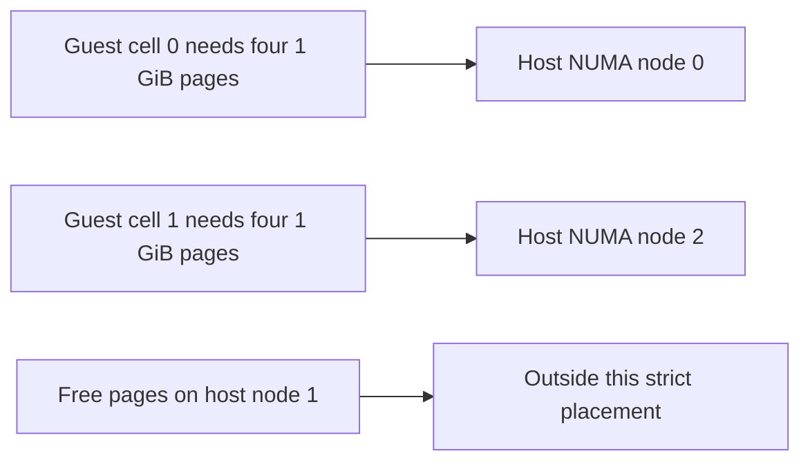

# Fix KVM Huge-Page Startup Failures: NUMA, Memlock, and XML

Author: [nawazdhandala](https://www.github.com/nawazdhandala)

Tags: KVM, HugePages, Troubleshooting

Description: Trace huge-page-backed KVM startup failures through guest-to-host NUMA mappings, per-node page capacity, memory locking, and libvirt XML validation.

A host can have enough huge pages for a virtual machine in total and still fail to start it. The guest may require four pages on a host NUMA node that has only two, while another node holds the remaining free pages. A global total hides that mismatch.

A second source of confusion is XML terminology. Guest NUMA cells describe the topology presented to the virtual machine. Host NUMA nodes describe where its backing memory can be allocated. The same number can appear in both places without referring to the same object.

This guide uses a schema-checked **libvirt 11.0.0** configuration example and Linux HugeTLB concepts. It is a diagnostic walkthrough for an existing KVM guest, not a complete virtual-machine deployment definition.

## Save the persistent configuration and failure evidence

Use the same libvirt connection that manages the failing guest. For a system connection, replace the example name:

```bash
guest=analytics-vm
virsh --connect qemu:///system version
virsh --connect qemu:///system domstate "$guest"
virsh --connect qemu:///system dumpxml "$guest" --inactive > guest-before.xml
virsh --connect qemu:///system freepages --all
```

The [virsh manual](https://libvirt.org/manpages/virsh.html) documents inactive XML and the per-cell free-page report. Saving the persistent definition helps distinguish a planned next-boot configuration from an existing live instance. Keep this copy unchanged while reviewing a separate candidate.

Collect the exact startup error and the associated QEMU log. An allocation error, file-access denial, and memory-locking failure call for different corrections. If additional libvirt logging is necessary, use the procedure appropriate to your daemon layout: modern installations may use modular daemons instead of a single `libvirtd`. The [libvirt logging guide](https://libvirt.org/kbase/debuglogs.html) explains those differences.

Do not repeatedly start a production guest just to gather more messages. A successful retry can start real services and writers. Use the established maintenance plan and a staging reproduction where possible.

## Translate guest cells into host requirements

Consider these elements from an 8 GiB guest definition. They belong inside an existing domain; preserve its operating-system, storage, firmware, and device configuration:

```xml
<memory unit='GiB'>8</memory>
<currentMemory unit='GiB'>8</currentMemory>
<memoryBacking>
  <hugepages>
    <page size='1' unit='GiB' nodeset='0-1'/>
  </hugepages>
  <allocation mode='immediate'/>
</memoryBacking>
<vcpu placement='static'>4</vcpu>
<cpu>
  <numa>
    <cell id='0' cpus='0-1' memory='4' unit='GiB'/>
    <cell id='1' cpus='2-3' memory='4' unit='GiB'/>
  </numa>
</cpu>
<numatune>
  <memory mode='strict' nodeset='0,2'/>
  <memnode cellid='0' mode='strict' nodeset='0'/>
  <memnode cellid='1' mode='strict' nodeset='2'/>
</numatune>
```

The guest has two 4 GiB cells. The huge-page `nodeset='0-1'` selects **guest cells** that use 1 GiB pages. The `memnode` entries map guest cell 0 to **host node 0** and guest cell 1 to **host node 2**.

Those meanings are defined in libvirt's [memory backing and NUMA tuning documentation](https://libvirt.org/formatdomain.html#memory-backing). `strict` placement narrows the allowed backing locations, while immediate allocation requests backing during initialization.

For this example, the resulting capacity requirement is:

| Guest cell | Guest memory | Page size | Required host node | Pages required |
| --- | ---: | ---: | ---: | ---: |
| 0 | 4 GiB | 1 GiB | 0 | 4 |
| 1 | 4 GiB | 1 GiB | 2 | 4 |

Suppose host nodes 0, 1, and 2 have four, six, and two free 1 GiB pages. Twelve pages exist globally, but the second cell cannot obtain its four pages from the specified host node. Reserving more on node 1 does not repair that placement.

The [Linux NUMA policy guide](https://www.kernel.org/doc/html/v6.12/admin-guide/mm/numa_memory_policy.html) also distinguishes memory policy from cpuset restrictions. Check both when a seemingly valid host-node selection still cannot allocate.



## Read the matching per-node pools

On the hypervisor, inspect the size and nodes named by the plan:

```bash
for node in 0 2; do
    pool="/sys/devices/system/node/node${node}/hugepages/hugepages-1048576kB"
    printf 'host node %s
' "$node"
    for name in nr_hugepages free_hugepages; do
        printf '%s=' "$name"
        cat "$pool/$name"
    done
done
```

These paths and counters are described in the [Linux HugeTLB guide](https://www.kernel.org/doc/html/v6.12/admin-guide/mm/hugetlbpage.html). A missing size directory is meaningful; do not substitute the default-size pool without checking the XML.

Free counts are a snapshot, not an exclusive reservation for the next start. Account for other guests and host users, then recheck immediately before the controlled attempt. If allocation targets were changed, verify actual readback rather than assuming the requested count was achieved.

Choose a correction based on the intended locality: provide sufficient backing on the required nodes, or deliberately revise placement after evaluating workload and device locality. Broadening the node set silently can turn a startup fix into an unexpected performance change.

## Inspect the actual backing mechanism

Check the QEMU memory backend shown in the generated command line or startup log. A file backend, memfd HugeTLB backend, and ordinary anonymous backend are not interchangeable diagnostic cases. The [QEMU invocation reference](https://www.qemu.org/docs/master/system/invocation.html) documents their backing, size, preallocation, and host-node controls.

For a file backend, verify the actual hugetlbfs path, matching page size, ownership, and applicable security labels in QEMU's context. For a memfd backend, absence of your guessed filesystem path is not proof that backing is missing. Use the backend that libvirt actually selected.

Keep permissions and capacity as separate checks. Adding pages will not fix a denied backing-file access, and changing file ownership will not satisfy a strict node's shortage.

## Investigate locking only when the error points there

Huge-page backing and an XML `<locked/>` request are separate settings. With QEMU/KVM, the latter also locks QEMU's own memory, whose overhead is not simply the guest RAM value. Libvirt's [locked-memory documentation](https://libvirt.org/formatdomain.html#memory-backing) explains why it requires careful resource planning.

Do not add `<locked/>` as a generic huge-page repair or choose an arbitrary hard limit equal to guest RAM. Likewise, a shell's `ulimit` does not establish the limits applied to a QEMU process launched by a service.

If QEMU remains alive long enough for inspection, resolve its host PID through the management tools and read:

```bash
pid=12345  # Replace with this guest's current QEMU host PID.
cat "/proc/$pid/limits"
```

The [process limits interface](https://man7.org/linux/man-pages/man5/proc_pid_limits.5.html) gives the actual soft and hard limits. If the process has already exited, inspect the launch error and relevant service/libvirt configuration instead of reading a reused PID. Correct a demonstrated locking constraint through the supported management configuration.

## Validate the candidate and verify a controlled start

After editing a separate full-domain candidate, run:

```bash
virt-xml-validate guest-candidate.xml domain
```

The [validator manual](https://libvirt.org/manpages/virt-xml-validate.html) describes this as schema validation. It does not allocate memory or prove host capabilities, file access, NUMA capacity, or successful guest boot. Use the schema installed with the target libvirt release.

Review the candidate diff before applying it through your normal VM management workflow. Preserve the original definition and coordinate the start with the guest's service owners. After startup, verify the QEMU mapping's backing and NUMA placement as well as guest health. A running guest alone does not demonstrate that the intended backing configuration took effect.

The example fragment was wrapped in a minimal test domain and passed the official libvirt 11.0.0 Relax NG schema. An invalid allocation-mode variant was rejected. Guest/host ID mapping, page-count arithmetic, and shell syntax were checked. No KVM guest, memory allocation, permission change, or locking test was executed.
