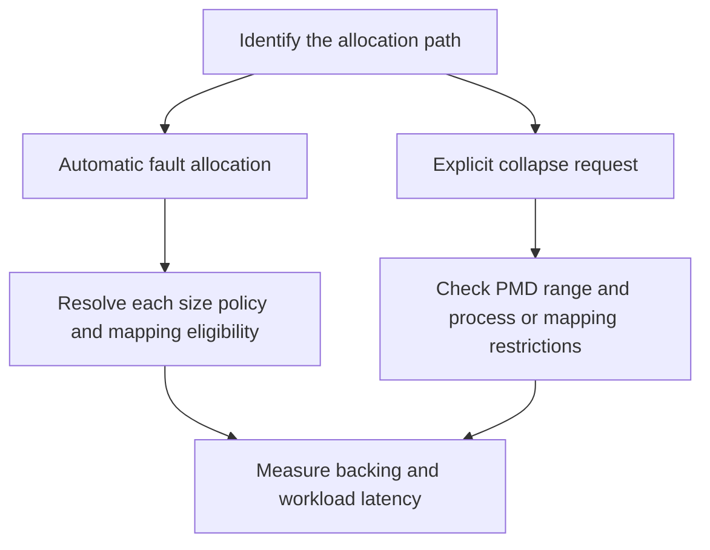

# Use MADV_COLLAPSE and Multi-Size THP with the Right Policy

Author: [nawazdhandala](https://www.github.com/nawazdhandala)

Tags: Linux, HugePages, Performance

Description: Separate automatic multi-size THP policy from explicit MADV_COLLAPSE requests, inspect inherited settings, and measure bounded collapse attempts safely.

An application can acquire transparent huge pages even when the top-level THP setting says `never`. That observation has several possible explanations, and changing the same setting again will not distinguish them.

A smaller page size might have its own enabled policy. The application might explicitly request collapse. Or the memory you inspected might already have huge-page backing from an earlier phase. A useful investigation records the allocation path, the effective settings, and the exact mapping together.

This guide uses **Linux 6.12** as its implementation baseline. THP means Transparent Huge Pages: larger memory backing managed by the kernel without an explicit HugeTLB reservation pool. Multi-size THP, abbreviated mTHP, includes sizes below the traditional page-middle-directory, or PMD, size.

## Separate the three paths

Think about when the work happens:

| Path | Trigger | Main question |
| --- | --- | --- |
| Automatic allocation | Application faults in memory | Which sizes are allowed for this mapping? |
| Background collapse | `khugepaged` scans eligible memory | Can existing backing be promoted later? |
| Explicit collapse | Application calls `MADV_COLLAPSE` | Can this range be collapsed during this call? |

The [Linux 6.12 THP guide](https://www.kernel.org/doc/html/v6.12/admin-guide/mm/transhuge.html) describes per-size policies and notes that background collapse targets PMD-sized THP. Smaller mTHP allocations use page-table entries rather than requiring a PMD mapping.

For example, choosing 64 KiB automatic backing does not mean an explicit collapse call will produce 64 KiB pages. In the [6.12 collapse implementation](https://raw.githubusercontent.com/torvalds/linux/v6.12/mm/khugepaged.c), the explicit path checks `PMD_ORDER` and walks PMD-sized intervals. Treat this as a different operation, not an alternative spelling of your chosen mTHP policy.

## Inspect effective policy without changing the host

Save this as `policy-report.py` and run it with Python 3. It reads the selected bracketed value from each control and resolves `inherit` against the top-level setting:

```python
import re
import sys
from pathlib import Path

root = Path(sys.argv[1]) if len(sys.argv) == 2 else Path('/sys/kernel/mm/transparent_hugepage')

def selected(path):
    match = re.search(r'\[([^]]+)\]', path.read_text())
    if not match:
        raise ValueError(f'No selected policy in {path}')
    return match.group(1)

top = selected(root / 'enabled')
print(f'top-level={top}')
for path in sorted(root.glob('hugepages-*kB/enabled')):
    local = selected(path)
    effective = top if local == 'inherit' else local
    print(f'{path.parent.name}: configured={local} effective={effective}')
print('Automatic anonymous THP policy only; MADV_COLLAPSE is a separate path.')
```

Run:

```bash
python3 policy-report.py
```

On a host where 64 KiB is explicitly `always` and 2 MiB is `inherit`, a top-level `never` leaves the 64 KiB policy enabled. The report makes that distinction visible. Available sizes depend on the system, so the helper discovers directories instead of assuming a universal list.

This is a policy inventory, not a prediction that every allocation will use the indicated size. Address layout, mapping eligibility, memory availability, and fallback still matter. The [6.12 eligibility code](https://raw.githubusercontent.com/torvalds/linux/v6.12/include/linux/huge_mm.h) separately applies supported orders, process/mapping restrictions, and the controls appropriate to the allocation path.

If your requirement is to compare base-page allocation with mTHP, capture every supported size's setting before the experiment. A benchmark labeled “THP disabled” is ambiguous if it records only the top-level file. Also distinguish a fresh process from an existing process whose memory was allocated under earlier settings.

## Know what an explicit request bypasses

`MADV_COLLAPSE`, introduced in Linux 6.1, is a synchronous, best-effort operation. Its eligibility and allocation behavior bypass the ordinary THP sysfs controls, including the usual defragmentation policy. It can cause reclaim or compaction in the calling thread. It does not bypass a mapping's `MADV_NOHUGEPAGE` restriction. These distinctions are documented in [madvise(2)](https://man7.org/linux/man-pages/man2/madvise.2.html).

That means `defrag=never` is not a latency guarantee for a library that calls this operation. Look at application and allocator behavior as well as host configuration when investigating unexpected pauses.

Process-level disabling is another control. The ordinary `PR_SET_THP_DISABLE` mode blocks THP even for explicit collapse and is inherited across `fork()` and `execve()`. The [current process-control manual](https://man7.org/linux/man-pages/man2/PR_SET_THP_DISABLE.2const.html) also documents an except-advised mode on newer kernels; do not assume that newer mode exists on the 6.12 baseline. Set any process policy deliberately in the workload or its launcher, rather than changing an unrelated diagnostic shell and expecting it to affect an already-running service.



## Measure one bounded request

The function below is intended for an existing staging application's owned anonymous mapping. It is not a standalone allocator. For this example, confirm a Linux x86-64 host with 4 KiB base pages and 2 MiB PMD size:

```bash
getconf PAGESIZE
cat /sys/kernel/mm/transparent_hugepage/hpage_pmd_size
```

Expected values are 4096 and 2097152. Supply an already-populated, writable, PMD-aligned range whose length is a positive multiple of 2 MiB. Keep the mapping alive and prevent concurrent unmapping. Do not use an arbitrary pointer from another process.

Save the function as `collapse-once.c`:

```c
#define _GNU_SOURCE
#include <errno.h>
#include <stdint.h>
#include <stdio.h>
#include <sys/mman.h>
#include <time.h>
#ifndef MADV_COLLAPSE
#define MADV_COLLAPSE 25
#endif

/* Linux x86-64, 4 KiB base pages, 2 MiB PMD-sized THP. */
int collapse_once(void *region, size_t length) {
    const size_t pmd = (size_t)2 * 1024 * 1024;
    if (!region || (uintptr_t)region % pmd || !length || length % pmd) {
        errno = EINVAL;
        return -1;
    }
    struct timespec before, after;
    if (clock_gettime(CLOCK_MONOTONIC, &before) == -1)
        return -1;
    int rc = madvise(region, length, MADV_COLLAPSE);
    int saved_errno = rc == -1 ? errno : 0;
    if (clock_gettime(CLOCK_MONOTONIC, &after) == 0) {
        double ms = (after.tv_sec - before.tv_sec) * 1000.0
                  + (after.tv_nsec - before.tv_nsec) / 1000000.0;
        printf("collapse rc=%d errno=%d elapsed_ms=%.3f\n", rc, saved_errno, ms);
    } else {
        fputs("Collapse attempted; elapsed time unavailable.\n", stderr);
    }
    errno = saved_errno;
    return rc;
}
```

Compile it as an object and link it into your staging harness:

```bash
cc -std=c11 -Wall -Wextra -Werror -c collapse-once.c -o collapse-once.o
```

There is intentionally no retry loop. The caller receives the collapse result while the diagnostic output includes its saved error and elapsed time. The compatibility constant comes from the [Linux UAPI header](https://raw.githubusercontent.com/torvalds/linux/v6.12/include/uapi/asm-generic/mman-common.h); defining it does not add support to an older running kernel. The timer uses [CLOCK_MONOTONIC](https://man7.org/linux/man-pages/man2/clock_gettime.2.html), which avoids discontinuous wall-clock changes.

Start with a small range during a maintenance or warm-up phase. Compare request latency with the later workload benefit; successful promotion alone does not establish that the operation was worthwhile.

## Interpret results at range granularity

The [collapse implementation's error mapping](https://raw.githubusercontent.com/torvalds/linux/v6.12/mm/khugepaged.c) helps separate allocation failure, charging constraints, temporary page-state problems, and ineligible ranges. For example, `ENOMEM` can reflect allocation failure, while cgroup charging failure maps to `EBUSY` in this baseline. Preserve the actual error rather than translating every failure into “fragmentation.”

An error from a large request does not prove that nothing changed. Some intervals can succeed before a later failure. Inspect the affected range after both success and failure, and avoid immediately repeating the whole request in a busy loop.

For anonymous PMD backing, inspect the target mapping's `AnonHugePages` value in `smaps`. For smaller mTHP, use the size-specific allocation statistics and a suitably controlled experiment; zero PMD accounting does not exclude smaller backing. The [proc implementation](https://raw.githubusercontent.com/torvalds/linux/v6.12/fs/proc/task_mmu.c) accounts anonymous PMD mappings separately. Host-wide counters cannot identify one application's allocation by themselves.

## Choose a policy that matches the application

A service with strict request latency may prefer measured automatic mTHP behavior and avoid synchronous promotion in its request path. A long-lived analytic process may have a preparation phase where one bounded collapse attempt is affordable. Those are workload decisions, not universal recommendations to enable or disable a feature.

Write down the chosen sizes, explicit-collapse behavior, process policy, measurement interval, and fallback when promotion fails. That record makes future comparisons reproducible and prevents a single `never` value from becoming a misleading description of the whole system.

The policy reader was executed against synthetic controls, including inherited and explicit settings. The C function compiled to a Linux x86-64 object with strict warnings and musl 1.2.5 headers. No Linux collapse request, policy mutation, or performance benchmark was run for this article.
