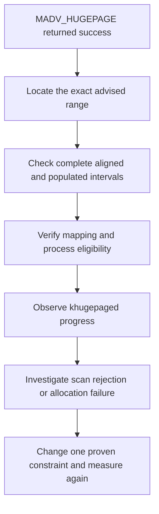

# Why MADV_HUGEPAGE Does Not Collapse Your Mapping

Author: [nawazdhandala](https://www.github.com/nawazdhandala)

Tags: Linux, HugePages, Troubleshooting

Description: Diagnose missing THP collapse by checking advice, aligned ranges, populated pages, process policy, and khugepaged progress before changing scan settings.

Calling `madvise(..., MADV_HUGEPAGE)` and immediately reading zero from `AnonHugePages` is not enough to diagnose a kernel failure. The call supplies advice. It does not promise that the requested range has already been replaced with larger backing pages when it returns.

Several conditions separate advice from observed collapse: the range must contain suitable aligned regions, the memory must be eligible, pages must be in a state the kernel can handle, and the relevant allocation or background scan must succeed.

This walkthrough follows **Linux 6.12** and traditional anonymous PMD-sized THP. A PMD is a level of the page-table structure. The small C experiment is scoped to Linux x86-64 with 4 KiB base pages and a 2 MiB PMD-sized THP unit; confirm those values before using it.

## Verify the advice and the target mapping

Check the return value of `madvise()`. If it fails, preserve `errno` and the exact address and length rather than continuing as if advice had been installed. The [madvise manual](https://man7.org/linux/man-pages/man2/madvise.2.html) defines the address-alignment requirements and the distinction between advice and explicit collapse requests.

Then locate the actual mapping in `/proc/PID/smaps`. Its `hg` flag records huge-page advice; `AnonHugePages` reports PMD-sized anonymous THP backing. An eligible mapping or an advice flag is not the same thing as current backing. `ht` instead identifies explicit HugeTLB, which is outside this collapse investigation. See the [smaps interface](https://man7.org/linux/man-pages/man5/proc_pid_smaps.5.html).

Inspect the mapping containing the buffer's address, not a process-wide sum. An allocator may put many objects in one arena, and another mapping's THP usage can hide the absence of coverage in the region you care about.

## Make the test range suitable for collapse

A large length is insufficient when the range lacks complete aligned PMD-sized intervals. Virtual alignment also differs from physical contiguity: an aligned address gives the kernel a suitable virtual range, but does not guarantee that contiguous physical backing can be obtained.

For the example below, confirm the host's sizes:

```bash
getconf PAGESIZE
cat /sys/kernel/mm/transparent_hugepage/hpage_pmd_size
```

Expect 4096 and 2097152 respectively. The PMD-size interface is documented in the [THP guide](https://www.kernel.org/doc/html/v6.12/admin-guide/mm/transhuge.html).

Save this as `advise-region.c`. It keeps a slightly oversized anonymous mapping, chooses an aligned 32 MiB subrange, populates it with THP advice disabled, and then switches that subrange to `MADV_HUGEPAGE`:

```c
#define _GNU_SOURCE
#include <stdint.h>
#include <stdio.h>
#include <sys/mman.h>
#include <unistd.h>

int main(void) {
    const size_t huge = (size_t)2 * 1024 * 1024;
    const size_t length = (size_t)32 * 1024 * 1024;
    long base = sysconf(_SC_PAGESIZE);
    if (base != 4096) {
        fputs("This example expects 4 KiB base pages.\n", stderr);
        return 2;
    }
    void *raw = mmap(NULL, length + huge, PROT_READ | PROT_WRITE,
                     MAP_PRIVATE | MAP_ANONYMOUS, -1, 0);
    if (raw == MAP_FAILED) { perror("mmap"); return 1; }
    uintptr_t aligned = ((uintptr_t)raw + huge - 1) & ~(uintptr_t)(huge - 1);
    unsigned char *region = (unsigned char *)aligned;
    if (madvise(region, length, MADV_NOHUGEPAGE) == -1) {
        perror("MADV_NOHUGEPAGE");
        munmap(raw, length + huge);
        return 1;
    }
    for (size_t offset = 0; offset < length; offset += (size_t)base)
        ((volatile unsigned char *)region)[offset] = 1;
    if (madvise(region, length, MADV_HUGEPAGE) == -1) {
        perror("MADV_HUGEPAGE");
        munmap(raw, length + huge);
        return 1;
    }
    printf("PID=%ld advised address=%p length=%zu\n",
           (long)getpid(), (void *)region, length);
    puts("Observe the mapping; press Enter to release it.");
    fflush(stdout);
    (void)getchar();
    if (munmap(raw, length + huge) == -1) { perror("munmap"); return 1; }
    return 0;
}
```

The program leaves the small alignment padding mapped until cleanup, avoiding fixed-address replacement or partial trimming. It writes once per base page, so the target region contains populated memory rather than a mostly untouched virtual reservation. There are sixteen 2 MiB intervals in the 32 MiB advised region.

Compile and run it on the scoped staging host:

```bash
cc -std=c11 -Wall -Wextra -Werror advise-region.c -o advise-region
./advise-region
```

Use the printed PID and address to inspect smaps while the program waits. The program does not force collapse and does not promise a particular result. Its role is to remove several application-layout variables while preserving the background behavior under investigation. `mmap()` and release semantics are documented in [mmap/munmap](https://man7.org/linux/man-pages/man2/mmap.2.html).

## Check policy before blaming fragmentation

Read the active global and per-size controls:

```bash
for name in enabled defrag; do
    printf '%s: ' "$name"
    cat "/sys/kernel/mm/transparent_hugepage/$name"
done
for file in /sys/kernel/mm/transparent_hugepage/hugepages-*kB/enabled; do
    [ -r "$file" ] || continue
    printf '%s: ' "$file"
    cat "$file"
done
```

The selected value is bracketed. Per-size settings can inherit the global policy or select their own behavior. For traditional background collapse, inspect the PMD-sized policy rather than inferring it from an unrelated smaller THP size.

Also check process-level disabling. A launcher or library can set `PR_SET_THP_DISABLE`, and the setting can be inherited across process creation and execution. Host policy alone does not tell you the process's state. See the [process THP-disable interface](https://man7.org/linux/man-pages/man2/PR_SET_THP_DISABLE.2const.html); newer kernels provide additional modes, so interpret the values for your actual release.

For the controlled example, record the relevant `THP_enabled` status field where available and the mapping's flags. If the real application behaves differently from the small test, compare launcher settings, allocation flags, and advice calls before changing global policy.



## Observe khugepaged without assuming a deadline

`khugepaged` is the background worker that scans for collapse opportunities. Inspect its controls and progress indicators:

```bash
base=/sys/kernel/mm/transparent_hugepage/khugepaged
for name in defrag pages_to_scan scan_sleep_millisecs alloc_sleep_millisecs \
            max_ptes_none max_ptes_swap max_ptes_shared full_scans pages_collapsed; do
    if [ -r "$base/$name" ]; then
        printf '%s=' "$name"
        cat "$base/$name"
    fi
done
```

Take another snapshot after a meaningful observation period while keeping the mapping alive. `full_scans` and `pages_collapsed` are global progress indicators, not confirmation that this particular region was visited or successfully collapsed. The kernel documentation cautions that the collapsed counter is only a rough progress measure.

A scan sleep interval is not an upper bound on the time until your mapping collapses. Workload size, scan budgets, rejected ranges, and allocation retry delays can all matter. Do not set the sleep interval to zero simply to accelerate a test; that changes CPU consumption and the workload environment.

The thresholds also explain some apparent inactivity. Too many absent, swapped, or shared entries can prevent a candidate from satisfying the configured scan conditions. Raising those thresholds changes memory or I/O tradeoffs, so identify the rejected condition first. The [khugepaged controls](https://www.kernel.org/doc/html/v6.12/admin-guide/mm/transhuge.html#khugepaged-controls) describe these settings.

## Separate scan rejection from allocation failure

The kernel can reject a region before attempting to allocate a replacement huge page. It can also find a candidate and then fail to allocate or charge its backing. Those call for different remedies.

Linux 6.12's [khugepaged implementation](https://raw.githubusercontent.com/torvalds/linux/v6.12/mm/khugepaged.c) distinguishes scan outcomes including unsuitable address ranges, excessive missing/swapped/shared entries, page-state checks, allocation failure, and cgroup charge failure. Treat those as diagnostic categories, not as outcomes visible from one global counter alone.

For example, a sparse untouched region does not become a better candidate because the host pool has more ordinary free RAM. Conversely, a fully populated aligned region can still face allocation or charging constraints. Record cgroup headroom, memory pressure, and relevant THP allocation-failure counters around the same interval.

If source-level attribution is needed, use the running kernel's available huge-memory trace events in a bounded staging investigation. Do not infer a specific scan rejection merely from a flat `pages_collapsed` graph.

## Verify the outcome rather than the tuning change

After addressing one supported cause, repeat the same workload and inspect the same range. A positive `AnonHugePages` value demonstrates PMD-sized coverage for that mapping at that time. It does not establish smaller multi-size THP coverage, and a partially covered mapping should be reported as partial.

If immediate synchronous collapse is the application requirement, evaluate `MADV_COLLAPSE` separately instead of assuming advice provides that contract. It has different behavior and costs; it is not a drop-in diagnostic shortcut.

The C program compiled into a Linux x86-64 object with musl 1.2.5 headers and warnings treated as errors. Alignment bounds and page-count arithmetic were checked, and shell snippets passed syntax checks. No Linux collapse, scan timing, cgroup behavior, or performance experiment was executed for this article.
