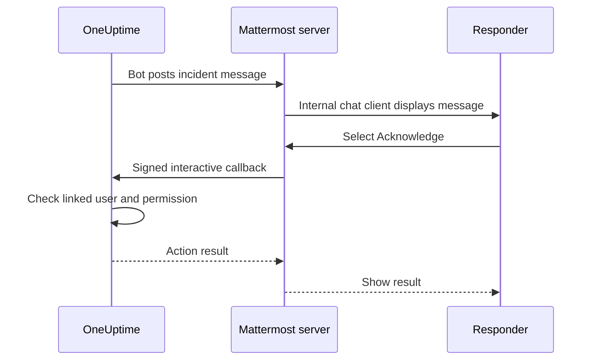

# How to Manage Air-Gapped Incidents with OneUptime and Mattermost

Author: [nawazdhandala](https://www.github.com/nawazdhandala)

Tags: Air-Gapped, Mattermost, Incident Management, Monitoring

Description: Connect self-hosted OneUptime and Mattermost through internal routes, link responders, and test incident actions with scoped access and verified callbacks.

An incident message appearing in Mattermost proves only the outbound half of an integration. A responder can still press Acknowledge and get an error because Mattermost cannot call OneUptime, or because the responder's accounts are not linked.

Treat the connection as three parts: a bot that posts messages, an internal callback path, and a verified relationship between each responder's accounts. Test those parts independently before making chat part of the production incident process.

## Establish the internal routes

This example uses `https://monitoring.internal.example` for OneUptime and `https://chat.internal.example` for Mattermost. Replace them with your approved names. Both services are already installed; this article configures their integration rather than deploying either platform.



Permit HTTPS between the two servers in both directions. Verify each runtime trusts the other's internal certificate authority, and that DNS resolves the intended address from each runtime. Users also need browser or desktop-client access to both names, including the identity services used for sign-in.

The documented OneUptime callback paths are `/api/mattermost/interactive` and `/api/mattermost/dialog`. Preserve them through internal reverse proxies. A browser-facing redirect to a login page is not a working server callback. These paths and the integration flow are documented in the [OneUptime Mattermost guide](https://oneuptime.com/docs/en/workspace-connections/mattermost#network-and-self-hosting).

## Allow the specific private destinations

OneUptime protects outbound webhook calls against unintended access to private services. For the **OneUptime 17.0.0 Helm chart**, the following values permit the named chat host while leaving broad private-network access disabled. Save this as `mattermost-egress.yaml`:

```yaml
webhooks:
  allowPrivateNetwork: false
  privateNetworkAllowlist: "chat.internal.example"
```

The names and mapping were checked against the [official chart package](https://helm-chart.oneuptime.com/oneuptime-17.0.0.tgz) and its [source values](https://github.com/OneUptime/oneuptime/blob/0de2d9ceac0a2404f5df7ad1f9ab1e22c56bea7e/HelmChart/Public/oneuptime/values.yaml). Use the supported keys for your deployed release rather than adding unknown values to an older chart.

With the approved chart already available locally, render your existing configuration plus the small override:

```bash
helm template rehearsal ./oneuptime-17.0.0.tgz \
  --namespace monitoring \
  -f your-existing-values.yaml -f mattermost-egress.yaml \
  > rendered.yaml
rg -n -A 1 \
  'name: (ALLOW_PRIVATE_NETWORK_WEBHOOKS|PRIVATE_NETWORK_WEBHOOK_ALLOWLIST)' \
  rendered.yaml
```

Replace `your-existing-values.yaml` with your actual deployment values. The relevant environment entries should show `ALLOW_PRIVATE_NETWORK_WEBHOOKS` as `false` and `PRIVATE_NETWORK_WEBHOOK_ALLOWLIST` as `chat.internal.example`. This local check does not contact Kubernetes or establish network reachability. Apply the reviewed change using your normal deployment process.

The reverse direction has a separate control. In Mattermost, add `monitoring.internal.example` under **System Console → Environment → Developer → Allow untrusted internal connections to**. Its configuration key is `ServiceSettings.AllowedUntrustedInternalConnections`. Preserve existing approved entries; this list uses whitespace separators, unlike OneUptime's comma-separated allowlist. Mattermost's [environment settings reference](https://docs.mattermost.com/administration-guide/configure/environment-configuration-settings#allow-untrusted-internal-connections) describes the setting and restart requirement.

This is permission to contact a destination, not permission to ignore its certificate. Keep insecure outgoing connections disabled and install the required CA trust in the actual server runtime. Avoid broad address ranges when the integration needs only one host.

## Create a dedicated bot and connect the project

Use a Mattermost bot dedicated to OneUptime. Enable bot creation under **System Console → Integrations → Bot Accounts**, create the bot, and securely retain its access token. Add it to the intended team and any private destination channel. Mattermost's [bot-account documentation](https://docs.mattermost.com/developers/integrate/reference/bot-accounts) explains bot creation, membership, and token handling.

Start with a limited test team. Do not give the bot System Admin merely to avoid investigating membership errors. Document who owns its token and how rotation will be rehearsed. A token copied into a shared incident note is a credential disclosure, even on an internal service.

In OneUptime, open **Project Settings → Workspace → Mattermost**, connect using the internal server URL and bot token, and select the intended default team. Then create a narrowly scoped incident rule under **Incidents → Workspace → Mattermost**. Use a test channel and test incident criteria before routing all production incidents. Follow the [connection instructions](https://oneuptime.com/docs/en/workspace-connections/mattermost#connect-mattermost).

Choose the channel strategy deliberately. A shared incident channel gives an overview but can be noisy. A separate channel per incident keeps discussion together but needs a cleanup and membership policy. Preserve the incident identifier in messages so responders can distinguish overlapping events.

## Link responders before testing actions

Each responder should connect their own account under **User Settings → Workspace → Mattermost**. OneUptime sends a direct message with a linking action; open it in the browser that requested it. Do this for every project where the person needs incident actions.

This personal link is separate from the bot connection. Test with an ordinary responder account, not only the administrator who installed the integration. That catches missing project permissions and account-mapping problems before an incident occurs. OneUptime's [account-linking instructions](https://oneuptime.com/docs/en/workspace-connections/mattermost#connect-your-own-mattermost-account) describe the verification flow.

Keep channel notifications and direct on-call pages distinct in your runbook. A message in a channel does not demonstrate that the selected on-call person received a direct notification. Configure and test the person's notification method separately if direct paging is required.

## Rehearse a complete incident in staging

Use one clearly named rehearsal incident and one authorized responder. Record the incident identifier and agreed start time, then work through this sequence:

1. **Post:** trigger the test rule and confirm the intended channel receives the correct incident and internal link.
2. **Open:** follow the link from the responder's normal client and confirm it opens the correct OneUptime record.
3. **Acknowledge:** press the action in Mattermost, then inspect the incident in OneUptime. Confirm the state and actor rather than relying only on a chat confirmation.
4. **Discuss:** add a harmless private rehearsal note and confirm it appears on the intended record.
5. **Resolve:** resolve the rehearsal incident and confirm the resulting state and expected notification updates.

If your process publishes incident notes to a status page, rehearse that approval path separately with explicitly labeled test content. Do not make a public note part of a routine connectivity test.

Now repeat with a linked user who lacks permission for the action. The action should be refused without changing the incident. Also test a private channel with the correct bot membership. These checks demonstrate that success depends on intended permissions rather than incidental administrator access.

## Diagnose failures by direction

| Symptom | Check first |
| --- | --- |
| Nothing reaches Mattermost | Bot token, team membership, OneUptime's outbound allowlist, DNS and TLS |
| Public channel works but private channel fails | Bot membership in the private channel |
| Message arrives but action fails | Mattermost's callback allowlist, reverse proxy route, TLS and OneUptime logs |
| One responder succeeds and another fails | Account linking and project permissions |
| Browser opens both services but callbacks fail | Server network path and server trust stores |
| Chat works but a sleeping phone receives nothing | Mobile push dependencies and client delivery behavior |

Mattermost documents private-address restrictions and action errors in its [interactive-message reference](https://docs.mattermost.com/developers/integrate/plugins/interactive-messages). Correlate logs around the test time on both services. Avoid logging bot tokens, complete signed callback bodies, or account-linking URLs.

Finally, run the rehearsal with public egress blocked in staging. Review Mattermost's optional online features using its [air-gapped configuration guide](https://docs.mattermost.com/deployment-guide/air-gapped-operations/disable-phone-home-features). Confirm that internal login, chat delivery, incident actions, and your fallback notification method remain usable. Keep the tested versions, two-way route map, bot ownership, and responder onboarding checklist with the integration configuration.
