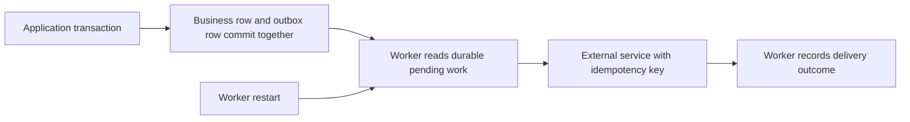

# When Managed PostgreSQL Does Not Support Your Extension

Author: [nawazdhandala](https://www.github.com/nawazdhandala)

Tags: PostgreSQL, Extension, Architecture

Description: Choose between built-in SQL, supported trusted-language code, external workers, another managed service, and self-hosting when an extension is unavailable.

An application requires a PostgreSQL extension, but the managed service rejects `CREATE EXTENSION`. Before moving the entire database, determine what failed and which capability the application actually needs.

An extension name is a package choice. The underlying requirement might be random identifiers, scheduled work, an external HTTP call, or a specialized index method. Those requirements lead to very different alternatives.

This guide uses PostgreSQL 17 for concrete SQL and RDS as one example of managed-provider policy. Provider capabilities vary by engine release and service; do not generalize one service's restrictions to every managed PostgreSQL offering.

## Diagnose the rejection before replacing the design

Record the exact error, engine version, requested extension version, effective role, and database. Distinguish an unavailable package from insufficient privileges, a provider allowlist, or a missing dependency.

This PostgreSQL 17 query checks what the server advertises for a requested extension:

```sql
SELECT name, default_version, installed_version
FROM pg_catalog.pg_available_extensions
WHERE name = 'REPLACE_WITH_EXTENSION_NAME';
```

Replace the literal with the real extension name. No row means the ordinary available-extension view does not advertise it on this server. A row still does not prove that your role may install it. [Available extension view](https://www.postgresql.org/docs/17/view-pg-available-extensions.html).

`CREATE EXTENSION` installs server-provided extension objects and generally needs their underlying creation privileges. Trusted extensions have a different privilege model, but “trusted” does not mean a missing package can be installed from your laptop. [PostgreSQL installation rules](https://www.postgresql.org/docs/17/sql-createextension.html).

On RDS, compare the engine-specific supported list and any configured `rds.allowed_extensions` restrictions. `SHOW rds.extensions` is available there, but AWS notes that its output can be inaccurate for parameters added in a minor release, so also consult the release-specific documentation. [RDS extension support and restrictions](https://docs.aws.amazon.com/AmazonRDS/latest/UserGuide/PostgreSQL.Concepts.General.FeatureSupport.Extensions.html).

A supported package blocked by an intentional policy is an administrative decision to review, not a reason to bypass the restriction.

## Describe the capability in terms of behavior

Write down what the application needs from the extension: inputs and outputs, correctness rules, performance, transaction boundaries, and failure behavior. Include existing data types and indexes that might already depend on it.

| Required behavior | Candidate approach | Main question |
|---|---|---|
| Simple computation or identifier generation | Built-in functions or reviewed SQL | Are semantics actually equivalent? |
| Reusable trusted-language logic | Functions or provider-supported extension framework | Does the allowed language expose the necessary capability? |
| Scheduled or external work | Separate worker or scheduler | Can completion be asynchronous and retried safely? |
| Custom index, planner hook, or native server code | Provider support or a different database deployment | Must the code run inside PostgreSQL? |
| Existing extension-specific stored data | Compatibility-preserving migration | How will data and queries be converted and validated? |

This exercise often narrows the problem. You may need one feature from a large extension, or you may discover that its in-server behavior is essential.

## Prefer built-in SQL when the semantics fit

For example, an application that needs random version-4 UUIDs can use PostgreSQL 17's built-in function:

```sql
SELECT pg_catalog.gen_random_uuid() AS new_id;
```

A UUID is a universally unique identifier. This function generates a random version-4 value without requiring the `uuid-ossp` extension. It is not a replacement for namespace-based or other UUID algorithms provided by that extension. [PostgreSQL 17 UUID functions](https://www.postgresql.org/docs/17/functions-uuid.html).

Test the behavior the application relies on, including null inputs, ordering, determinism, and index usage. A superficially similar SQL expression can have different performance or output semantics.

For custom functions, use the privileges and language support the provider actually exposes. Keep normal caller permissions unless a carefully reviewed design requires elevated execution. PostgreSQL distinguishes `SECURITY INVOKER` from `SECURITY DEFINER`; changing that setting is a security decision, not an installation workaround. [Function definition semantics](https://www.postgresql.org/docs/17/sql-createfunction.html).

Some services offer a supported path for trusted-language extensions. RDS's Trusted Language Extensions framework, `pg_tle`, is designed for environments without underlying filesystem access. Check its supported engine versions, language capabilities, and administrator-controlled permissions before adopting it. It does not make arbitrary native libraries portable. [RDS Trusted Language Extensions](https://docs.aws.amazon.com/AmazonRDS/latest/UserGuide/PostgreSQL_trusted_language_extension.html).

## Move external work across a deliberate boundary

A separate worker can often replace an extension whose main purpose is scheduling or communicating with another service. A sidecar is a process deployed alongside an application, commonly in the same Kubernetes Pod. It remains a database client; it does not gain access to a managed database's server memory or extension directory.

For example, replace a database-side HTTP call with an application transaction that records durable work, followed by a worker that delivers it:



The outbox is a database table holding work that still needs delivery. Writing it in the same transaction as the business change avoids committing the business record without recording the intended follow-up.

This design changes the contract: the external action completes later. The worker needs bounded retries, ownership or leasing of pending work, monitoring, and a policy for repeatedly failing items. If the remote action succeeds but the worker crashes before recording success, delivery can be attempted again. Use an idempotency key and outcome reconciliation rather than claiming exactly-once execution.

PostgreSQL `NOTIFY` can wake a listening worker, but keep the durable work in the table. The notification mechanism delivers to listening clients and should not be treated as a replacement for persistent work tracking. Do not put secrets in notification payloads. [PostgreSQL notification behavior](https://www.postgresql.org/docs/17/sql-notify.html).

An external worker cannot reproduce every extension's transaction semantics. If the application requires an operation to participate synchronously inside a database transaction, evaluate whether moving it out changes correctness. Do not hold long database transactions open while making uncontrolled remote calls merely to imitate the old interface.

## Recognize when the code must run in the server

A custom PostgreSQL background worker can attach to server shared memory and participate in the server's lifecycle. A remote application worker does not have those capabilities. Likewise, a native index implementation cannot become an ordinary client query simply by packaging its library into another container. [PostgreSQL background worker model](https://www.postgresql.org/docs/17/bgworker.html).

When that integration is essential, compare providers that explicitly support the extension and required version. Ask about upgrades, backups, replicas, failover, and support ownership. “The extension can be enabled” is only the first compatibility check.

If no suitable managed offering exists, self-hosting may be justified. It transfers responsibility for packaging, patching, monitoring, failover, and recovery to your team. Include the extension in restore rehearsals; the data backup and compatible server packages must work together. [PostgreSQL backup approaches](https://www.postgresql.org/docs/17/backup.html).

Do not make the decision solely on the ability to install a shared library. Evaluate whether the team can sustain the resulting database operation through upgrades and incidents.

## Validate the replacement before migrating

Build a small acceptance suite around the capability contract. Compare representative outputs, important edge cases, query plans, concurrency, and failure recovery. For a worker-based alternative, include duplicate delivery, worker restart, and an unavailable remote service. For an in-database replacement, include role boundaries and transaction rollback behavior.

Plan conversion of existing extension-dependent data and queries separately from new feature implementation. Keep a rollback boundary that accounts for writes made after the change.

The right alternative preserves the behavior the application actually needs while making its operational responsibilities clear. Sometimes that is a built-in function; sometimes it is a durable worker; sometimes it requires a different database platform. Choose from those requirements, not from the installation error alone.
