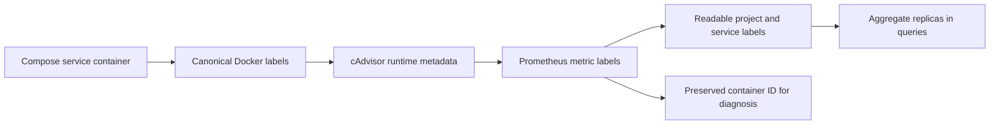

# Map cAdvisor Container IDs to Compose Service Names in Prometheus

Author: [nawazdhandala](https://www.github.com/nawazdhandala)

Tags: Docker, Docker Compose, Prometheus, Monitoring

Description: Expose Docker Compose project and service labels through cAdvisor, map them in Prometheus, and aggregate replicas without losing container identity.

A dashboard labeled with long container IDs is difficult to use during an incident. Replacing those IDs with a service name seems tempting, but a service can have several replicas. If you remove the only label distinguishing those replicas, you can make different measurements collide.

A better approach is to retain container identity and add two readable dimensions: the Compose project and the Compose service. This walkthrough uses **cAdvisor 0.55.1** and a **Prometheus 3.7.3** configuration. It assumes Docker Compose already runs your workloads and cAdvisor already collects their metrics. It does not require renaming containers or redeploying the applications.

## Follow the labels from Docker to Prometheus

Compose creates canonical labels on its resources. On service containers, `com.docker.compose.project` identifies the project and `com.docker.compose.service` identifies the service key from the Compose file. The prefix is reserved; do not manually add those labels to your Compose configuration. See the [Compose label specification](https://compose-spec.github.io/compose-spec/container_spec.html#labels).

For example, two projects can both contain a service called `api`. A service-only dashboard would merge them. Keep the project and a host or environment dimension until you intentionally choose a broader aggregation.



There is no lookup against Docker at Prometheus query time in this approach. The readable dimensions travel with each sampled metric.

## Confirm the source metadata first

On a machine with an authorized Docker CLI connection to the correct daemon, replace the placeholder with a real container ID or name:

```bash
CONTAINER='REPLACE_WITH_CONTAINER_ID_OR_NAME'
docker container inspect --format '{{json .Config.Labels}}' "$CONTAINER"
```

Expect a JSON object containing the project and service keys. Docker's [inspect command](https://docs.docker.com/reference/cli/docker/container/inspect/) supports Go-template formatting; this command only reads metadata.

If the labels are absent, check whether that particular container was actually created as a Compose service. A manually launched container, a parent cgroup, and a Compose service container are different things. Relabeling cannot reconstruct metadata that never reaches the exporter.

Also confirm that cAdvisor connects to the same Docker daemon. Seeing resource statistics through Linux cgroups does not prove that Docker metadata enrichment succeeded.

## Expose only the Compose labels you need

If cAdvisor already exports the two labels, leave its configuration alone. If your deployment intentionally disables arbitrary container labels, these arguments allow only the two Compose keys:

```text
--store_container_labels=false
--whitelisted_container_labels=com.docker.compose.project,com.docker.compose.service
```

These are argument fragments to merge into an existing cAdvisor deployment, preserving its other arguments, image digest, mounts, and security settings. The allowlist requires `store_container_labels=false`, as documented in the [runtime options](https://github.com/google/cadvisor/blob/v0.55.1/docs/runtime_options.md). Restart or roll out cAdvisor through your normal process after changing its arguments.

The label transformation for the pinned release is:

| Docker label | cAdvisor metric label |
|---|---|
| `com.docker.compose.project` | `container_label_com_docker_compose_project` |
| `com.docker.compose.service` | `container_label_com_docker_compose_service` |

cAdvisor prefixes container labels and replaces unsupported characters in label names with underscores. Its [label collection implementation](https://github.com/google/cadvisor/blob/v0.55.1/metrics/prometheus.go) retains the cgroup `id`, alias-derived `name`, and image metadata separately. Label values such as `shop` and `api` are not reconstructed from the container's generated name.

Inspect the existing protected metrics endpoint or query a raw container metric in Prometheus. Confirm both labels on a known application container before changing scrape rules. A missing `name` label is a separate metadata issue; it is not a reason to parse a container ID into a guessed service name.

## Copy the labels at scrape time

The following is a complete minimal Prometheus configuration for a private staging network. Replace `cadvisor.internal:8080` with your approved target. Retain your existing authentication and TLS settings when adapting it to an existing job; the HTTP example assumes an already protected private endpoint.

```yaml
global:
  scrape_interval: 30s
scrape_configs:
  - job_name: cadvisor-compose
    static_configs:
      - targets: ['cadvisor.internal:8080']
    metric_relabel_configs:
      - source_labels: [container_label_com_docker_compose_project]
        regex: '(.+)'
        target_label: compose_project
        replacement: '$1'
      - source_labels: [container_label_com_docker_compose_service]
        regex: '(.+)'
        target_label: compose_service
        replacement: '$1'
```

Reserve `compose_project` and `compose_service` for this mapping; the rules overwrite those destination labels when the source is nonempty. A group with no Compose metadata gets neither destination label. The original labels and `id` remain present.

Use `metric_relabel_configs`, which operate on scraped samples. Target `relabel_configs` operate earlier and cannot read these sample labels. Prometheus documents both stages in its [configuration reference](https://prometheus.io/docs/prometheus/latest/configuration/configuration/#metric_relabel_configs).

Save the adapted file as `prometheus.yml`, then validate it using the matching Prometheus distribution before your normal configuration reload:

```bash
promtool check config prometheus.yml
```

The expected result is a successful configuration check. It does not contact Docker or establish that the target exports the required labels.

## Aggregate replicas without deleting their identity

Start with memory working set, which is a point-in-time byte measurement:

```promql
sum by (instance, compose_project, compose_service) (
  container_memory_working_set_bytes{
    job="cadvisor-compose", compose_project!="", compose_service!=""
  }
)
```

This combines replicas only when they share the selected host, project, and service. For example, two `shop/api` replicas using 100 MiB and 150 MiB produce 250 MiB. A `payments/api` container remains separate. Keep your environment label too if one Prometheus view spans environments.

For an individual-container panel, inspect the same metric without `sum` and include `id` in the legend. Prometheus [aggregation operators](https://prometheus.io/docs/prometheus/latest/querying/operators/#aggregation-operators) let you choose grouping at query time; that is safer than discarding identifying labels during ingestion.

Before trusting the total, check for repeated collection of the same container:

```promql
count by (instance, id) (
  container_memory_working_set_bytes{job="cadvisor-compose"}
) > 1
```

A result flags multiple series for the same target and container under that job. Investigate extra scrape labels or overlapping collection paths. This check does not detect duplicates scraped under different jobs or different instance labels, so audit target discovery as well.

## Test changes against real lifecycle events

In staging, check a project with two replicas, another project with the same service name, and a non-Compose container. The replicas should aggregate within their project; the unrelated project should remain separate; the non-Compose container should stay available in raw metrics but outside the Compose-specific query.

Recreate one staging replica through your normal deployment workflow. Its container identity should change while its project and service remain stable. Allow normal scrape and staleness handling before interpreting the transition. Label changes create new time series; they do not rewrite historical samples, so old dashboard ranges may need a transition-aware query.

Finally, keep the raw identity labels. Human-readable service totals are useful for understanding ownership and impact, while container IDs are still needed to investigate one failing replica. Carrying both lets the same data answer both questions without fragile name parsing or an external join table.
