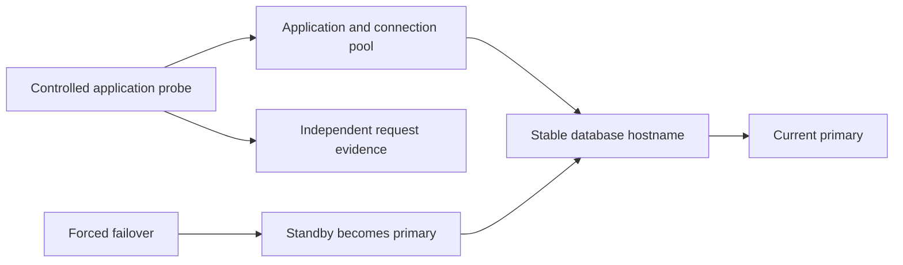

# Measure Application Recovery During an Azure MySQL Forced Failover

Author: [nawazdhandala](https://www.github.com/nawazdhandala)

Tags: Azure, MySQL, Reliability, Testing

Description: Run a controlled Azure MySQL failover rehearsal and measure application recovery, connection-pool behavior, sustained success, and uncertain write outcomes.

The portal says failover succeeded, but the application still returns connection errors. That gap is the reason to test application recovery rather than time only the database operation.

A useful rehearsal follows real requests through the application, records their outcomes, and keeps watching after the first success. It also checks whether interrupted writes were committed, rejected, or left uncertain. This guide describes that experiment for an existing zone-redundant Azure Database for MySQL Flexible Server. The analysis code was tested locally with synthetic data; no Azure failover was performed.

## Establish what this test covers

High availability, or HA, provides a standby server that can take over from the primary. Zone-redundant HA places the servers in different availability zones. Forced failover activates the standby and disconnects clients, which must reconnect. Microsoft documents this as a way to test application behavior in its [HA overview](https://learn.microsoft.com/en-us/azure/mysql/flexible-server/concepts-high-availability).

A forced database failover is not a simulation of losing an entire zone. It does not remove your application hosts, DNS resolvers, queues, or other dependencies from that zone. Record this limitation explicitly instead of reporting the rehearsal as proof of complete zone resilience. Azure's [reliability guidance](https://learn.microsoft.com/en-us/azure/reliability/reliability-database-mysql) describes the wider shared responsibility.

Use a representative nonproduction environment first. Verify that HA is healthy, identify the current primary and standby zones, and establish an owner, maintenance window, stop condition, and recovery contact. Do not perform this experiment during an unrelated incident or migration.

## Define success before pressing the button

Pick one application read and one controlled write workflow that exercise the real connection pool and authentication path. A static health endpoint or a direct database connection from an administrator's laptop does not test the application's recovery behavior.

Use a dedicated test account and isolated test records. Give each write a unique operation identifier and record the client's acknowledgment outside the database being tested. Idempotency means repeated submissions of the same operation do not create multiple business effects; use the application's existing idempotency mechanism where available.

Decide how long a successful request may take. A request that eventually succeeds after a user-visible timeout should not count as healthy for a five-second service objective.

Record at least these milestones:

| Milestone | Meaning |
| --- | --- |
| Trigger accepted | Reference time for the exercise |
| First failed or over-budget request | First observed application impact |
| First successful request after impact | A possible recovery, still unproven |
| Sustained healthy interval | Evidence that recovery persists |
| Write reconciliation complete | Interrupted operations have known outcomes |

Call the measured duration an observed recovery time. The recovery-time objective is the target you agreed beforehand, not whatever the test happened to achieve.

## Collect evidence through the real path

Start a low-rate probe before failover and confirm a healthy baseline. Keep the request interval and timeout fixed. Record request identifiers, start and completion times, latency, final outcome, and relevant error classes. Use a monotonic clock for elapsed durations so wall-clock adjustments do not distort them; retain UTC timestamps for correlation with Azure events.

The probe should preserve the application's normal retry behavior while making it visible. Record attempts and the final request outcome separately. One successful response after several retries may be acceptable within the latency budget, but the attempt history explains what happened.



Use the database hostname rather than a pinned IP. Azure's HA documentation describes both DNS behavior and a gradually introduced load-balancer-based model for applicable networking configurations. Do not make an observed IP change a mandatory pass condition; measure successful application connections instead. See the [current failover architecture](https://learn.microsoft.com/en-us/azure/mysql/flexible-server/concepts-high-availability).

## Trigger one controlled failover

In the server's **High Availability** page, check the primary and standby zones, select **Forced Failover**, review the warning, and confirm within the approved window. Record the trigger time and provider notifications. After completion, inspect the new zone roles. These are the steps in Microsoft's [portal failover procedure](https://learn.microsoft.com/en-us/azure/mysql/flexible-server/how-to-configure-high-availability).

Keep the probe running throughout. Do not repeatedly trigger failover because the application has not yet recovered. If the provider operation finishes but requests still fail, investigate the application pool, retry limits, resolver behavior, and authentication path.

Avoid restarting every application instance immediately. Doing so can hide a pool-recovery defect and create a burst of new connections. If recovery requires a restart, record that intervention and its timing as part of the result.

## Calculate sustained recovery from samples

Export the post-trigger observations to `samples.csv` with columns `elapsed_s,healthy`. `elapsed_s` is the request completion time in seconds after the trigger, measured by the same probe clock. Set `healthy` to `1` only when the application operation succeeded within its agreed latency budget; otherwise use `0`.

This Python 3.11 script reads that file. It requires a 30-second healthy span and resets the candidate interval if samples are more than five seconds apart. Those are illustrative acceptance settings, not Azure guarantees:

```python
import csv
import math

previous = None
first_failure = None
first_success = None
healthy_start = None
confirmed = None

with open("samples.csv", newline="") as stream:
    for row in csv.DictReader(stream):
        elapsed = float(row["elapsed_s"])
        value = row["healthy"]
        if not math.isfinite(elapsed) or elapsed < 0 or value not in {"0", "1"}:
            raise ValueError("Invalid elapsed time or health flag")
        if previous is not None:
            if elapsed <= previous:
                raise ValueError("Samples must be strictly ordered")
            if elapsed - previous > 5:
                healthy_start = confirmed = None
        previous = elapsed

        if value == "0":
            if first_failure is None:
                first_failure = elapsed
            healthy_start = confirmed = None
        elif first_failure is not None:
            if first_success is None:
                first_success = elapsed
            if healthy_start is None:
                healthy_start = elapsed
            if elapsed - healthy_start >= 30 and confirmed is None:
                confirmed = elapsed

print("First observed impact:", first_failure)
print("First success after impact:", first_success)
print("Current recovery interval begins:", healthy_start)
print("Sustained recovery confirmed at:", confirmed)
```

The reader follows Python's [CSV documentation](https://docs.python.org/3.11/library/csv.html). Run it with `python3.11 analyze.py` after saving the code as `analyze.py` beside the CSV.

In a synthetic test with a failure at zero, a success at two seconds, another failure at four seconds, and uninterrupted two-second healthy samples from six through 36 seconds, it reports first success at two and sustained confirmation at 36. The recovered interval begins at six. These numbers demonstrate the analysis, not Azure performance.

`None` for confirmation means the final observed interval did not establish sustained recovery. If no failure was observed, report that fact rather than inventing a zero-duration outage. Sampling can miss short failures, and a long request can make the first observed completion later than the actual start of impact.

## Reconcile writes and report the practical result

After the application is healthy, match every attempted test operation against its stored result and external acknowledgment. A client timeout does not prove that a database transaction rolled back. Resolve uncertain operations by their identifiers before resubmitting them.

Report the initial healthy baseline, first impact, recovery interval, confirmation time, error distribution, and any manual intervention. Include workload, client version, pool settings, timeout budget, and probe interval so a later test can be compared fairly.

Keep observing beyond the first healthy interval for recurring failures or backlog growth. If the exercise exceeds the recovery objective, change one identified cause and repeat under comparable conditions. A successful rehearsal demonstrates how this application recovered under these conditions; it does not replace testing the broader zone-failure scenario.
