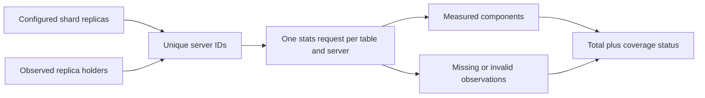

# Measure RethinkDB Table Disk Usage Across Shards and Replicas

Author: [nawazdhandala](https://www.github.com/nawazdhandala)

Tags: RethinkDB, Storage, Observability

Description: Sum RethinkDB table/server disk statistics without counting a server twice, and report missing replicas separately from measured storage totals.

A table occupies more disk than the size of its exported documents. Replicas keep additional copies, storage metadata consumes space, and files can contain reclaimable or preallocated regions. Looking at one server or multiplying one number by the replication factor can produce a misleading capacity estimate.

RethinkDB exposes storage statistics for a table on a particular server. The useful measurement is therefore a collection of unique table/server pairs, with a clear statement of which pairs could not be measured. This guide builds that report and explains its limits.

The code uses Python 3.11 and `rethinkdb==2.4.10.post1`. The interpretation was checked against server 2.4.4 statistics source. Local tests exercised aggregation with sample records and constructed queries; no actual cluster disk usage was measured.

## Decide which size you need

There are several different questions hidden inside “how big is the table?”

| Measurement | What it helps answer |
|---|---|
| Exported document bytes | How large is a particular serialization of the logical data? |
| Reported table/server storage | How much storage-engine space is attributed to this table on a server? |
| Sum across replica holders | What is the measured replicated footprint across the selected servers? |
| Filesystem or volume usage | How much host or volume capacity is consumed overall? |

This tutorial reports the third measurement, retaining the second as a per-server breakdown. It does not estimate a deduplicated logical dataset or replace filesystem monitoring.

The [statistics reference](https://rethinkdb.com/docs/system-stats/) provides four `space_usage` fields under `storage_engine.disk`: `data_bytes`, `metadata_bytes`, `garbage_bytes`, and `preallocated_bytes`. Keep these components separate in the report even when also presenting their sum.

The [2.4.4 statistics implementation](https://github.com/rethinkdb/rethinkdb/blob/v2.4.4/src/clustering/administration/stats/request.cc) derives these values from serializer accounting. It subtracts garbage from data extents and calculates preallocation from file size, clamping temporary negative preallocation to zero. Their sum is a reported storage-engine footprint, not a promise of exact equality with allocated filesystem blocks at every instant.

`data_bytes` is not the number of bytes in an application JSON export. Likewise, garbage is not an instruction to delete files manually, and preallocated space is not equivalent to data the application can safely discard.

## Count each table/server pair once

The statistics key is `["table_server", table_uuid, server_uuid]`. It contains no shard identifier. If server A holds several shards from the same table, request and count that pair once, not once per shard.

The [stats backend source](https://github.com/rethinkdb/rethinkdb/blob/v2.4.4/src/clustering/administration/stats/stats_backend.cc) itself collects a set of servers across a table's shards when enumerating table/server records. Repeating the same pair for each shard would multiply an already aggregated server value.



Use both configured and observed holders. During a transition, status can include a server that is no longer in the intended placement but still retains data. The [system-table documentation](https://rethinkdb.com/docs/system-tables/) describes that temporary retention. Conversely, an unavailable configured replica still belongs in the expected coverage list even when its statistics cannot be retrieved.

## Collect a read-only report

Supply an authenticated administrative connection named `conn`, using the cluster's approved TLS settings. Install the pinned driver in an isolated environment with `python -m pip install rethinkdb==2.4.10.post1`. Save this module as `disk_usage.py`:

```python
import math
from rethinkdb import RethinkDB

r = RethinkDB()
FIELDS = ("data_bytes", "metadata_bytes", "garbage_bytes", "preallocated_bytes")


def servers_for(config, status):
    servers = {server for shard in config["shards"] for server in shard["replicas"]}
    servers.update(replica["server"] for shard in status["shards"]
                   for replica in shard["replicas"])
    return sorted(servers)


def summarize(server_ids, rows):
    totals = {field: 0 for field in FIELDS}
    measured = {}
    issues = {}
    for server in sorted(set(server_ids)):
        row = rows.get(server)
        if row is None or "error" in row:
            issues[server] = "missing" if row is None else row["error"]
            continue
        usage = row.get("storage_engine", {}).get("disk", {}).get("space_usage", {})
        if any(type(usage.get(field)) not in (int, float)
               or not math.isfinite(usage[field]) or usage[field] < 0
               for field in FIELDS):
            issues[server] = "missing or invalid space-usage fields"
            continue
        measured[server] = {field: usage[field] for field in FIELDS}
        for field in FIELDS:
            totals[field] += usage[field]
    return {"complete": bool(server_ids) and not issues, "components": totals,
            "measured_bytes": sum(totals.values()),
            "per_server": measured, "issues": issues}


def measure(conn, database, table):
    system = r.db("rethinkdb")
    table_id = r.db(database).table(table).config().run(conn)["id"]
    config = system.table("table_config", identifier_format="uuid").get(table_id).run(conn)
    status = system.table("table_status", identifier_format="uuid").get(table_id).run(conn)
    server_ids = servers_for(config, status)
    rows = {}
    for server in server_ids:
        try:
            rows[server] = system.table("stats").get(
                ["table_server", table_id, server]
            ).run(conn)
        except Exception as error:
            rows[server] = {"error": type(error).__name__}
    return {"table_id": table_id, "expected_servers": server_ids,
            **summarize(server_ids, rows)}
```

Call `measure(conn, "app", "events")`, replacing `app.events` with the target table. The function resolves the table UUID, reads configuration and status with UUID-formatted server references, and gathers each unique table/server record.

`measured_bytes` sums all four components from the successfully read pairs. `per_server` retains the component values that produced that total. `issues` lists missing, errored, or invalid observations. `complete` is true only when there is a nonempty expected-server list and every requested pair supplied valid fields.

The per-server exception handler records the error class and continues collecting other pairs. It does not convert an authentication or transport error into zero bytes. For an operational collector, also preserve sanitized error details and collection timestamps in the evidence store. Failure to obtain the initial configuration or status is allowed to fail the report rather than inventing an empty topology.

An incomplete result must be labeled “measured subtotal,” not “total table size.” It can be useful during an incident, but it cannot establish that capacity fell merely because a server disappeared from observation.

## Interpret coverage carefully during movement

The configuration, status, and statistics requests happen at different times. `complete` means complete coverage of the server set observed by this collection, not an atomic snapshot of the entire cluster. Topology can change between requests.

During reconfiguration or backfill, keep the raw configuration and status alongside the report and repeat the collection. Backfill is the process of copying data to bring a replica up to date. Temporary extra copies can legitimately increase measured storage before old copies are released.

The report cannot discover every disconnected disk or abandoned file outside the database's visible topology. It also cannot assign a table/server aggregate back to individual shards merely by dividing by the shard count. Shards may differ in size, and the source measurement does not provide that breakdown.

Do not multiply the reported total by the replica count. Replicas on distinct servers are already included. Dividing by a replica factor to estimate logical data is also only a rough assumption, especially during incomplete replication, compaction differences, or topology changes.

## Validate with a small known fixture

The local tests used two measured server records, each containing 100 data bytes, 10 metadata bytes, 5 garbage bytes, and 20 preallocated bytes. The expected combined footprint was 270 bytes. Repeating a server ID did not change that result, while adding an unmeasured expected server made the report incomplete without discarding the measured subtotal.

Additional cases covered an observed holder outside the configured set, timeout records, missing fields, invalid numeric values, and valid all-zero measurements. These are synthetic accounting tests, not measurements of real files or replicas.

In staging, compare reports before and after a known data load, index change, or planned replica expansion. Record the topology and wait for the relevant work to settle before interpreting differences. The [jobs table](https://rethinkdb.com/docs/system-jobs/) can help identify concurrent backfill or index construction that makes a comparison misleading.

Retain bytes as the canonical unit. If displaying GiB, divide by `1024 ** 3` and label the result GiB; do not silently mix it with decimal GB. Trend the components and per-server distribution, not just the grand total. Growing garbage, growing live data, and a new replica are different explanations for rising capacity use.

For capacity decisions, combine this report with filesystem free space, growth rate, and headroom for planned copying or maintenance. A useful number has both a defined meaning and visible coverage; without those, a neat total can conceal the missing server that matters most.
