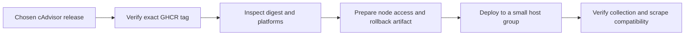

# Migrate cAdvisor Images to GHCR Without Guessing Release Tags

Author: [nawazdhandala](https://www.github.com/nawazdhandala)

Tags: Docker, Kubernetes, Monitoring, DevOps

Description: Move cAdvisor deployments from GCR to GHCR using verified release tags, manifest digests, architecture checks, and a staged rollout with a retained rollback image.

Changing a container registry looks like a one-line edit until the new reference fails to pull. The hostname, repository path, release tag, architecture, and image-pull policy all participate in identifying the artifact that a node actually runs.

cAdvisor's official instructions direct releases before v0.53.0 to `gcr.io/cadvisor/cadvisor` and newer releases to `ghcr.io/google/cadvisor`. The migration changes the repository path as well as the registry hostname. [Official versioned installation instructions](https://github.com/google/cadvisor/blob/v0.55.1/README.md).

Use a chosen release and verified artifact reference. Do not assume replacing `gcr.io` with `ghcr.io` while leaving the rest untouched will produce a valid image.

## Decide whether this is also a version upgrade

Inventory the current configured reference and the image actually running on representative nodes. If the current version predates the GHCR transition and the target is a newer release, this is both a registry migration and a software upgrade.

Review the target's release notes and the changes between the old and new versions. Preserve cAdvisor's arguments, host mounts, security settings, scrape labels, and monitoring expectations unless a reviewed compatibility change requires otherwise. [cAdvisor v0.53.0 release](https://github.com/google/cadvisor/releases/tag/v0.53.0), [v0.55.1 release](https://github.com/google/cadvisor/releases/tag/v0.55.1).

Record an independently usable rollback image before rollout. A string pointing at an old registry is insufficient if that registry will no longer be reachable from your nodes. Keep the required old artifact in an approved registry or otherwise available through your established deployment process.

## Verify the image tag rather than copying the Git tag

A Git release tag and a registry image tag are separate identifiers. During this article's registry checks on 20 November 2026, the following GHCR references behaved differently:

| Reference | Observed registry result |
| --- | --- |
| `ghcr.io/google/cadvisor:v0.53.0` | Manifest available |
| `ghcr.io/google/cadvisor:0.53.0` | Manifest request returned 404 |
| `ghcr.io/google/cadvisor:0.55.1` | Manifest available |
| `ghcr.io/google/cadvisor:v0.55.1` | Manifest request returned 404 |

These are observations of those specific tags, not a rule about every release. Check the official package and the selected reference at preparation time. [Official cAdvisor package](https://github.com/google/cadvisor/pkgs/container/cadvisor).

With Docker Buildx installed and registry access available, inspect the chosen image without starting a container:

```bash
docker buildx imagetools inspect ghcr.io/google/cadvisor:0.55.1
```

The output shows the manifest or index digest and platform entries. This command reads registry metadata; it does not prove the image starts successfully on your host. [Docker imagetools inspect](https://docs.docker.com/reference/cli/docker/buildx/imagetools/inspect/).

The checked 0.55.1 index digest was:

```text
sha256:e02855207ec07bb45ee41f720645945251f093f24c28f8c29cf718490f784922
```

It contained runnable Linux amd64 and arm64 manifests, plus entries marked with unknown platform metadata. Do not count unknown-platform entries as additional supported CPU architectures. Inspect the index members and their purpose rather than assuming every entry is runnable.

## Pin the artifact and check every required architecture

For an approved 0.55.1 deployment, a Compose image fragment can use the verified index digest:

```yaml
services:
  cadvisor:
    image: ghcr.io/google/cadvisor:0.55.1@sha256:e02855207ec07bb45ee41f720645945251f093f24c28f8c29cf718490f784922
```

Merge this into the existing service definition. The digest identifies content independently of a mutable tag. An index digest can select the appropriate child manifest for a supported node architecture; a single-platform manifest digest has a narrower scope. Kubernetes documents digest pinning and multi-architecture image indexes. [Kubernetes image references](https://kubernetes.io/docs/concepts/containers/images/).

Inventory your actual node architectures. A valid reference on an amd64 workstation does not demonstrate that an arm64 node can pull and run the required image. If you mirror the image internally, preserve the platforms your cluster uses and verify the destination reference after copying.

Do not assume the source and destination registry expose identical digest representations after a mirroring tool transforms media types or copies only one platform. Record what was copied and what the deployment will reference. A digest check is content verification, not automatically proof of publisher identity or a successful signature-policy evaluation.



## Prepare access from the nodes that pull images

Registry access from a laptop is not the same as access from a container runtime on a cluster node. Check node DNS, outbound policy, proxy configuration, registry trust, and any credential policy that applies to GHCR or your internal mirror.

For Kubernetes, review image-pull credentials and namespace placement where credentials are required. Also inspect the workload's existing `imagePullPolicy`: Kubernetes does not automatically change an already assigned pull policy merely because the image tag changes. [Kubernetes pull policy and credentials](https://kubernetes.io/docs/concepts/containers/images/).

Use a staging node that does not already have the target image cached. This verifies the path that replacement or newly provisioned nodes will need. Do not delete production caches just to force a test.

## Roll out deliberately and verify behavior

For an approved Compose staging service named `cadvisor`, prepare the configured image first:

```bash
docker compose pull cadvisor
```

This downloads the service image without starting it. After reviewing the service change and choosing the maintenance point, recreate that service through the normal Compose workflow:

```bash
docker compose up -d --no-deps cadvisor
```

The second command changes the running service and can interrupt collection briefly; it is not an inspection command. `--no-deps` avoids starting linked dependencies as part of this action. [Compose pull](https://docs.docker.com/reference/cli/docker/compose/pull/), [Compose up](https://docs.docker.com/reference/cli/docker/compose/up/).

After rollout, confirm the running image identity, startup logs, container discovery, and expected metric families. Compare labels and recording-rule outputs with the baseline. A successful pull and an HTTP 200 response do not establish that every required host mount or metric collector still works.

For Kubernetes, make the image change through the existing Helm, manifest, or GitOps owner. Avoid a separate manual change that the owner will immediately revert. Observe rollout status and a cold-node pull before expanding the change.

## Retain a short migration record

Record the old reference, target release, verified digest, required platforms, access checks, and successful scrape comparisons. Keep rollback artifacts until the target has survived ordinary workload churn and a replacement-node test.

The registry manifests and digest bytes in this article were fetched and checked directly. Compose syntax and shell examples were checked locally; no Docker pull, container execution, Kubernetes rollout, or registry mirror operation is claimed. Those deployment checks remain necessary for your environment.

A reliable migration finishes when new nodes can fetch the intended artifact and monitoring still observes the expected workloads. The registry hostname edit is only the beginning of that verification.
