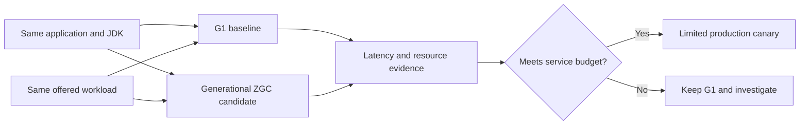

# Migrate from G1 to Generational ZGC and Measure the Tradeoff

Author: [nawazdhandala](https://www.github.com/nawazdhandala)

Tags: Java, Garbage Collection, Performance

Description: Compare G1 and Generational ZGC with the same JVM, workload and resource budget, then use request latency and capacity evidence to plan a safe rollout.

A service can have much shorter garbage collection pauses and still deliver slower requests. Collection consumes CPU, allocation can stall, and requests can wait behind busy application threads. Moving from G1 to Generational ZGC therefore needs an application benchmark, not just a screenshot of smaller pause durations.

This guide separates three questions: does the chosen runtime support the flags, does the service benefit under realistic load, and can that benefit survive a production resource budget? The commands were smoke-tested with Azul Zulu OpenJDK 21.0.13.1+2 on macOS ARM64. No production service or HTTP latency benchmark was run for this article.

## Establish a fair starting point

First confirm that garbage collection contributes materially to the latency problem. Compare request timestamps with GC and safepoint logs. A safepoint is a coordinated JVM stop; some stops have causes other than collection. If slow requests primarily wait on a database, changing collectors may leave the problem untouched.

Keep the application build, JDK distribution, JDK patch, instance size, CPU limits, heap settings and dataset constant for the first comparison. If the application currently uses JDK 17, establish a working G1 baseline on the intended JDK 21 runtime before switching collectors. Otherwise, the experiment combines a runtime upgrade with a GC change.

Remove G1-specific tuning from the ZGC launch configuration. Save the complete original arguments for rollback, including options supplied through environment variables or deployment templates. Do not leave two collector-selection flags enabled.



The shared inputs matter more than running both tests at exactly the same time. Running competing JVMs on one saturated machine introduces another source of contention.

## Select flags for the actual release

On the JDK 21 build used here, Generational ZGC requires both flags:

```bash
# Replace this path with the selected JDK 21 installation.
JAVA21=/path/to/jdk-21.0.13.1/bin/java
"$JAVA21" -XX:+UseZGC -XX:+ZGenerational \
  -XX:+PrintFlagsFinal -version
```

Inspect the version output and the `UseZGC` and `ZGenerational` entries. Both should be `true`, with a command-line origin. This starts a new diagnostic JVM; it does not inspect an already running service. The [OpenJDK 21 update source](https://raw.githubusercontent.com/openjdk/jdk21u/jdk-21.0.13%2B8/src/hotspot/share/gc/shared/gc_globals.hpp) defines `ZGenerational` as disabled by default.

These arguments are deliberately release-specific. In [JDK 23](https://docs.oracle.com/en/java/javase/23/gctuning/z-garbage-collector.html), `-XX:+UseZGC` selects the generational implementation by default. In [JDK 24](https://docs.oracle.com/en/java/javase/24/gctuning/z-garbage-collector.html), ZGC is generational only and the `ZGenerational` option is removed. Do not copy the JDK 21 command unchanged into every later runtime.

## Verify startup separately from performance

The companion `AllocationSmoke.java` retains a small ring of byte arrays while replacing its entries. It creates collection activity without calling an application endpoint. Compile it with the selected JDK and run the collectors separately from the directory containing that file:

```bash
JDK21=/path/to/jdk-21.0.13.1
"$JDK21/bin/javac" AllocationSmoke.java
mkdir -p gc-smoke

"$JDK21/bin/java" -Xms256m -Xmx256m -XX:+UseG1GC \
  '-Xlog:gc*,safepoint:file=gc-smoke/g1.log:time,uptime,level,tags' \
  -cp . AllocationSmoke

"$JDK21/bin/java" -Xms256m -Xmx256m \
  -XX:+UseZGC -XX:+ZGenerational \
  '-Xlog:gc*,safepoint:file=gc-smoke/zgc.log:time,uptime,level,tags' \
  -cp . AllocationSmoke
```

Each run should print `allocation smoke complete` and write its own log. Review initialization messages to confirm the selected collector and heap capacity. Both runs completed locally. Their elapsed times are intentionally not presented as a performance comparison: the program is short, has no request queue, and does not represent a warmed service. The [Java launcher documentation](https://docs.oracle.com/en/java/javase/21/docs/specs/man/java.html) describes unified logging and heap arguments.

The 256 MiB heap is a smoke-test setting, not a service recommendation. For service tests, preserve your measured baseline heap budget first. Leave memory for thread stacks, direct buffers, compiled code and other native allocations outside the Java heap.

## Design the service experiment

Use a staging environment with production-like CPU restrictions and representative data. Run the same request mix, including expensive routes and payload sizes. Warm application caches and compiled code before recording steady-state results, but measure cold startup separately because deployments still need to become ready promptly.

Choose an offered request rate independently of response completion when modeling externally arriving traffic. A test that sends its next request only after the previous response can quietly reduce pressure as the service slows. Grafana explains this distinction in its [open and closed load-model documentation](https://grafana.com/docs/k6/latest/using-k6/scenarios/concepts/open-vs-closed/). Also verify that the load generator has enough capacity; dropped iterations are missing workload, not successful service responses.

Use several stages: ordinary traffic, expected peak traffic, a bounded burst, and recovery after the burst. Repeat runs, alternate collector order, and preserve raw measurements. Keep unrelated deployments and dataset changes out of the experiment.

| Evidence | Decision it supports |
|---|---|
| Offered requests, completed requests and errors | Whether both runs served equivalent work |
| Per-route p50, p95, p99 and timeout counts | Whether ordinary and tail requests improved |
| CPU usage and CPU throttling | Whether concurrent collection exceeds the CPU budget |
| Heap occupancy after collection and allocation stalls | Whether collection keeps up with allocation |
| Process resident memory and container memory | Whether the deployment fits its actual limit |
| Pause durations and collection activity | Why application behavior changed |
| Startup and burst recovery time | Whether rollout and overload behavior remain acceptable |

A p99 is the duration below which 99 percent of measured requests fall. Do not average p99 values from unrelated instances and call the result a fleet percentile. Preserve compatible histograms or raw observations and compare equivalent windows with adequate request counts.

## Interpret the tradeoff before tuning

ZGC needs room for live objects and allocations made while collection runs. A tiny pause does not prove that this headroom exists. If requests stall during allocation, inspect heap pressure and CPU availability before assuming the collector has solved the problem. Oracle's [ZGC heap guidance](https://docs.oracle.com/en/java/javase/24/gctuning/z-garbage-collector.html) explains this concurrent-allocation requirement.

Start with the same resource budget, then conduct a separate capacity experiment if needed. If ZGC meets the latency goal only with more memory or CPU, record that cost explicitly. Conversely, lower pause time without a meaningful request improvement may not justify migration.

Keep memory-return policy consistent with the question being tested. Equal `-Xms` and `-Xmx` values prevent ZGC from uncommitting heap below that fixed minimum. A smaller initial heap answers a different memory-footprint question. Do not introduce pre-touch, large pages and heap changes together and attribute the entire result to collector selection.

## Roll out with a measurable exit condition

Set acceptance limits before the canary: latency at peak load, error rate, CPU headroom, memory ceiling and restart readiness. Send a small representative traffic share to the candidate, compare it with a contemporaneous G1 group, and observe a full workload cycle.

Rollback means restarting with the saved G1 configuration and the known application/runtime artifact. It is not an in-place collector switch. Keep enough healthy capacity to drain the candidate safely. Expand only when request outcomes and resource costs meet the agreed limits; retain the benchmark configuration so the next JDK upgrade can be evaluated with the same discipline.
