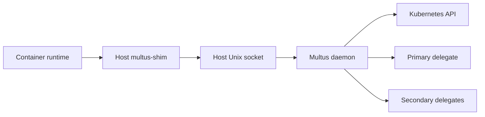

# Migrate Multus from Thin to Thick and Verify the Daemon Socket

Author: [nawazdhandala](https://www.github.com/nawazdhandala)

Tags: Multus, Kubernetes, Networking

Description: Plan a staged Multus thin-to-thick migration, verify the host-to-daemon socket mapping, and test new Pod attachment and deletion before expanding the rollout.

Changing Multus architecture changes where networking operations execute. With the thin plugin, the runtime invokes Multus directly. With the thick plugin, a small host executable called the shim forwards requests to a persistent Multus daemon. The daemon then invokes the actual network plugins, called delegates.

Existing Pods can keep passing traffic while that new request path is broken. A migration therefore needs more than a green DaemonSet: it must demonstrate that new Pods can attach networks and that deleted Pods release their resources.

This guide uses **Multus v4.3.1** as its source reference. It describes a controlled migration plan and read-only diagnostics, not a universal installer. Distribution-managed clusters should use their platform's supported migration procedure. No live cluster migration was performed for this article.

## Understand the new dependency

The shim communicates with the daemon over a Unix socket, a local communication endpoint represented by a filesystem path. There is no network Service to create for this connection. The host and daemon must see the same underlying socket through their respective mounts. [Thick-plugin architecture](https://github.com/k8snetworkplumbingwg/multus-cni/blob/v4.3.1/docs/thick-plugin.md).



Treat three pieces as one deployment unit: the shim binary, the active CNI configuration, and the daemon with its mounts and permissions. Updating only one creates an intermediate state that may not process networking requests.

## Inventory before changing a node

Choose a disposable staging node or a maintenance node whose workloads can be safely moved. Record the runtime's CNI configuration and binary directories, the active primary network, Multus configuration, delegate versions, network definitions, and IP address allocation state. Save the current installation manifests and exact image references for recovery.

Also identify who owns those files. A platform operator, a primary CNI installer, and an old Multus DaemonSet can overwrite a manual change. A successful migration requires one coordinated owner rather than competing installers.

For a standalone cluster using the upstream names, these commands provide an initial inventory:

```bash
kubectl -n kube-system get daemonset kube-multus-ds -o yaml
kubectl -n kube-system get pods -l app=multus -o wide
kubectl get network-attachment-definitions -A
```

Adapt names to your deployment. Retain the output in restricted operational records; configuration can reveal internal infrastructure details. Inspect the node's CNI files through approved host access, without deleting cached allocations or editing generated files during discovery.

## Build the target configuration deliberately

The v4.3.1 thick-plugin manifest is explicitly a quickstart that does not cover upgrades. It also references `snapshot-thick` for both the daemon and installer images. Checking out a tagged source tree does not make those image references immutable. Select and verify your approved release artifacts, then pin both images by digest in the reviewed deployment. [Pinned reference manifest](https://github.com/k8snetworkplumbingwg/multus-cni/blob/v4.3.1/deployments/multus-daemonset-thick.yml).

Before rollout, compare the target configuration against this checklist:

| Area | Required agreement |
| --- | --- |
| Binary location | Runtime finds the installed shim and delegates |
| CNI configuration | Runtime selects the intended Multus entry and primary delegate |
| Socket mount | Host and daemon paths resolve to the same socket |
| Host resources | Delegates can reach their required files, namespaces, and sockets |
| API access | Daemon identity can read the required Pods and network definitions |
| Recovery | Previous configuration and compatible binaries remain available |

The daemon may need host resources that the thin plugin previously accessed directly. Review every delegate's needs, including external IPAM daemons and node-local files. The reference deployment uses a host-root mount and chroot configuration; chroot changes the filesystem root used for delegate execution. Do not remove those settings without understanding your delegate requirements.

## Verify the socket from the correct side

In the reference layout, host `/run` is mounted at `/host/run` inside the daemon. Its `socketDir` is `/host/run/multus/`. The socket filename is `multus.sock`, so the corresponding host path is `/run/multus/multus.sock`. A customized deployment can use different paths. [Socket path implementation](https://github.com/k8snetworkplumbingwg/multus-cni/blob/v4.3.1/pkg/server/api/socket.go).

After the controlled target installation, run this on the selected Linux node with approved elevated access and curl installed:

```bash
sudo test -S /run/multus/multus.sock && echo 'Socket file exists'
sudo curl --unix-socket /run/multus/multus.sock \
  --noproxy '*' --connect-timeout 2 --max-time 5 \
  --fail --silent --show-error --output /dev/null \
  --write-out 'HTTP %{http_code}\n' http://localhost/healthz
```

The first command only checks the file type. A leftover socket can pass that test without a working listener. The second sends an HTTP health request through the Unix socket and should report HTTP 200. `--noproxy '*'` prevents an environment proxy from interfering; `localhost` supplies the HTTP URL while the socket selects the connection. [curl Unix-socket option](https://curl.se/docs/manpage.html#--unix-socket).

The v4.3.1 daemon also exposes `/readyz`; it returns an error during graceful shutdown. Neither endpoint proves that a delegate can configure a Pod or that API access works. They are communication and lifecycle checks, not full network acceptance tests. [Health and readiness handlers](https://github.com/k8snetworkplumbingwg/multus-cni/blob/v4.3.1/pkg/server/server.go).

## Move through one controlled node first

Use your platform's maintenance workflow to stop ordinary workload placement and handle evictions. Respect Pod disruption budgets and local-data requirements. A cordon alone does not evict existing workloads, and draining a node requires deliberate handling of DaemonSets. Do not force past an eviction failure simply to accelerate the migration. [Kubernetes node maintenance](https://kubernetes.io/docs/tasks/administer-cluster/safely-drain-node/).

Coordinate the old installer's withdrawal and the target installation so they cannot race over host files. Preserve the primary CNI configuration throughout. Avoid launching a second cluster-wide installer as a canary: its host writes can defeat the intended isolation.

On the selected node, verify the active configuration points to the shim, check the socket, and inspect the matching daemon's recent logs. Then run approved disposable workloads: first primary networking only, then each required secondary attachment. Check DNS, required Services, secondary addresses, routes, and cross-node traffic.

Delete those disposable workloads through Kubernetes and verify their IPAM allocations are released as expected. Repeat creation with fresh sandbox identities. Passing only the first ADD operation misses deletion and reuse problems.

## Define when to stop or recover

| Failure | First investigation |
| --- | --- |
| Socket missing | Daemon startup, socket directory, and host mount |
| Socket exists but connection fails | Listener, permissions, stale endpoint, or wrong node |
| Health succeeds but ADD fails | API access, delegate files, binary paths, and configuration |
| ADD works but DEL fails | Saved network configuration, IPAM service, and cleanup logs |
| Old Pods work but replacements fail | New shim-to-daemon request path |

Keep the node out of general placement until both creation and deletion pass. If recovery is necessary, restore the coordinated installation through its owner; do not just replace the shim while leaving generated thick-plugin configuration behind. Preserve evidence and network state rather than clearing CNI directories indiscriminately.

Expand only after the first node passes, then repeat the same acceptance checks for each node class. A migration is complete when fresh workloads reliably attach and detach across the fleet, not when the last daemon Pod becomes Running.
