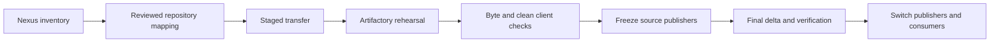

# Migrate Nexus to Artifactory While Preserving Package Identities

Author: [nawazdhandala](https://www.github.com/nawazdhandala)

Tags: Artifact Management, Artifact Repository, Migration

Description: Plan a Nexus-to-Artifactory migration that preserves package coordinates, verifies artifact bytes, and tests clean clients before switching publishers.

A repository migration can copy every visible file and still break a release. A Maven client might request the right version through the wrong repository group. An npm lockfile might retain an old download address. A container tag might exist while one platform's image is missing.

Treat migration as three separate promises: the package identity remains usable, its bytes remain unchanged, and the access path behaves correctly. Verify each promise before switching production publishers. The practical approach below uses a staged migration and a small independent checksum check; it does not assume a successful transfer log proves a working repository.

## Define what must stay the same

Package coordinates are the fields a client uses to identify a package. They are distinct from the server address used to download it. Write a mapping for every repository, including its consumers and owners.

| Item | Preserve | Explicitly review |
| --- | --- | --- |
| Maven release | Group, artifact, version, classifier, extension and bytes | Repository URL, server ID and group membership |
| npm package | Scope, name, version and package archive | Registry routing and lockfile download locations |
| Python distribution | Project, version and distribution files | Index URL and generated index pages |
| Container image | Required manifest digests and referenced content | Registry hostname, repository path and platform coverage |

An endpoint change is still a client change, even when coordinates remain stable. If keeping a familiar hostname, test how its proxy routes package-specific requests. Do not assume replacing DNS makes Nexus paths into Artifactory paths.

Inventory release artifacts, source archives, signatures, checksums and required metadata. Separate hosted content you own from proxy caches that can potentially be repopulated. A cache miss is acceptable only if the upstream remains reachable and still serves the required bytes. Include old versions needed for rollback, not just the current release.

## Choose and rehearse the migration tool

JFrog documents a Docker-based Nexus Migrator for Artifactory 7.x. Its scope includes artifacts and security entities, but repository groups, routing rules, plugins and build information require separate attention. Build a manual-work checklist from the [official migration coverage table](https://docs.jfrog.com/installation/docs/migrating-from-sonatype-nexus-repository-manager-to-artifactory).

For a reproducible rehearsal, record the exact downloaded migrator version, its verified distribution checksum, Nexus version and Artifactory version. The [release notes](https://docs.jfrog.com/installation/docs/nexus-migrator-release-notes) list **0.9.23**, dated 19 November 2026, while the overview still names 0.9.20. Resolve that discrepancy against the actual release you download; do not substitute an unrecorded latest image halfway through the migration.

Prepare a disposable target and follow the [documented prerequisites](https://docs.jfrog.com/installation/docs/before-you-begin-1). The normal host-based workflow requires Docker on the Nexus machine, suitable administrator access and enabled Nexus script execution. Plan any restart needed to enable that setting. Confirm storage headroom and trust for your internal certificate authority before moving data. Keep credentials out of shell history and published logs.

The documented stages are `config`, `getConfig`, `createRepo`, `migrateArtifact` and `migrateSecurity`. Run them deliberately, inspecting generated configuration before creating target repositories. See the [staged migration reference](https://docs.jfrog.com/installation/docs/run-the-migration-tool-in-multiple-stages) for the selected release's options. A stage that changes permissions deserves its own review; copied roles are not proof that access is appropriately restricted.



Inspect naming rewrites in `migrationConfig.yaml`. Repository renames can change endpoints even if package coordinates survive. Enable additional checksum calculation only after assessing resource use; JFrog warns that `checksumCalc: true` increases memory consumption. The [configuration documentation](https://docs.jfrog.com/installation/docs/edit-migration-configuration-optional) also describes PyPI reserved-path rewrites. Generated index pages may be recreated rather than copied byte for byte, so distinguish package archives from server-generated indexes in your acceptance criteria.

## Independently check the downloaded bytes

For each release selected for verification, download its artifact from both systems using an authorized client with normal TLS verification. Store successful response bodies in separate local files. Reject HTTP errors before saving evidence: hashing an HTML login page proves nothing about a package.

Create `checks.json` with one row per artifact. Replace the example coordinate, local filenames and expected checksum with your inventory. Obtain the expected SHA-256 from a retained release manifest or a baseline calculated from the source before migration. Protect that baseline from later modification.

```json
[
  {
    "coordinate": "com.acme:payments:1.4.2:jar",
    "source": "downloads/nexus-payments-1.4.2.jar",
    "target": "downloads/artifactory-payments-1.4.2.jar",
    "sha256": "REPLACE_WITH_64_LOWERCASE_HEX_CHARACTERS"
  }
]
```

Save this as `verify_downloads.py`. It uses Python's standard library, reads files in bounded chunks, and stops on a missing file, duplicate coordinate or mismatch. The hashing operations follow [Python's hashlib API](https://docs.python.org/3.9/library/hashlib.html).

```python
import hashlib
import json
import re
import sys
from pathlib import Path


def digest(filename):
    result = hashlib.sha256()
    with Path(filename).open("rb") as stream:
        for block in iter(lambda: stream.read(1024 * 1024), b""):
            result.update(block)
    return result.hexdigest()


rows = json.loads(Path(sys.argv[1]).read_text())
if not isinstance(rows, list) or not rows:
    raise ValueError("Expected a nonempty list of artifact checks")
seen = set()
for row in rows:
    coordinate = row["coordinate"]
    if not isinstance(coordinate, str) or not coordinate or coordinate in seen:
        raise ValueError("Missing or duplicate coordinate")
    seen.add(coordinate)
    expected = row["sha256"]
    if not isinstance(expected, str) or not re.fullmatch(r"[0-9a-f]{64}", expected):
        raise ValueError("Expected a real SHA-256 baseline")
    for side in ("source", "target"):
        if digest(row[side]) != expected:
            raise ValueError(f"Checksum mismatch: {coordinate} ({side})")
    print(f"MATCH {coordinate}")
print(f"Verified {len(rows)} artifact pairs")
```

Run it from the directory containing the referenced download paths:

```bash
python3 verify_downloads.py checks.json
```

Success prints one `MATCH` per pair and a final count. Any error exits unsuccessfully. This checks only the supplied inventory, not completeness, authenticity of the baseline, or package usability. For a large repository, automate inventory coverage and retain the expected total alongside results. This helper was tested locally with synthetic files; no Nexus-to-Artifactory migration was executed for this article.

## Exercise clients without their old caches

Use disposable build workers with empty package caches. Test each supported package format through its intended target endpoint. Resolve exact pinned releases, then build a representative application. Confirm expected dependency versions and verify authentication with an ordinary reader account.

Separately test publishers in a designated staging repository. Confirm approved uploads work, unauthorized writes fail, and release overwrite protection still applies. Recreate repository grouping and private namespace routing explicitly; a successful package download is insufficient if an internal missing package can now resolve from an unintended public source.

For containers, verify every required platform and fetch associated signatures and attestations. Preserve their links to the intended digest. Record failures by coordinate and endpoint so a missing archive is distinguishable from a permissions or routing problem.

## Cut over with a defined rollback boundary

Pause source publishing and scheduled deletion before the final transfer. Capture a final inventory, migrate the remaining changes, and rerun verification against that stable baseline. Switch a small controlled set of consumers first, then enable target publishing when checks pass.

Keep Nexus available read-only for the agreed recovery window. Before Artifactory accepts new writes, reverting client configuration may be straightforward. Afterward, rollback requires reconciling artifacts published only to Artifactory; pointing clients back without that reconciliation can make valid releases disappear.

Approve retirement only when package owners have demonstrated clean builds, publishers use the target, required evidence is accessible, and recovery procedures cover the new repository. Preserve the mapping, baseline hashes and verification reports as migration evidence rather than relying on a screenshot of a completed job.
