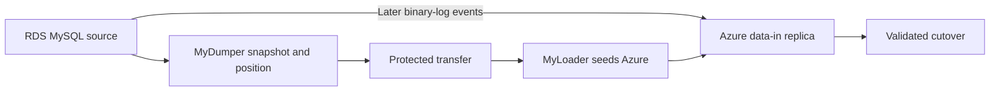

# Migrate RDS MySQL to Azure with MyDumper and Data-In Replication

Author: [nawazdhandala](https://www.github.com/nawazdhandala)

Tags: Azure, MySQL, AWS, Database Migration

Description: Seed Azure MySQL from an RDS snapshot made with MyDumper, resume from its exact binary-log position, and verify catch-up before a controlled cutover.

A low-downtime database migration has two connected parts: copy a consistent starting dataset, then replay changes made after that dataset's snapshot. The important connection is the replication position. If the copied data and starting position describe different moments, the target can miss changes or apply them twice.

This walkthrough uses MyDumper/MyLoader **1.0.19-1**, MySQL **8.0** on both sides, and a new, non-HA Azure Database for MySQL Flexible Server. The example uses binary-log file positions with GTID mode already OFF. GTIDs are transaction identifiers used by an alternative replication method; do not disable them on an existing deployment to fit this example.

For clarity, the lab has one application database, `appdb`, containing InnoDB tables with explicit primary keys and no stored routines, events, triggers, or views. Broader applications need an inventory and migration plan for those objects before using this pattern.

## Check compatibility and the replication route

Match character sets, collations, and `lower_case_table_names` before loading data. Table-name case behavior is especially important across managed services. Treat incompatibilities as prerequisites, not errors to ignore during import. Microsoft's [RDS migration guide](https://learn.microsoft.com/en-us/azure/mysql/flexible-server/how-to-migrate-rds-mysql-data-in-replication) describes the source and target preparation.

Current Azure documentation supports data-in replication on HA-enabled servers through **GTID-based replication**. This article's file-position example deliberately uses a non-HA target. Do not generalize older migration guidance into a claim that all data-in replication is incompatible with HA. Also, Azure currently documents private-endpoint-only targets with public access disabled as unsupported for data-in replication. Use a supported network model, such as VNet integration with a working route to RDS. See the [current requirements](https://learn.microsoft.com/en-us/azure/mysql/flexible-server/concepts-data-in-replication).



The Azure server itself must resolve and reach the RDS endpoint on TCP 3306. A migration VM reaching both databases does not prove that route. Review cross-cloud routing, DNS, return traffic, and narrowly scoped security rules.

## Retain the source logs long enough

RDS binary logging depends on automated backups being enabled with positive retention. Use the RDS parameter group to review the logging format; AWS recommends row-based logging for new replication setups. Read the [RDS binary-log configuration documentation](https://docs.aws.amazon.com/AmazonRDS/latest/UserGuide/USER_LogAccess.MySQL.BinaryFormat.html).

On the RDS source, inspect retention through an authorized administrative session:

```sql
CALL mysql.rds_show_configuration();
```

Budget for dumping, transfer, loading, catch-up, and troubleshooting. The following is an example change for an approved migration whose budget fits within 96 hours:

```sql
CALL mysql.rds_set_configuration('binlog retention hours', 96);
```

Monitor source storage while retaining those logs. AWS documents a maximum of 168 hours for this setting and warns about retained-log storage consumption. A long retention setting cannot recreate logs already purged. See [RDS retention procedures](https://docs.aws.amazon.com/AmazonRDS/latest/UserGuide/mysql-stored-proc-configuring.html).

## Capture a consistent snapshot with the pinned tools

Install the reviewed [1.0.19-1 release](https://github.com/mydumper/mydumper/releases/tag/v1.0.19-1) on migration hosts and inspect both binaries' version output. Use adequate local storage and protect dumps as production data. Schedule a schema-change freeze and a reviewed locking window.

Create a dedicated `migration.cnf` with this content, rather than inheriting an unknown machine-wide configuration:

```ini
[mydumper]
threads=4

[myloader]
threads=4

```

This file sets four workers for each tool and contains no password. Treat that count as a starting point for rehearsal, not a universal tuning value.

Run the dump from a host near RDS. Replace the endpoint, username, paths, and database name. The output directory must be a fresh migration directory:

```bash
mydumper --defaults-file='/absolute/path/migration.cnf' \
  --host='RDS_ENDPOINT' --user='DUMP_USER' --ask-password \
  --database='appdb' \
  --outputdir='/absolute/path/new-rds-dump' \
  --ssl-mode=VERIFY_IDENTITY --ca='/absolute/path/rds-ca-bundle.pem' \
  --sync-thread-lock-mode=LOCK_ALL --trx-tables=1
```

`LOCK_ALL` synchronizes the dump using table locks; it can block writes while locks are held. The account needs the relevant read, metadata, replication-position, and locking permissions. Review the [privilege requirements](https://mydumper.github.io/mydumper/docs/html/requirements.html) with the database owner.

This release explicitly supports `LOCK_ALL` and `SAFE_NO_LOCK` for RDS; do not replace the chosen mode with an unreviewed no-lock option. The RDS handling is in the [tagged locking implementation](https://github.com/mydumper/mydumper/blob/v1.0.19-1/src/mydumper/mydumper_start_dump.c). Rehearse blocking behavior and abort criteria before production.

Check exit status and logs, and require a completed `metadata` file. In this release, source information is written under `[source]` with `SOURCE_LOG_FILE` and `SOURCE_LOG_POS` labels, including commented labels when automatic replication setup was not requested. Preserve their values exactly. The [tagged metadata writer](https://github.com/mydumper/mydumper/blob/v1.0.19-1/src/mydumper/mydumper_working_thread.c) is more precise for this version than older examples using `[master]`.

## Load only into the prepared target

Transfer the complete dump through an approved encrypted channel and verify file integrity. Keep normal application writers away from the target. Run MyLoader near Azure using an account authorized to create and load the reviewed schema:

```bash
myloader --defaults-file='/absolute/path/migration.cnf' \
  --host='TARGET.mysql.database.azure.com' \
  --user='LOAD_USER' --ask-password \
  --directory='/absolute/path/transferred-rds-dump' --enable-binlog \
  --ssl-mode=VERIFY_IDENTITY --ca='/absolute/path/azure-ca-bundle.pem'
```

For this pinned release, `--enable-binlog` avoids the default attempt to set `SQL_LOG_BIN=0`, which can require privileges unavailable to a managed-service loader account. The flag remains supported but emits a warning that upstream discourages it; verify this behavior before upgrading the tools. See the [tagged loader source](https://github.com/mydumper/mydumper/blob/v1.0.19-1/src/myloader/myloader.c) and [argument handler](https://github.com/mydumper/mydumper/blob/v1.0.19-1/src/myloader/myloader_arguments.c). Budget for the extra target log volume.

This creates and populates objects; it is not a read-only validation. Use a new target without existing application data. Investigate every load error rather than adding overwrite or ignore-error switches. The connection and directory options are documented in the [MyLoader reference](https://mydumper.github.io/mydumper/docs/html/myloader_usage.html).

Recreate application users and grants separately; they are not supplied by replication of application tables. Validate schema and representative data before starting the change stream. If the source contains more application databases than this lab, include them consistently or design reviewed replication filters; dumping one database does not automatically restrict every incoming event to it.

## Start replication from the snapshot position

Create a dedicated RDS replication account with the required replication privilege, restricted network access, and TLS required. Azure's replication setup takes CA certificate **contents**, not a path on your migration VM. Obtain the appropriate trust material from the [official RDS certificate documentation](https://docs.aws.amazon.com/AmazonRDS/latest/UserGuide/UsingWithRDS.SSL.html).

In an authorized Azure SQL session, populate the following variables from reviewed configuration and a protected secret source. The file and numeric position must come from this dump's metadata. Then use the documented procedure signature:

```sql
CALL mysql.az_replication_change_master(
    @source_host, @replication_user, @replication_password,
    3306, @snapshot_file, @snapshot_position, @source_ca_pem
);
CALL mysql.az_replication_start();
SHOW REPLICA STATUS;
```

These session variables are prerequisites, not automatically populated values. Keep secrets out of saved scripts and logs. Review the [Azure procedure documentation](https://learn.microsoft.com/en-us/azure/mysql/flexible-server/how-to-data-in-replication) for their meanings. Its CA argument configures the replication TLS path; it does not expose the same `VERIFY_IDENTITY` option used by the dump clients. Confirm the managed replication connection's verification behavior meets your policy rather than assuming client flags apply to it.

## Prove catch-up before changing writers

Inspect replication I/O and SQL thread state, error fields, and executed source position. A zero lag number alone is insufficient; the [MySQL status reference](https://dev.mysql.com/doc/refman/8.0/en/show-replica-status.html) explains its limitations.

At cutover, pause source writers and drain active transactions. Record the final source position, wait for Azure to apply through that boundary, and compare business invariants. Only then stop and remove the replication relationship through the documented Azure procedures.

Move a controlled application cohort to Azure, verify an identifiable write and readback, then resume normal writers. Keep RDS fenced against new writes and retained for the agreed review period. After Azure accepts writes, moving back requires data reconciliation; an old connection string is not a complete rollback. Restore the required HA, monitoring, backup, and capacity settings before declaring the migration finished.
