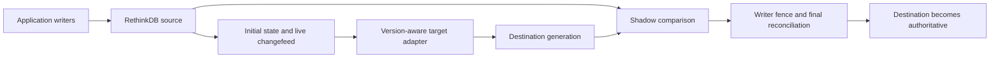

# Migrate from RethinkDB with Snapshot, Catch-Up, and Cutover Checks

Author: [nawazdhandala](https://www.github.com/nawazdhandala)

Tags: RethinkDB, Data Migration, Reliability

Description: Build a verifiable RethinkDB migration with initial changefeed state, versioned target writes, deletion tracking, shadow reads, and an explicit writer handoff.

Moving a live RethinkDB application involves two problems: copying the current documents and deciding which database owns the next write. A fast snapshot addresses only the first. A changefeed helps the target follow updates, but it does not supply a durable replay log or automatically make the handoff lossless.

Aim to keep reads available throughout migration. If writes must also remain continuously available, design a durable acceptance queue or a proven per-entity ownership handoff before promising zero downtime. Otherwise, a short, measured write fence is an honest cutover boundary. A write fence stops new source writes and waits for previously accepted writes to finish.

This protocol focuses on moving current application state, not reconstructing every historical event. The destination database is deliberately unspecified: its adapter must implement the atomic write and durability contract described below.

## Define the migration contract first

Inventory primary keys, secondary-index query shapes, time values, binary fields, and deletion behavior. RethinkDB has [data types](https://rethinkdb.com/docs/data-types/) beyond plain strings and numbers; define how each is represented at the destination before comparing serialized documents.

For the example, every source document has a nonempty string `id`, a positive integer `migration_rev`, and a Boolean `deleted` flag. Each business update increments the revision in the same atomic document operation. Deletion sets `deleted=true` and increments the revision instead of physically removing the document. Retain these tombstones until migration and rollback windows end. A tombstone is a retained record saying that an entity was deleted.

All writers must adopt this contract, including administrative scripts and scheduled cleanup. Plan the initial revision backfill before migration; do not race a blind backfill against active writers. If you cannot change deletion behavior, you need another durable way to capture deletes or a complete authoritative reconciliation before cutover.



A generation is a separately identified attempt to build the destination. Do not expose an incomplete generation to users.

## Couple the initial copy with change capture

A separate table scan followed by a new changefeed leaves a gap between the two operations. Use `include_initial` to receive initial documents through the same subscription as live changes. The [changes reference](https://rethinkdb.com/api/python/changes/) documents that initial rows can be interleaved with changes and that queue overflow produces an error.

With Python driver 2.4.10.post1 and an approved connection named `conn`, construct the full-table subscription as follows:

```python
from rethinkdb import RethinkDB

r = RethinkDB()
cursor = r.db("app").table("items").changes(
    include_initial=True,
    include_states=True,
    include_types=True,
    squash=False,
).run(conn)
```

Replace the database and table names after checking the destination mapping. Do not filter out tombstones. The consumer must handle `initial`, `add`, and `change` by submitting `new_val`; a physical `remove` violates this example's retained-tombstone contract and should stop promotion. Errors and unknown event types also require investigation. Close the cursor in a `finally` block when its owning worker exits.

The `ready` state means the server has sent the initial values, as described in the [changefeed guide](https://rethinkdb.com/docs/changefeeds/python/). If your consumer dispatches writes asynchronously, wait for their durable completion too. Neither event means no newer source writes exist.

## Make destination writes safe to repeat

A copied old value must not overwrite a newer value already delivered by the feed. The adapter should compare revisions and commit the document plus its revision atomically. This small executable model demonstrates that rule without pretending to implement a destination database:

```python
from copy import deepcopy

def apply_version(state, incoming):
    if not isinstance(incoming, dict):
        raise ValueError("Expected a document")
    key = incoming.get("id")
    revision = incoming.get("migration_rev")
    if not isinstance(key, str) or not key:
        raise ValueError("Expected a nonempty string id")
    if type(revision) is not int or revision < 1:
        raise ValueError("Expected a positive integer revision")
    if type(incoming.get("deleted")) is not bool:
        raise ValueError("Expected an explicit deletion flag")
    previous = state.get(key)
    if previous is not None:
        if revision < previous["migration_rev"]:
            return "stale"
        if revision == previous["migration_rev"]:
            if incoming != previous:
                raise RuntimeError("Same revision has different content")
            return "duplicate"
    state[key] = deepcopy(incoming)
    return "applied"
```

For a fixture at revision one, delivering revision two twice applies it once and identifies the repeat as a duplicate. Delivering revision one afterward leaves revision two intact. A deletion remains stored with its revision so an older live document cannot resurrect it. Recreating the same identifier must continue the revision sequence, not reset it.

The dictionary is only a single-process model. A real adapter needs an atomic conditional write or transaction, durable acknowledgments, and concurrency tests. A read followed by an unconditional write is insufficient when multiple workers process the same key. Preserve deterministic transformed content so equal revisions can be compared meaningfully.

## Treat disconnects as a reconciliation event

Do not resume from an imagined durable changefeed offset. On overflow or lost connection, stop declaring that generation caught up. Retain diagnostics, then rebuild or reconcile against a fresh initial subscription. A fresh generation avoids carrying unexplained extra rows from an abandoned attempt.

There is another important limit: [RethinkDB consistency documentation](https://rethinkdb.com/docs/consistency/) says changefeeds ignore `read_mode` and behave as `single`. A feed observation is therefore not equivalent to a majority-committed source audit. After source failover, a destination might even contain a revision that is no longer authoritative. A greater-revision rule alone cannot repair that case.

Invalidate the attempt if source history appears to move backward. Final authoritative reconciliation must detect extra keys and mismatched content, not merely wait until the destination revision is at least as high. Rebuild a clean destination generation from the quiescent source if necessary; do not let stale target revisions veto the authoritative repair.

## Compare reads while the source remains authoritative

Shadow reads execute a destination query for comparison while continuing to return the source result to users. Start with a small sample and compare normalized content, identifiers, ordering, pagination boundaries, and deletion visibility. Protect personal data in discrepancy logs.

| Result | Interpretation |
|---|---|
| Same revision, different normalized content | Mapping or adapter defect |
| Destination behind source | Possibly lag; investigate sustained differences |
| Destination-only key | Missed deletion, abandoned generation, or source rollback |
| Equal counts, different keys | Counts alone concealed a correctness problem |

Live comparisons can race legitimate writes. Compare revision-aware samples and repeat discrepancies before classifying them. Separately verify destination indexes, latency, and capacity under expected load. A correct point lookup does not validate the application's sorted or paginated queries.

## Hand off writers at a provable boundary

First fence all source writers, including background jobs, and drain in-flight requests. Keep reads on the source. Confirm there are no unresolved indeterminate write outcomes. Drain destination work, then perform a complete comparison against the stable source using the required majority read semantics and healthy source configuration. Check key sets, revisions, tombstones, and normalized content.

A marker document arriving through one feed is not a global barrier for unrelated documents or tables. Avoid using a single timestamp or marker as proof that every partition has caught up. For multiple tables, fence their writers together and validate the cross-table invariants your application needs.

Only after reconciliation succeeds should the routing layer assign write ownership to the destination. Prevent stale application instances from continuing source writes. Start controlled traffic, verify its reads and writes, and then resume normal writers. If requests are queued during the fence, acknowledge them according to the queue's real durability contract; do not report completed database mutations before they happen.

Rollback changes after the first destination-only write. Switching the endpoint back would lose access to those writes unless a tested reverse synchronization or replay path exists. Keep the source protected, retain the migration evidence, and rehearse that decision before cutover. Local tests for this article cover the version model and driver query construction, not a live migration or a zero-downtime guarantee.
