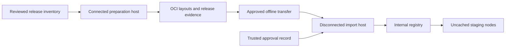

# Mirror an Entire Container Release Offline with Verified Digests

Author: [nawazdhandala](https://www.github.com/nawazdhandala)

Tags: Container Registry, Air-Gapped, Docker

Description: Build an offline release bundle, preserve multi-platform images, verify imported digests, and find missing dependencies before deployment.

An offline installation can fail even when its main application image is present. A database migration Job might use another image. An operator might inject a helper container only after installation. A chart hook might need an image that never appears in the steady-state Deployment.

The release is therefore the unit of transfer. Build a reviewed inventory, freeze its image references, carry the required content across the boundary, and prove that the destination can serve it without help from the source registry.

This walkthrough uses **crane 0.20.6** and one Open Container Initiative (OCI) image-layout directory per image reference. It covers image transport, not database backup or application-state recovery. Keep those recovery procedures separate.

## Define what belongs in the release

Render the exact deployment configuration intended for the disconnected environment. Record its chart or manifest version, enabled features, target CPU architectures, and configuration checksums. Review the resulting resources alongside the product's installation documentation.

Use an inventory with these fields:

| Field | Why it matters |
|---|---|
| Component and trigger | Identifies startup, migration, hook, scheduled, or injected images |
| Source repository and digest | Freezes the exact upstream object |
| Destination repository and release tag | Defines the import mapping |
| Required platforms | Prevents an AMD64-only rehearsal hiding an ARM64 omission |
| Layout directory | Connects each image to its transferred files |
| Verification evidence | Records publisher checks and destination digest results |

Include bootstrap tools and the registry's own recovery artifacts if the environment cannot obtain them independently. Retain charts, configuration schemas, approved CA certificates, and the crane binary for the destination operating system. Do not put registry passwords in the bundle.

A rendered manifest inventory is a starting point. Review operators, admission-time injection, optional Jobs, and runtime package downloads separately. A successful render cannot prove that an application never downloads another executable.



The approval record must be independently trustworthy. A checksum shipped beside an altered bundle does not establish who authorized its contents.

## Freeze each source before downloading

Install the pinned crane version on the preparation host, configure trusted registry CAs, and authenticate using your approved credential mechanism. The following Bash example uses placeholder repository names and a release tag; replace them with a reviewed inventory entry. Run it from a new, empty working directory.

```bash
set -eu
source_repo='registry.vendor.example/team/api'
source_tag='approved-release'
layout='release-bundle/images/api'

crane version
expected=$(crane digest --platform all "$source_repo:$source_tag")
mkdir -p release-bundle/images
test ! -e "$layout"
printf '%s\n' "$expected" > release-bundle/api.digest
crane pull --format oci --platform all \
  "$source_repo@$expected" "$layout"
```

Confirm that `crane version` reports `v0.20.6`. The digest resolves the tag once; the subsequent download uses that fixed reference. For a multi-platform image, the digest identifies the index that points to the architecture-specific manifests. For a single-platform image, it identifies that image's manifest.

The explicit OCI format matters: crane's default pull output is a tarball format. With `--format oci`, this version writes a **directory**, including an `index.json` entry point and content-addressed blobs. Its pull implementation preserves the entire source index when all platforms are selected. [Pinned pull implementation](https://github.com/google/go-containerregistry/blob/v0.20.6/cmd/crane/cmd/pull.go), [OCI image-layout specification](https://github.com/opencontainers/image-spec/blob/v1.1.1/image-layout.md).

Repeat this process for every inventory entry, using a fresh directory each time. Do not append multiple release images into one layout for this procedure. One layout entry per original reference makes the import behavior and digest comparison unambiguous.

## Package evidence as well as bytes

Record the resolved digest in the reviewed inventory, not only in the small example digest file. Retain the platform descriptors and the exact source-to-destination mapping. Include publisher-signature verification results and the material your offline verification policy requires.

Image copying is not automatically a complete signature or software bill of materials transfer. Associated artifacts can refer *to* an image through the registry's referrers mechanism; they are not necessarily children reached by downloading its image index. Inventory and transfer them using tooling compatible with the publisher's artifact convention, then verify them in the destination repository. [OCI Distribution referrers specification](https://github.com/opencontainers/distribution-spec/blob/v1.1.1/spec.md#listing-referrers).

Use the organization's approved packaging and transfer process to preserve the complete directory tree. Produce a checksum inventory covering every transferred file, and authenticate that inventory through the release approval process. On arrival, check both the approved inventory and the received files before importing anything.

Do not rename an OCI directory archive and assume it is a Docker-save archive. This procedure supplies an extracted OCI **directory** to crane. Its file and directory input paths use different loaders. [Pinned push implementation](https://github.com/google/go-containerregistry/blob/v0.20.6/cmd/crane/cmd/push.go).

## Import into a reserved destination

On the disconnected import host, install the same crane version, trust the internal registry's certificate chain, and obtain write access to a dedicated release repository. Reserve a fresh release tag through registry policy or your release process: the push command below does not promise to reject an existing tag.

After verifying the transferred bundle, run this Bash example from its parent directory:

```bash
set -eu
layout='release-bundle/images/api'
destination='registry.internal.example/releases/api:approved-release'
expected=$(cat release-bundle/api.digest)

crane push "$layout" "$destination"
actual=$(crane digest --platform all "$destination")
test "$actual" = "$expected"
printf 'Verified destination digest: %s\n' "$actual"
```

The expected outcome is a successful equality check against the independently approved source digest. Stop the release if it differs; do not update the expected value to match an unexplained result.

Do **not** add `--index` here. In crane 0.20.6, ordinary directory push unwraps the layout's single entry and publishes that original image or index. The `--index` option instead publishes the layout index itself. That wrapper can have a different digest from the original multi-platform index. This distinction follows the pinned push implementation linked above.

Repeat and record the result for every inventory row. Configure deployments to use the internal repository with the verified digest where the product supports digest references. Merely retaining the old public hostname in chart values can defeat an otherwise correct import.

## Prove the release is usable offline

Use isolated staging nodes with empty image caches and the actual intended architectures. Block public egress through the staging environment's reviewed network controls. Do not disconnect production to perform this test.

Exercise installation, migration Jobs, injected containers, scheduled tasks, restart, and an upgrade or recovery path appropriate to the release. Confirm pulls originate from the internal registry and investigate any attempted public lookup. An index digest check does not, by itself, demonstrate that every referenced layer can be downloaded by the actual node runtime.

For this article, a local test with crane 0.20.6 downloaded a synthetic AMD64/ARM64 index into an OCI directory, stopped the source registry, and imported the directory into a second registry. The original index digest remained unchanged and both platforms' layers were readable. A separate `--index` push changed the top-level digest as expected. These were anonymous loopback HTTP fixtures; they did not test production TLS, credentials, signatures, Kubernetes execution, or a real product release.

Approve the offline release only when the inventory is complete, transfer verification succeeds, every destination digest matches, associated verification artifacts are available, and uncached staging workloads pass. Preserve that evidence with the bundle so the next installation starts from a reproducible release rather than a collection of remembered tags.
