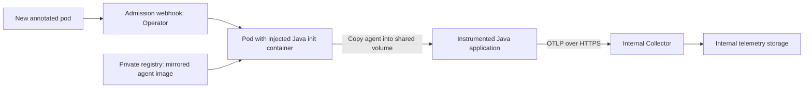

# Mirror OpenTelemetry Auto-Instrumentation Images for Offline Kubernetes

Author: [nawazdhandala](https://www.github.com/nawazdhandala)

Tags: Air-Gapped, Monitoring, Observability

Description: Mirror language agents for offline injection, configure exact Instrumentation image overrides, and verify private pulls and Java export trust.

A healthy OpenTelemetry Operator does not prove that automatic instrumentation will work offline. The Operator can accept a pod and inject an initialization container whose image still points to a public registry. The application then waits for an image it cannot download.

This guide uses Operator **v0.163.0** and its documented Java instrumentation image **2.33.1-3**. The [release notes](https://github.com/open-telemetry/opentelemetry-operator/releases/tag/v0.163.0) and [tagged Java TLS example](https://github.com/open-telemetry/opentelemetry-operator/blob/v0.163.0/tests/e2e-instrumentation/instrumentation-java-tls/00-install-instrumentation.yaml) establish those pins. Examples were checked against tagged source and parsed locally; no live injection or registry transfer was performed.

## Understand Which Image Runs Where

The Operator handles admission: Kubernetes asks its webhook whether a new pod needs modification. For Java, injection adds an init container that copies the agent into a shared volume, then configures the application to load it. The agent sends telemetry using OpenTelemetry Protocol (OTLP) to a Collector, which forwards it to storage.



Keep three image inventories:

| Image category | Runs in | Why it is separate |
| --- | --- | --- |
| Operator and installation helpers | Operator namespace | Runs controllers and admission webhook |
| Collector distribution | Collector namespace or workload | Receives and exports telemetry |
| Language instrumentation images | Injected workload pod | Supplies agents or language libraries |

Mirror the application's own image too. Inventory certificate-management components, sidecars, jobs, and other dependencies in your chosen Operator installation. If cert-manager supplies webhook certificates, its images and resources must also be available offline. Webhook certificate trust is between Kubernetes and the Operator; it is separate from application export trust.

This tutorial assumes the pinned Operator, its matching custom resource definitions (CRDs), and an internal Collector are already working. A CRD teaches Kubernetes the schema of a resource such as `Instrumentation`. Installing only the CRD does not run the webhook.

## Inventory Every Language You Intend to Inject

The [v0.163.0 Instrumentation schema](https://github.com/open-telemetry/opentelemetry-operator/blob/v0.163.0/apis/v1alpha1/instrumentation_types.go) defines these image fields. Annotation names below use the prefix `instrumentation.opentelemetry.io/`:

| Language | Image override | Annotation suffix |
| --- | --- | --- |
| Java | `spec.java.image` | `inject-java` |
| Node.js | `spec.nodejs.image` | `inject-nodejs` |
| Python | `spec.python.image` | `inject-python` |
| .NET | `spec.dotnet.image` | `inject-dotnet` |
| Go | `spec.go.image` | `inject-go` |
| PHP | `spec.php.image` | `inject-php` |
| Ruby | `spec.ruby.image` | `inject-ruby` |
| Apache HTTPD | `spec.apacheHttpd.image` | `inject-apache-httpd` |
| NGINX | `spec.nginx.image` | `inject-nginx` |

Use the [tagged per-language guides](https://github.com/open-telemetry/opentelemetry-operator/tree/v0.163.0/docs/auto-instrumentation/languages) to check enablement flags and runtime requirements. Ruby, for example, is disabled by default in this release. Go uses a privileged instrumentation sidecar with different requirements; it does not follow the Java workflow of copying a Java archive (JAR).

For every language actually enabled for use, record the source reference, destination, supported platform, and digest. Mirror any `spec.java.extensions[].image` entries as well. Those create additional init containers. Do not assume setting the Operator's own registry rewrites language images; populate the appropriate overrides in every Instrumentation resource that workloads select.

## Transfer the Selected Image Without Changing Its Contents

On a connected machine with a reviewed Crane binary, save the pinned Java image for Linux AMD64:

```bash
SOURCE='ghcr.io/open-telemetry/opentelemetry-operator/autoinstrumentation-java:2.33.1-3'
crane pull --platform linux/amd64 "$SOURCE" java-agent-amd64.tar
```

Keep an integrity record for the archive and its selected source digest. Verify it after approved transfer. On an internal importer with registry credentials and CA trust already configured:

```bash
DEST='registry.example.internal/otel/autoinstrumentation-java:2.33.1-3'
crane push java-agent-amd64.tar "$DEST"
```

These are the documented [Crane pull](https://github.com/google/go-containerregistry/blob/main/cmd/crane/doc/crane_pull.md) and [push](https://github.com/google/go-containerregistry/blob/main/cmd/crane/doc/crane_push.md) operations. Preserve the archive/tool pairing; a tar filename does not guarantee compatibility with another import tool. Protect the destination tag against replacement and retain the resulting digest, or use the reviewed destination digest in the image override.

Repeat for every enabled language and platform in your inventory. This example deliberately schedules AMD64. A portable Java agent does not make its Linux init-container filesystem architecture-independent. For other languages, check runtime compatibility too: Python distinguishes `glibc` and `musl` platforms, while this release's .NET guide lists `linux-x64` and `linux-musl-x64` runtime identifiers. Do not infer ARM support from a matching version number.

## Create a Java Instrumentation Resource

Use an existing `apps` namespace. The example assumes an internal Collector exposing **HTTPS OTLP/HTTP on port 4318 with mutual TLS**. Mutual TLS means the Collector also verifies the application's client certificate. It requires a separately configured Collector receiver; a plaintext gateway from another tutorial will not accept this connection.

Provision these in `apps` through your normal certificate process:

- ConfigMap `collector-ca`, with the trusted Collector CA bundle under `ca.crt`.
- Secret `collector-client-tls`, with a valid client certificate under `tls.crt` and its private key under `tls.key`.
- Image-pull Secret `internal-registry`, authorized to read the mirrored application and agent repositories.

Save this as `instrumentation.yaml`. Replace the internal names to match your Collector and registry:

```yaml
apiVersion: opentelemetry.io/v1alpha1
kind: Instrumentation
metadata:
  name: offline-java
  namespace: apps
spec:
  exporter:
    endpoint: https://otel-gateway.observability.svc.cluster.local:4318
    tls:
      secretName: collector-client-tls
      configMapName: collector-ca
      ca_file: ca.crt
      cert_file: tls.crt
      key_file: tls.key
  propagators:
    - tracecontext
    - baggage
  sampler:
    type: parentbased_traceidratio
    argument: "1"
  java:
    image: registry.example.internal/otel/autoinstrumentation-java:2.33.1-3
    env:
      - name: OTEL_EXPORTER_OTLP_PROTOCOL
        value: http/protobuf
      - name: OTEL_METRICS_EXPORTER
        value: none
      - name: OTEL_LOGS_EXPORTER
        value: none
```

This starts with traces only. The sampler retains traces started locally for the trial while respecting parent decisions; choose production sampling separately. Disabling metrics and logs makes the first acceptance test easier to interpret.

The Operator's [Java TLS assertions](https://github.com/open-telemetry/opentelemetry-operator/blob/v0.163.0/tests/e2e-instrumentation/instrumentation-java-tls/01-assert.yaml) show injected mounts and the Java `OTEL_EXPORTER_OTLP_CERTIFICATE`, client-certificate, and client-key variables. The [Java SDK configuration](https://opentelemetry.io/docs/languages/java/configuration/) defines these exporter settings. This is Java-specific evidence, not a promise that every language handles certificate files identically.

Ensure the Collector certificate covers the endpoint's DNS name. Its receiver must trust the issuer of the client certificate. The Collector's separate credentials for exporting to OneUptime remain on the Collector; applications do not need that backend ingestion key.

## Annotate the Workload Template

Create the Instrumentation resource before new application pods. Merge the following fragment into an existing Deployment's `spec.template`, preserving its other fields. It assumes the Java application container is named `app`:

```yaml
metadata:
  annotations:
    instrumentation.opentelemetry.io/inject-java: "offline-java"
    instrumentation.opentelemetry.io/container-names: "app"
spec:
  nodeSelector:
    kubernetes.io/arch: amd64
  imagePullSecrets:
    - name: internal-registry
```

These are pod-template annotations, not Deployment-level metadata. Naming the Instrumentation resource avoids ambiguous selection. The [container selection guide](https://github.com/open-telemetry/opentelemetry-operator/blob/v0.163.0/docs/auto-instrumentation/multi-container.md) documents `container-names`; without selection, the first application container is normally targeted.

The workload's pull Secret applies to its injected init container too. Credentials in the Operator namespace do not automatically transfer to application pods. Each node runtime must separately trust the registry's CA; the Collector CA mounted above cannot fix an image-pull certificate error. See [Kubernetes private-image guidance](https://kubernetes.io/docs/tasks/configure-pod-container/pull-image-private-registry/).

Existing application environment variables take precedence over injected settings. Inspect existing `OTEL_*` variables and Java agent options for conflicts. Changing an Instrumentation resource does not retrofit running pods; use a controlled workload rollout after review.

## Verify the Admitted Pod, Then the Trace

In staging, create a new pod on a node without cached application or agent images. Deny public egress at the node and pod boundaries while preserving internal registry, webhook, DNS, and Collector access. Do not remove production caches.

After selecting the intended context, replace the pod placeholder and inspect both image lists with [kubectl JSONPath](https://kubernetes.io/docs/reference/kubectl/jsonpath/):

```bash
kubectl --context YOUR_STAGING_CONTEXT -n apps get pod YOUR_POD \
  -o jsonpath='{range .spec.initContainers[*]}{.name}{"\t"}{.image}{"\n"}{end}{range .spec.containers[*]}{.name}{"\t"}{.image}{"\n"}{end}'
```

The admitted pod should contain the mirrored Java init image, complete its copy step, and start the application with the agent attached. Inspect pod events and the resulting mounts and environment without sharing secret contents. A Deployment manifest alone cannot show whether admission injected the expected image.

Generate a request to a supported instrumented application endpoint and find its trace in the internal backend. Require both successful cold-node startup and verified telemetry. Missing injection suggests annotations, resource selection, or webhook availability; `ImagePullBackOff` suggests image paths, credentials, trust, or platform mismatch. A running agent with failed export instead points to endpoint, protocol, or client/server TLS trust. Keep these checks separate so a successful image mirror is not mistaken for a working monitoring path.
