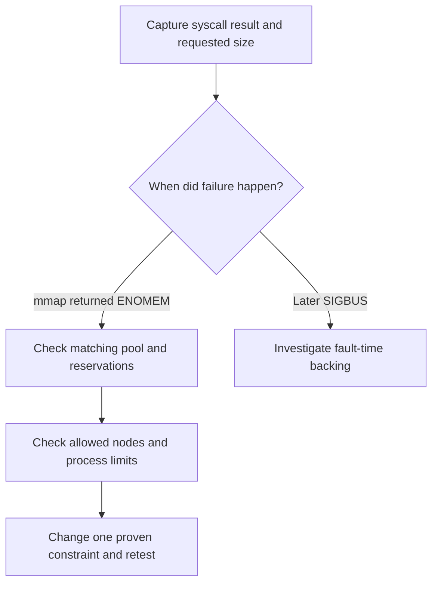

# Diagnose MAP_HUGETLB ENOMEM When Linux Still Has Free RAM

Author: [nawazdhandala](https://www.github.com/nawazdhandala)

Tags: Linux, HugePages, Troubleshooting

Description: Diagnose HugeTLB allocation failures by checking page size, outstanding reservations, NUMA restrictions, and process limits before changing memory settings.

A service reports “Cannot allocate memory,” yet the host has gigabytes available. If the failing call uses `mmap()` with `MAP_HUGETLB`, ordinary free RAM is only part of the investigation. The application requested explicit huge pages, and the kernel must satisfy that particular request.

Start with evidence from the failing process. Do not increase several memory settings at once: a successful restart would then tell you little about which constraint mattered. This walkthrough uses Linux 6.12 documentation as its baseline and provides read-only checks. Distribution patches and processor support can change the available page sizes.

## First establish what actually failed

Record the mapping length in bytes, flags, selected huge-page size, return value, and `errno` immediately after the failed call. Application logs that translate every allocation problem into “out of memory” lose useful distinctions.

For `mmap()`, failure is `MAP_FAILED`. `ENOMEM` needs a capacity or address-space investigation. `EINVAL` calls for checking arguments and alignment. With `MAP_HUGETLB`, `EPERM` can indicate that the caller lacks `CAP_IPC_LOCK` and membership in the configured `hugetlb_shm_group`. Granting broad privileges is not an appropriate response to an actual `ENOMEM`. These distinctions come from the [mmap interface documentation](https://man7.org/linux/man-pages/man2/mmap.2.html).

Also distinguish a failed call from a later crash. A mapping can succeed before the application touches its pages. A later `SIGBUS` signal belongs to a page-fault investigation: the kernel could not supply backing for an accessed region. Keep the timing visible in the incident record.



## Inspect the pool the application requested

On a Linux host with procfs and sysfs mounted, run:

```bash
uname -r
awk '/^(HugePages_Total|HugePages_Free|HugePages_Rsvd|HugePages_Surp|Hugepagesize|Hugetlb):/' /proc/meminfo
for pool in /sys/kernel/mm/hugepages/hugepages-*; do
    [ -d "$pool" ] || continue
    printf '\n%s\n' "$pool"
    for field in nr_hugepages free_hugepages resv_hugepages surplus_hugepages; do
        [ -r "$pool/$field" ] || continue
        printf '%s=' "$field"
        cat "$pool/$field"
    done
done
```

The first summary reports the default huge-page size. The directory listing separates supported sizes, such as `hugepages-2048kB` for 2 MiB and `hugepages-1048576kB` for 1 GiB. These counters count pages, not bytes. The `Hugetlb` meminfo field is different: it reports memory across sizes. See the [Linux HugeTLB administration guide](https://www.kernel.org/doc/html/v6.12/admin-guide/mm/hugetlbpage.html).

Compare that inventory with the actual mapping flags. `MAP_HUGE_2MB` and `MAP_HUGE_1GB` select particular sizes; a request without an explicit size uses the default. A healthy 2 MiB pool does not demonstrate capacity for a 1 GiB request. Transparent Huge Pages are a separate mechanism and do not establish capacity in this explicit pool.

## Account for pages already promised to other mappings

“Free” is not the same as “available for a new reservation.” Some unused pages have already been promised to existing mappings that have not touched them yet. A useful initial estimate is:

```text
uncommitted pool pages = free pages - reserved pages
requested pages = round up(requested bytes / huge-page bytes)
```

The kernel's [HugeTLB reservation explanation](https://www.kernel.org/doc/html/v6.12/mm/hugetlbfs_reserv.html) describes this distinction. Its detailed implementation discussion references an older kernel, so use it to understand reservations rather than as a complete algorithm for every modern allocation path.

For example, suppose a 2 MiB pool has 128 free pages and 120 reserved pages. A new 64 MiB request needs 32 pages, while the uncommitted estimate is eight. Looking only at the 256 MiB represented by free pages misses the existing promises.

Save this Python 3 helper as `pool-estimate.py`. It reads a selected pool without changing it:

```python
import argparse
import re
from pathlib import Path

parser = argparse.ArgumentParser()
parser.add_argument("pool", type=Path)
parser.add_argument("requested_bytes", type=int)
args = parser.parse_args()
match = re.fullmatch(r"hugepages-(\d+)kB", args.pool.name)
if not match or args.requested_bytes <= 0:
    parser.error("use a hugepages-SIZEkB directory and a positive byte count")
page_bytes = int(match.group(1)) * 1024
if page_bytes == 0:
    parser.error("page size must be positive")
free = int((args.pool / "free_hugepages").read_text())
reserved = int((args.pool / "resv_hugepages").read_text())
needed = (args.requested_bytes + page_bytes - 1) // page_bytes
print(f"Requested pages: {needed}")
print(f"Free pages: {free}; reserved pages: {reserved}")
print(f"Uncommitted-pool estimate: {max(0, free - reserved)} pages")
print("Snapshot only: this does not check NUMA, limits, or surplus allocation.")
```

Run it against the pool that matches the failing call:

```bash
python3 pool-estimate.py /sys/kernel/mm/hugepages/hugepages-2048kB 67108864
```

For the example counters, expect 32 requested pages and eight uncommitted pages. Reads are not atomic, and concurrent workloads can change the counts. Surplus allocation can also affect the outcome. Treat the result as a shortage hypothesis, not proof that every request above that estimate must fail.

## Check where the process is allowed to allocate

NUMA means that memory is divided into nodes with different access distances from processors. Capacity elsewhere in the host may not satisfy a process's memory policy.

Replace `12345` with the application's PID as seen from the host. Run as an account permitted to inspect that process:

```bash
app_pid=12345
awk '/^(Name|VmSize|Mems_allowed_list):/' "/proc/$app_pid/status"
cat "/proc/$app_pid/numa_maps"
for file in /sys/devices/system/node/node*/hugepages/hugepages-2048kB/free_hugepages; do
    [ -r "$file" ] || continue
    printf '%s=' "$file"
    cat "$file"
done
```

Change the final path's size for a 1 GiB request. `Mems_allowed_list` shows allowed memory nodes, while `numa_maps` describes policy and placement for existing mappings. It cannot show a mapping that failed to be created. Read these alongside the application's configured allocation policy. The interfaces are documented in [process status](https://man7.org/linux/man-pages/man5/proc_pid_status.5.html) and [NUMA reporting](https://man7.org/linux/man-pages/man7/numa.7.html).

Do not relax node placement automatically. It may protect latency or isolate a workload. First establish whether the requested capacity exists on an eligible node.

## Eliminate other constraints before expanding the pool

Inspect the target process, rather than the limits inherited by your troubleshooting shell:

```bash
app_pid=12345
cat "/proc/$app_pid/limits"
wc -l < "/proc/$app_pid/maps"
cat /proc/sys/vm/max_map_count
cat "/proc/$app_pid/cgroup"
```

`limits` reports soft and hard limits with units. Address-space limits (`RLIMIT_AS`) and, where applicable, data limits (`RLIMIT_DATA`) can cause allocation failure independently of pool capacity. See [process limits](https://man7.org/linux/man-pages/man5/proc_pid_limits.5.html) and [getrlimit](https://man7.org/linux/man-pages/man2/getrlimit.2.html). The maps line count is an approximate current mapping count, useful when investigating [max_map_count](https://www.kernel.org/doc/html/v6.12/admin-guide/sysctl/vm.html#max-map-count), not a calculation of how many additional mappings are guaranteed.

For containers or managed services, resolve the process's actual cgroup and inspect its ancestors. In cgroup v2, the HugeTLB controller exposes size-specific usage, limits, and events. Linux 6.12 documents enforcement of its usage limit at page-fault time. Therefore, a `hugetlb.2MB.events` limit event is relevant evidence, but does not by itself explain an earlier `mmap()` failure. Check the host's actual controller and kernel rather than assuming every memory-related error has the same cause. See the [cgroup v2 HugeTLB interface](https://www.kernel.org/doc/html/v6.12/admin-guide/cgroup-v2.html#hugetlb).

## Retest the constraint you identified

A useful incident conclusion names the request and limiting condition: “64 MiB in 2 MiB pages needed 32 new reservations; only eight were uncommitted during the failed attempt.” It should also record node restrictions and process limits so another operator can reproduce the reasoning.

If capacity is genuinely insufficient, plan an appropriately sized pool while preserving memory for ordinary workloads. Runtime growth can fail because memory is fragmented; a larger requested setting is not evidence that allocation succeeded. Verify resulting counters. Do not use `MAP_NORESERVE` to declare success: bypassing reservations can move a shortage into later execution.

Repeat a representative allocation and first-touch test in an isolated environment before changing production policy. The Python arithmetic and argument checks here were tested against synthetic files; Linux allocation, NUMA restrictions, and fault behavior were not executed for this article.
