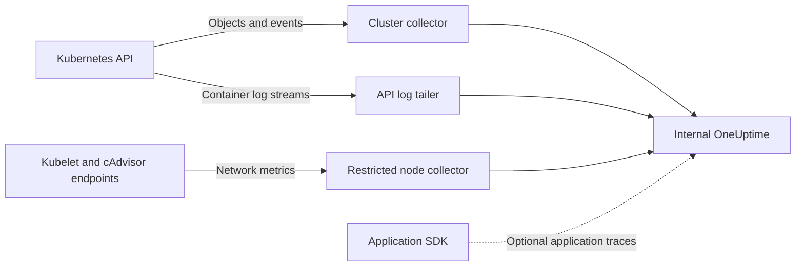

# Monitor Air-Gapped OpenShift Clusters with Restricted Security Policies

Author: [nawazdhandala](https://www.github.com/nawazdhandala)

Tags: Air-Gapped, OpenShift, Monitoring, Security

Description: Deploy the OneUptime agent with restricted OpenShift permissions, mirror its images, and understand the logs and metrics available without host access.

An isolated OpenShift cluster can remain observable without granting a monitoring agent privileged access to every node. The important choice is how the agent collects information. Reading container logs through the Kubernetes API has different permissions and operating costs from mounting the node's log directory.

This guide reviews OneUptime Kubernetes agent chart **17.0.0** and OpenShift **4.20** security documentation. The chart was rendered locally to inspect permissions, workloads, and images. No live OpenShift deployment was tested. One security limitation in the pinned chart's metric transport is called out explicitly below.

## Start with the Restriction, Then Choose the Collection Path

OpenShift uses Security Context Constraints (SCCs) to decide which pod security settings are allowed. Under `restricted-v2`, workloads cannot simply request privileged execution or host-directory mounts. OpenShift also assigns user IDs from the namespace's range. A hard-coded user ID that works on another Kubernetes distribution can fail admission here. See Red Hat's [SCC documentation](https://docs.redhat.com/en/documentation/openshift_container_platform/4.20/html/authentication_and_authorization/managing-pod-security-policies).

OneUptime provides two distinct presets. `openshift` creates additional SCCs for collectors needing host access. `openshift-restricted` creates no SCC and adapts collection to the restricted environment. Choose the latter when your administrator has ruled out additional host permissions. Do not select the broader preset merely to silence a failed pod.



An SDK is a library added to an application to produce telemetry. That is a separate route to tracing when kernel-level instrumentation is unavailable.

## Agree on What Will Be Visible

The [agent's OpenShift reference](https://oneuptime.com/docs/en/telemetry/kubernetes-agent#openshift) describes these tradeoffs:

| Signal | Restricted collection path | Important limit |
| --- | --- | --- |
| Cluster objects and events | Kubernetes API | Requires approved read permissions |
| Container standard output and error | API log tailer | A long-lived API connection per streamed container |
| Node, pod, and container resource metrics | Network access to kubelet/cAdvisor | Still requires authorization, reachability, and TLS review |
| OpenShift operators, version, Routes, DeploymentConfigs | API resource snapshots | Not equivalent to collecting every platform metric |
| Host operating-system detail | Not collected through host files | Host `/proc`, `/sys`, and filesystem access are absent |
| eBPF traces and continuous profiles | Disabled by the restricted preset | Use application instrumentation where appropriate |
| Node audit-log files | Not collected | Use a separately approved audit-log pipeline |

The absence of host mounts does not mean the node DaemonSet disappears. A DaemonSet runs a pod on each eligible node; here it can collect metrics over the network without reading host files. Similarly, application traces can still arrive from SDKs even though automatic eBPF tracing is absent. eBPF is a Linux kernel mechanism used by some agents to observe application activity.

## Reduce the Offline Installation to the Required Components

For an initial deployment, disable optional cost collection, AI access, profiling, and debugging. That reduces both image inventory and permission review. Enable additional features only when their dependencies and data access have been reviewed.

On a connected preparation machine, retain the versioned chart:

```bash
helm pull kubernetes-agent --version 17.0.0 \
  --repo https://helm-chart.oneuptime.com
```

Save the images required by the final rendered values, verify their identities and archive checksums, transfer them, and import them into your internal registry. This example requires two unique images:

| Original image | Example internal destination |
| --- | --- |
| `otel/opentelemetry-collector-contrib:0.161.0` | `registry.example.internal/observability/otelcol-contrib:0.161.0` |
| `oneuptime/kubernetes-log-tailer:17.0.0` | `registry.example.internal/oneuptime/kubernetes-log-tailer:17.0.0` |

The Collector version is the one pinned by this agent chart, not the version used in an unrelated Collector tutorial. Confirm each image exists for your node architectures before transfer. Keep source and destination digests in the recovery inventory and protect pinned internal tags from replacement. Re-render whenever enabling another component: optional workloads can add images.

Prepare an existing Secret named `oneuptime-ingestion-key` in `oneuptime-agent`, with the ingestion key under `api-key`. Use the project's telemetry ingestion key, not a project management API key. Deliver it through your secret-management process instead of putting it in shell history or a values file.

## Use an Explicit Restricted Values File

Save this as `restricted-values.yaml`, replacing hostnames and choosing a cluster name unique within your OneUptime project:

```yaml
preset: openshift-restricted
clusterName: factory-openshift-a
oneuptime:
  url: https://monitoring.example.internal
  existingSecretName: oneuptime-ingestion-key
image:
  repository: registry.example.internal/observability/otelcol-contrib
  tag: "0.161.0"
logs:
  mode: api
  api:
    image:
      repository: registry.example.internal/oneuptime/kubernetes-log-tailer
      tag: "17.0.0"
aiAgent:
  enabled: false
cost:
  enabled: false
ebpf:
  enabled: false
profiling:
  enabled: false
auditLogs:
  enabled: false
debug:
  enabled: false
namespaceFilters:
  rules:
    - action: include
      namespaces: ["apps-*"]
      scopes: [podLogs]
```

The namespace rule collects pod logs only from namespaces beginning `apps-`. It is a collection filter, not an authorization boundary: it does not narrow the chart's ClusterRole or filter all events and resource snapshots. Review those permissions independently. Replace the rule with your actual application namespaces.

These keys come from the [pinned chart source](https://github.com/OneUptime/oneuptime/blob/0de2d9ceac0a2404f5df7ad1f9ab1e22c56bea7e/HelmChart/Public/kubernetes-agent/values.yaml). No fixed user ID or custom SCC is added. The preset allows OpenShift to assign the user and security labels.

## Inspect Before Applying

Render using the local chart archive:

```bash
helm template kubernetes-agent ./kubernetes-agent-17.0.0.tgz \
  --namespace oneuptime-agent --values restricted-values.yaml \
  > restricted-rendered.yaml
```

The reviewed output contained a cluster-collector Deployment, API-log-tailer Deployment, and node-collector DaemonSet. All used the same `kubernetes-agent` service account. It contained no SCC, hostPath volume, privileged container, host PID setting, or fixed `runAsUser`. Containers dropped all Linux capabilities and disabled privilege escalation. Those are useful checks, not a substitute for admission on your cluster.

Review the ClusterRole too. Restricted pod execution and broad read access are different controls. Logs can contain sensitive application data even when the reader is unprivileged. Agree on retention and who may query the resulting telemetry.

For private pulls, arrange registry CA trust on the nodes and authorized pull credentials through the platform's supported workflow. Once the release's service account exists, an existing registry Secret can be linked to it:

```bash
oc --context YOUR_STAGING_CONTEXT -n oneuptime-agent \
  secrets link kubernetes-agent internal-registry --for=pull
```

This changes that service account's pull configuration; it does not grant cluster administration. The Secret must already exist in the namespace. Ensure the association is present before the controlled creation or replacement of agent pods. Red Hat documents [image pull-secret association](https://docs.redhat.com/en/documentation/openshift_container_platform/4.20/html/images/managing-images).

## Review Transport Security Separately

The pinned chart's [node-collector template](https://github.com/OneUptime/oneuptime/blob/0de2d9ceac0a2404f5df7ad1f9ab1e22c56bea7e/HelmChart/Public/kubernetes-agent/templates/configmap-daemonset.yaml) renders certificate-verification skipping for kubelet and cAdvisor requests. The restricted preset does not remove those settings. Do not describe this unmodified chart as satisfying a policy that requires verification on every connection.

If that policy applies, resolve the limitation before production: review a maintained chart customization or upstream fix that mounts the correct kubelet trust chain, verifies the endpoint identity, and removes verification bypasses. Validate the resulting Collector configuration and handshake against your actual kubelet certificates. There is no documented all-purpose values switch in this reviewed chart that supplies that entire solution; inventing one would hide the gap.

Outbound OneUptime HTTPS is another connection. Both the Collector and the log-tailer runtime must trust its certificate chain. Registry CA configuration does not configure either application's trust store. A private-CA deployment therefore needs a reviewed trust-distribution customization for both workloads, not a disabled verification setting.

## Accept the Deployment by Signal, Not by Pod Color

After transport and permission review, install the local chart through your staging release process. Use fresh nodes without cached agent images and block public egress while preserving internal dependencies. Confirm every image pull uses the internal registry.

Inspect the SCC actually assigned to each pod:

```bash
oc --context YOUR_STAGING_CONTEXT -n oneuptime-agent get pods \
  -o 'custom-columns=NAME:.metadata.name,SCC:.metadata.annotations.openshift\.io/scc'
```

Expect `restricted-v2` in the intended environment; a different SCC warrants investigation rather than assuming the preset enforced it. Generate a distinctive log line in an included namespace, check an event and resource snapshot, and verify fresh container CPU or memory data. Confirm excluded namespaces are absent from pod-log results while recognizing that other collection scopes remain separate.

Watch API-server load as log streams increase. Rehearse a tailer restart and measure gaps: API streaming is not a durable log archive. Finally, distinguish intentional missing host/eBPF signals from actual collection failures. A permissions refusal, an image-pull error, and an exporter TLS error belong to different parts of the pipeline and need different fixes.
