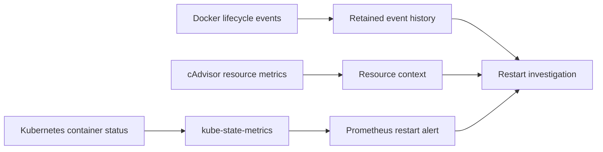

# Monitor Container Restarts Without a cAdvisor Restart Counter

Author: [nawazdhandala](https://www.github.com/nawazdhandala)

Tags: Kubernetes, Docker, Prometheus, Alerting, Monitoring

Description: Use Kubernetes restart counters or retained Docker lifecycle events instead of inferring exact restart counts from cAdvisor resource metrics.

A container's CPU counter drops, its memory graph disappears briefly, and its start-time series changes. Those observations suggest a lifecycle change, but they do not establish an exact restart count. The container may have restarted, been replaced, or simply become temporarily invisible to monitoring.

cAdvisor is useful for resource usage. For restart monitoring, collect lifecycle information from the system managing the container. In Kubernetes, kube-state-metrics exposes restart counts from object status. With standalone Docker, runtime events provide the transitions needed for an event-based view.

This article uses cAdvisor 0.55.1, kube-state-metrics 2.15.0 metric definitions, and Prometheus 3.7.3 query tests. It does not claim that a container workload was restarted during validation.

## Do not turn an unrelated metric into a restart counter

The [cAdvisor metric catalog](https://github.com/google/cadvisor/blob/v0.55.1/docs/storage/prometheus.md) includes start time, resource counters, and out-of-memory events. It does not provide a general container restart counter in this release.

`container_start_time_seconds` is a timestamp-valued gauge. In the [exporter implementation](https://github.com/google/cadvisor/blob/v0.55.1/metrics/prometheus.go), it comes from the container specification's creation time. Treating changes in that value as a complete restart ledger is unsafe: replacement can create a different time series, several transitions can happen between scrapes, and creation time is not a promise to advance for every process restart.

Similarly, CPU counter resets describe counter continuity, while OOM events describe a particular failure mechanism. Neither covers every restart cause. A failed scrape only establishes that observation failed.



Keep these signals together for investigation, but preserve their different meanings.

## Use the Kubernetes status counter

For regular containers, kube-state-metrics exposes `kube_pod_container_status_restarts_total`, with namespace, pod, container, and pod UID labels. UID is the unique identity of a particular pod object; a replacement pod can reuse a name while having a different UID. Init containers have a separate restart metric. The [versioned pod metric reference](https://github.com/kubernetes/kube-state-metrics/blob/v2.15.0/docs/metrics/workload/pod-metrics.md) lists both.

First verify that your Prometheus server actually scrapes kube-state-metrics and stores this metric. Scraping kubelet's cAdvisor endpoint alone does not supply it. Keep the relevant job and cluster selection in your queries so unrelated environments do not overlap.

For an existing job named `kube-state-metrics`, inspect recent increases:

```promql
increase(kube_pod_container_status_restarts_total{
  job="kube-state-metrics"
}[10m])
```

Replace the job name if yours differs. Do not sum away UID while diagnosing a recreated pod. Also inspect whether replicas of the metrics exporter cause multiple observations of the same Kubernetes object; resolve that collection issue before building aggregate restart totals.

The Kubernetes API notes that kubelet tries to preserve restart counts, but state can be lost after node restarts and the count may reset to zero. See the [Kubernetes 1.35 container-status definition](https://github.com/kubernetes/api/blob/v0.35.0/core/v1/types.go). This is operational status, not an immutable lifetime audit record.

## Alert on observed increases, with explicit limits

Here is a complete rule group for Prometheus 3.7.3. Save it as `container-restarts.rules.yml` and include it through your existing Prometheus `rule_files` configuration:

```yaml
groups:
  - name: container-restarts
    interval: 30s
    rules:
      - alert: ContainerRestartObserved
        expr: |
          increase(kube_pod_container_status_restarts_total{
            job="kube-state-metrics"
          }[10m]) > 0
        labels:
          severity: warning
        annotations:
          summary: Container restart count increased
          description: Inspect the pod identity, termination state and previous logs.
```

There is no `for` delay in this example: a positive observation can fire on the next evaluation. Routing, grouping, silences, and delivery still belong to your alerting configuration. Decide whether any observed restart deserves a warning in your environment before enabling it.

Validate syntax before deployment:

```bash
promtool check rules container-restarts.rules.yml
```

Prometheus's [`increase` documentation](https://prometheus.io/docs/prometheus/latest/querying/functions/#increase) explains that it adjusts for counter resets and extrapolates across the range. A displayed increase can therefore be fractional. Use this expression to detect observed activity, not as an exact accounting report.

A newly discovered series whose first value is already three does not prove three restarts occurred inside the last ten minutes. Without an earlier observation, the timing is unknown. Likewise, restarts between loss of status and its later recovery can be absent from the retained counter history. Monitor scrape health separately rather than translating missing observations into zero restarts.

## Investigate the cause separately

After an alert, retain the pod UID, container name, observation time, and current restart count. Inspect the latest termination state and available previous logs through your normal Kubernetes tools. A last-termination reason describes the last retained state; it is not a history of every restart counted during the window.

Include init containers deliberately if they are part of the alert's scope. Their separate metric should not be silently omitted from a dashboard labeled “all container restarts.” Conversely, planned replacement of a pod is a new object lifecycle, not necessarily an increment of the old pod's restart counter.

## For Docker, retain events before you need them

On a host using standalone Docker, inspect a bounded recent event window. Replace `app-container` with the relevant container name or ID and use the correct Docker context:

```bash
docker system events --since 10m --until 0s \
  --filter type=container \
  --filter container=app-container \
  --filter event=die --filter event=start \
  --format '{{json .}}'
```

This read-only command returns matching stop/start transitions ending at invocation time. Filters for the same field are alternatives. Docker's [events documentation](https://docs.docker.com/reference/cli/docker/system/events/) describes the filtering and notes that only the last 256 historical events are returned. A ten-minute request does not guarantee ten minutes of complete history on a busy daemon.

For durable monitoring, collect the live stream into retained storage and record host identity, container ID, action, and event time. Handle reconnects and duplicated delivery explicitly. Count a subsequent start for the same container according to a documented definition; an initial start is not a restart, and a replacement with a new ID is a separate lifecycle. Missing events should create a coverage warning, not a fabricated zero.

Local rule tests for this article cover an increasing counter, an unchanged counter, a reset followed by an increase, and a newly seen constant value. They establish how the alert responds to those inputs. Production acceptance should additionally verify source coverage and notification delivery using an approved staging workload.
