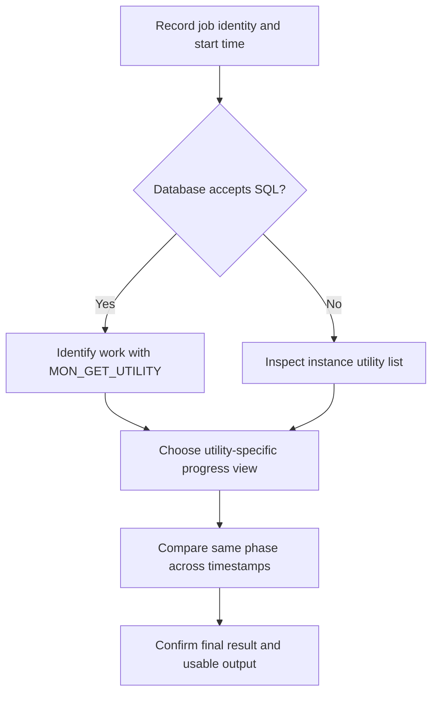

# Monitor Db2 Utilities Without Misreading Their Progress

Author: [nawazdhandala](https://www.github.com/nawazdhandala)

Tags: Database, Monitoring, Troubleshooting

Description: Track Db2 backup, restore, reorganization, and statistics collection with MON_GET_UTILITY and utility-specific evidence, without inventing completion estimates.

A backup has been running for an hour. A reorganization appears to have stopped moving. A statistics job disappeared from the monitoring screen. These observations require different responses, even though all three involve database utilities.

Start by identifying the operation, then use the progress information that actually applies to it. `MON_GET_UTILITY` helps answer who started what and when. It is not a universal percentage-complete interface. Detailed progress comes from commands such as `LIST UTILITIES SHOW DETAIL` and the relevant `db2pd` options.

The examples below target Db2 LUW 11.5 and a single-partition database named `APPDB`. Replace that placeholder with your database. Run commands from a separate monitoring session with the instance environment loaded. They inspect existing work; they do not start or cancel utilities. No Db2 runtime was available for executing these examples.

## Identify the running operation first

When the database accepts SQL connections, connect through the Db2 command-line processor:

```bash
db2 connect to APPDB
```

Then run this SQL in that connection:

```sql
SELECT CURRENT TIMESTAMP AS CAPTURED_AT,
       MEMBER, COORD_MEMBER, APPLICATION_HANDLE,
       HEX(UTILITY_INVOCATION_ID) AS INVOCATION_HEX,
       UTILITY_ID, UTILITY_TYPE, UTILITY_START_TIME,
       SESSION_AUTH_ID, OBJECT_SCHEMA, OBJECT_NAME,
       SUBSTR(UTILITY_DETAIL, 1, 300) AS DETAIL_PREVIEW
FROM TABLE(SYSPROC.MON_GET_UTILITY(-2)) AS U
ORDER BY UTILITY_START_TIME, MEMBER, UTILITY_ID;
```

The `-2` requests information from all active members of the connected database. The invocation identifier is binary, so `HEX` makes it readable. Keep the member and start time alongside the utility ID; the ID is unique to a database partition, not a permanent global job identifier. The preview deliberately truncates a potentially large detail field. Retrieve the full detail separately when investigating exact options.

IBM documents the returned identity and ownership fields in its [MON_GET_UTILITY reference](https://www.ibm.com/docs/en/ias?topic=functions-mon-get-utility-get-utilities-running-database). The routine also appears in the [Db2 11.5 request-monitoring interfaces](https://www.ibm.com/docs/en/db2/11.5.x?topic=monitoring-request-information-using-table-functions). It requires the appropriate routine privilege or administrative authority; PUBLIC execution is not granted by default.

Do not add imagined columns such as `PERCENT_COMPLETE` to this query. An empty result means no matching active utility was observed in this scope at that instant. It does not establish that yesterday's backup succeeded.

## Use instance monitoring when SQL is unavailable

An offline backup or restore can make a normal database connection unavailable. That is a reason to change the monitoring path, not to interrupt the operation so that a dashboard can reconnect.

From an authorized instance session, run:

```bash
db2 list utilities show detail
```

This lists active utilities at instance scope and reports detailed progress where supported. Check the database name and member or partition number before associating an entry with your job. IBM lists SYSADM, SYSCTRL, SYSMAINT, or SYSMON as the required authority choices in the [LIST UTILITIES reference](https://www.ibm.com/docs/de/db2/11.5.x?topic=commands-list-utilities).

The command is useful even when the SQL route is unavailable. Conversely, having permission to execute a monitoring function does not automatically establish permission to run every operating-system diagnostic command. Arrange both access paths before the maintenance window.



## Match the diagnostic to the utility

On the database server, `db2pd` reads diagnostic information from the Db2 engine. Use the actual database name for `-db`, not an unrelated client alias. These commands are alternatives selected for the operation under investigation:

```bash
# Backup or restore performance and work information
db2pd -db APPDB -barstats

# Table reorganization
db2pd -db APPDB -reorgs

# Index reorganization
db2pd -db APPDB -reorgs index

# Table and index statistics collection
db2pd -db APPDB -runstats
```

Use an account authorized for `db2pd` on that host. Its [command reference](https://www.ibm.com/docs/en/db2/11.5.x?topic=commands-db2pd-monitor-troubleshoot-db2-engine-activities) describes these options. Capture the retrieval time, database, object, status, phase, and counters together. In a multi-member installation, a local diagnostic sample is not automatically a complete cluster report.

| Operation | Useful evidence | Common interpretation mistake |
|---|---|---|
| BACKUP | Utility identity, estimated work, buffer and media activity | Treating processed database bytes as the compressed file size |
| RESTORE | Current phase, image being processed, buffer activity | Assuming every phase has a known total |
| REORG | Table or index identity, phase, counters, status | Treating one phase's progress as the whole job |
| RUNSTATS | Table collection followed by index collection | Assuming a finished table scan means all statistics are done |

For backups, `-barstats` includes information about workers that move buffers and workers that interact with backup media. Those observations help distinguish ongoing processing from time waiting for data or buffers. They do not by themselves prove a storage fault. See IBM's [backup performance output explanation](https://www.ibm.com/docs/en/db2/11.5.x?topic=barstats-example-output-backup-performance-monitoring).

A restore can involve multiple phases and, for an automatic incremental restore, multiple images. Read the image position and phase before comparing samples. IBM's [restore output example](https://www.ibm.com/docs/en/db2/11.5.x?topic=barstats-example-output-restore-performance-monitoring) includes a total-work value that is not a useful ordinary byte estimate. Do not turn unavailable or sentinel values into a precise percentage.

## Compare like with like

Save two observations several minutes apart at an interval appropriate to the job. Match the invocation, member, object, phase, and units before calculating a rate. If the phase changed from scanning data to rebuilding an index, the new counter belongs to different work.

For an illustrative same-phase sample, suppose completed work rises from 20 GiB to 26 GiB in 120 seconds. That is 6 GiB per two minutes, approximately 51.2 MiB per second. It is a recent rate, not a promise about the remaining duration. Later processing can use different resources or wait for other work.

Only calculate a fraction when the reported total is positive, meaningful, and in the same units as completed work. Display “total unavailable” otherwise. Avoid averaging percentages across partitions: equally weighting a small partition and a much larger one can produce a misleading overall result.

For index reorganization, retain the current index, current phase, and partition information. IBM's [index reorganization monitoring example](https://www.ibm.com/docs/en/db2/11.5.x?topic=reorganization-monitoring-index) shows why these dimensions matter. A new index or partition can reset the apparent progress without reversing completed work.

For RUNSTATS, inspect both table and index sections. IBM's [11.5 performance guide](https://public.dhe.ibm.com/ps/products/db2/info/vr115/pdf/en_US/db2_perf_tune_115.pdf) documents `LIST UTILITIES` and `db2pd -runstats`. A zero maximum counter is not a denominator for a completion calculation.

## Investigate a flat counter without cancelling blindly

First rule out an old capture, the wrong database, a phase transition, and a completed operation whose record remains visible in a diagnostic view. Then correlate the utility with its job output, diagnostic messages, storage availability, and any relevant application waits.

A maintenance window can also impose deliberate throttling. Record the displayed priority before assuming the engine is unexpectedly slow. Escalate with timestamps and the exact command options rather than just “stuck at 70 percent.” Cancelling backup, restore, and reorganization has different recovery implications; a monitoring threshold should not automatically terminate them.

## Close the job with outcome evidence

Preserve the originating command's return status and output. For backup and restore, IBM documents [successful-operation performance records in db2diag.log](https://www.ibm.com/docs/en/db2/11.5.x?topic=backup-restore-statistics) at diagnostic levels 3 and 4. Correlate these with the correct operation rather than treating a matching database name as sufficient.

A completed backup still needs the team's image verification and restore rehearsal policy. A restored database may require rollforward and application checks before writers return. A reorganization needs its final status and table accessibility checked. Statistics collection needs the expected table and index statistics confirmed.

Store both progress samples and final evidence in the maintenance record. This separates “we saw work advancing” from “the requested operation completed successfully,” which is the distinction an on-call engineer needs when deciding what to do next.
