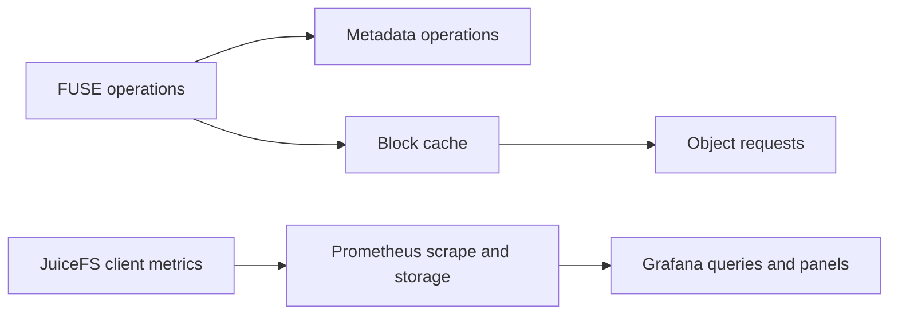

# Monitor JuiceFS with Prometheus and Grafana Across Storage Layers

Author: [nawazdhandala](https://www.github.com/nawazdhandala)

Tags: JuiceFS, Prometheus, Grafana, Monitoring

Description: Scrape JuiceFS client metrics and build useful Grafana views for FUSE activity, metadata latency, cache hits, and object requests without misleading aggregates.

A single storage-throughput graph cannot explain whether a JuiceFS client is waiting on metadata, serving cached blocks, or downloading objects. Start with a small dashboard that follows the request path. Keep each client's identity visible so a slow mount is not hidden inside a fleet average.

This walkthrough uses **JuiceFS Community Edition 1.4.2** metric names and **Prometheus 3.7.3** configuration and query checks. It assumes an existing Linux FUSE mount and a Prometheus installation. Grafana reads the resulting time series; it does not scrape the JuiceFS client itself.

## Expose a deliberate metrics endpoint

JuiceFS mount processes expose Prometheus metrics, normally on loopback port 9567. Set the address explicitly in your existing mount configuration if you need a predictable target:

```bash
juicefs mount --metrics 127.0.0.1:9567 "$META_URL" /mnt/jfs
```

This illustrates a foreground mount with an approved metadata address and empty mountpoint. Add the option to the existing service definition through your normal maintenance procedure; do not launch a second mount over the running filesystem.

Loopback works when Prometheus shares the client's network namespace. For a central scraper, use a reachable internal interface and restrict access to the monitoring network, or retain loopback behind your authenticated TLS proxy. Do not expose the raw metrics listener to the public internet.

With an explicit occupied address, this release logs a listener failure instead of choosing another port. Without an explicit address it can fall back to an available port. Check the client log for the actual listener and verify it, rather than assuming every mount uses 9567. This behavior is defined in the [metrics listener implementation](https://github.com/juicedata/juicefs/blob/v1.4.2/cmd/mount.go).

For the loopback example:

```bash
curl --fail --silent --show-error http://127.0.0.1:9567/metrics
```

Expect text containing metric declarations and samples. This proves endpoint reachability, not successful file access. Check it from the scraper's own network context as well.

## Give every scrape target a stable identity

For a single host running both processes, save this as a staging `prometheus.yml`:

```yaml
global:
  scrape_interval: 15s
  evaluation_interval: 15s

scrape_configs:
  - job_name: juicefs
    honor_labels: false
    static_configs:
      - targets: ["127.0.0.1:9567"]
        labels:
          cluster: staging
          node: worker-a
```

In an existing Prometheus configuration, merge the job into its current `scrape_configs` list instead of replacing other jobs. Change the target to the reachable internal endpoint for central collection. Use distinct targets for multiple mount processes and stable labels appropriate to your infrastructure.

`honor_labels: false` retains Prometheus's target identity when an exporter supplies a conflicting `instance` label. The client's original conflicting value becomes `exported_instance`. JuiceFS also supplies `vol_name` for the volume and `mp` for the mountpoint. Verify the actual labels in Prometheus before building dashboard filters. The [scrape configuration reference](https://prometheus.io/docs/prometheus/latest/configuration/configuration/#scrape_config) documents label conflict handling.

Validate before using your normal configuration reload procedure:

```bash
promtool check config prometheus.yml
```

After several scrapes, query `up{job="juicefs"}`. A value of 1 means Prometheus successfully scraped that target. A zero indicates a scrape failure; a missing series can mean the target was never configured or disappeared from discovery. None of these alone describes application I/O success.



## Start with four questions

Use a five-minute window initially. `rate()` converts a cumulative counter into a per-second rate and accounts for counter resets. Apply it before aggregation. Prometheus explains these rules in its [query function reference](https://prometheus.io/docs/prometheus/latest/querying/functions/#rate).

**How much filesystem work reaches this mount?**

```promql
sum by (instance, vol_name, mp) (
  rate(juicefs_fuse_ops_durations_histogram_seconds_count{job="juicefs"}[5m])
)
```

This measures completed FUSE operations per second, not application requests or file count. One application action can require several filesystem operations. The histogram's `_count` series counts observations; its `_sum` series accumulates their durations.

**How long do metadata operations take on average?**

```promql
1000 *
sum by (instance, vol_name, mp) (
  rate(juicefs_meta_ops_durations_histogram_seconds_sum{job="juicefs"}[5m])
)
/
sum by (instance, vol_name, mp) (
  rate(juicefs_meta_ops_durations_histogram_seconds_count{job="juicefs"}[5m])
)
```

The result is milliseconds per operation. This is a weighted mean, not a percentile and not the metadata database's internal execution time. Investigate the operation mix and backend transaction metrics when it rises. The metric is registered in the [metadata implementation](https://github.com/juicedata/juicefs/blob/v1.4.2/pkg/meta/base.go).

**What fraction of block-cache lookups hit?**

```promql
sum by (instance, vol_name, mp) (
  rate(juicefs_blockcache_hits{job="juicefs"}[5m])
)
/
(
  sum by (instance, vol_name, mp) (
    rate(juicefs_blockcache_hits{job="juicefs"}[5m])
  )
  +
  sum by (instance, vol_name, mp) (
    rate(juicefs_blockcache_miss{job="juicefs"}[5m])
  )
)
```

Display this as a fraction from zero to one, or use Grafana's corresponding percent unit. It is a lookup ratio, not a byte hit ratio, and does not measure reads already satisfied by the kernel page cache. No activity can produce an undefined ratio; show that as no data rather than silently turning it into a perfect hit rate.

**How many bytes are downloaded from object storage?**

```promql
sum by (instance, vol_name, mp) (
  rate(juicefs_object_request_data_bytes{job="juicefs",method="GET"}[5m])
)
```

Use bytes per second as the panel unit. Add separate panels for PUT traffic, object request errors, and request duration when investigating uploads or retries. The [metric reference](https://github.com/juicedata/juicefs/blob/v1.4.2/docs/en/reference/p8s_metrics.md) documents the cache and object families, including the `method` label.

## Connect Grafana and review the dashboard assumptions

Add a Prometheus data source using the URL reachable **from Grafana's server**. In separate containers, `localhost` points to the current container, not the Prometheus container. Configure required authentication and CA trust without disabling certificate verification. Follow Grafana's [data source setup](https://grafana.com/docs/grafana/latest/datasources/prometheus/configure/).

Build the four panels above or import the [JuiceFS 1.4.2 dashboard JSON](https://github.com/juicedata/juicefs/blob/v1.4.2/docs/en/grafana_template.json) as a reviewed starting point. Select the intended data source and inspect its variable filters, node labels, units, and expressions against your collected series. A pinned dashboard avoids unexpected changes from importing a moving template, but still requires environment-specific review.

Do not sum `juicefs_used_space` across every client and call it total filesystem usage: multiple clients can report the same volume-wide value. Similarly, a gateway or SDK client does not provide the same FUSE operation view as a mounted client.

## Turn observations into useful alerts

Begin with sustained scrape failures and application-visible filesystem failures. Add latency and object-error alerts only with a minimum traffic requirement and a baseline appropriate to the workload. Pair cache activity with backend traffic; a lower hit ratio during a one-time scan may be normal.

During a controlled staging workload, confirm that the expected client, volume, and mount labels change in the expected panels. Check that idle periods remain distinguishable from collection failures. The configuration and query arithmetic here were checked locally with Prometheus tooling and synthetic series; live FUSE scraping and Grafana rendering still require validation in your environment.
