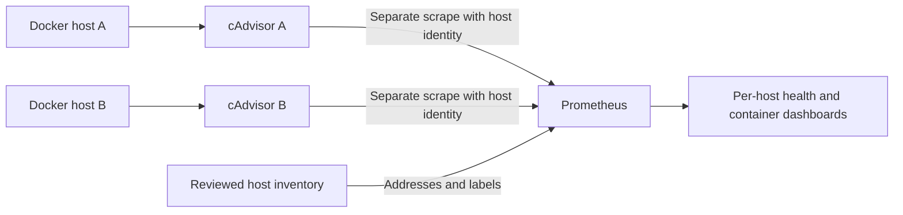

# Monitor Multiple Docker Hosts with cAdvisor and Stable Labels

Author: [nawazdhandala](https://www.github.com/nawazdhandala)

Tags: Docker, Prometheus, Monitoring

Description: Scrape cAdvisor separately on each Docker host, keep host identity stable across address changes, and validate inventory labels before discovery updates.

When a second Docker host joins your monitoring system, adding another URL is easy. Preserving the meaning of the resulting data takes more care. A container named `api` can run on both machines, addresses can change, and a load-balanced endpoint can hide which machine answered a scrape.

Use one cAdvisor installation per monitored host and one independently addressable Prometheus target for each installation. Attach identity labels from a controlled inventory. This gives each host a clear health signal and lets dashboards group container data without guessing where it came from.

The examples use Prometheus 3.7.3 configuration syntax and cAdvisor 0.55.1 as the reviewed exporter release. They assume the host deployments already work and that the scraper can reach their metrics endpoints over an access-controlled monitoring network.

## Keep collection local and scraping explicit

cAdvisor observes the container and host resources available to its installation. Putting a single cAdvisor container on host A does not make host B's local filesystem and control groups appear there. Deploy and verify the exporter on each host. [cAdvisor deployment model](https://github.com/google/cadvisor/blob/v0.55.1/README.md).



Do not place a round-robin load balancer between one scrape target and several cAdvisor instances. Success would mean that some backend answered, while samples could alternate between hosts. Stable service discovery is useful; hiding multiple independent exporters behind one target is not.

Protect each endpoint from general application and public access. The HTTP examples below assume a protected transport, such as an encrypted private overlay with scraper-only access rules. If traffic crosses an untrusted network, configure verified TLS at an approved proxy and use HTTPS scrape settings. A private-looking address alone is not encryption or authorization. [Prometheus security model](https://prometheus.io/docs/operating/security/).

## Define identity before writing the target list

Use labels that have clear ownership and limited values:

| Label | Example | Meaning |
| --- | --- | --- |
| `job` | `cadvisor` | Collection role |
| `host_id` | `docker-prod-a` | Unique inventory identity for this host |
| `instance` | `docker-prod-a` | Stable scrape-instance identity in this design |
| `environment` | `production` | Deployment environment |
| `site` | `london` | Operational location |

Prometheus normally assigns `instance` from the target address unless you explicitly set it. This tutorial replaces it with `host_id`. The actual connection address remains available in target diagnostics. [Jobs and instances](https://prometheus.io/docs/concepts/jobs_instances/).

Define what host replacement means for your organization. If a replacement machine is a new asset, allocate a new identity. If the identifier represents a deliberately persistent logical role, document that continuity. Never let two live exporters share the same `host_id` merely to keep dashboard lines looking smooth.

## Put targets in a discovery file

Create `/etc/prometheus/targets/cadvisor.json` in the filesystem visible to Prometheus. Replace the example DNS names with independently reachable host endpoints:

```json
[
  {
    "targets": ["docker-a.monitoring.example:8080"],
    "labels": {
      "host_id": "docker-prod-a",
      "environment": "production",
      "site": "london"
    }
  },
  {
    "targets": ["docker-b.monitoring.example:8080"],
    "labels": {
      "host_id": "docker-prod-b",
      "environment": "production",
      "site": "london"
    }
  }
]
```

Each group contains exactly one endpoint. This is a policy for this inventory, not a general limitation of Prometheus. File-based discovery accepts target groups with attached labels and updates targets when the file changes. It separates host inventory changes from the main scrape configuration. [File-based discovery](https://prometheus.io/docs/guides/file-sd/).

Use this minimal `prometheus.yml`, or merge the job into your existing configuration:

```yaml
global:
  scrape_interval: 30s
  scrape_timeout: 10s

scrape_configs:
  - job_name: cadvisor
    scheme: http
    metrics_path: /metrics
    honor_labels: false
    file_sd_configs:
      - files:
          - /etc/prometheus/targets/cadvisor.json
        refresh_interval: 1m
    relabel_configs:
      - source_labels: [host_id]
        regex: ".+"
        action: keep
      - source_labels: [host_id]
        target_label: instance
```

The first relabel rule excludes targets missing `host_id`. The second sets their stable `instance` label. This changes labels, not the destination address. `honor_labels: false` keeps configured target labels authoritative when the exporter supplies conflicting names; conflicting exported labels are renamed with an `exported_` prefix. [Scrape and relabel configuration](https://prometheus.io/docs/prometheus/latest/configuration/configuration/).

Do not rely on the keep rule as inventory validation. A dropped target can disappear quietly, so compare discovered targets with the expected host list during every rollout.

## Reject ambiguous inventory updates

Save this Python 3 check as `check_inventory.py`. It implements the intentionally narrow file format above and reads the candidate file without modifying it:

```python
import json
import re
import sys
from pathlib import Path

rows = json.loads(Path(sys.argv[1]).read_text())
if not isinstance(rows, list) or not rows:
    raise SystemExit("Expected a non-empty target list")

hosts, endpoints = set(), set()
for row in rows:
    if not isinstance(row, dict):
        raise SystemExit("Each target group must be an object")
    targets = row.get("targets")
    labels = row.get("labels")
    if not isinstance(targets, list) or len(targets) != 1:
        raise SystemExit("Expected one endpoint per host")
    if not isinstance(labels, dict):
        raise SystemExit("Missing labels")
    host = labels.get("host_id")
    endpoint = targets[0]
    if not isinstance(host, str) or not re.fullmatch(r"[a-z0-9-]+", host):
        raise SystemExit("Invalid host_id")
    if not isinstance(endpoint, str) or not re.fullmatch(
        r"[A-Za-z0-9.-]+:[0-9]+", endpoint
    ):
        raise SystemExit("Expected DNS-name:port endpoint")
    if not 1 <= int(endpoint.rsplit(":", 1)[1]) <= 65535:
        raise SystemExit("Invalid port")
    if any(not isinstance(v, str) for v in labels.values()):
        raise SystemExit("Label values must be strings")
    if host in hosts or endpoint in endpoints:
        raise SystemExit("Duplicate host or endpoint")
    hosts.add(host)
    endpoints.add(endpoint)

print(f"Validated {len(hosts)} unique hosts")
```

Run it against the candidate inventory before replacing the active file. It checks format and duplicate entries, not DNS resolution or certificate trust. It deliberately excludes IPv6 literals; extend the endpoint parser explicitly if those are part of your inventory.

Validate the main configuration with the matching `promtool check config` command as well. Publish a complete candidate file with an atomic replacement on the same filesystem, using your configuration-management process. For containerized Prometheus, mount the containing targets directory read-only so replaced files remain visible; avoid depending on replacement of a separately bind-mounted file.

## Verify identity as well as availability

In the Prometheus Targets page, confirm two independent URLs and the expected labels. Then evaluate:

```promql
up{job="cadvisor"}
```

Expect one current series per discovered target, with distinct `instance` and `host_id` values. A zero indicates a failed scrape. A missing series may mean a missing or dropped target, so keep an independent expected-host inventory.

For a quick site-level count of successful scrapes:

```promql
sum by (site) (up{job="cadvisor"})
```

This counts healthy targets, not running application containers. Prometheus aggregations remove labels not included in the grouping; keep `host_id` when a dashboard must distinguish machines. [Aggregation operators](https://prometheus.io/docs/prometheus/latest/querying/operators/).

## Rehearse an address change

In staging, change one endpoint while keeping its approved `host_id`. Verify discovery adopts the new URL and the resulting `instance` remains stable. Also test a duplicate host entry and a missing identity: your inventory check should reject both before publication.

Finally, compare a known container on each host with the exporter data. Container IDs will change when workloads are recreated; stable host labels do not make container identities permanent. Keep that distinction visible in dashboards and alerts so a correct host migration does not conceal a missing workload.
