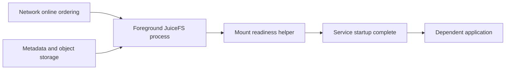

# Mount JuiceFS at Boot with systemd and Explicit Readiness Checks

Author: [nawazdhandala](https://www.github.com/nawazdhandala)

Tags: JuiceFS, Systemd, Linux

Description: Supervise a foreground JuiceFS mount, wait for usable filesystem access, and investigate stale mounts without starting duplicate daemons or forcing cleanup.

A JuiceFS mount can work from a terminal and fail during boot because the service starts with a different environment, before its dependencies are reachable, or alongside another mount owner. Fixing those conditions is more reliable than adding an arbitrary sleep.

This example targets **JuiceFS Community Edition 1.4.2 on Linux** and uses directives documented for **systemd 257**. It runs one root-owned foreground mount service. It is a custom service design, not a copy of JuiceFS's alternative fstab or mount-unit recipe.

First prove that the existing volume mounts and supports application reads on the intended host. This procedure does not format a volume. Never run both an fstab entry and this service for the same mount point. [JuiceFS boot-mount guidance](https://github.com/juicedata/juicefs/blob/v1.4.2/docs/en/administration/mount_at_boot.md).

## Separate network ordering from storage readiness

`network-online.target` is a boot synchronization point. Its meaning depends on the host's network manager and wait-online service; it is not a continuing guarantee that a particular metadata server or object-storage endpoint is reachable.

Use both `Wants=` and `After=` to request and order against it, then handle service startup failure normally. Verify that the appropriate wait-online service is enabled for the host's actual network manager. [systemd network-online guidance](https://github.com/systemd/systemd/blob/v257/docs/NETWORK_ONLINE.md).



The application still needs its own health checks. A readable mount root does not prove that every object can be downloaded or that application credentials and permissions are correct.

## Prepare one mount owner

Install the pinned Linux binary at `/usr/local/bin/juicefs`, and confirm `/dev/fuse` is available. FUSE is the kernel interface that lets a userspace process provide a filesystem. Install the distribution's required FUSE tooling and review device access rather than changing permissions broadly.

Prepare an empty `/mnt/jfs` mount point and a local cache directory at `/var/cache/juicefs`. Verify that neither path conceals unrelated data. Provision the metadata password in `/etc/juicefs/meta-password`, readable only by the service's intended privileged account, using your secret-management process.

The example metadata URL uses Redis over TLS. Replace its hostname, username, and database number with the already-tested volume reference. Install the appropriate CA trust on the host and preserve any required object-storage certificate paths. JuiceFS supports `META_PASSWORD_FILE` so the password need not appear in the command line. [Pinned metadata connection guide](https://github.com/juicedata/juicefs/blob/v1.4.2/docs/en/reference/how_to_set_up_metadata_engine.md).

Do not add mount-namespace isolation settings casually. A service whose mount is private may report success while the application cannot see it. Separately review filesystem ownership and FUSE access rules for non-root applications.

## Add a bounded readiness helper

Save the following root-owned executable as `/usr/local/libexec/juicefs-wait-ready`. It needs util-linux `mountpoint` and GNU `timeout`/`stat` in the service PATH:

```sh
#!/bin/sh
set -eu
point=${1:?Mount point required}
attempt=0
while [ "$attempt" -lt 20 ]; do
    if mountpoint -q "$point" &&
       timeout 2 stat -- "$point/." >/dev/null 2>&1; then
        exit 0
    fi
    attempt=$((attempt + 1))
    sleep 1
done
printf 'JuiceFS mount did not become readable: %s\n' "$point" >&2
exit 1
```

The first check avoids mistaking the ordinary underlying directory for a mounted filesystem. The second requests a filesystem attribute read with a timeout. The loop is a startup gate, not an ongoing monitor or an identity check for arbitrary existing mounts. The single-owner prerequisite still matters. [util-linux mountpoint documentation](https://man7.org/linux/man-pages/man1/mountpoint.1.html).

GNU timeout sends a termination signal when the duration expires. [Coreutils 9.7 timeout implementation](https://github.com/coreutils/coreutils/blob/v9.7/src/timeout.c). A process stuck in uninterruptible kernel I/O may not respond promptly even to a timeout signal. Treat this as a failed startup requiring investigation, not a hard guarantee that every storage failure can be interrupted within two seconds.

## Keep JuiceFS in the foreground

Save this as `/etc/systemd/system/juicefs-data.service`, after replacing the metadata URL:

```ini
[Unit]
Description=JuiceFS data filesystem
Wants=network-online.target
After=network-online.target
RequiresMountsFor=/var/cache/juicefs
StartLimitIntervalSec=300
StartLimitBurst=5

[Service]
Type=exec
User=root
Environment=PATH=/usr/bin:/bin
Environment=META_PASSWORD_FILE=/etc/juicefs/meta-password
ExecStartPre=/usr/bin/test -c /dev/fuse
ExecStart=/usr/local/bin/juicefs mount --cache-dir /var/cache/juicefs rediss://juicefs@metadata.example.internal:6379/1 /mnt/jfs
ExecStartPost=/usr/local/libexec/juicefs-wait-ready /mnt/jfs
ExecStop=/usr/local/bin/juicefs umount --flush /mnt/jfs
Restart=on-failure
RestartSec=10
TimeoutStartSec=90
TimeoutStopSec=300

[Install]
WantedBy=multi-user.target
```

Do not add `-d` or `--background`. Systemd should supervise the foreground process instead of a parent that exits after launching a daemon. `Type=exec` establishes that the executable started; `ExecStartPost` supplies the additional mount-readiness gate. Ordered dependents wait for that startup work to finish. [systemd service semantics](https://www.freedesktop.org/software/systemd/man/257/systemd.service.html).

The restart limit prevents an unlimited rapid failure loop. It does not repair missing credentials or a stale mount. `RequiresMountsFor` orders startup after the cache path's backing filesystem, while the network dependency addresses a different prerequisite. [systemd unit dependencies](https://www.freedesktop.org/software/systemd/man/257/systemd.unit.html).

The stop command requests normal unmounting with staging-data flush. The example does not enable writeback mode. Size the shutdown window for your actual behavior, and stop application writers before stopping the mount; systemd may terminate a service that exceeds its stop timeout. Check the pinned client's mount and unmount help before adopting the options.

## Validate on the target Linux host

After reviewing paths, credentials, and ownership, check the unit without starting it:

```bash
sudo systemd-analyze verify /etc/systemd/system/juicefs-data.service
```

Resolve reported issues before enabling the service. This catches unit problems but does not test remote storage, FUSE permissions, or application access. [systemd-analyze verification](https://www.freedesktop.org/software/systemd/man/257/systemd-analyze.html).

Then, during an approved staging test:

```bash
sudo systemctl daemon-reload
sudo systemctl enable --now juicefs-data.service
systemctl status juicefs-data.service --no-pager
journalctl -u juicefs-data.service -b --no-pager
```

These commands reload unit definitions, enable startup at boot, start the service now, and inspect its status and current-boot logs. Use an account permitted to read the system journal. [systemctl reference](https://www.freedesktop.org/software/systemd/man/257/systemctl.html), [journalctl reference](https://www.freedesktop.org/software/systemd/man/257/journalctl.html).

Confirm the readiness helper succeeded and perform application-level reads and writes. Reboot the staging host and repeat. Also test an unavailable metadata service: the unit should fail visibly rather than allowing applications to write into an unmounted local directory.

For a dependent service, add `Requires=juicefs-data.service` and `After=juicefs-data.service` in its `[Unit]` configuration. Consider stronger lifecycle coupling if the application must stop whenever the mount service disappears, and verify restart behavior explicitly. Startup dependencies are not a replacement for runtime storage-error handling.

## Investigate stale mounts before cleanup

If the service fails, inspect its recorded process and recent logs before starting another copy:

```bash
systemctl show juicefs-data.service -p MainPID -p ControlGroup -p SubState
journalctl -u juicefs-data.service -b -n 100 --no-pager
mountpoint /mnt/jfs
```

Determine whether the mount belongs to this service, a manual process, another unit, or a container namespace. Stop dependent workloads and the identified mount owner through the normal procedure. A normal `juicefs umount /mnt/jfs` is appropriate only after confirming the exact target and coordinating its users.

A busy mount usually means someone still has files or directories open. Do not use blanket process-killing commands or automatic forced unmounts in `ExecStartPre`. On Linux, JuiceFS's force-unmount behavior uses lazy detachment, which can leave existing file handles and the old daemon alive. That is not proof that the filesystem has been safely cleaned up. [Pinned troubleshooting guidance](https://github.com/juicedata/juicefs/blob/v1.4.2/docs/en/administration/troubleshooting.md#unmount-error).

After fixing the cause and confirming the old mount is gone, reset the unit's failed state if its start limit was reached, then start it once. Preserve logs that explain the original failure.

The service and helper were source-reviewed and structurally checked; JuiceFS 1.4.2 command options were verified against its binary help. This authoring environment did not run Linux systemd, FUSE mounting, reboot, or stale-mount recovery. Run the target-host verification and staging acceptance steps before relying on this unit at boot.
