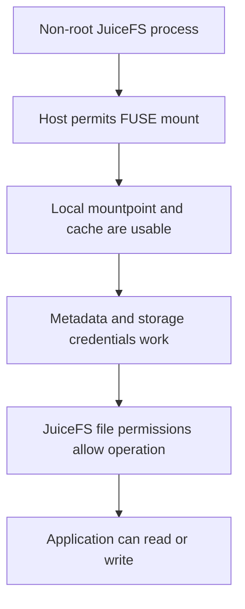

# Mount JuiceFS as a Non-Root User with a Writable Cache

Author: [nawazdhandala](https://www.github.com/nawazdhandala)

Tags: JuiceFS, Linux, Security

Description: Prepare a non-root JuiceFS mount, separate cache permissions from filesystem access, and enable user_allow_other only when other local users need access.

A non-root JuiceFS mount can fail before it ever reaches object storage. The account may lack access to the FUSE device, the mount helper may be unavailable, or the client may try to create its cache in a root-owned directory. Fixing one of these does not automatically fix the others.

This walkthrough targets **JuiceFS Community Edition 1.4.2 on Linux**. It uses an existing volume, a mountpoint and cache owned by the mounting account, and an optional host-level setting for sharing the mount with other local users.

## Separate the four permission checks

FUSE, or Filesystem in Userspace, lets a normal process serve filesystem operations through the kernel. The helper and device still need to be provisioned correctly by the host administrator. The [kernel FUSE overview](https://docs.kernel.org/filesystems/fuse/fuse.html) explains the distinction between the mount owner and a user accessing files.



For example, a writable cache does not grant permission to create files in a JuiceFS project directory. An account that can read the project may still be unable to mount because the host denies access to `/dev/fuse`.

Use the actual service or application account for each check. Running the command with `sudo` changes the identity, environment, cache defaults, and FUSE behavior, so it can hide the original problem.

## Check the host prerequisites

Ask the host administrator to provide the distribution's supported FUSE package and mount-helper configuration. Check the device and available helpers without changing them:

```bash
ls -l /dev/fuse
command -v fusermount || command -v fusermount3
```

Expect a FUSE device and a helper appropriate to the distribution and installed JuiceFS build. These checks establish presence, not that every permission or security-policy requirement is satisfied. If JuiceFS reports a specific missing helper path, compare that error with the installed package rather than creating an arbitrary executable symlink.

Some distributions restrict helper execution or device access to a group. After an approved group-membership change, start a fresh login or service process before testing; an existing shell does not automatically gain new supplementary groups. The [JuiceFS troubleshooting guide](https://github.com/juicedata/juicefs/blob/v1.4.2/docs/en/administration/troubleshooting.md) covers missing helpers and permission failures.

Do not solve these errors by granting broad privileges to the entire application. Containers add another layer of device and mount permissions; a host working correctly does not mean an arbitrary container can mount FUSE.

## Create account-owned local directories

The following commands use paths beneath the current account's home directory. Run them as that account, and choose unused paths if these directories already contain unrelated data:

```bash
umask 077
MOUNT_DIR="$HOME/mnt/juicefs"
CACHE_DIR="$HOME/.cache/juicefs-client"
mkdir -p "$MOUNT_DIR" "$CACHE_DIR"
ls -ld "$MOUNT_DIR" "$CACHE_DIR"
```

The restrictive umask protects newly created directories. It does not repair ownership or modes of directories that already exist. Inspect the output and resolve any unexpected owner before mounting. The mountpoint should be empty so that mounting does not conceal local files.

Check that the cache can actually create and remove a temporary file. This Python 3.11-compatible probe avoids overwriting an existing filename:

```bash
python3 - "$CACHE_DIR" <<'PY'
import os
import sys
import tempfile

with tempfile.NamedTemporaryFile(dir=sys.argv[1], prefix="cache-check-") as probe:
    probe.write(b"cache-write-check\n")
    probe.flush()
    os.fsync(probe.fileno())
print("Cache file creation, write, and cleanup succeeded")
PY
```

The temporary file is removed when the context exits. Failure points to local directory permissions, space, filesystem state, or another host restriction. Python's [temporary-file documentation](https://docs.python.org/3.11/library/tempfile.html) describes this lifecycle.

Cache capacity and device free space still need monitoring. A successful tiny write does not establish that the disk can hold a production working set. If data requires encryption at rest, provision encrypted storage underneath this cache directory; JuiceFS object encryption alone does not encrypt cached plaintext.

## Mount an application directory with explicit cache settings

Before mounting, have a storage administrator confirm that `/projects/analytics` exists inside the volume and grants the application's numeric user and group IDs the required access. This is a JuiceFS directory, not a directory to create under the local mountpoint before mounting.

Use the existing volume's metadata address and secure credential delivery:

```bash
juicefs mount \
  --subdir /projects/analytics \
  --cache-dir "$CACHE_DIR" \
  --cache-size 2048 \
  rediss://metadata.example.internal:6379/9 \
  "$MOUNT_DIR"
```

Replace the endpoint, database, and project path. The `--subdir` option exposes that part of the existing filesystem as the mount root. The cache limit is an illustrative 2GiB expressed in MiB. The foreground command keeps startup errors visible; after it starts, inspect the mount from another session running as the same account.

A subdirectory mount is useful for limiting the visible tree, but do not treat it as a substitute for securing metadata and backing-storage credentials. An account holding administrative infrastructure credentials has powers beyond the mounted view.

By default, FUSE restricts access to the mounting user. If that is exactly who runs the application, no `user_allow_other` change is needed.

## Enable sharing only when another local identity needs it

Suppose a separate service account must read through this same mount. For a non-root mount, the documented sharing path has two parts:

1. A host administrator enables the standalone line `user_allow_other` in `/etc/fuse.conf`, preserving the rest of the file.
2. The mounting account includes `-o allow_other` in its initial JuiceFS mount command.

For that shared configuration, use this command **instead of** the previous mount command:

```bash
juicefs mount \
  -o allow_other \
  --subdir /projects/analytics \
  --cache-dir "$CACHE_DIR" \
  --cache-size 2048 \
  rediss://metadata.example.internal:6379/9 \
  "$MOUNT_DIR"
```

Do not run it blindly over an existing mount while changing options. Arrange a controlled stop and normal unmount when switching the initial configuration.

`user_allow_other` permits non-root users to request sharing; it does not enable sharing on every mount. `allow_other` removes the mount-owner-only gate, but ordinary file permissions still matter. JuiceFS automatically enables kernel `default_permissions` checks. These behaviors are documented in the [1.4.2 FUSE option reference](https://github.com/juicedata/juicefs/blob/v1.4.2/docs/en/reference/fuse_mount_options.md).

Other users also need traversal permission on every local parent directory leading to the mountpoint. A private home directory may intentionally prevent that. For a shared service mount, ask the administrator to provision an appropriately owned mountpoint outside the private home; do not broadly open the home directory to make this example work.

## Verify the intended identities and stop cleanly

Test one allowed operation as the mounting account, then as the intended second account if sharing is enabled. Also verify that an unrelated account cannot perform operations your file permissions prohibit. Do not confuse a successful directory listing with permission to create or rename files.

When finished, stop applications using the mount and request a normal unmount as the mounting account:

```bash
juicefs umount "$MOUNT_DIR"
```

A busy mount is a reason to find active consumers, not to force detachment. If writeback is enabled in your actual deployment, follow its flush procedure and preserve pending data.

The local cache probe was tested for successful creation and cleanup and for failure on a missing directory. No Linux FUSE mount or cross-user access test was run for this article. Those host-specific checks are the final step before adopting the configuration for a service.
