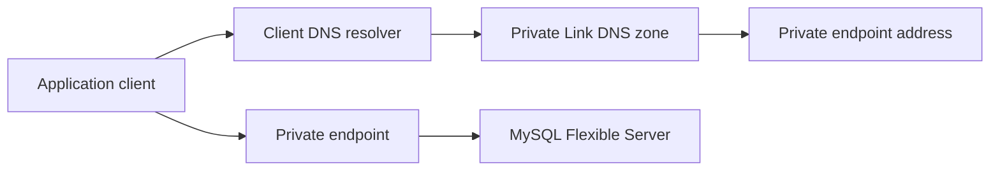

# Move Azure MySQL from VNet Integration Without Losing the Access Path

Author: [nawazdhandala](https://www.github.com/nawazdhandala)

Tags: Azure, MySQL, Networking

Description: Plan Azure MySQL's irreversible VNet-detach transition with a downtime window, private-endpoint DNS checks, verified TLS, and controlled application recovery.

Moving Azure Database for MySQL Flexible Server from virtual-network integration to Private Link is a networking change with a real interruption. It is not simply adding a DNS record to the existing connection path.

Microsoft documents a specific transition workflow. Its warning is explicit: the operation is irreversible and has downtime. Plan the destination access path before starting, especially when public access must remain disabled. This guide provides a preparation and acceptance sequence; the network operation was not executed while writing it.

## Distinguish the two private networking models

With virtual-network integration, the server uses a delegated subnet in your virtual network, or VNet. Private Link instead provides a private endpoint: a private IP address in a subnet through which clients reach the service. The terms sound similar, but their configuration and DNS dependencies differ. See the [VNet networking overview](https://learn.microsoft.com/en-us/azure/mysql/flexible-server/concepts-networking-vnet) and [Private Link overview](https://learn.microsoft.com/en-us/azure/mysql/flexible-server/concepts-networking-private-link).

The dedicated transition procedure allows a VNet-integrated server to move to the networking infrastructure that supports public access and Private Link. The server name and data do not need to move to a different database server. That does not mean existing connections remain usable throughout the change.

Choose the intended end state explicitly:

| End state | Client path to prepare |
| --- | --- |
| Private Link only | Approved private endpoint, reachable subnet, and working private DNS |
| Public access only | Public name resolution, permitted client egress addresses, and server firewall rules |
| Both | Separate verification of each intended path and a clear reason for retaining public access |

Private Link does not require that you leave internet access enabled. Public access is a separate choice in the transition workflow.

## Prepare a client-by-client access inventory

List application hosts, background workers, deployment agents, administrator jump hosts, and on-premises clients. For each, record its DNS resolver, network route, database hostname, authentication method, and owner. DNS is the system that translates a hostname into an address.

Include clients that run only occasionally. A nightly export or disaster-recovery job can remain broken long after the main application appears healthy.

Prepare the target endpoint subnet, required permissions, DNS zone links or forwarding, and a workstation that can finish the portal workflow if the application network is unavailable. Confirm endpoint approval responsibilities before the maintenance window.

For Azure public cloud, the documented Private Link DNS zone for MySQL Flexible Server is `privatelink.mysql.database.azure.com`. Clients normally keep using the server's ordinary hostname, such as `SERVER_NAME.mysql.database.azure.com`; their DNS path must resolve it to the appropriate private endpoint. Review [Azure's private-endpoint DNS guidance](https://learn.microsoft.com/en-us/azure/private-link/private-endpoint-dns).



The upper path resolves the destination. The lower path carries the database connection. Correct DNS does not establish that routing or access rules allow the connection.

Inspect existing private zones and custom resolver overrides for the server name. An old answer can keep clients pointed at the former path. Do not delete a shared DNS zone to fix one hostname; identify the records and links that are actually involved.

## Establish the interruption and recovery plan

Schedule a window that covers detachment, endpoint configuration, DNS convergence, new connections, and application verification. A database showing Ready is only one milestone. Rehearse with a representative nonproduction server to measure the full application interruption; do not promise a fixed duration from the portal's update status.

Pause normal writers and background producers according to the application's maintenance procedure. Let in-flight work drain and record how uncertain commits will be reconciled if a connection drops. Confirm available backups and the separate recovery plan before starting.

Because the transition is irreversible, “switch back to VNet integration” is not a valid rollback step. Define a recovery path for fixing the new endpoint or DNS configuration. If the business requires a parallel-server migration instead, design and rehearse that separately, including data synchronization and cutover.

## Complete the documented transition

In the server's **Networking** page, select **Move to Private Link** and review the warning. The wizard first detaches the server from its VNet integration, then lets you configure the new access path. For private-only access, leave the public-access option unchecked and complete private-endpoint configuration after detachment.

Microsoft warns that detaching with public access disabled and then leaving the endpoint step incomplete makes the server inaccessible. Stay with the operation until the intended path exists and can be verified. Follow the [dedicated transition guide](https://learn.microsoft.com/en-us/azure/mysql/flexible-server/how-to-network-from-private-to-public), rather than treating general networking summaries as a reversible-mode toggle.

If public access is an approved destination, configure the specific allowed client egress addresses. Do not broaden access simply to bypass an unresolved private DNS problem. The [public networking documentation](https://learn.microsoft.com/en-us/azure/mysql/flexible-server/concepts-networking-public) explains server firewall controls.

## Verify DNS and TCP from each client network

The following read-only checks are for a Windows host with the DnsClient and NetTCPIP PowerShell modules. Replace the hostname and run them from the same network path as the application:

```powershell
$mysqlName = 'SERVER_NAME.mysql.database.azure.com'
Resolve-DnsName -Name $mysqlName -Type A -DnsOnly
Test-NetConnection -ComputerName $mysqlName -Port 3306 -InformationLevel Detailed
```

For the private-only design, compare the returned address with the private endpoint's actual address. Then check `TcpTestSucceeded`. A successful TCP test means a connection to the port was possible; it does not prove MySQL authentication or certificate verification succeeded. The commands are documented in [Resolve-DnsName](https://learn.microsoft.com/en-us/powershell/module/dnsclient/resolve-dnsname?view=windowsserver2025-ps) and [Test-NetConnection](https://learn.microsoft.com/en-us/powershell/module/nettcpip/test-netconnection?view=windowsserver2025-ps).

Repeat from each distinct resolver and network route. One successful jump-host test does not establish that containers, remote workers, or on-premises applications use the same DNS answer.

## Verify the database connection with TLS

Use a client that verifies the server certificate and hostname. For a shell host with the MySQL 8.4 command-line client, replace these placeholders with the server name, an approved test account, and the path to your maintained Azure MySQL CA bundle:

```bash
mysql --host='SERVER_NAME.mysql.database.azure.com' \
  --port=3306 --user='TEST_ACCOUNT' --password \
  --ssl-mode=VERIFY_IDENTITY \
  --ssl-ca='/PATH/TO/azure-mysql-ca-bundle.pem' \
  --execute='SELECT 1 AS connection_check;'
```

The client prompts for the password. Expect a result containing `connection_check` with value `1`. `VERIFY_IDENTITY` checks both the certificate chain and hostname, as documented in [MySQL 8.4 connection options](https://dev.mysql.com/doc/refman/8.4/en/connection-options.html); the execution option is described in the [client reference](https://dev.mysql.com/doc/refman/8.4/en/mysql-command-options.html).

This proves a narrow authenticated query, not application correctness. Keep the hostname in the connection string instead of replacing it with the private IP. Do not disable verification to work around a certificate-name failure.

## Resume useful traffic in stages

Renew application connections through the application's supported pool or restart procedure. DNS changes do not move an already open database session. Check actual application reads and a designated controlled write while normal writers remain paused.

After that check passes, resume ordinary producers gradually and watch connection failures, request latency, and queue depth. Reconcile work interrupted during the window rather than replaying every write blindly.

Record the new endpoint, DNS evidence from each client path, public-access state, and application acceptance results. Keep obsolete-network cleanup separate until the dependency inventory confirms those resources are no longer needed. The transition is complete when the intended clients can perform their work through the intended path, not merely when the wizard closes.
