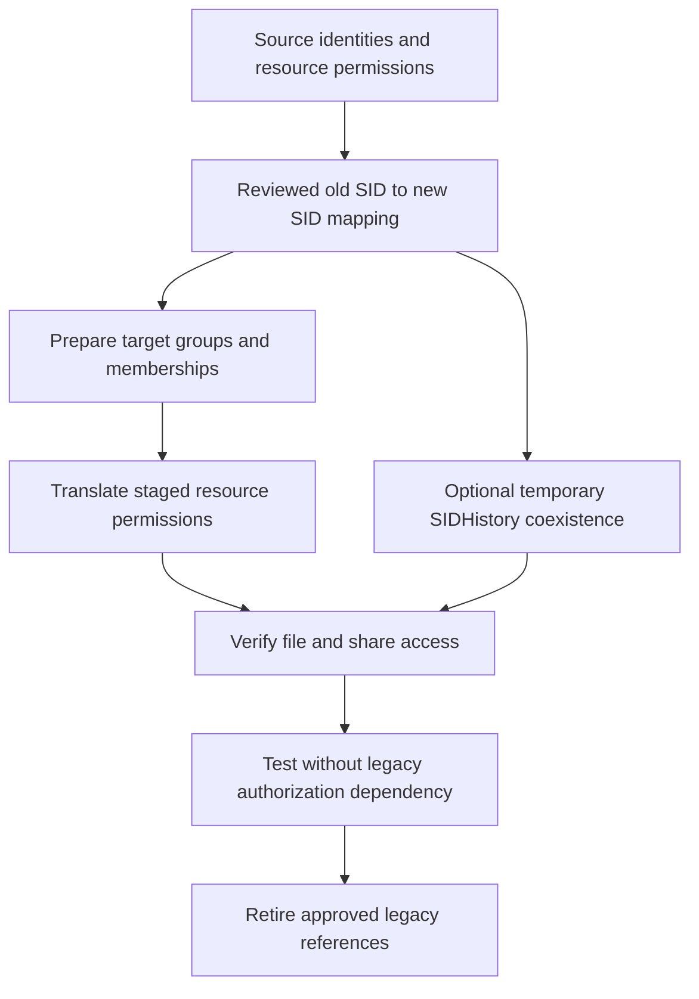

# Move File Shares Between AD Domains Without Losing Intended Access

Author: [nawazdhandala](https://www.github.com/nawazdhandala)

Tags: Active Directory, File Permissions, Data Migration

Description: Plan cross-domain file-share migration with verified SID mappings, temporary SIDHistory use, ACL translation, and separate share-permission checks.

Copying a file share to a server in another Active Directory domain does not translate its permissions. The destination can contain an exact copy of the old security descriptors while the new users remain unable to open their files.

The key is identity. `OLD\FinanceReaders` and `NEW\FinanceReaders` can have identical names and completely different security identifiers, or SIDs. Build the migration around an approved relationship between those identities, then verify the resulting access. Do not infer that relationship from names alone.

This article uses Windows Server 2022 file servers as its reference environment. The inspection snippets are read-only and use Windows PowerShell-compatible syntax. They require the relevant Windows administration modules; they do not perform an account migration or change trust settings.

## Separate the three migration decisions

| Decision | What changes | What it does not accomplish |
| --- | --- | --- |
| Data transfer | File contents and selected metadata reach the destination | Old SIDs do not automatically become target-domain SIDs |
| Temporary SIDHistory use | Historical SIDs can participate in a migrated identity's authorization | It does not rewrite the file's ACL or guarantee trust traversal |
| Security translation | Selected references in resource security descriptors map to approved new identities | It does not create the intended group memberships or configure every share |

An ACL is an access control list. Its entries identify who receives which rights. An access token contains the security identities Windows uses when evaluating a process's access.

Microsoft documents `objectSid` and `sIDHistory` separately in [user naming attributes](https://learn.microsoft.com/en-us/windows/win32/ad/naming-properties). Keeping an old SID as history can bridge a transition, but it should not become the only explanation for why a production application works.



## Inventory identity references before choosing a tool

Collect file and directory permissions, owners, audit rules, share permissions, and memberships of server-local groups used by those permissions. Include service accounts and scheduled jobs. A user migration can look successful while a service continues running under an old account.

On a Windows administration host with the ActiveDirectory module and authorized read access, inspect the actual source and destination objects. Replace the domain controller names and sample account names:

```powershell
$ErrorActionPreference = 'Stop'
Import-Module ActiveDirectory

Get-ADGroup -Identity 'FinanceReaders' -Server 'dc1.old.example.com' |
    Select-Object DistinguishedName, SID, GroupCategory, GroupScope

Get-ADGroup -Identity 'FinanceReaders' -Server 'dc1.new.example.com' |
    Select-Object DistinguishedName, SID, GroupCategory, GroupScope

Get-ADUser -Identity 'migration-pilot' -Server 'dc1.new.example.com' -Properties SIDHistory |
    Select-Object DistinguishedName, SID, @{Name='HistoricalSIDs'; Expression={
        ($_.SIDHistory | ForEach-Object { $_.Value }) -join ';'
    }}
```

These commands identify the objects and explicitly request the additional user attribute. See [Get-ADGroup](https://learn.microsoft.com/en-us/powershell/module/activedirectory/get-adgroup?view=windowsserver2025-ps) and [Get-ADUser](https://learn.microsoft.com/en-us/powershell/module/activedirectory/get-aduser?view=windowsserver2022-ps). Empty history is not inherently an error: the design may use direct target-domain permissions instead.

Keep an approved mapping record containing source SID, target SID, object type, source purpose, target group membership policy, resource scope, and approver. Reject ambiguous mappings and unexpected many-to-one merges. Combining two old groups into one new group can combine rights that were deliberately separated.

Group scope matters. Global, universal, and domain-local groups have different membership and permission-assignment rules. Validate the nesting design against [Active Directory security group guidance](https://learn.microsoft.com/en-us/windows-server/identity/ad-ds/manage/understand-security-groups), especially when resources and users move at different times.

## Understand what SIDHistory can and cannot bridge

A populated directory attribute is not proof that the file server receives the expected authorization data. Trust direction, SID filtering, authentication policy, and the resource location all affect the access path.

Microsoft's [netdom trust reference](https://learn.microsoft.com/en-us/windows-server/administration/windows-commands/netdom-trust) distinguishes trust controls including SID filtering and SIDHistory behavior. Do not disable filtering globally as an “access denied” fix. Review the actual trust boundary with the directory security owner and use the narrow, approved coexistence design.

For each pilot, record whether access is expected through current target groups, historical SIDs, or still-active source-domain membership. Otherwise a successful test can hide an unfinished translation.

Also check the support status of the migration tool. Microsoft's [ADMT support policy](https://learn.microsoft.com/en-us/troubleshoot/windows-server/active-directory/support-policy-and-known-issues-for-admt) states that the ADMT 3.2 code base is deprecated, receives no fixes, and was not updated for listed modern operating systems including Windows Server 2022. An old ADMT walkthrough is not evidence of a supported implementation for this environment. Choose tooling whose support and security requirements match the actual systems.

## Translate a staged copy with explicit rules

Inventory a representative destination directory's file-system access rules using SIDs rather than resolved names:

```powershell
$ErrorActionPreference = 'Stop'
$Acl = Get-Acl -LiteralPath 'D:\MigrationStage\Finance\Restricted'
$Acl.GetAccessRules($true, $true, [System.Security.Principal.SecurityIdentifier]) |
    Select-Object @{Name='SID'; Expression={$_.IdentityReference.Value}},
        AccessControlType, FileSystemRights, IsInherited, InheritanceFlags, PropagationFlags
```

The two Boolean arguments include explicit and inherited entries. The requested identity type exposes the SID. See [GetAccessRules](https://learn.microsoft.com/dotnet/api/system.security.accesscontrol.commonobjectsecurity.getaccessrules). This is one directory's DACL inventory, not an owner or audit-rule export and not a recursive scan.

Translate only approved identities. Preserve each entry's rights, allow/deny type, inheritance, and propagation behavior unless a separately approved policy change says otherwise. Identify the parent that supplies an inherited entry; repeatedly rewriting children can break the intended inheritance model.

Select a documented translation mode. Temporarily adding target entries while retaining source entries supports coexistence, but can broaden access and preserve old deny interactions. Replacing references is cleaner but removes an immediate compatibility path. Test both positive and negative access cases before choosing.

Track owners and audit-rule identities separately from DACL entries. For example, [icacls documentation](https://learn.microsoft.com/en-us/windows-server/administration/windows-commands/icacls) describes SID substitution during DACL restoration, but that is not a complete owner-and-audit translation procedure. A successful DACL tool run cannot close every identity-related task.

An unresolved SID is an investigation item. It may refer to an unavailable domain or an intentionally retained identity. Do not delete it merely because the current machine cannot display a friendly name.

## Recreate share access separately

On each file server, inspect the named share:

```powershell
Get-SmbShareAccess -Name 'Finance' |
    Select-Object AccountName, AccessControlType, AccessRight
```

[Get-SmbShareAccess](https://learn.microsoft.com/en-us/powershell/module/smbshare/get-smbshareaccess?view=windowsserver2022-ps) reads the SMB share's access rules. Match those identities to the approved target groups and review expected denies. Testing a local disk path bypasses this share-access layer, so it cannot replace a test through the actual client share path.

Keep the destination restricted while translating and validating. If a later delta copy restores source security descriptors, it can undo the translation. Choose one ordering: finish the frozen source security copy, then translate and verify, or use a migration workflow that consistently applies the mapping on every pass. Document which process owns permissions at each stage.

## Prove the target identity is sufficient

Use a fresh pilot sign-in and fresh SMB connection after membership or identity changes. Test reading, writing, creating, renaming, and denied operations using the intended target account. Include service identities and protected subfolders.

A controlled test identity without historical SIDs, placed in the approved target groups, helps expose legacy dependencies. It does not replace tests of the actual migrated accounts, which may have additional memberships and restrictions. Do not remove production SIDHistory just to create a test condition.

Before retiring old groups, trusts, or historical identities, reconcile the remaining source-SID references and verify applications no longer depend on them. Keep the approved mapping and before/after descriptors with the migration evidence. If destination writes have begun, rollback also requires data reconciliation; reversing directory permissions alone cannot restore the old data state.
