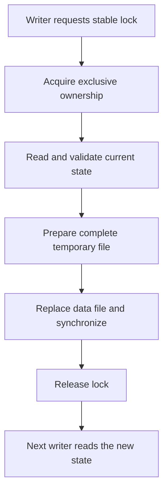

# Can Multiple Hosts Safely Update the Same Shared File?

Author: [nawazdhandala](https://www.github.com/nawazdhandala)

Tags: File Storage, NFS, Concurrency

Description: Understand lost updates, stable lock files, atomic replacement, and the cross-host tests needed before using a shared file as mutable application state.

Multiple hosts can coordinate file updates, but sharing a pathname does not provide that coordination. You need an agreed update protocol, a locking mechanism that actually crosses the client boundary, and a recovery policy for failures with uncertain outcomes.

For important mutable state, a transactional service may be easier to operate than a custom shared-file protocol. If a shared file is appropriate, separate the guarantees you need rather than treating “atomic” as a synonym for “safe.”

## Atomic replacement does not prevent lost updates

Suppose a counter contains 10. Host A reads 10, host B reads 10, and both independently prepare 11. Each writer can publish a complete replacement file successfully. The final result is still 11, although two increments occurred.

| Mechanism | What it contributes | What it does not establish |
| --- | --- | --- |
| Temporary file plus replacement | Publication of a complete new file under one name | Exclusive ownership of the read-modify-write sequence |
| Shared locking protocol | Serialization among participating writers when supported | Participation by every program or recovery from every failure |
| File and directory synchronization | Requests to persist data and namespace changes | Exactly-once application operations |
| Operation ID and reconciliation | Detection of retries and uncertain outcomes | Automatic correctness without durable records |

Linux documents atomic pathname replacement and the continued validity of existing descriptors in [rename](https://man7.org/linux/man-pages/man2/rename.2.html). A reader holding an old descriptor may continue seeing the old object. Readers that require the current serialized value must participate in the protocol and reopen appropriately.

## Lock the entire decision, not just the final write

Acquire coordination before reading the state used to calculate the update. Hold it while validating, preparing, and publishing the new value. Reading first and locking only around replacement leaves the lost-update race intact.

A separate, stable lock file is useful when the data file itself is replaced. Locking the data object's old descriptor and then replacing its pathname can allow another process to open and lock a different object at that same pathname.



Do not delete the stable lock file after each operation. A waiting process may still refer to the old lock object while a new process creates another one. The presence of a lock filename is also not evidence that a lock is currently held.

## A local example with a persistent lock object

This Python 3.11 example demonstrates cooperating processes on a local POSIX file system. It uses [Python's `fcntl.flock`](https://docs.python.org/3.11/library/fcntl.html) and a securely created [named temporary file](https://docs.python.org/3.11/library/tempfile.html) in the same directory as the counter.

The directory must already exist and be private to the cooperating application identity. It must contain only this lab's files; this is not hardened against hostile path replacement or symlinks. Save the code as `counter.py`:

```python
import fcntl
import os
import tempfile
from pathlib import Path


def increment(root):
    root = Path(root)
    target = root / 'counter.txt'
    lock_fd = os.open(root / 'counter.lock', os.O_CREAT | os.O_RDWR, 0o600)
    pending = None
    try:
        fcntl.flock(lock_fd, fcntl.LOCK_EX)
        try:
            value = int(target.read_text())
        except FileNotFoundError:
            value = 0
        if value < 0:
            raise ValueError('Counter must be nonnegative')
        with tempfile.NamedTemporaryFile(mode='w', dir=root, prefix='.counter-',
                                         delete=False) as writer:
            pending = Path(writer.name)
            writer.write(f'{value + 1}\n')
            writer.flush()
            os.fsync(writer.fileno())
        os.replace(pending, target)
        pending = None
        directory_fd = os.open(root, os.O_RDONLY | os.O_DIRECTORY)
        try:
            os.fsync(directory_fd)
        finally:
            os.close(directory_fd)
        return value + 1
    finally:
        try:
            if pending is not None:
                pending.unlink(missing_ok=True)
        finally:
            os.close(lock_fd)


if __name__ == '__main__':
    import sys
    print(increment(sys.argv[1]))
```

The lock file remains at a stable path. The counter is read only after acquiring its lock, and malformed or negative content raises an error rather than silently resetting state. Temporary output is flushed, synchronized, closed, and replaced before the containing directory is synchronized. File synchronization and directory-entry persistence are separate concerns in the [fsync documentation](https://man7.org/linux/man-pages/man2/fsync.2.html).

Run a small isolated example from Bash:

```bash
LAB_COUNTER=$(mktemp -d)
chmod 700 "$LAB_COUNTER"
python3.11 counter.py "$LAB_COUNTER"
python3.11 counter.py "$LAB_COUNTER"
```

The expected outputs are `1` and `2`. Keep the printed values and the directory while inspecting the result. The temporary file's restrictive permissions suit this single-identity fixture; a production replacement must implement its own reviewed ownership, permissions, and metadata policy.

We also executed two independent local processes, each performing 100 increments, and verified a final value of 200. Separate cases rejected malformed and negative contents without changing them, then successfully acquired the lock for a later valid operation. These tests ran on local macOS storage. They are not evidence of NFS or SMB correctness.

## Verify the filesystem's actual locking behavior

A lock API's behavior depends on the filesystem and client implementation. On Linux NFS clients, `flock` is implemented using whole-file byte-range locking in supported kernels, and exclusive locking requires opening the file for writing. Linux SMB behavior differs by kernel and can impose mandatory locking semantics. The [flock manual](https://man7.org/linux/man-pages/man2/flock.2.html) describes these distinctions; do not assume every mount has local advisory-lock behavior.

Inspect effective mount options on every participant. The Linux NFS [`local_lock` option](https://man7.org/linux/man-pages/man5/nfs.5.html) can confine locking to one client. A same-host concurrency test can pass in that configuration while two hosts both believe they have exclusive access.

Coordination and cache freshness also need separate verification. A lock on a separate file does not automatically validate every cached byte of the data file. NFSv4's [data caching and file locking rules](https://www.rfc-editor.org/rfc/rfc7530.html#section-10.3.2) tie guarantees to the data ranges actually locked. Reopening the replaced data is part of this example's design, but it is not a universal substitute for validating the deployed network filesystem's behavior.

If the storage vendor cannot support the proposed cross-host protocol, use a supported single-writer service or transactional store. A local demonstration should help explain the design, not justify bypassing that requirement.

## Test contention across real hosts

Use a dedicated staging export and two machines with the production client versions and mount settings. First hold the lock on A and verify B cannot acquire an incompatible lock until A releases it. A nonblocking attempt can make that test observable without an indefinitely waiting test process.

Next run concurrent increments and verify the exact expected total. Log each operation's unique ID, acquisition, publication, and acknowledgment. Check that every writer opens the same lock object through the same shared resource; a lock file in each host's local temporary directory provides no cross-host exclusion.

Exercise readers as well. A reader that only needs a complete historical generation may accept either generation during publication. A reader that uses the latest value to make a decision needs the same coordination and freshness rules as a writer. Multi-file updates require an additional transaction or versioned manifest design; one atomic rename does not commit several unrelated paths together.

In an isolated test environment, include process termination while holding the lock, interruption during temporary-file writing, and client/server reconnect behavior. Define expected recovery before injecting failures. Do not delete a lock file just because a process appears stuck.

## Treat uncertain completion as a separate problem

A failure after replacement but before acknowledgment can leave the counter incremented even though the caller sees an error. The sample can also raise an error during directory synchronization after replacement has already happened. Blindly retrying would perform another increment.

Production operations need a durable operation identifier and a way to determine whether that identifier already changed the state. When lock ownership can expire or be revoked, the old writer must not continue publishing after a new writer takes over. A fencing design prevents stale owners from committing, but it only works when the storage service enforces the ownership generation; a counter stored in an ordinary file is not enforcement by itself.

Choose a transactional database or service when those recovery requirements exceed what the file platform can reliably provide. The acceptance criterion is not that two writers completed once. It is that participating hosts serialize decisions, readers receive the required state, and failures cannot silently turn retries into lost or duplicated updates.
