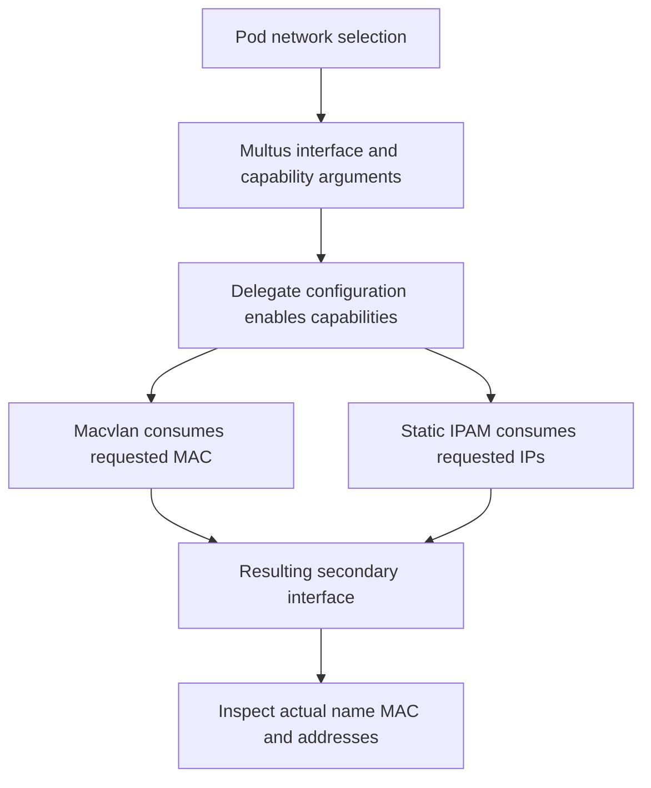

# Request Custom Interface Names, MACs, and IPs in Multus

Author: [nawazdhandala](https://www.github.com/nawazdhandala)

Tags: Multus, Kubernetes, Networking

Description: Request a named secondary interface and specific MAC and IP addresses, then verify capability forwarding and support in the selected CNI and IPAM plugins.

An application may expect an interface called `metrics0`, a reserved MAC address, or a predictable secondary IP. Multus can carry those requests, but the annotation is only the beginning of the configuration path. The delegate must support the requested feature, and the address allocator must honor the IP request in the format you supply.

A successful Pod creation is not enough evidence. A plugin may generate its own address, reject the request, or require a capability declaration before the runtime value reaches it. Verify the final interface and addresses rather than assuming the annotation became reality.

This example uses **Multus v4.3.1** with **CNI plugins v1.8.0**, specifically macvlan and static IPAM. The static IPAM component was built and exercised locally with a valid and invalid requested address. No Linux interface creation, MAC assignment, or Kubernetes attachment was tested.

## Trace each request to its owner

| Requested property | Selection field | Component that must honor it |
| --- | --- | --- |
| Interface name inside the Pod | `interface` | Multus interface selection and the delegate |
| Ethernet MAC address | `mac` | A delegate supporting the MAC runtime value |
| IP address and prefix | `ips` | The selected IPAM implementation |

Multus's network-selection schema defines these fields. Its runtime configuration code forwards secondary-network IP and MAC requests through capability arguments. CNI capability declarations identify which dynamic values should be passed to a plugin. They are not Kubernetes permissions and do not add missing implementation support. [Multus selection fields](https://github.com/k8snetworkplumbingwg/multus-cni/blob/v4.3.1/pkg/types/types.go), [runtime forwarding](https://github.com/k8snetworkplumbingwg/multus-cni/blob/v4.3.1/pkg/types/conf.go), [CNI capability conventions](https://www.cni.dev/docs/conventions/).



This is a deliberately specific plugin combination. Do not generalize its behavior to every Multus network.

## Prepare one reserved test identity

Use a disposable staging Pod with a single reserved secondary address and a unique locally administered unicast MAC. Reserve both through the network owner's process. The sample MAC `02:00:00:00:00:50` is illustrative, not a value to copy across multiple workloads. The `192.0.2.0/24` subnet is documentation-only.

Prerequisites are working Multus, macvlan and static binaries on the selected node, a verified parent interface, and upstream permission for the additional MAC and IP. A cloud network may require separate address registration or disallow child MACs entirely. Those constraints are independent of whether Multus accepts the annotation.

Keep this test to one Pod. Static IPAM assigns the supplied addresses; it is not a cluster-wide reservation service. Two Pods requesting the same value can create a conflict even when both configurations parse correctly. [Static IPAM behavior](https://www.cni.dev/plugins/current/ipam/static/).

## Declare the capabilities on the delegate

The NAD below contains a single macvlan delegate. Replace its namespace and parent interface before use:

```yaml
apiVersion: k8s.cni.cncf.io/v1
kind: NetworkAttachmentDefinition
metadata:
  name: requested-identity-lab
  namespace: REPLACE_NAMESPACE
spec:
  config: |-
    {
      "cniVersion": "0.3.1",
      "name": "requested-identity-lab",
      "type": "macvlan",
      "master": "REPLACE_PARENT_INTERFACE",
      "mode": "bridge",
      "capabilities": {"mac": true, "ips": true},
      "ipam": {"type": "static"}
    }
```

Here `capabilities` belongs to the delegate configuration, alongside `type` and `master`. The requested values are supplied separately at Pod creation. In a chained configuration, review capability placement for each actual plugin entry rather than copying this single-plugin layout blindly.

In CNI plugins v1.8.0, macvlan reads `runtimeConfig.mac`. Its IPAM invocation passes the configuration to the selected allocator, and static IPAM reads `runtimeConfig.ips`. That source path is why this example uses this particular combination. [Macvlan source](https://github.com/containernetworking/plugins/blob/v1.8.0/plugins/main/macvlan/macvlan.go), [static IPAM source](https://github.com/containernetworking/plugins/blob/v1.8.0/plugins/ipam/static/main.go).

No default route is added. Begin with an approved same-subnet peer so route changes do not obscure whether the requested identity was honored.

## Add the Pod's network selection

Use this metadata fragment in a complete staging Pod manifest, or under a Deployment's `spec.template.metadata`:

```yaml
metadata:
  annotations:
    k8s.v1.cni.cncf.io/networks: >-
      [{"name":"requested-identity-lab","interface":"metrics0",
        "mac":"02:00:00:00:00:50","ips":["192.0.2.50/24"]}]
```

The NAD is assumed to be in the Pod's namespace. Add an explicit `namespace` field if selecting an approved cross-namespace attachment, and verify the applicable isolation rules.

`metrics0` is the requested name **inside the Pod**, not the node's parent interface. It must not collide with another interface in that Pod. `ips` is a JSON array, and this static-IPAM example supplies CIDR notation including the prefix length. A bare address is not equivalent to the demonstrated request.

The documented text annotation syntax can request an interface name using `network@interface`. JSON is clearer here because the request also contains MAC and IP fields. [Multus interface naming examples](https://github.com/k8snetworkplumbingwg/multus-cni/blob/v4.3.1/docs/how-to-use.md).

## Verify output before testing the application

After creating the disposable Pod through your normal process, inspect its network-status annotation and the real interface. These commands run inside an approved diagnostic container containing iproute2:

```bash
ip -d link show dev metrics0
ip -4 addr show dev metrics0
ip -4 route show dev metrics0
```

Require the expected name, MAC, address, and prefix. Then connect to the approved same-subnet peer and verify that the peer observes the intended source. A matching annotation with an unexpected live interface is not a pass.

If the MAC differs, inspect capability forwarding and the installed delegate version. If the IP differs, check which IPAM plugin actually ran and whether it supports specific address requests. If neither interface nor address exists, inspect the original CNI error before changing the request format.

Do not switch to static IPAM merely to force an address in a production network that depends on centrally managed allocation. Choose an allocator and reservation workflow that supports the operational requirement, including safe recreation and release. A requested value is not evidence of exclusive ownership.

## Test lifecycle and rejection behavior

The local component test for this article confirmed that static IPAM v1.8.0 returned `192.0.2.50/24` when supplied through runtime configuration and rejected malformed CIDR input. It did not prove Multus capability delivery or macvlan behavior in a live namespace.

Your staging acceptance test should cover a fresh attachment, observed identity, normal teardown, and recreation after confirming the old workload is gone. Also verify that your admission controls prevent unapproved address requests. Do not deliberately create duplicate live addresses to test this protection on a shared network.

Once these checks pass, document the exact delegate, IPAM version, capability declarations, and reservation owner together. That makes the requested identity reproducible and avoids turning a convenient annotation into an unmanaged address assignment system.
