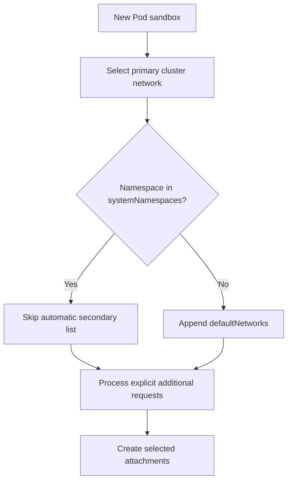

# Add Default Multus Networks While Excluding System Namespaces

Author: [nawazdhandala](https://www.github.com/nawazdhandala)

Tags: Multus, Kubernetes, Networking

Description: Configure automatic Multus secondary attachments with explicit namespace exclusions, preserve the primary network, and verify rollout behavior without confusing defaults with access control.

A shared secondary network can become repetitive to declare on every workload. Multus supports a `defaultNetworks` list that adds secondary attachments automatically. That is useful when the network is a standard requirement, but it also makes the network a startup dependency for many more Pods.

Use namespace exclusions deliberately. System components should not acquire an application data interface merely because their Pods were recreated after a Multus configuration change. At the same time, understand that an exclusion from automatic attachment is not a security boundary against explicit requests.

This article reviews **Multus v4.3.1** configuration and source. The examples were parsed and checked locally, without changing a running cluster. Apply the change through the owner of your Multus installation and verify its effective configuration on a staging node first.

## Keep primary and secondary selection separate

Multus has two configuration styles: `clusterNetwork`, optionally accompanied by `defaultNetworks`, or a `delegates` list. In the reviewed version, `clusterNetwork` takes precedence when both styles are supplied. Do not add conflicting fields to an existing generated configuration and assume they merge.

The primary network supplies the Pod's normal cluster attachment. `defaultNetworks` adds networks after it, and explicit Pod network annotations can add further attachments. The [v4.3.1 configuration guide](https://github.com/k8snetworkplumbingwg/multus-cni/blob/v4.3.1/docs/configuration.md) describes these relationships.



This flow describes selection, not access permission. Namespace isolation, admission controls, definition permissions, and network policy have their own roles.

## Prepare the shared attachment before enabling the default

Create and test the intended NetworkAttachmentDefinition first. It must name an installed plugin and use parent interfaces, bridges, or other prerequisites present on every node eligible for the affected workloads.

Also review address capacity. A network previously used by ten explicitly annotated Pods may now be needed by hundreds of new sandboxes. Use coordinated address management appropriate to the network. A static address intended for one test Pod is unsuitable for a broadly applied default.

Test the attachment explicitly with a disposable Pod before making it automatic. Confirm interface creation, addressing, DNS and route behavior, application reachability, and deletion cleanup. Keep primary DNS and API connectivity in the acceptance checks even when the secondary network is intended only for application data.

Finally, inspect workloads that already request the same network. Do not assume the automatic and explicit paths deduplicate. Remove redundant requests through their owning templates as part of the controlled rollout, or keep the default disabled until the intended attachment count is clear.

## Add a scoped configuration fragment

The following JSON is a fragment to merge into an existing, reviewed `clusterNetwork`-style configuration. It is not a complete Multus installation file. Replace the absolute path with the actual primary CNI configuration used by your deployment:

```json
{
  "clusterNetwork": "/REPLACE_WITH_PRIMARY_CNI_CONFIG",
  "multusNamespace": "network-system",
  "defaultNetworks": ["application-data"],
  "systemNamespaces": [
    "kube-system",
    "kube-public",
    "kube-node-lease",
    "network-system"
  ]
}
```

The example expects an existing `application-data` NetworkAttachmentDefinition in `network-system`. The setting `multusNamespace` controls where Multus resolves these configured network names; it does not move application Pods into that namespace.

Preserve required installation settings such as credentials, binary paths, logging, readiness handling and the existing primary configuration. If your installation currently uses `delegates`, plan and validate any configuration-style conversion separately. If an installer automatically generates the file, change its supported input rather than hand-editing output that will be overwritten.

`systemNamespaces` is a JSON array of exact namespace names. It is not a wildcard list, label selector, or comma-separated string. In the [v4.3.1 type implementation](https://github.com/k8snetworkplumbingwg/multus-cni/blob/v4.3.1/pkg/types/conf.go), the default list contains `kube-system`, and matching compares the namespace name directly. Supplying your own list replaces the intended configured list; include every exclusion you still need.

Do not put `kube-*` in the array expecting it to match all Kubernetes namespaces. Similarly, excluding `network-system` does not exclude a namespace named `network-system-tests`.

## Understand what exclusions actually skip

The [default-network selection implementation](https://github.com/k8snetworkplumbingwg/multus-cni/blob/v4.3.1/pkg/k8sclient/k8sclient.go) loads the primary network and then appends the default secondary list only when the Pod's namespace is not excluded. It does not remove the primary network.

An excluded Pod can still have an explicitly requested secondary network if other controls permit it. If the requirement is “system workloads must never use this data network,” enforce that requirement through admission and access controls in addition to the automatic-attachment configuration.

There is also no per-Pod opt-in decision in this default list. If only a small subset of applications needs the network, explicit annotations or a carefully scoped admission mechanism may be easier to maintain than a broad default with an expanding exclusion list.

## Verify the effective configuration and new Pods

Before rollout, inspect the definition in its configured lookup namespace:

```bash
kubectl -n network-system get \
  network-attachment-definitions.k8s.cni.cncf.io application-data -o yaml
kubectl get namespaces
```

The first command should show the expected plugin and addressing configuration. Compare the actual namespace inventory with the exclusion list, including infrastructure namespaces created by your platform rather than Kubernetes itself.

On the staging node, verify the configuration actually consumed by Multus. The location depends on the installation. Avoid publishing kubeconfig credentials while collecting evidence. A correct ConfigMap in the API does not prove that a running daemon or generated host configuration is using it.

Create fresh, otherwise ordinary test Pods without explicit network annotations. Use one application namespace and one administrator-approved excluded test namespace. If necessary, temporarily include that dedicated test namespace in the staging exclusion list instead of adding arbitrary workloads to `kube-system`.

```bash
kubectl -n REPLACE_NAMESPACE get pod REPLACE_TEST_POD -o yaml
kubectl -n REPLACE_NAMESPACE describe pod REPLACE_TEST_POD
kubectl -n REPLACE_NAMESPACE exec REPLACE_TEST_POD -- ip -brief address
kubectl -n REPLACE_NAMESPACE exec REPLACE_TEST_POD -- ip route show
```

The diagnostic image must contain iproute2. Inspect both the network-status annotation and real interfaces. The application test should have the automatic attachment; the excluded test should retain its primary network without that automatic addition. Test primary DNS and an application destination after counting interfaces.

## Roll out as a network dependency change

Existing Pods do not receive the new interface merely because the default list changes. Recreate controlled workloads to test the new sandbox path, then expand the rollout gradually. Track attachment failures, address-pool use, and startup latency.

If the shared network fails, newly created non-excluded Pods can fail too. Keep the previous configuration and a workload recreation plan. Removing the default affects future attachment selection; it is not a command to hot-remove an interface from already running Pods.

Review exclusions whenever new infrastructure namespaces are introduced. A default network is sustainable when its consumers, address capacity, node prerequisites and failure impact are explicit. The configuration should reduce repetition without making a hidden data-network dependency part of every system Pod's startup.
