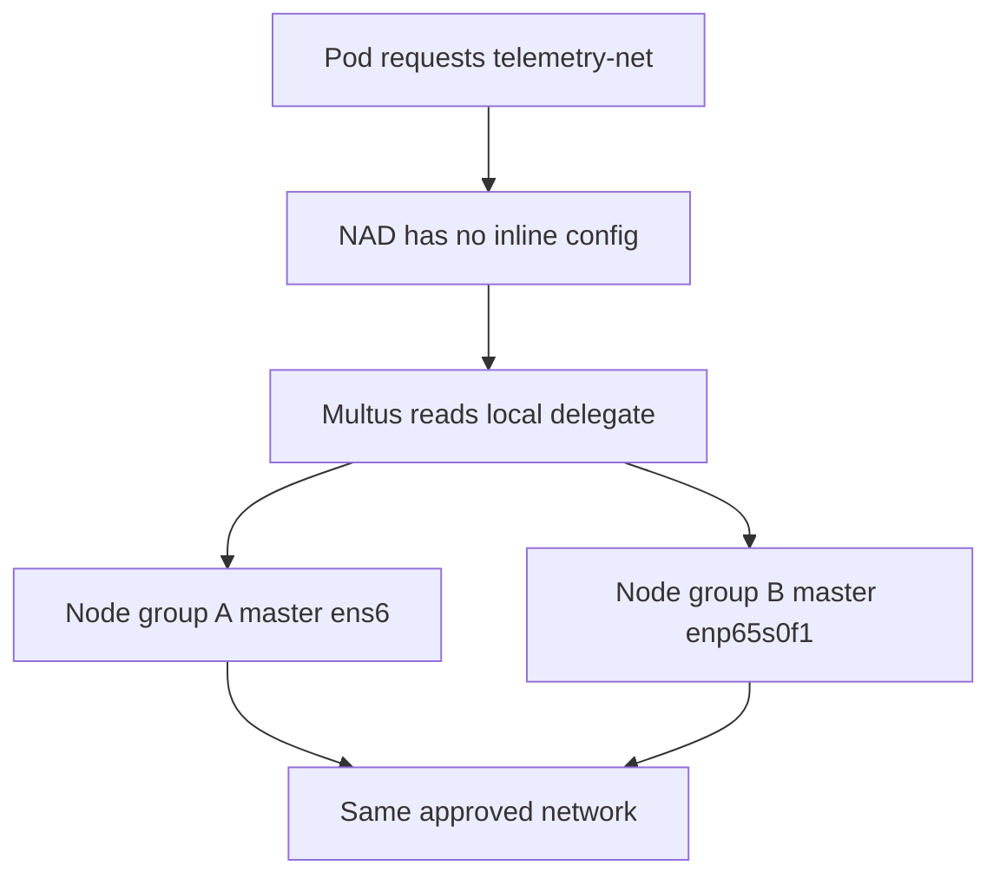

# Configure Multus Delegates When Node Interface Names Differ

Author: [nawazdhandala](https://www.github.com/nawazdhandala)

Tags: Multus, Kubernetes, Networking

Description: Map one logical Multus network to different node interfaces using managed local delegate files or explicit node-pool attachments and scheduling constraints.

A secondary network works on one node but fails on another with “link not found.” The NetworkAttachmentDefinition names `ens6`, while the second node connects the same network through `enp65s0f1`. Kubernetes object names are consistent; the hardware naming is not.

Multus does not automatically translate a delegate's `master` field into the correct device on each node. You need an explicit mapping between the logical network and each node's prepared interface. This guide uses **Multus v4.3.1** and its supported node-side configuration-file lookup. It also explains when separate attachments and scheduling constraints are easier to operate.

The snippets are configuration examples reviewed against tagged source. No node interfaces were renamed and no live CNI attachments were created.

## Inventory network identity before interface names

Collect the interface name, hardware or device identity, connected network, VLAN where applicable, MTU, and node pool. Two interfaces called `ens6` may connect to different networks; two differently named interfaces may connect to the same one.

Use approved node access for read-only inspection:

```bash
ip -d link show dev REPLACE_INTERFACE
ip -4 addr show dev REPLACE_INTERFACE
```

Confirm the external switch or virtual-network attachment separately. An interface's existence is not proof that it carries the intended storage, telemetry, or application network. Also check whether the chosen delegate already requires a particular parent type, device allocation, or kernel capability.

Avoid removing `master` simply to suppress the error. The macvlan plugin falls back to the default-route interface when the parent is omitted, which may attach the workload to the node's management network. [Macvlan parent selection](https://www.cni.dev/plugins/current/main/macvlan/).

## Choose where the mapping belongs

There are three practical approaches:

| Approach | Useful when | Operational cost |
| --- | --- | --- |
| Consistent node interface names | Node provisioning is centrally controlled | Naming changes need boot and network-management testing |
| Node-local delegate configuration | One logical network spans heterogeneous nodes | Files must be managed and checked on every eligible node |
| Separate NADs per node pool | A few stable hardware pools exist | Workload selection and scheduling must stay paired |

Stable naming can be part of node provisioning, but do not rename a live management interface from a troubleshooting shell. On systemd-based systems, `.link` matching and naming policies are applied through the device-management lifecycle and may interact with early-boot configuration. Follow the operating system's supported process. [systemd.link documentation](https://www.freedesktop.org/software/systemd/man/latest/systemd.link.html).

For the rest of this example, assume both node groups reach the same approved secondary subnet and only the parent interface name differs.

## Use an empty NAD with managed local files

Multus v4.3.1 supports a NAD without inline `spec.config`. It then looks for a delegate configuration in its configured `confDir`, matching the configuration's `name` to the NAD name. The documented default directory is `/etc/cni/multus/net.d`. This is a specific lookup feature, not environment-variable expansion inside a NAD. [Pinned file-backed NAD example](https://github.com/k8snetworkplumbingwg/multus-cni/blob/v4.3.1/docs/how-to-use.md), [configuration directory](https://github.com/k8snetworkplumbingwg/multus-cni/blob/v4.3.1/docs/configuration.md).

Create the following definition through your normal deployment process after preparing the nodes:

```yaml
apiVersion: k8s.cni.cncf.io/v1
kind: NetworkAttachmentDefinition
metadata:
  name: telemetry-net
  namespace: REPLACE_NAMESPACE
```

Each eligible node receives a managed file with the same CNI `name` but its verified local parent. This example assumes an already installed, working Whereabouts Kubernetes backend for shared address allocation:

```json
{
  "cniVersion": "0.3.0",
  "name": "telemetry-net",
  "type": "macvlan",
  "master": "REPLACE_NODE_PARENT",
  "mode": "bridge",
  "ipam": {
    "type": "whereabouts",
    "range": "192.0.2.0/24",
    "range_start": "192.0.2.100",
    "range_end": "192.0.2.120"
  }
}
```

The subnet is documentation-only. Replace it with an approved range, including exclusions or reservations required by your environment. Node group A might render `master` as `ens6`; group B might render it as `enp65s0f1`. Keep the logical name and allocation scope consistent for the same network. Do not substitute independent host-local pools containing the same addresses on every node. [Whereabouts v0.9.4 configuration](https://github.com/k8snetworkplumbingwg/whereabouts/blob/v0.9.4/README.md).



The file must be visible inside the filesystem context where Multus performs the lookup. For a containerized daemon, a host path and its container mount path are not automatically identical. Verify the effective `confDir` and mounts; do not copy a file to the host and assume the daemon can see it.

The match is by the JSON configuration's `name`, not merely the filename. Avoid duplicate matching names in the directory. Restrict write access because changing the file changes where future workload attachments connect.

## Gate scheduling on completed node preparation

Label a node as ready for this network only after its parent, delegate binaries, local file, mounts, and allocator access have passed checks. Use an organization-owned label key. This Pod-spec fragment illustrates the scheduling constraint:

```yaml
spec:
  nodeSelector:
    networking.example.com/telemetry-ready: "true"
```

Place it under `spec.template.spec` for a Deployment. Replace the example label domain with your own. Kubernetes `nodeSelector` requires a matching label; it does not inspect interfaces or verify CNI files. The label must be maintained by your provisioning process. [Assigning Pods to nodes](https://kubernetes.io/docs/concepts/scheduling-eviction/assign-pod-node/).

If using separate NADs instead, define one attachment for each parent layout and pair each workload template with its matching node selector or required affinity. A NAD's `master` does not itself constrain the scheduler. Ensure application deployment tooling cannot select the group-A NAD while scheduling onto group B.

## Validate each mapping and its lifecycle

Before rollout, parse every generated JSON file and compare its logical name, network range, and expected parent against the inventory. Review intentional differences rather than relying on a whole-file checksum: the parent field is expected to differ.

Run a disposable attachment test on at least one node from every group. Require the correct secondary interface, address, and application destination; then verify normal deletion releases the allocation. Repeat after node replacement or reboot to prove configuration management recreates the mapping.

Changing a delegate file does not migrate existing interfaces. Coordinate future Pod recreation with the network change and preserve the previous mapping for recovery. If the real network or allocator scope changes, treat that as a separate migration rather than a harmless interface-name edit.

A useful operating rule is to label network readiness last and withdraw it when preparation becomes invalid. That turns hardware naming differences into an explicit provisioning responsibility instead of a random scheduling-time failure.
