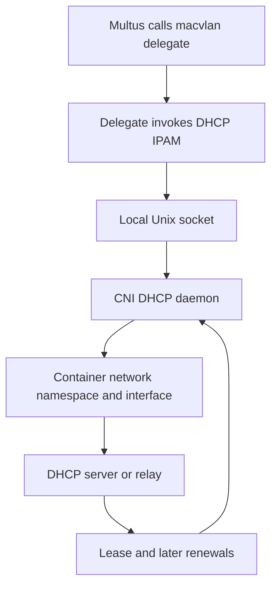

# Run the CNI DHCP Daemon for Multus and Diagnose Missing Leases

Author: [nawazdhandala](https://www.github.com/nawazdhandala)

Tags: Multus, Kubernetes, DHCP

Description: Configure the CNI DHCP daemon used by Multus delegates, verify its socket and namespace access, and trace missing offers, acknowledgments, and renewals.

A Multus attachment using DHCP needs more than `"ipam":{"type":"dhcp"}` in its network definition. The DHCP IPAM plugin contacts a local daemon, and that daemon acquires and maintains the lease for the container interface.

This is the **CNI plugins DHCP daemon**, not a DHCP server built into Multus. The server that owns the address pool must already be reachable on the relevant network or through its supported relay arrangement. Running the daemon does not create that server or its scope.

This guide uses **CNI plugins v1.8.0** with a macvlan secondary attachment. Examples were checked against tagged source and local syntax checks. No DHCP acquisition, Linux namespace operation, or Kubernetes deployment was executed.

## Understand the two connections

The first connection is local: the short-lived IPAM invocation talks to the daemon through a Unix socket. The second is on the network: the daemon operates on behalf of the container interface and exchanges DHCP messages with the server.



A socket error occurs before a missing server offer becomes relevant. Conversely, a successful connection to the daemon does not prove the VLAN, relay, or DHCP scope is correct. The separate daemon is needed because leases must be renewed beyond the initial CNI ADD operation. [DHCP plugin operation](https://www.cni.dev/plugins/current/ipam/dhcp/).

## Choose one supervised daemon per eligible node

Use your distribution's supported deployment when available. Verify the plugin and daemon versions, startup supervision, socket visibility, and access to container network namespaces. The daemon must be available on every node eligible for the DHCP-backed workload.

For a dedicated Linux staging node with the v1.8.0 binary installed at `/opt/cni/bin/dhcp`, this source-verified command runs the daemon in the foreground:

```bash
sudo /opt/cni/bin/dhcp daemon \
  -socketpath /run/cni/dhcp.sock \
  -timeout 10s
```

Use it only when no managed daemon or socket-activation service already owns that endpoint. Keep it running for the lifetime of the test attachment, including renewal and normal teardown. The `timeout` value bounds an individual client request; it is not a promise that the complete allocation attempt ends after ten seconds. The release has separate retry controls. [Pinned daemon flags](https://github.com/containernetworking/plugins/blob/v1.8.0/plugins/ipam/dhcp/main.go).

For persistent systemd operation, the tagged project supplies `cni-dhcp.service` and `cni-dhcp.socket`. The service starts the same binary in daemon mode, while the socket unit listens on `/run/cni/dhcp.sock`. Install and enable these through your node configuration process after reviewing paths and ownership; do not run the foreground command alongside them. [Service unit](https://github.com/containernetworking/plugins/blob/v1.8.0/plugins/ipam/dhcp/systemd/cni-dhcp.service), [socket unit](https://github.com/containernetworking/plugins/blob/v1.8.0/plugins/ipam/dhcp/systemd/cni-dhcp.socket).

Where those unit names are used, inspect both:

```bash
systemctl status cni-dhcp.socket cni-dhcp.service --no-pager
```

Socket activation means an inactive service before the first request is not automatically a failure. Check the listening socket and activation result together. [systemctl inspection](https://www.freedesktop.org/software/systemd/man/latest/systemctl.html).

## Match the delegate's socket path

This NAD assumes a prepared macvlan parent and a reachable IPv4 DHCP service. Replace the namespace and parent interface before deployment:

```yaml
apiVersion: k8s.cni.cncf.io/v1
kind: NetworkAttachmentDefinition
metadata:
  name: dhcp-secondary
  namespace: REPLACE_NAMESPACE
spec:
  config: |-
    {
      "cniVersion": "0.3.1",
      "name": "dhcp-secondary",
      "type": "macvlan",
      "master": "REPLACE_PARENT_INTERFACE",
      "mode": "bridge",
      "ipam": {
        "type": "dhcp",
        "daemonSocketPath": "/run/cni/dhcp.sock"
      }
    }
```

The socket path must resolve to the same socket from the IPAM process's filesystem view. With a containerized daemon or thick Multus deployment, confirm the mounts rather than assuming all processes see the host's paths unchanged.

The daemon's `hostprefix` option affects its socket and network-namespace path handling. In the pinned source, the listener uses the prefix plus the socket path, and namespace access also uses the host prefix. Configure this only with an explicit map of host paths and container mounts. A working socket mount without access to the requested namespace is insufficient. [Daemon path handling](https://github.com/containernetworking/plugins/blob/v1.8.0/plugins/ipam/dhcp/daemon.go).

Do not remove a socket just because a startup example elsewhere suggests doing so. First establish whether a live daemon or socket unit owns it. Removing an active endpoint can disrupt new requests while existing lease-maintenance work continues elsewhere.

## Follow the first failing stage

Create one disposable workload using this attachment and inspect its Pod events alongside the local daemon logs. Correlate the interface, sandbox identity, and time.

| Failure evidence | Inspect next |
| --- | --- |
| Cannot dial DHCP daemon | Correct socket path, permissions, mounts, and listener |
| Cannot open network namespace | Host-prefix mapping and namespace visibility |
| Interface not found | Delegate setup and requested interface name |
| Requests sent, no offer received | VLAN, relay, server scope, pool capacity, and filtering |
| Offer received, allocation still fails | Request/acknowledgment sequence and server policy |
| Address initially works then fails | Daemon continuity and lease renewal evidence |

DHCPv4 normally uses UDP ports 67 and 68. With approved capture permissions on the relevant interface, a bounded diagnostic capture can inspect that exchange:

```bash
tcpdump -p -n -i REPLACE_INTERFACE -s 576 -c 40 \
  'udp and (port 67 or port 68)'
```

The packet limit is not a timeout; stop manually after a short observation window if no packets match. The filter may include other clients, so correlate the transaction and client identity with the server logs. Avoid sharing captures containing infrastructure identifiers without review. [DHCP protocol](https://www.rfc-editor.org/rfc/rfc2131), [tcpdump options](https://github.com/the-tcpdump-group/tcpdump/blob/tcpdump-4.99.5/tcpdump.1.in).

Seeing a discover message without an offer narrows the search. It does not prove the server is down: the request or reply may be blocked, on the wrong segment, or rejected by server policy. Do not enable broadcast flags or relax filtering globally without identifying the requirement.

## Test renewal and recovery, not just acquisition

The tagged daemon keeps active lease objects in memory and maintains them until release. A daemon restart is therefore a lifecycle event to rehearse, not merely a harmless way to clear an error. Do not infer successful lease maintenance from a Pod that still temporarily retains its address. [Lease lifecycle implementation](https://github.com/containernetworking/plugins/blob/v1.8.0/plugins/ipam/dhcp/daemon.go).

In staging, verify initial allocation, the expected prefix and routes, application connectivity, a scheduled renewal, and normal Pod deletion. Then rehearse the distribution's supported daemon and node recovery procedure. Confirm that replacement Pods receive valid leases and that old allocations follow the server's release or expiry behavior.

Promote the configuration only when node supervision, socket access, DHCP exchange, and renewal all have evidence. That prevents a successful first address assignment from hiding a daemon dependency that fails hours later.
